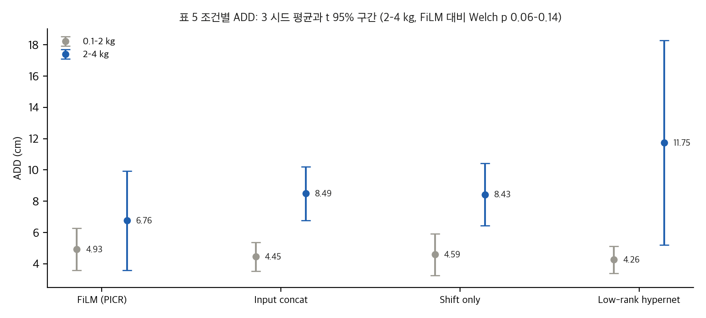
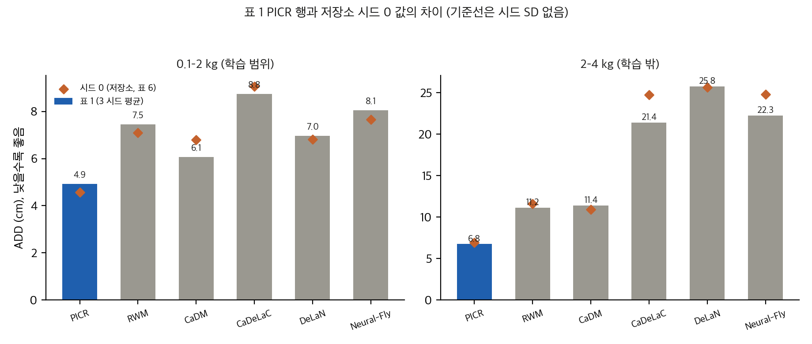

> **논문:** Jungjin Lee, Se Jin Kim, Sung Kwon On, Insoon Yang. *Physics-Informed Causal Reasoning for Nonstationary Robot Dynamics.* arXiv:2611.19251 (v1, 2026-11-14).
> 공식 코드는 GitHub jungbbal/PICR에 있고 라이선스 파일이 없습니다. 이 글의 그래프는 논문 표 값을 우리가 다시 그린 것입니다. 논문 그림은 넣지 않았습니다(arXiv 라이선스가 CC BY가 아님).

## 논문이 묻는 것

같은 관절 상태와 같은 토크라도 물체의 질량이나 무게중심이 다르면 결과 운동이 달라집니다. 로봇이 무거운 물건을 들었을 때 모델을 다시 학습하지 않고 이 변화를 따라갈 수 있을까요?

기존 방법은 두 갈래입니다. 문맥 기반 적응(CaDM, RWM 같은 계열)은 최근 이력에서 잠재 문맥을 뽑아 일반 신경망에 넣습니다. 이 방법은 문맥이 운동 방정식의 어디에 들어가는지 정하지 않습니다. 물리 구조 신경망(DeLaN 같은 계열)은 Lagrangian 구조를 주지만 시스템 하나만 설명하고, 시스템이 바뀌었는지 알지 못합니다.

PICR은 두 흐름을 잇습니다. 문맥 z를 최근 12프레임의 관절 상태와 토크에서 추정하고, z가 고정된 Lagrangian 망의 **관성 행렬 H와 위치에너지 V만** FiLM으로 바꿉니다. 코리올리 항 c와 중력 항 g는 H와 V에서 유도되므로 어떤 문맥에서도 운동 방정식의 구조가 유지됩니다.

## 이 글에서 확인한 것

**1. 학습 밖 페이로드 오차는 실제로 줄어듭니다.** 논문 표 1에서 2–4 kg(학습 범위 밖) ADD는 PICR 6.76 cm, RWM 11.15, CaDM 11.40, CaDeLaC 21.41, DeLaN 25.78, Neural-Fly 22.27 cm입니다. 비율로 1.65–3.81배입니다. 초록의 "1.6–3.8배"와 맞습니다. 학습 범위 안과 밖의 차이(증가량)도 PICR이 1.8 cm로 가장 작습니다.

**2. 그런데 FiLM의 우위는 통계적으로 약합니다.** 표 5는 조건화 방식을 3 시드로 비교합니다. 학습 밖에서 FiLM(6.76 ± 1.28)은 입력 연결(8.49), 시프트만(8.43), 저랭크 하이퍼네트워크(11.75)보다 낮습니다. 하지만 Welch p는 0.06–0.14입니다. 학습 범위 안에서는 FiLM(4.93)이 세 대안(4.26–4.59)보다 오히려 높습니다. 방향은 맞지만 확정하기는 이릅니다.

*그래프 1: 우리가 그린 그래프. 논문 표 5의 조건화 방식 비교이며 3 시드 평균과 t 95% 구간입니다. 검정이 아니라 구간입니다.*

**3. 저장소 재현값과 논문 표 1이 다릅니다.** 저장소 README와 프로젝트 페이지는 PICR의 학습 밖 ADD를 6.92 cm라고 적습니다. 이 값은 시드 0 체크포인트에서 나온 값입니다. 논문 표 1의 6.76 cm는 3 시드 평균입니다. gain도 0.86 대 0.90으로 다릅니다. 공개된 체크포인트는 시드 0 하나뿐이라 3 시드 평균은 재현할 수 없습니다.

*그래프 2: 우리가 그린 그래프. 기준선에는 시드 SD가 없어서 평균만 표시했습니다.*

**4. "여러 배 낮은 중력과 관성"은 비교 대상에 따라 2.5–5.4배입니다.** 논문은 PICR의 중력과 관성 오차가 CaDeLaC과 DeLaN보다 "여러 배" 낮다고 씁니다. 중력 RMSE는 CaDeLaC의 5.3배, DeLaN의 4.7배로 맞습니다. 관성 RMSE는 CaDeLaC의 5.4배이지만 DeLaN에는 2.5배입니다. 그리고 이 RMSE는 한 에피소드의 1초 구간에서 나온 값입니다.

**5. 공식 코드에는 논문에 없는 학습 설정이 있습니다.** 검증과 체크포인트에 EMA 가중치(감쇠 0.999)를 쓰고, 손실 계수 λ_a = 1.0과 λ_ID = 0.3을 씁니다. 논문 본문에는 이 값이 없습니다. 파라미터 수 6,545,957개는 논문 표 2와 맞습니다. 인코더 132,616개와 폭 256 모델의 0.56M도 맞습니다.

## 맥에서 할 수 있는 것

- **논문 표의 재현은 어렵습니다.** 학습과 평가 데이터가 공개되지 않았습니다. 데이터 생성에는 Isaac Sim과 NVIDIA GPU가 필요합니다. 이 맥에는 CUDA가 없습니다.
- **구조의 재구현은 가능합니다.** FiLM으로 Lagrangian 망을 조건화하는 구조, 문맥 인코더, 질량과 CoM 가우시안 대조 손실은 PyTorch로 쓸 수 있습니다. 6.5M 파라미터 규모라서 MPS나 CPU에서 학습할 수 있습니다. 노력은 1–2주로 추정합니다(측정 전).

## 한계

논문이 스스로 밝힌 한계는 다음과 같습니다. 단일 시뮬레이션 로봇(Franka Panda, Isaac Sim), 파지가 단단하다는 가정, 개루프 300 ms 예측, 실로봇 평가 없음입니다. CoM 변화는 학습 데이터에서 토크 영향이 약 5%뿐이고, 문맥이 CoM 축을 따라 정렬되지 않는다고도 적었습니다.

이 글의 판단은 수치 재계산과 공식 코드의 정적 읽기에 근거합니다. 실험은 재현하지 않았습니다. 세부 근거는 분석 문서에 있습니다.

## 자료

- [통합 리포트 PDF](report/report_public.pdf)
- [01. 논문 분석: Physics-Informed Causal Reasoning for Nonstationary Robot Dynamics](analysis/01_paper_analysis.md)
- [02. 선행연구, 공식 코드, 이 저장소의 관련 분석](analysis/02_prior_work.md)
- [03. 수치 재계산, 일관성 검사, 주장 판정](analysis/03_analysis.md)
- [04. 공식 코드 대조 (논문 ↔ 코드)와 구현 가능성](analysis/04_code_verification.md)
