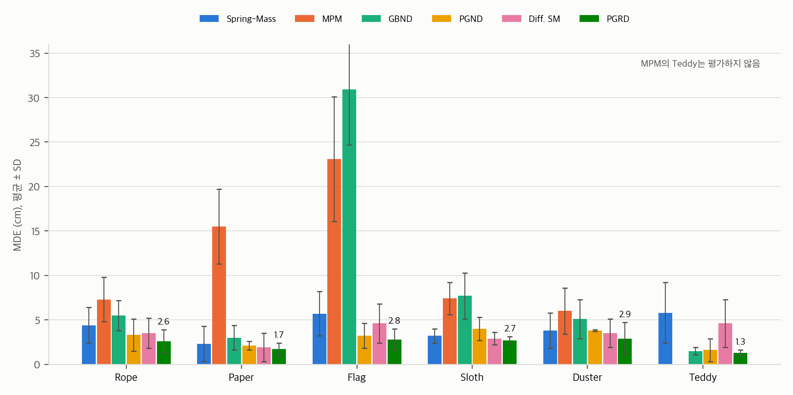
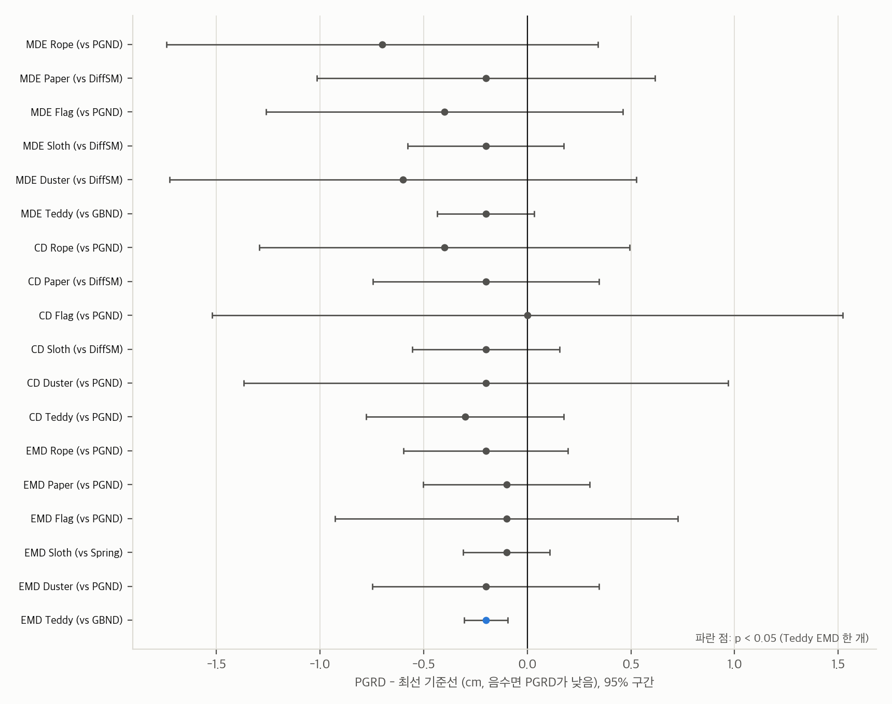
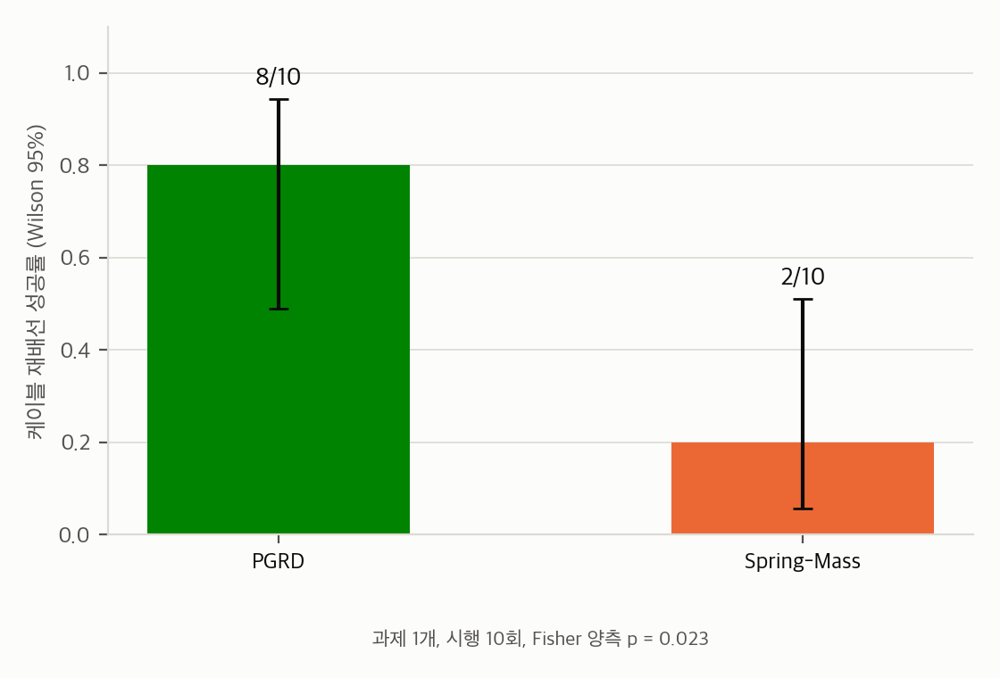

# Physics-Guided Residual Dynamics 분석

이 글은 arXiv:2607.13451(Patel, Zhang, Pokkali, Lazebnik, Li)를 검토한 기록입니다. 논문은 스프링-질량 시뮬레이터를 물리 백본으로 두고, 그 한 스텝 예측에 학습된 **속도 잔차**를 더해 변형체의 궤적을 예측합니다. 저자들은 실로봇 데이터 6개 객체에서 GBND, PGND, MPM, 스프링-질량 기준선보다 낫다고 보고합니다.

## 논문의 방법

- 백본은 스프링-질량 모델이고 semi-implicit Euler로 적분합니다. 파라미터 다섯 개(강성, 감쇠, 스프링 임계 거리, 노드당 최대 스프링, 바닥 마찰)를 CMA-ES로 객체마다 맞춥니다. 미분은 쓰지 않습니다.
- 잔차 네트워크는 PTv3 인코더, NeRF식 디코더, 게이트가 있는 슬라이딩 윈도 트랜스포머로 구성합니다. 잔차는 위치가 아니라 속도에 더하고, 학습은 자기 예측을 다시 넣는 다중 스텝 롤아웃입니다.

## 검토 결과

그래프: 객체별, 방법별 MDE(cm) 평균과 SD. 값은 논문 표 I에서 옮겼고 그림은 우리가 만들었습니다.

- **셀 단위 우위는 맞습니다.** MDE, CD, EMD와 J, F, LPIPS의 36셀에서 PGRD가 최선 또는 동률입니다.
- **통계 근거는 약합니다.** 최선 기준선과의 차이는 추종 지표 18개 비교 중 1개만 p < 0.05입니다(Teddy EMD). 영상 지표는 0개입니다. 가정은 ±가 에피소드 간 SD이고 객체당 20 에피소드입니다. 논문은 이 정의를 쓰지 않습니다.
- **본문 주장의 반례.** "PGND가 GBND보다 모든 객체에서 낫다"는 Teddy에서 맞지 않습니다. MDE는 GBND 1.5 대 PGND 1.6이고, EMD는 둘 다 0.8입니다.
- **코드와의 차이.** 공식 저장소에는 Diff. Spring-Mass 기준선, 계획과 언어 목표 생성, 데이터 수집 파이프라인이 없습니다. CD는 단방향으로 계산합니다. 논문은 양방향이라고 씁니다. 입력 채널은 논문 표에 18, 코드 설정(n_history = 2)에서는 24입니다.

그래프: 객체·지표별 PGRD와 최선 기준선의 차이(MDE, CD, EMD)와 95% Welch 구간(±는 SD, 객체당 20 에피소드 가정). 파란 점 하나만 p < 0.05입니다.

그래프: 케이블 재배선 과제의 성공률(10회)과 Wilson 95% 구간. 8/10 대 2/10, Fisher 양측 p = 0.023입니다. 과제 한 개의 결과입니다.

## 재현과 구현 가능성

- 이 맥(Apple M4 Pro, CUDA 없음)에서 공식 학습과 재현은 어렵습니다. 공식 설치는 CUDA 12.8 PyTorch, DGL, Warp와 미분 래스터라이저에 묶여 있고, 하위 모듈 하나가 저장소에 없습니다.
- 스프링-질량 백본과 속도 잔차 적분을 CPU에서 작게 다시 짜는 것은 가능하다고 봅니다. 노력은 1–2주로 추정합니다(측정 전). 이는 공식 결과의 재현이 아닙니다.
- 논문 그림은 arXiv non-exclusive 라이선스라서 이 글에 넣지 않았습니다.

## 남은 질문

- ±의 정의와 평가 에피소드 수
- 데이터 분할이 객체별인지 전체 합계인지(본문과 공식 학습 스크립트가 다릅니다)
- 입력 채널 수(논문 18, 코드 24)와 트랜스포머 윈도 길이
- 공식 저장소에 LICENSE가 없다는 점

자세한 대조와 판정은 `analysis/` 문서 네 편(01–04)에 있습니다.

## 자료

- [통합 리포트 PDF](report/report_public.pdf)
- [01. 논문 분석: Learning Physics-Guided Residual Dynamics for Deformable Object Simulation](analysis/01_paper_analysis.md)
- [02. 선행연구와 관련 저장소](analysis/02_prior_work.md)
- [03. 수치 재계산과 일관성 검사](analysis/03_analysis.md)
- [04. 공식 코드 대조: 논문 ↔ `shivanshpatel35/pgrd`](analysis/04_code_verification.md)
