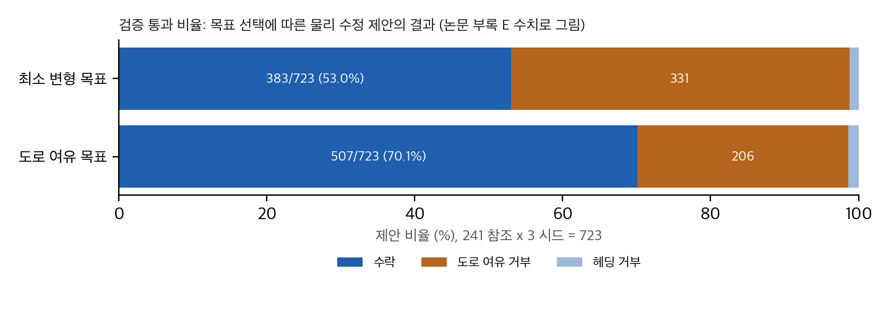
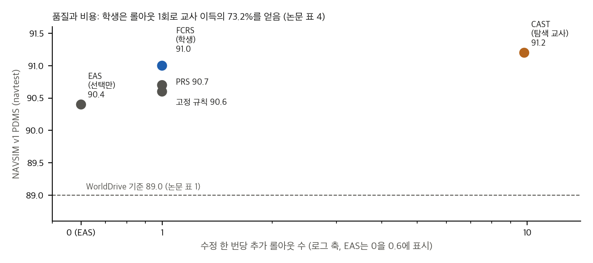

> **논문:** Hongyu Zhang, Xiaoshuai Hao 외. *Efficient World-Model Planning via Physics-Guided Search Distillation.* arXiv:2611.24171 (v2, 2026-11-19). 학회 표기는 찾지 못했습니다.
> 공식 코드와 프로젝트 페이지는 찾지 못했습니다. 이 글은 논문 본문, 표, 부록의 수치만 사용했습니다. 논문 그림은 arXiv non-exclusive 라이선스라서 싣지 않았고, 이 글의 그래프는 논문 수치로 우리가 그린 것입니다.

## 논문이 묻는 것

자율주행 세계모델 플래너는 후보 궤적마다 미래 장면을 예측하고 점수를 매깁니다. 그런데 예측이 정확해도 실행 궤적이 도로를 벗어날 수 있습니다. 추종 오차와 차량 동역학 때문입니다. 게다가 후보 풀 안에 실행 가능한 궤적이 하나도 없으면, 재순위로는 고칠 수 없습니다.

논문은 NAVSIM v1 장면 12,146개를 진단합니다. 278개가 개입이 필요했고, 그중 106개(38.1%)는 풀 안에 도로 준수 대안이 없었습니다.

## 방법: 선택, 탐색 교사, 학생, 한 번 검증

PGSD는 네 부분으로 나뉩니다.

1. **EAS (실행 인식 선택):** 상위 5개 후보를 추종 제어기와 자전거 모델로 4초 실행하고, 발자국이 도로 경계를 5 cm 넘으면 실행 여유가 있는 후보로 바꿉니다.
2. **CAST (탐색 교사):** 궤적을 횡방향으로 두 매개변수 변형해서 실행 여유를 최대로 만드는 수정을 찾습니다. 오프라인에서만 쓰고, 롤아웃은 최대 10회입니다.
3. **FCRS (학생):** 동결된 세계모델의 미래 특징과 실행 피드백을 받아 수정을 한 번 예측합니다. 추가 학습 파라미터는 24,770개입니다.
4. **SRV (한 번 검증):** 예측 수정을 실행 롤아웃 한 번으로 검증하고, 여유가 2 cm 미만이거나 헤딩이 크게 틀리면 EAS 후보로 돌아갑니다.

## 가장 잘 뒷받침되는 결과: 목표를 실행 여유로 고르기

같은 검증기 아래에서 두 목표를 비교했습니다. 최소 변형 목표와 도로 여유 목표입니다. 개발 참조 241개, 세 시드로 측정했습니다.

그래프: 논문 부록 E 수치로 우리가 그림. 수락은 383/723에서 507/723으로 늘고, 여유 거부는 331에서 206으로 줄었습니다. 논문 그림이 아닙니다.

- 수락률 차이는 **+17.15 pp**입니다. 논문의 세션 부트스트랩 구간은 [11.88, 21.79]이고, 제안을 독립으로 본 우리 계산은 [12.2, 22.1]입니다. 두 구간은 맞습니다.
- 241개 참조 중 228개(94.6%)가 실행 여유를 더 얻었습니다. 참조별 부호 검정은 매우 강하게 유의합니다.
- 교사가 실행 가능한 부분집합 (202개 참조)에서는 복구 성공률이 62.7%에서 82.7%로 올랐습니다. 정수로 맞는 값입니다.

이 결과는 한 개발 세트에서 얻은 것입니다. 다른 장면 분포에서 같은지는 알 수 없습니다.

## NAVSIM 점수와 비용

| 방법 | 입력 | PDMS (NAVSIM v1) | 추가 롤아웃 / 수정 |
|---|---|---|---|
| WorldDrive (단일 시점 기준) | 카메라 | 89.0 | 0 |
| EAS 선택만 | + 맵 | 90.4 | 0 |
| FCRS (학생) | + 맵, FAR 특징 | 91.0 | 1 |
| CAST (교사, 참조) | + 맵 | 91.2 | 9.81 |

그래프: 논문 표 3, 4 수치로 우리가 그림. 학생은 탐색 1,040회 대신 106회의 롤아웃으로 교사 이득의 73.2%를 얻습니다. 논문 그림이 아닙니다.

- 탐색 교사는 수정 한 번에 9.81회 롤아웃을 씁니다. 학생은 1회입니다. 롤아웃 수는 89.8% 줄었습니다. 중앙 지연은 학생 25.13 ms, 탐색 239.49 ms입니다 (CPU 단일 스레드 측정).
- **조심할 점 1:** PGSD는 도로 지도, ego 상태, 추종 모델을 추가로 씁니다. 기준선은 센서만 씁니다. "단일 시점 최고"라는 말은 센서 입력만 같다는 조건에서만 맞습니다.
- **조심할 점 2:** EAS에서 FCRS로 가는 0.56점 차이에 신뢰구간이나 시드 표준편차가 없습니다. 장면 수준의 차이 표준편차가 31.5점 이상이어야 유의하지 않으므로, 대체로 유의할 것으로 보입니다. 확인하려면 장면별 점수가 필요합니다.
- **조심할 점 3:** 73.2%라는 보유율은 비정규화 점수로 계산한 값입니다. 공개된 반올림 값으로는 55.6%에서 91.4%까지 가능합니다.
- **조심할 점 4:** NAVSIM v2에서 WorldDrive 기준값 27.72는 저자들이 다시 돌린 값입니다. PGSD는 38.96으로 +11.24 (40.5%)입니다.

## 재계산으로 확인한 것

- 수락, 거부, 교사 부분집합, 롤아웃 수, 파라미터 수가 보고값과 맞습니다. 학생 파라미터 183,620개는 층별로 계산해도 정확히 맞습니다.
- 작은 불일치 하나: 실행 피드백을 뺀 뒤의 수락 차이가 본문에는 7.72 pp지만, 정수로 계산하면 7.75 pp입니다. 반올림 탓으로 보입니다.
- 보고된 PDMS는 집계 하위 점수로 정확히 재현되지 않습니다. 장면별 곱의 평균이기 때문입니다. 그래도 PDMS가 기대 상한을 넘지 않는다는 조건은 모두 맞습니다.

## 구현할 수 있는가

- **논문 수치 재현은 이 맥에서 불가능합니다.** 공식 코드가 없고, 주행 데이터와 플래너 가중치, 추론 GPU가 필요합니다.
- **핵심 알고리즘의 축소판은 가능합니다.** 2D 도로와 자전거 모델, 추종 제어기, 여유 계산, EAS, 한 번 검증, CAST 탐색을 numpy로 짜는 것입니다. 노력은 3–5일로 추정합니다.

## 한계

- 공식 코드와 프로젝트 페이지가 없어 구현 세부는 부록 설명에 의존합니다.
- NAVSIM 주 결과에 구간과 시드 원자료가 없습니다.
- 목표 선택 실험은 개발 참조 241개 한 세트에서만 확인됩니다.
- 정보가 다른 기준선과 비교하고 있습니다.

## 자료

- [통합 리포트 PDF](report/report_public.pdf)
- [01. 논문 분석: Efficient World-Model Planning via Physics-Guided Search Distillation](analysis/01_paper_analysis.md)
- [02. 선행연구와 자료](analysis/02_prior_work.md)
- [03. 수치 재계산과 일관성 검사](analysis/03_analysis.md)
- [04. 주장 검증 (공식 코드 없음)](analysis/04_claim_verification.md)
