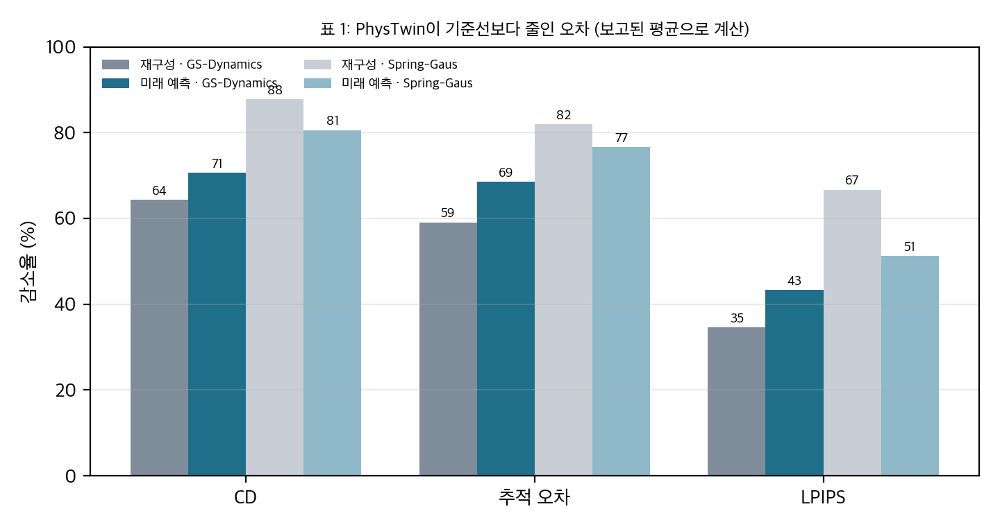
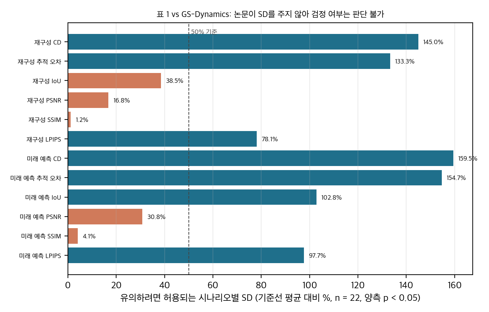
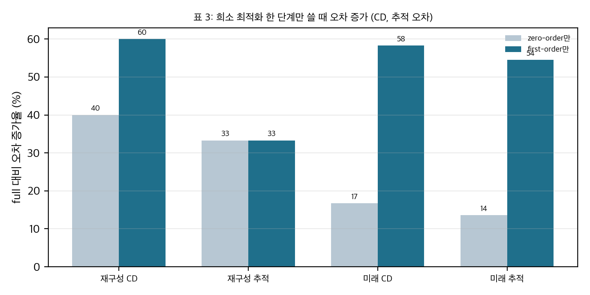

> **논문:** Hanxiao Jiang, Hao-Yu Hsu, Kaifeng Zhang, Hsin-Ni Yu, Shenlong Wang, Yunzhu Li. *PhysTwin: Physics-Informed Reconstruction and Simulation of Deformable Objects from Videos.* ICCV 2025, arXiv:2503.17973 (v1, 2025-03-23 하나).
> **공식 코드:** github.com/Jianghanxiao/PhysTwin (MIT). 정적으로만 읽었고 실행하지 않았습니다.
> **라이선스:** arXiv non-exclusive distribution. CC BY가 아니므로 논문 그림은 싣지 않고, 우리가 그린 그래프와 논문 표의 수치만 씁니다.

## 논문이 묻는 것

변형체를 로봇이 다루려면 시뮬레이터 안에 같은 물체가 있어야 합니다. 그런데 밧줄, 봉제인형, 천, 택배 상자처럼 모양이 계속 바뀌는 물체는 스캔해서 물리 파라미터를 정하기 어렵습니다. PhysTwin은 **서로 다른 시점의 RGB-D 영상 세 개**에서 형상, 외형, 물리 파라미터를 함께 맞춰, 관측에 없던 상호작용에도 움직이는 디지털 트윈을 만듭니다.

이전 연구는 한쪽만 잘했습니다. 동적 NeRF와 3D Gaussian은 외형을 잘 맞추지만 새 상호작용을 예측하지 못하고, 물리 기반 방법은 사전 스캔이나 촘촘한 시점을 요구했습니다. 학습 기반 시뮬레이터는 데이터를 많이 필요로 했습니다.

## 방법 한눈에

| 구성 | 쓰인 것 | 최적화 |
|---|---|---|
| 형상 | 생성형 3D 모델(TRELLIS)로 완성한 메시, 2D 대응과 등록으로 자세와 크기를 맞춤 | 등록 단계 (비미분) |
| 위상과 물리 | 스프링-질량 그래프. 연결 반경과 이웃 수, 동질 강성 | CMA-ES (샘플링, 0차) |
| 조밀한 물리 | 점마다 스프링 강성, 충돌 계수 | Adam (경사, 1차) |
| 외형 | 등방성 3D Gaussian, 첫 프레임에서 학습 후 선형 혼합 스키닝으로 변형 | 렌더링 손실 |

핵심은 **미분할 수 없는 변수는 샘플링으로, 나머지는 경사로** 맞추는 두 단계 구조입니다. 손실은 관측 점에 대한 단방향 Chamfer 거리, 추적기(CoTracker3)의 3D 의사 정답과의 차이, 렌더링 손실을 더합니다.

## 결과: 평균은 좋지만 검정 근거가 없습니다

논문은 22개 시나리오에서 재구성, 미래 예측, 처음 보는 상호작용을 평가했습니다. 다음은 논문 표 1의 미래 예측 값입니다.

| 방법 | CD ↓ | 추적 오차 ↓ | IoU % ↑ | PSNR ↑ | SSIM ↑ | LPIPS ↓ |
|---|---|---|---|---|---|---|
| GS-Dynamics | 0.041 | 0.070 | 49.8 | 22.540 | 0.924 | 0.097 |
| **PhysTwin** | **0.012** | **0.022** | **72.5** | **25.617** | **0.941** | **0.055** |

*표 1 (논문 수치를 옮김). 미래 예측에서 PhysTwin은 GS-Dynamics보다 CD를 70.7%, 추적 오차를 68.6% 줄입니다.*

이 차이를 재계산해 보면 두 가지가 보입니다.

*그림 1. 표 1과 표 2의 평균으로 계산한 감소율. 기하와 추적 지표는 50% 이상 줄었습니다. 우리가 그린 그래프입니다.*

**첫째, 기하와 추적의 평균 차이는 큽니다.** 시나리오 사이 편차가 평균만큼 커도 22개 쌍 비교에서 p < 0.05가 나올 수 있습니다.

**둘째, SSIM 차이는 작습니다.** 재구성의 SSIM은 0.940에서 0.945로, 미래 예측은 0.924에서 0.941로 움직였습니다. 같은 검정에서 SSIM의 허용 편차는 기준선 평균의 1–4%에 그칩니다. 본문의 "모든 지표에서 일관되게 앞선다"는 표현은 SSIM 쪽에서 과합니다.

*그림 2. 22개 시나리오 쌍 비교에서 p < 0.05가 되기 위해 허용되는 시나리오별 SD 상한을 기준선 평균 대비 %로 나타냄. 파란색은 50% 이상으로 관대한 조건, 주황색은 50% 미만으로 엄격한 조건입니다. 우리가 그린 그래프입니다.*

시나리오별 값과 실패 사례 수는 논문에 없습니다. 그래서 신뢰구간과 p값은 계산할 수 없습니다. 특히 Spring-Gaus는 **성공한 경우만** 보고했고, 실패 횟수는 적혀 있지 않습니다.

## 코드를 읽으면 보이는 것

공식 저장소(MIT, 2026-08-24 커밋 기준)를 정적으로 읽으면 논문 본문과 다른 점이 몇 가지 있습니다.

- **형상 사전은 22개 중 13개에만 쓰입니다.** `data_config.csv`에서 천 8개와 택배 상자 1개는 형상 사전을 쓰지 않고 관측 점으로 맞춥니다. 논문의 "완전한 형상"은 이 13개에 해당합니다.
- **최적화 목적에 가속도 정규화 항이 있습니다.** 0차 최적화의 손실에 가중치 0.01짜리 가속도 항이 들어가는데, 논문 식에는 없습니다.
- **평가 기준이 최적화 목적과 다릅니다.** 최적화는 최근접 거리의 제곱을 쓰고, 평가는 L1 Chamfer를 씁니다. 2D 평가는 중앙 시점 하나에서 사람 마스크를 가리고 계산합니다. 논문에는 이 내용이 없습니다.

*그림 3. 표 3(부록)에서 한 단계만 쓸 때 전체 모델 대비 CD와 추적 오차 증가율. 두 단계가 함께 필요하다는 주장과 같은 방향입니다. 우리가 그린 그래프입니다.*

## 이 맥에서 할 수 있는 것

이 저장소는 CUDA에 묶여 있습니다. 시뮬레이터가 `cuda:0`을 하드코딩하고, 렌더링은 CUDA 래스터라이저를 씁니다. 형상 사전과 추적도 GPU 모델입니다. 그래서 **논문 실험을 이 맥에서 재현하는 것은 불가능합니다.**

가능한 것은 두 가지입니다.

1. 공개된 결과 파일과 평가 스크립트로 표 1의 CD와 추적 오차를 다시 계산하는 것. 평가 스크립트는 CPU에서 돌 수 있지만, 데이터와 결과 파일을 내려받아야 하고 크기는 아직 확인하지 않았습니다.
2. 직접 짠 작은 스프링-질량 모델(numpy)로 "0차로 구조를 잡고 1차로 강성을 맞춘다"는 분담이 단순한 물리에서도 필요한지 보는 것.

## 정리

- PhysTwin은 물리 시뮬레이터, 생성형 형상 사전, 추적 사전을 한 최적화로 묶은 구체적인 방법입니다.
- 기하와 추적의 평균 개선은 큽니다. SSIM 개선은 작고, 시나리오별 값이 없어 유의성은 말할 수 없습니다.
- 천과 상자에는 완전한 형상이 없습니다. 이 예외는 코드에 있고 본문에는 없습니다.
- 재현은 CUDA GPU가 있어야 합니다. 이 맥에서는 평가 스크립트 재계산까지가 현실적인 범위입니다.

## 자료

- [통합 리포트 PDF](report/report_public.pdf)
- [01. 논문 분석: PhysTwin](analysis/01_paper_analysis.md)
- [02. 선행연구와 관련 자료 (PhysTwin)](analysis/02_prior_work.md)
- [03. 표 재계산과 일관성 검사 (PhysTwin)](analysis/03_analysis.md)
- [04. 코드 대조: 논문 ↔ 공식 저장소 (PhysTwin)](analysis/04_code_verification.md)
