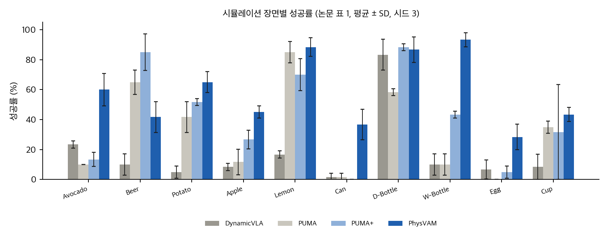
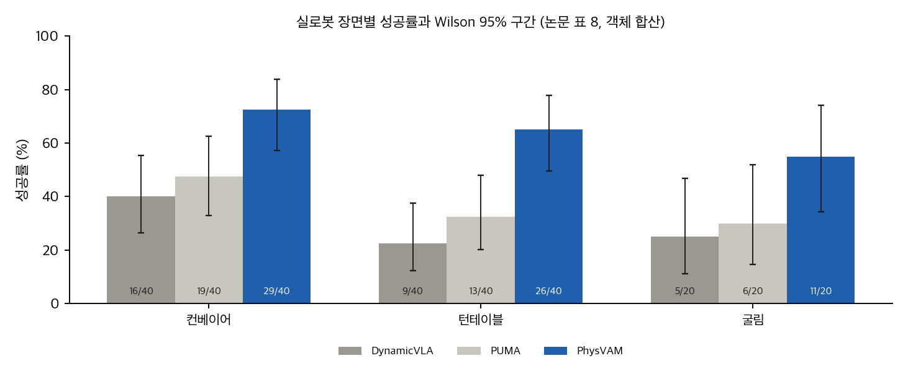
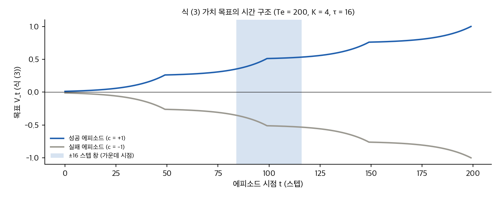

> **논문:** Yuxiang Yang, Jingbo Zhang, Jiaru Zhong, Junliang Chen, Yirui Zhou, Guangming Wang, Haitao Lin, Huaiyuan Xu, Yi Wang, Lap-Pui Chau. *PhysVAM: Physics-oriented Future Value Action Model for Dynamic Object Manipulation.* arXiv:2611.26105 (v1, 2026-11-19). 학회 표기는 없습니다.
> 공식 코드는 아직 공개되지 않았습니다. 이 글의 그림은 모두 우리가 그린 그래프이며, 논문 그림은 쓰지 않았습니다(논문 라이선스가 CC BY가 아닙니다).

## 논문이 묻는 것

물체가 움직이는 동안 로봇은 행동을 정해야 합니다. 잡으려는 물체가 손이 닿기 전에 옆으로 움직이면, 좋아 보이던 자세도 실패로 끝납니다. 이 문제에 흔한 접근은 미래 장면을 영상으로 그리는 것입니다. 하지만 생성된 미래 영상은 기하가 틀어지기 쉽고, 접촉이 실제로 작업을 진전시키는지는 알려 주지 않습니다.

PhysVAM은 방향을 바꿉니다. 미래 장면 대신 **현재 행동이 앞으로 작업 진행도를 얼마나 올리거나 내릴지**를 여러 지평(4, 8, 16, 32 스텝)에서 예측합니다. 이 값은 같은 시점의 여러 예측으로 학습하고, 행동을 만드는 확산 트랜스포머에 게이트된 교차 주의로 넣습니다.

## 방법을 한 문장으로

물체의 최근 위치와 로봇 행동 이력을 입력으로, 성공과 실패 결과에 시간 감쇠를 곱한 목표를 맞추는 작은 가치 확산 모델(ValueDiT)을 두고, 그 지평별 특징을 약 1B 파라미터 행동 모델(ActionDiT)의 세 층에 넣습니다.

## 결과: 시뮬레이션

그래프: 논문 표 1의 장면별 성공률 (평균 ± SD, 시드 3). 우리가 그린 그래프입니다.

- PhysVAM 평균 성공률은 58.83%입니다. 원래 기준선 PUMA(31.83%)보다 27.0 pp 높습니다. 장면 단위 쌍체 검정에서 p = 0.015입니다.
- 증강 기준선 PUMA+(41.50%, 저자가 가치 설계를 붙인 변형)와 비교하면 차이는 17.33 pp입니다. 장면 단위 p = 0.07이라 이 차이는 확실하지 않습니다.
- 가치 분기를 빼면 50.50%, 현재 값만 쓰면 46.50%로 떨어집니다. 두 절제 모두 시드 3개 기준 p < 0.01입니다.
- 시간 지표(8.23 s)는 가장 짧지만, 낙하로 끝난 시행도 포함된 값이라 효율의 증거로는 약합니다.

## 결과: 실로봇

그래프: 논문 표 8의 장면별 성공률과 Wilson 95% 구간 (객체 합산). 우리가 그린 그래프입니다.

- 평균 64.17%로 PUMA(36.67%)보다 27.5 pp 높습니다. 풀링한 실제 비율은 66/100 대 38/100입니다(p = 0.0001).
- 세 장면 모두 PhysVAM이 앞서지만, 굴림 장면은 시행 20회라 유의하지 않습니다(p = 0.20).
- 시드와 표준편차가 보고되지 않았습니다. 과제당 한 번 실행한 결과입니다.

## 식 검사: 가치 목표는 시간에서 나온다

논문은 "가치 예측이 잡기 성공과 실패에 따라 반응한다"고 보입니다. 예측 변화는 성공 잡기에서 +0.254, 실패 잡기에서 −0.185로 차이가 큽니다. 다만 학습 목표 자체도 시간과 결과로 정해집니다. 식 (3)을 직접 계산하면, 성공 에피소드의 목표는 시간에 대해 줄지 않고(비감소), 실패 에피소드의 목표는 늘지 않습니다(비증가).

그래프: 식 (3) 가치 목표의 시간 구조 (에피소드 길이 200, 앵커 4개, τ = 16). 우리가 그린 그래프입니다.

따라서 "목표가 잡기 근처에서 모두 증가한다"는 사실은 학습 결과에 대한 증거가 아닙니다. 예측이 목표보다 큰 국소 변화를 보인다는 쌍체 비교만 근거로 쓸 수 있습니다. 그 비교도 같은 에피소드 안의 시행이 독립이라고 가정하므로, 실제 유의성은 더 낮을 수 있습니다.

## 확실하지 않은 것

- **가치 재가중.** 가치 모델로 행동 샘플에 가중치를 주면 58.83%에서 61.50%가 됩니다. 그러나 차이 2.67 pp는 시드, 장면, 풀링 어느 검정으로도 유의하지 않습니다(p = 0.09, 0.29, 0.38).
- **기준선 설정.** 세 방법이 같은 12K 성공과 10K 실패 궤적으로 학습되었는지 본문에 없습니다. 실패 궤적은 기준선의 롤아웃에서 왔습니다.
- **시뮬레이션 관측.** 시뮬의 물체 위치가 시뮬 상태 그대로인지 추정 결과인지 본문에 없습니다. 실로봇은 FoundationPose 추정을 씁니다.
- **표준편차 정의.** 시드 3개의 표준편차는 모집단 정의(÷3)로 계산된 것으로 보입니다. 표본 정의로 읽으면 값이 약 22% 커집니다.

## 이 맥에서 재현할 수 있는가

**논문 재현은 불가능합니다.** 공식 코드가 없고, 학습은 RTX 5090 4장으로 48 GPU 시간이 들며, 실로봇(AgileX PiPER 팔과 턴테이블 등)이 필요합니다. 이 맥(Apple M4 Pro, CUDA 없음)에서 할 수 있는 것은 수치 재계산, 표 간 일치 검사, 가치 목표 식 검사입니다. 축소 구현(작은 동적 도달 토이)은 조건부로 가능하며, 노력은 1–2주로 추정합니다. 이 축소 구현은 논문 수치와 비교할 수 없습니다.

## 마무리

PhysVAM의 핵심 아이디어, 즉 미래 영상 대신 여러 지평의 작업 진행도를 예측해 행동을 안내한다는 발상은 설득력이 있습니다. 시뮬에서 원래 기준선을 넘는 폭은 크고 실로봇에서도 방향이 같습니다. 반면 증강 기준선과의 차이, 재가중 효과, 효율 주장은 지금 자료로는 확실하지 않습니다. 공식 코드와 기준선 설정이 공개되면 이 판단을 다시 확인할 수 있습니다.

## 자료

- [통합 리포트 PDF](report/report_public.pdf)
- [01. 논문 분석: PhysVAM (arXiv:2611.26105)](analysis/01_paper_analysis.md)
- [02. 선행연구, 공식 저장소, 관련 분석](analysis/02_prior_work.md)
- [03. 재계산, 일관성 검사, 토이 검사](analysis/03_analysis.md)
- [04. 주장 검증 (공식 코드가 없어 논문 주장을 직접 대조)](analysis/04_claim_verification.md)
