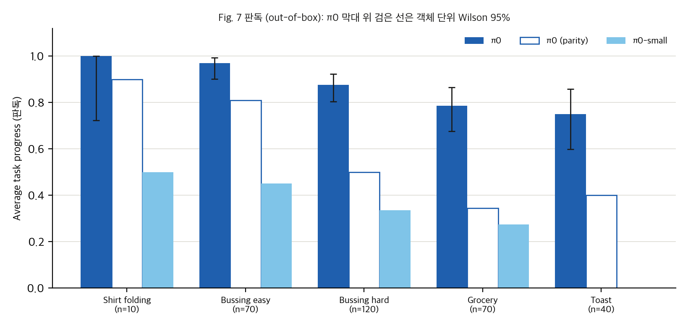
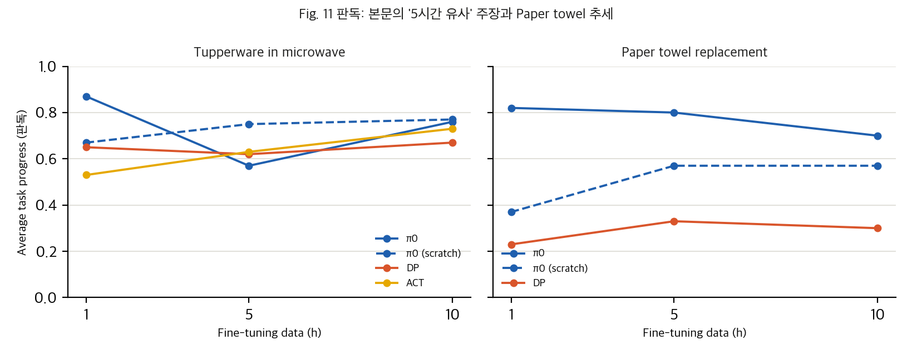

> **논문:** Kevin Black 외. *π0: A Vision-Language-Action Flow Model for General Robot Control.* RSS 2025, arXiv:2410.24164 (v4, 2026-01-08).
> 공식 코드(openpi, Apache-2.0)는 정적으로만 읽었고 실행하지 않았습니다. 이 글의 그래프는 논문 결과를 다시 그린 것이 아니라, 그림에서 읽은 값으로 우리가 만든 것입니다.

## 논문이 묻는 것

로봇 정책도 언어 모델처럼 대규모 사전학습과 사후학습으로 만들 수 있을까요? π0는 사전학습 VLM(PaliGemma 3B)에 행동 전문가(약 300M)를 붙이고, 흐름 매칭으로 50스텝 행동 청크를 만듭니다. 자체 데이터 903M 스텝(7개 로봇, 68개 과제)과 OXE 등으로 사전학습하고, 과제별로 미세조정합니다.

핵심 선택은 두 가지입니다. 행동을 이산 토큰이 아니라 흐름 매칭으로 만들어 고주파 청크를 다루는 것, 그리고 VLM 토큰과 행동 토큰을 **가중치를 나누고 어텐션 마스크로만 연결**하는 것입니다. 블록 마스크는 세 덩어리로 나뉩니다. 이미지와 언어는 행동을 보지 못하고, 상태는 캐시를 위해 행동을 보지 못하고, 행동 토큰끼리는 양방향입니다.

## 이 글에서 확인한 것

**수식과 구현은 맞습니다.** 공개 코드의 시간 분포는 Beta(1.5, 1)를 0.999 이하로 자른 것이고, 논문의 식과 변수 변환으로 같은 분포입니다(KS 검정 p = 0.47). 10스텝 오일러, 311M 행동 전문가, 3블록 마스크도 논문과 같습니다. 코드 주석은 시간 방향이 논문과 반대라고 밝힙니다.

**결과는 그림에만 있습니다.** Fig. 7, 9, 11, 13에는 값 라벨도, 오차 막대도, 검정도, 시도별 원자료도 없습니다. 각 과제는 시도를 10번 했습니다. 그래서 그림을 300 dpi로 읽어 값을 얻고, 객체 단위로 검정했습니다. 셔츠 접기의 1.00 대 0.90은 10번 시도로는 구분되지 않습니다. 버스와 식료품 차이는 객체를 독립으로 본 상한에서 유의합니다.

그림: 논문 Fig. 7을 읽은 값(±0.01)과 π0의 구간. n은 점수 분모(시도 10번 × 물체 수)입니다. 우리가 그린 그래프입니다.

**본문과 그림이 어긋나는 곳이 세 군데 있습니다.**

- 본문은 완전 모델이 "전 과제에서 최고"라고 하지만, Packing eggs에서는 scratch(0.885)가 fine-tuned(0.845)보다 높습니다.
- 본문은 Table bussing이 사전학습에 없다고 하지만, 그림은 이 과제를 사전학습에 있는 과제 패널에 둡니다.
- 본문은 Tupperware 5시간 정책이 기준선과 비슷하다고 하지만, 그림에서 π0는 5시간에 0.57로 기준선(0.62–0.75)보다 낮습니다. 10시간(0.76)이 비슷합니다. Paper towel은 데이터가 늘수록 π0가 0.82에서 0.70으로 떨어지는데 언급이 없습니다.

그림: 논문 Fig. 11을 읽은 값입니다. 왼쪽은 Tupperware에서 5시간의 하락, 오른쪽은 Paper towel에서 데이터가 늘수록 떨어지는 π0입니다. 우리가 그린 그래프입니다.

**데이터 규모는 가정에 달려 있습니다.** 903M 스텝이 10,000시간이 되려면 평균 약 25 Hz여야 합니다. 모든 로봇이 50 Hz면 약 5,000시간, 20 Hz면 약 12,500시간입니다.

## 공식 코드에서 본 것

공식 저장소는 π0의 모델, 학습, 추론 코드와 base 체크포인트 설정을 공개합니다. 공개하지 않은 것도 분명합니다. 사전학습 데이터 혼합과 사전학습 코드, π0-small, 실로봇 평가 코드가 없습니다. 논문의 학습 하이퍼파라미터(배치, 학습률, 스텝)도 없습니다. 공개 미세조정 기본값(배치 32, 3만 스텝, 최고 학습률 2.5e-5)은 있지만 논문 설정과 같다는 근거는 없습니다.

차이도 두 가지 있습니다. 행동 차원은 논문이 18이라고 쓰지만 공개 설정은 32입니다. 재계획 주기도 다릅니다. 논문은 50 Hz 로봇에서 25스텝을 실행한다고 쓰는데, 공개 LIBERO 예제는 5스텝만 실행합니다.

## 이 맥에서 구현할 수 있는가

**재현은 불가능합니다.** 사전학습은 데이터와 레시피가 없습니다. 미세조정은 CUDA 기기가 필요하고, 실로봇은 하드웨어가 필요합니다.

**추론과 구조 재구현은 가능합니다.** 3.2B 모델을 bf16으로 올리면 메모리는 약 7 GB입니다. 속도는 아직 재지 않았습니다. 논문의 73 ms는 RTX 4090 기준입니다. 흐름 손실, 3블록 마스크, 시간 분포는 작은 설정으로 옮겨 검산할 수 있습니다. 이 작업은 2–4일 정도로 봅니다(추정).

## 읽을 때 조심할 것

- 그림 값은 우리가 읽은 근사치입니다. 정확한 수치는 저자의 원자료가 필요합니다.
- 객체 단위 검정은 상한입니다. 같은 시도 안의 물체는 독립이 아닙니다.
- 논문 표현("전 과제 최고", "사전학습에 없음")은 그림과 맞춰 읽어야 합니다.

## 정리

π0는 흐름 매칭 행동 전문가와 블록 어텐션을 VLA에 붙이는 설계로, 공개 코드의 구현은 논문 수식과 잘 맞습니다. 하지만 결과의 통계와 학습 레시피가 비어 있어서, 수치를 인용하거나 재현하려면 그 빈칸을 먼저 확인해야 합니다.

## 자료

- [통합 리포트 PDF](report/report_public.pdf)
- [01. 논문 분석: π0 (arXiv:2410.24164)](analysis/01_paper_analysis.md)
- [02. 선행연구, 구성 요소의 출처, 관련 자료 (π0)](analysis/02_prior_work.md)
- [03. 수치 재계산과 일관성 검사 (π0)](analysis/03_analysis.md)
- [04. 논문 ↔ 공식 코드 대조 (π0)](analysis/04_code_verification.md)
