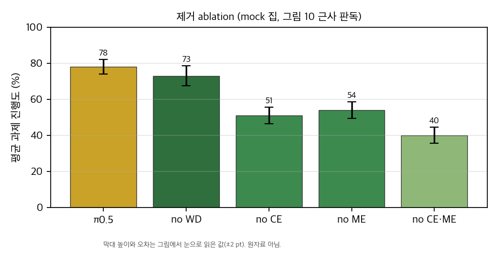
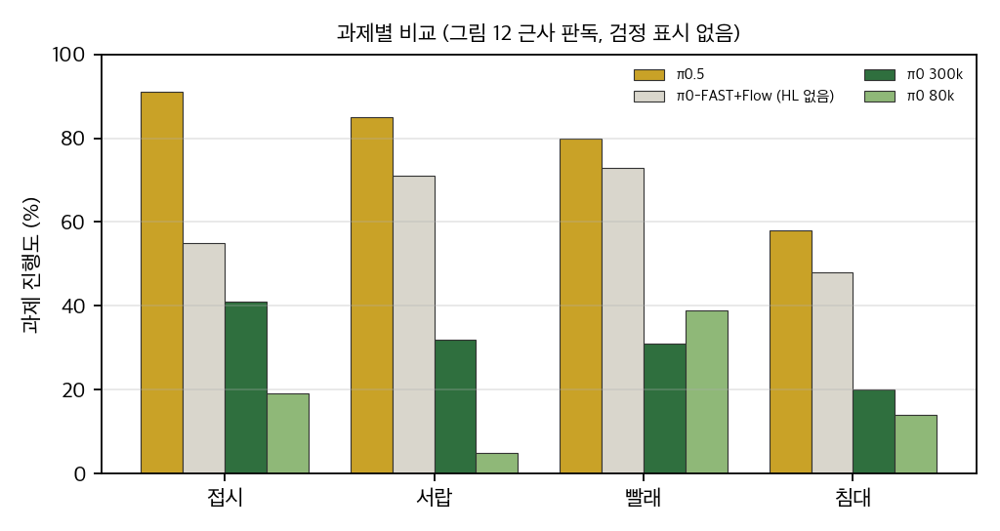

> **논문:** Physical Intelligence (Black, Brown, … Zhilinsky). *π0.5: a Vision-Language-Action Model with Open-World Generalization.* CoRL 2025 (PMLR v305), arXiv:2504.16054 (v1, 2025-04-22, 버전 하나).
> 공식 코드 openpi(Apache-2.0)는 정적으로만 읽었습니다. 실행, 설치, 가중치 다운로드는 하지 않았습니다. 논문 그림은 라이선스(arXiv non-exclusive) 때문에 싣지 않고, 우리가 그린 그래프만 씁니다.

## 논문이 하는 주장

π0.5는 π0 위에 여러 데이터 원천을 함께 학습시킨 VLA입니다. 데이터는 모바일 조작기 약 400시간, 다른 로봇 데이터, 실험실 교차 embodiment 데이터, 고수준 subtask 라벨, 웹 VQA와 검출 데이터, 그리고 사람이 로봇에 내린 언어 명령(post-training)입니다. 학습은 두 단계입니다. 먼저 액션을 FAST 이산 토큰으로 바꿔 사전학습하고, 그다음 flow matching 액션 전문가를 붙여 post-training합니다. 추론 때는 같은 모델이 먼저 subtask 문장을 만들고, 그 조건으로 액션을 냅니다.

결과는 새 집 3곳에서 10–15분짜리 청소 과제를 수행한 것입니다. 정량 평가는 모의 집 4개 과제에서 과제당 10회씩 했습니다.

## 그림으로 본 제거 실험

논문 그림 10은 학습 데이터에서 다른 로봇 데이터를 빼면 성능이 떨어진다고 보여 줍니다. 그림 막대를 눈으로 다시 그리면 다음과 같습니다. 원자료가 아니므로 값은 ±2 pt 정도 오차가 있습니다.

*그림: 논문 그림 10의 평균 과제 진행도를 눈으로 읽어 다시 그린 것입니다. 우리가 그린 그래프입니다.*

ME(다른 집의 고정형 로봇)나 CE(실험실 다양한 로봇)를 빼면 큰 폭으로 떨어집니다. 두 가지 오차막대 해석(95% 신뢰구간이나 표준오차) 모두에서 p < 0.001 수준입니다. 웹 데이터를 뺀 경우의 p = 0.385는 두 해석 사이에 있어 계산과 모순되지 않습니다. 다만 이 정밀도로는 “웹 데이터가 무의미하다”고 말하기 어렵습니다. 논문도 웹 데이터의 효과는 분포 밖 물체를 다루는 언어 추종 실험에서 크다고 보고합니다.

## 과제별 비교에서 조심할 점

그림 12는 π0.5와 π0 계열을 과제별로 비교합니다. 접시와 서랍에서는 차이가 뚜렷합니다. 빨래와 침대에서는 막대가 겹칩니다. 그림에는 검정 결과가 없는데 본문은 “significantly”라고 씁니다.

*그림: 논문 그림 12의 과제별 진행도를 눈으로 읽어 다시 그린 것입니다. 검정 표시는 원 그림에 없습니다. 우리가 그린 그래프입니다.*

재계산해 보면 그림 12의 π0.5 과제 평균(약 78.5)은 그림 10의 π0.5 막대(약 78)와 맞습니다. 두 그림이 같은 기준선을 쓴다는 뜻입니다.

## 공식 코드와 논문의 차이

openpi 저장소에는 π0.5 설정과 추론·미세조정 코드가 있습니다. README는 “이 저장소에서는 π0.5 학습과 추론 모두 flow matching 헤드만 지원한다”고 적었습니다. 코드를 읽은 결과는 다음과 같습니다.

- **일치하는 부분:** 상태를 이산 텍스트 토큰으로 넣는 방식, adaRMS로 타임스텝을 주입하는 방식, 타임스텝 분포 Beta(1.5, 1)(시간축을 뒤집어 논문과 같음), 1–99% 분위수 정규화, 이미지 증강 값, 액션 청크 50, 전문가 크기.
- **다른 부분:** 논문 Eq. (1)의 FAST 토큰 교차엔트로피와 flow의 혼합 손실이 π0.5 경로에 없습니다. 공개 코드는 flow MSE만 씁니다.
- **확인되지 않은 부분:** 고수준 텍스트 생성 경로가 이 저장소의 π0.5 코드에서 보이지 않습니다. 찾지 못한 것인지 없는 것인지는 더 넓게 훑어야 합니다.
- **공개 코드에 없는 부분:** README는 공개 π0.5 체크포인트가 knowledge insulation으로 학습됐다고 합니다. 그러나 공개된 모델 경로에는 stop-gradient가 없습니다. 체크포인트를 학습한 방식이 공개되지 않은 것으로 보이며, 이 코드로 미세조정하면 그 방식은 적용되지 않습니다. 어텐션 마스크로 VLM이 액션 전문가를 보지 못하게 하는 것뿐이고, 액션 손실의 기울기는 VLM까지 흘러 들어갑니다.
- **문서 오류 가능성:** 논문 부록 E의 2B VLM 헤드 수 “18”은 코드 설정 8과 다릅니다.

## 이 맥에서 할 수 있는 것

논문 학습을 맥에서 재현하는 것은 불가능합니다. 혼합 데이터와 학습 규모, 실로봇 평가가 필요합니다. 학습 레시피 중 FAST 사전학습과 혼합 데이터는 공개되지 않았습니다.

할 수 있는 것은 두 가지입니다. 첫째, 혼합 손실을 CPU에서 작은 모델로 구현해 두 목표의 기울기가 어떻게 간섭하는지 보는 실험입니다. 둘째, 공개 체크포인트로 추론 지연을 재는 것입니다. 후자는 JAX 설치와 체크포인트 다운로드가 먼저 필요합니다.

## 정리

π0.5의 공개 코드는 논문의 전체 레시피가 아니라 flow-only 쪽 구현입니다. 구조 세부는 논문과 잘 맞습니다. 손실과 고수준 추론은 공개 코드로 확인할 수 없고, 논문 그림의 과제별 “유의하다”는 표현은 검정 없이 쓰인 부분이 많습니다.

## 자료

- [통합 리포트 PDF](report/report_public.pdf)
- [π0.5: a Vision-Language-Action Model with Open-World Generalization (arXiv:2504.16054) 논문 분석](analysis/01_paper_analysis.md)
- [선행연구와 관련 자료 (π0.5)](analysis/02_prior_work.md)
- [03 수치 재계산과 일관성 검사 (π0.5)](analysis/03_analysis.md)
- [04 논문 ↔ 공식 코드 대조 (π0.5, openpi)](analysis/04_code_verification.md)
