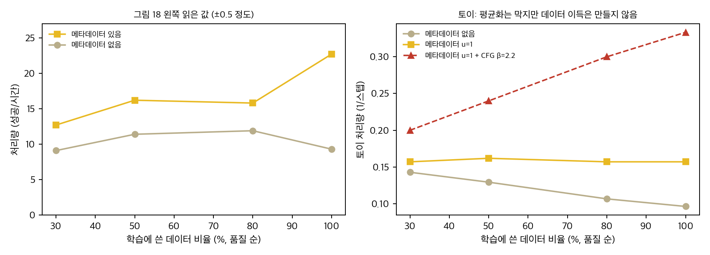
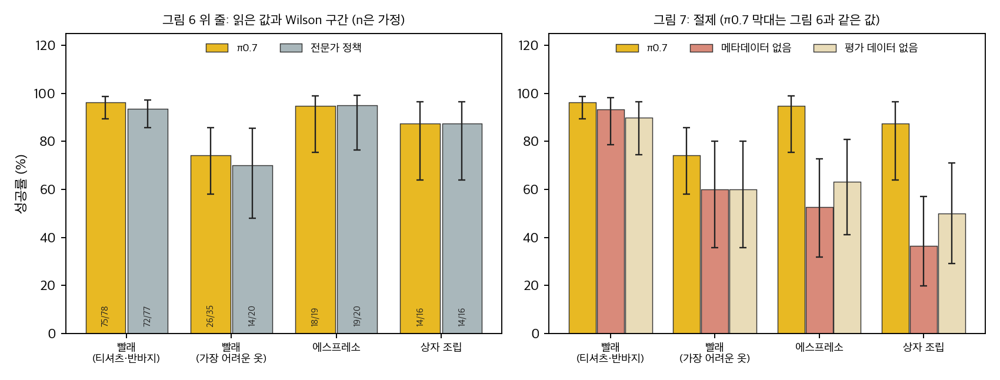
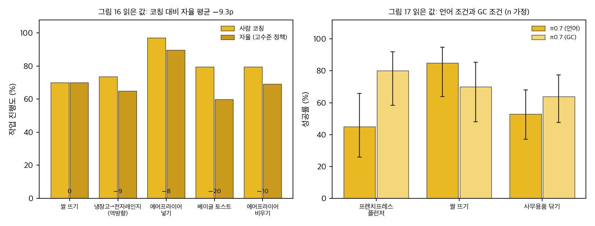

# 03. 보고 수치 재계산과 토이

논문은 대부분의 결과를 막대 그래프로만 주고 표나 시행 수를 주지 않습니다(사람 연구 부록 F의 30회만 예외). 그래서 이 문서는 (1) 그림의 벡터 막대와 오차 막대에서 값을 읽고, (2) 오차 막대가 Wilson 95% 구간과 맞는 정수 시행 수를 찾아 **가정**하고, (3) 그 가정 아래 Fisher 정확 검정과 정수 가능성 검사를 합니다. 스크립트는 `analysis/recompute.py`(결과 `recompute_results.json`), 토이는 `analysis/toy_metadata.py`, 그래프는 `analysis/plot_figures.py`입니다. 모두 CPU 단일 프로세스이고 수 초에서 20초 안에 끝납니다.

**읽기 방식과 한계.** 그림 6–11, 15–17, 20, 22의 막대는 PDF 벡터 도형입니다(PyMuPDF로 막대 높이와 눈금선에서 값을 계산, 소수점 아래는 "그림 판독 값"이며 원자료가 아닙니다). 그림 9, 12, 18은 래스터 이미지라 픽셀 판독입니다(±2–3%p). 해칭 막대(GC)는 벡터 좌표 대신 이미지에서 읽었습니다. 시행 수는 논문에 없어서 아래 V2의 가정입니다.

## V1. 그림 사이 값 일치

- 그림 7의 π0.7 막대(성공률 96.2, 74.3, 94.7, 87.5%)는 그림 6 위 줄의 π0.7 막대와 소수점까지 같고 오차 막대도 같습니다. 그림 7은 처리량을 π0.7 = 1.0으로, 그림 6은 전문가 = 1.0으로 정규화합니다. 두 그림의 π0.7 성공률은 일치합니다.
- 부록 그림 20의 관절 제어 막대(π0.5, π0.6 각 6과제 12개)는 그림 12(래스터라 픽셀 판독)의 π0.5, π0.6 막대와 판독 오차(±1%p) 안에서 같습니다.
- 그림 16의 "코칭" 막대 중 공통 3과제(에어프라이어 넣기 97.2, 비우기 79.6, 베이글 79.5)는 그림 15의 **GC 막대**(97.2, 79.6, 79.5)와 일치합니다. 그림 15의 언어만 쓴 π0.7 막대(97.5, 76.7, 47.4)와는 베이글에서 다릅니다(`04` K2).

## V2. 오차 막대에서 시행 수 추정

그림 6(위 줄), 7, 10의 성공률 막대 24개에 대해 막대 높이 k/n이 되고 오차 막대가 Wilson 95% 구간에 가장 잘 맞는 (k, n)을 찾았습니다. 24개 모두 구간 양끝 오차 합이 0.001 이하로 맞았습니다. 오차 막대가 Wilson 95% 구간이고 아래 n이 시행 수라고 보면 설명이 됩니다(그림 판독의 가정, 저자 확인 필요).

| 그림 | 칸 | 가정한 k/n |
|---|---|---|
| 6, 7 | 빨래(티셔츠·반바지) π0.7 / 전문가 / 메타데이터 없음 / 평가 데이터 없음 | 75/78, 72/77, 28/30, 27/30 |
| 6, 7 | 빨래(가장 어려운 옷) π0.7 / 전문가 / 절제 | 26/35, 14/20, 9/15, 9/15 |
| 6, 7 | 에스프레소 π0.7 / 전문가 / 메타데이터 없음 / 평가 데이터 없음 | 18/19, 19/20, 10/19, 12/19 |
| 6, 7 | 상자 조립 π0.7 / 전문가 / 메타데이터 없음 / 평가 데이터 없음 | 14/16, 14/16, 8/22, 9/18 |
| 10 | 표준 지시 π0.5 / π0.6 / π0.7 / GC | 18/27, 24/27, 26/27, 25/27 |
| 10 | 복합 지시 π0.5 / π0.6 / π0.7 / GC | 8/36, 8/36, 13/36, 23/36 |

(그림 7의 절제 두 칸은 오차 막대 읽기가 깨져 막대 높이만으로 k/n을 정했습니다.) 같은 과제 안에서도 π0.7(35회), 전문가(20회), 절제(15회)의 시행 수가 서로 다릅니다. 모델 사이 시행 수 불균형은 검정력을 좌우합니다(V3, V4).

## V3. π0.7 대 전문가 (그림 6 위 줄, 성공률)

| 과제 | π0.7 | 전문가 | Fisher p | 이 시행 수에서 검출되는 최소 하락(전문가 대비) |
|---|---|---|---|---|
| 빨래(티셔츠·반바지) | 75/78 = 96.2% | 72/77 = 93.5% | 0.50 | 11.5%p |
| 빨래(가장 어려운 옷) | 26/35 = 74.3% | 14/20 = 70.0% | 0.76 | 30%p |
| 에스프레소 | 18/19 = 94.7% | 19/20 = 95.0% | 1.0 | 27%p |
| 상자 조립 | 14/16 = 87.5% | 14/16 = 87.5% | 1.0 | 44%p |

네 과제 모두 π0.7과 전문가의 성공률 차이는 검출되지 않습니다. 다만 시행 수가 16–35라서 "같다"를 확인할 힘은 낮습니다. 빨래(가장 어려운 옷)에서 π0.7이 전문가보다 30%p 넘게 나쁜 경우도 이 설계로는 놓칠 수 있고, 상자 조립은 44%p입니다. "전문가와 맞먹는다"는 문장은 차이를 검출하지 못했다는 뜻으로 읽는 것이 정확합니다(`04` C1).

**처리량(전문가 = 1.0):** 위 줄 네 과제에서 π0.7은 0.98, 1.47, 0.96, 1.45입니다. 빨래(가장 어려운 옷)와 상자 조립에서 오차 막대 하한이 약 1.29와 1.24이고 전문가 막대 상한이 약 1.17과 1.14라서 막대끼리는 겹치지 않습니다(오차 막대의 종류는 논문에 없어 정식 검정은 하지 못함). 처리량은 성공 수를 시간으로 나눈 값이라 성공률과 속도의 곱입니다. 두 과제에서 성공률은 같고 처리량이 1.45배라면 에피소드 시간 차이가 주 원인으로 읽힙니다.

## V4. 절제 (그림 7)

| 과제 | π0.7 | 메타데이터 없음 | p | 평가 데이터 없음 | p |
|---|---|---|---|---|---|
| 빨래(티셔츠·반바지) | 75/78 | 28/30 = 93.3% | 0.62 | 27/30 = 90.0% | 0.35 |
| 빨래(가장 어려운 옷) | 26/35 | 9/15 = 60.0% | 0.33 | 9/15 = 60.0% | 0.33 |
| 에스프레소 | 18/19 | 10/19 = 52.6% | 0.008 | 12/19 = 63.2% | 0.042 |
| 상자 조립 | 14/16 | 8/22 = 36.4% | 0.002 | 9/18 = 50.0% | 0.030 |

성공률로 보면 에스프레소와 상자 조립에서는 두 절제 모두 π0.7보다 낮고 유의합니다. 빨래 두 과제는 성공률 차이가 유의하지 않습니다. 본문은 "π0.7이 모든 과제에서 두 절제를 의미 있게 앞선다, 차이는 처리량에서 가장 크다"고 씁니다(Sec. IX-A). 처리량 막대 기준으로는 π0.7 = 1.0에 대해 메타데이터 없음 0.75, 0.53, 0.64, 0.25, 평가 데이터 없음 0.66, 0.60, 0.62, 0.57로 모두 낮습니다. 즉 "처리량에서 가장 크다"는 서술은 막대와 맞고, "성공률에서도 의미 있게 앞선다"는 빨래 두 과제에서는 이 시행 수(가정)로 확인되지 않습니다.

## V5. 지시 따르기 (그림 9, 픽셀 판독)

그림 9는 막대 높이를 ±2%p, 오차 막대를 Wilson으로 보고 유효 시행 수를 부엌 약 67회, 침실 약 79회(지시 단위, 암별 55–82의 평균)로 추정했습니다. 이 가정 아래:

| 환경 | π0.5 | π0.6 | π0.7 | π0.7 대 π0.6 p | π0.6 대 π0.5 p |
|---|---|---|---|---|---|
| 새 부엌 4곳 | 약 28% | 약 54% | 약 86% | 5×10⁻⁵ | 0.005 |
| 새 침실 2곳 | 약 25% | 약 55% | 약 73% | 0.020 | 3×10⁻⁴ |

π0.7이 π0.6보다 높다는 방향은 두 환경 모두 분명합니다. 지시 하나하나가 독립이 아니라 14개 시나리오 안에 묶여 있어서(같은 환경과 같은 시퀀스) 위 p는 독립 가정이라 낙관적입니다(시나리오 단위 비교는 시행 수 부족으로 못 함).

## V6. 복합 지시 (그림 10)

| 검정 | p |
|---|---|
| 복합: GC 23/36 대 π0.7 13/36 | 0.033 |
| 복합: GC 23/36 대 π0.6 8/36 | 7×10⁻⁴ |
| 복합: π0.7 13/36 대 π0.6 8/36 | 0.30 |
| 표준: π0.7 26/27 대 π0.6 24/27 | 0.61 |
| 표준: π0.7 26/27 대 GC 25/27 | 1.0 |

본문 "π0.7이 복합 지시에서 이전 모델을 앞서고 하위 목표 이미지가 더 올린다"(Sec. IX-B)에서 앞의 절은 **언어만 쓴 π0.7(36% 대 22%)로는 이 시행 수에서 확인되지 않고(p = 0.30)**, GC를 더한 변형(64%)에서 확인됩니다. 뒤의 절(GC 대 π0.7)은 p = 0.033입니다.

## V7. 데이터 편향 반대 과제 (그림 11, 작업 진행도)

역방향 정리: π0.5 53, π0.6 33, π0.7 84, GC 81. 냉장고→전자레인지 역방향: 0, 5, 0, 74. 작업 진행도는 이항이 아니라 정식 검정은 못 했습니다. 읽을 수 있는 것: 역방향 정리는 π0.7이 크게 앞서고, 냉장고 역방향은 **언어만 쓴 π0.7이 π0.5와 같이 0 근처**이고 GC만 74입니다. 본문도 "GC가 결정적"이라고 적습니다(Sec. IX-B). 한 문장에 묶은 "π0.7이 이전 모델을 크게 앞선다"는 GC 변형 기준입니다.

## V8. 교차 로봇 (그림 12, 20, 22)

그림 12(작업 진행도, π0.5/π0.6/π0.7): 테이블 세팅 63/79/81, 가방 39/51/60, 용기 정리 47/77/86, 셔츠 담기 57/66/93, 수건 7/44/59(GC 77), 셔츠 접기 2/43/68(GC 86). 오차 막대 기준으로 π0.7이 π0.6과 겹치지 않는 칸은 셔츠 담기, 셔츠 접기(GC)이고, 테이블 세팅은 같은 수준, 가방과 용기 정리는 오차 막대가 일부 겹칩니다(그림 판독).

부록 그림 20(관절 제어 대 말단장치 EE 제어, 해칭 막대는 픽셀 판독 ±3%p): π0.5는 테이블 63→71, 가방 39→57, 용기 47→45, 셔츠 담기 57→65, 수건 7→3, 셔츠 접기 2→1. π0.6은 79→79, 51→58, 77→82, 66→62, 44→54, 43→37. 본문은 "뚜렷한 차이가 없다"고 쓰며(Sec. IX-C, 부록 E), 대부분 칸이 ±10%p 안이지만 **π0.5의 가방 과제는 +18%p**(오차 막대가 겹치지 않는 크기)입니다(`04` K5).

## V9–V10. 코칭 (그림 15, 16)

- 그림 15: 에어프라이어 넣기 π0.7 97.5, 비우기 76.7, 베이글 47.4(GC 97.2, 79.6, 79.5). 베이글에서 언어만 쓴 π0.7(47.4)은 π0.6(47.6)과 같습니다. 본문은 "π0.7은 이전 방법보다 훨씬 효과적으로 코칭된다"고 적습니다(Sec. IX-D). 에어프라이어 두 과제에서는 π0.5, π0.6(13–25%)보다 크게 높고 베이글은 GC에서만 높습니다.
- 그림 16 (코칭 대 자율, 작업 진행도): 쌀 뜨기 70/70, 냉장고 역방향 73.7/65.0, 넣기 97.2/89.7, 베이글 79.5/59.8, 비우기 79.6/69.1. 자율이 코칭보다 평균 9.3%p 낮고 베이글은 19.7%p 낮습니다. 본문은 "roughly match"라고 적습니다.

## V11. 새 단기 과제 (그림 17, 성공률)

시행 수는 막대가 20분의 정수(플런저, 쌀 뜨기)이거나 36분의 정수(사무용품 닦기)가 되는 값으로 가정했습니다. 오차 막대가 Wilson이 아닌 칸이 있어(플런저 첫 줄) n은 근사입니다.

| 과제 | π0.5 | π0.6 | π0.7 | GC | π0.7 대 π0.6 p | GC 대 π0.7 p |
|---|---|---|---|---|---|---|
| 플런저 (n=20 가정) | 1/20 | 13/20 | 9/20 | 16/20 | 0.34 | 0.048 |
| 쌀 뜨기 (n=20 가정) | 5/20 | 3/20 | 17/20 | 14/20 | < 0.0001 | 0.45 |
| 사무용품 닦기 (n=36 가정) | 13/36 | 9/36 | 19/36 | 23/36 | 0.029 | 0.47 |

본문은 "언어 조건(π0.7)과 이미지 목표(GC) 조건에서 비슷하게 강하다"고 씁니다(그림 17 캡션). 이 시행 수에서 두 조건의 차이는 플런저(45% 대 80%)만 유의하고, 나머지는 유의하지 않지만 차이는 11–15%p입니다. 플런저에서는 언어만 쓴 π0.7(45%)이 π0.6(65%)보다 낮습니다(유의하지 않음).

## V12. 같은 모델, 같은 과제의 두 그림 (그림 17 대 18 오른쪽)

그림 18 오른쪽의 "π0.7" 막대(전체 데이터 모델)는 그림 17의 π0.7과 같은 모델과 과제입니다. 읽은 값은 쌀 뜨기 85%(그림 17) 대 56%(그림 18, 15/27 가정, 픽셀 판독), 관절 물체 돌리기 39% 대 48%, 사무용품 닦기 53% 대 47%입니다. 쌀 뜨기의 17/20 대 15/27은 p = 0.056입니다. 그림 18의 평가가 다른 세션이거나 다른 설정일 가능성이 있으나 본문에 설명은 없습니다(`04` K3).

## V13. 혼합 품질 스케일링 (그림 18 왼쪽, 픽셀 판독 ±0.5)

| 데이터 비율 | 30% | 50% | 80% | 100% |
|---|---|---|---|---|
| 메타데이터 있음 | 12.7 | 16.2 | 15.8 | 22.7 |
| 메타데이터 없음 | 9.1 | 11.4 | 11.9 | 9.3 |

- 메타데이터 있음: 30%→100%에서 1.79배. 단조 증가는 아니고 50%→80%에서 −0.4(오차 막대 안), 80%→100%에서 +6.9입니다. 본문은 "계속 향상된다(continuously improve)"고 씁니다(Sec. IX-E).
- 메타데이터 없음: 30%→100%에서 1.02배로 사실상 같고, 80%→100%에서 −2.6입니다. 본문은 "더 나빠질 수 있다"고 씁니다. 30% 대비로는 나빠지지 않았고 80% 최고점에서 100%로 줄었습니다.
- 두 곡선의 차이는 30%에서 3.6, 100%에서 13.4입니다. 격차가 벌어지는 것은 맞지만 거의 전부 마지막 구간(80→100%)에서 생깁니다. 이 시점에 추가되는 20%의 성격(가장 낮은 품질 구간)이 같이 바뀝니다.
- 모델은 버킷마다 처음부터 한 번씩(8개) 학습한 것으로 서술되고 시드 반복은 없습니다. 오차 막대는 평가 시행의 변동일 뿐 학습 시드 변동이 아닙니다.

## V14. 사람 연구 (부록 F, 그림 22)

- 서술: 10명 × 3회 = 30회. 보고: 진행도 90.9%, 성공률 80.6%.
- **정수 가능성:** 30회 중 성공 24회는 80.0%, 25회는 83.3%이므로 80.6%는 30회의 정수 비율이 아닙니다. 31회라면 25/31 = 80.65%가 맞고, 진행도도 6점 만점 × 31회 = 186점 중 169점 = 90.86%로 맞습니다(30회라면 180점 중 163.6점이라 정수가 아님). 읽은 오차 막대(성공률 약 63–91%)는 Wilson 25/31 = 63.7–90.8%와 맞습니다. 즉 읽은 값은 **31회**와 맞고 서술은 30회입니다(`04` K1).
- π0.7 (GC): 성공 80%, 진행도 85.6%. 정수 가능한 시행 수는 15, 30, 45(진행도 77/90, 154/180, 231/270)이고 10, 20, 25회는 불가능합니다. 읽은 오차 막대(성공률 약 52–92%, 픽셀 판독)는 Wilson 12/15 = 54.8–93.0%와 가깝습니다. 즉 π0.7 (GC)는 **15회**로 읽힙니다.
- 성공률 비교: 25/31 대 12/15 Fisher p = 1.0. "비슷하다"는 맞지만, 15회 대 31회의 비교라 차이를 검출할 힘은 낮습니다. 진행도는 90.9 대 85.6(GC)입니다. 언어·이미지 목표 모두 없는 π0.7(그림 12 오른쪽)은 진행도 약 68%로 사람과 겹치지 않습니다. 본문 서술(Sec. IX-C)은 "task progress가 숙련 조작자와 비슷하다"이고, 비교 대상 막대는 GC 변형입니다.

## V15. 산술 점검 (식과 서술)

| 항목 | 계산 | 결과 |
|---|---|---|
| 학습 시점 RTC 지연 최대 | 12스텝 ÷ 50 Hz | 240 ms. UR5e는 20 Hz라서 같은 12스텝이면 600 ms(본문은 50 Hz 기준만 서술) |
| 청크 길이 | 50스텝 | 50 Hz에서 1.0초, 20 Hz에서 2.5초. 실행 구간 Ĥ = 15, 25스텝은 0.3, 0.5초(50 Hz) |
| 세계 모델 1스텝 | 1.25초 ÷ 25스텝 | 50 ms(텍스트와 이미지 CFG 포함) |
| 하위 목표 갱신 주기 | Δ = 4초 | 세계 모델 지연 1.25초 + 4개 GPU. 갱신 중에도 정책은 이전 목표로 실행 |
| 파라미터 | 4B + 0.86B | 4.86B ≈ "약 5B"(MEM 인코더 포함 여부는 미명시) |
| 하위 목표가 있고 하위 과제 문장이 없는 예시 비율 | 0.25 × 0.30 | 7.5% |
| 속도 라벨 누락 확률 | 1 − 0.85 × 0.95 | 19.25% |
| 메타데이터 정보가 아예 없는 확률 | 0.15 + 0.85 × 0.05³ | 15.0% |
| CFG 유효 안내 세기 | w = 1 + β | β = 1.3, 1.7, 2.2에서 2.3, 2.7, 3.2 |
| 세계 모델 시퀀스 길이(단일 분기) | ViT 448×336/14: 3시점 × 768 + VAE 512×384/16: (현재 3 + 목표 3) × 768 | 약 6,900 토큰(패치 병합 없다는 가정). 본문의 "거의 1만"은 텍스트와 CFG 가지를 더하면 가능한 범위 |
| 속도 빈 | 1750–2250 → "2000 steps" | 폭 500으로 서술과 일치. 예시 프롬프트의 "Speed: 8000"은 50 Hz에서 160초 |

메타데이터 "속도"는 과제별 에피소드 길이의 15 백분위로 프롬프트합니다(Sec. VII). 즉 테스트 때는 학습 에피소드 중 빠른 쪽 15% 경계에 해당하는 속도를 요청합니다.

## V16. 과제 다양성 절제 (그림 18 오른쪽, 픽셀 판독)

읽은 값(전체 모델 / 무작위 20% 제외 / 가장 다양한 20% 제외): 쌀 뜨기 56/52/32%, 관절 물체 돌리기 48/35/9%, 사무용품 닦기 47/47/7%. 쌀 뜨기의 Wilson 폭에서 n = 27을 가정하고 세 과제에 같은 n을 썼습니다(가정).

| 과제 | 전체 대 다양한 20% 제외 p | 무작위 20% 제외 대 다양한 20% 제외 p |
|---|---|---|
| 쌀 뜨기 | 0.17 | 0.27 |
| 물체 돌리기 | 0.002 | 0.039 |
| 사무용품 닦기 | 0.002 | 0.002 |

본문은 "모든 과제에서 전체 모델과 무작위 제외 모델이 다양한 20% 제외 모델을 크게 앞선다"고 씁니다(Sec. IX-E). 이 가정에서 물체 돌리기와 사무용품 닦기는 확인되고, 쌀 뜨기는 방향은 같지만 유의하지 않습니다(`04` C14). 그림 17의 π0.7 쌀 뜨기(85%)와 이 그림의 π0.7(56%)은 서로 다릅니다(V12).

## 토이: 메타데이터가 혼합 품질의 평균화를 막는가 (`toy_metadata.py`)

설정은 스크립트 머리말에 있습니다. 1차원 상태에서 시연자 이득 k = 0.2 + 0.6u(u는 품질)로 데이터를 상위 30, 50, 80, 100% 품질로 자르고, 메타데이터가 없는 MLP와 있는 MLP(15% 가림)를 5 시드로 학습한 뒤 수렴 스텝의 역수를 처리량으로 봅니다. 파라미터는 우리 가정이며 논문 값에 맞추지 않았습니다.

| 데이터 비율 | 메타데이터 없음 | u=1 프롬프트 | u=1 + CFG β=1.3 | u=1 + CFG β=2.2 |
|---|---|---|---|---|
| 상위 30% | 0.143 | 0.157 | 0.173 | 0.200 |
| 상위 50% | 0.129 | 0.162 | 0.203 | 0.240 |
| 상위 80% | 0.107 | 0.157 | 0.230 | 0.300 |
| 전체 | 0.096 | 0.157 | 0.267 | 0.333 |

읽을 수 있는 것: (1) 메타데이터가 없으면 데이터를 늘릴수록(평균 이득 0.71→0.50) 처리량이 0.143→0.096으로 떨어지고, 메타데이터에 u=1을 주면 0.157 근처로 유지됩니다. 이것은 최소제곱 회귀가 조건 없는 평균을 배우고 조건이 있으면 조건별 평균을 배운다는 사실이며, 논문 그림 18 왼쪽의 "없음" 곡선이 내려가는 이유로 같은 효과가 가능하다는 정도만 시사합니다. (2) CFG를 키우면 처리량이 더 오르지만, 이는 학습 데이터에 있던 최대 이득(0.8)을 넘는 외삽입니다(데이터가 늘수록 무조건 모델이 느려져 외삽 차이가 커지는 효과). 논문의 CFG(β = 1.3–2.2)가 같은 이유로 속도를 올릴 수 있지만 안정성 한계를 시험하지 않은 점은 같은 구조입니다. (3) 토이에는 **데이터를 늘리면 좋아지는 효과가 없습니다**(상태 다양성이 없는 1차원). 그림 18의 "메타데이터 있음" 곡선이 오르는 부분은 이 토이가 다루지 않습니다.

그래프: 왼쪽은 논문 그림 18 왼쪽을 우리가 읽은 값(±0.5), 오른쪽은 토이 결과. 논문 그림을 다시 그린 것이 아니라 읽은 값으로 그렸습니다.

그래프: 그림 6 위 줄과 그림 7의 성공률 막대(읽은 값)와 가정한 시행 수의 Wilson 구간. 시행 수는 막대 높이와 오차 막대에서 추정한 가정입니다.

그래프: 그림 16의 코칭 대 자율(작업 진행도), 그림 17의 언어 조건 대 목표 이미지 조건(성공률, 시행 수 가정).

