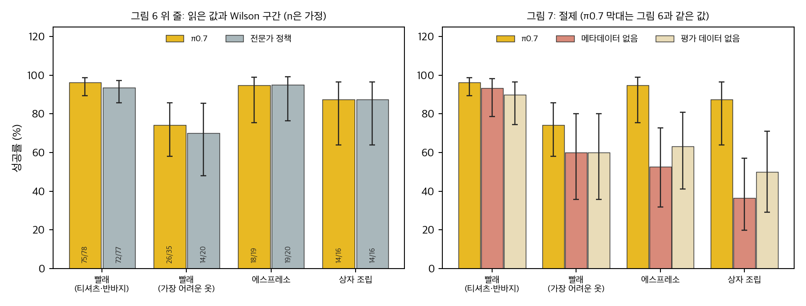
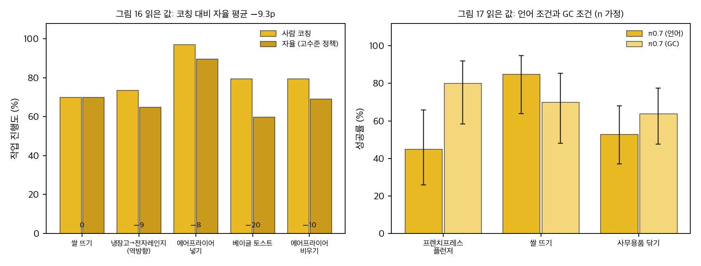
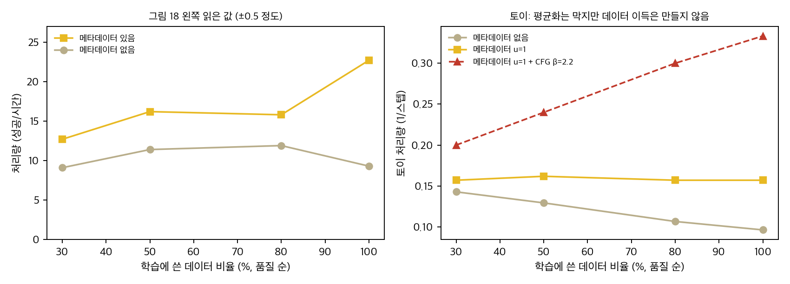

> **논문:** Physical Intelligence. *π0.7: a Steerable Generalist Robotic Foundation Model with Emergent Capabilities.* CoRL 2026 구두 발표(공식 채택 목록에서 제목으로 대조), arXiv:2604.15483 (v2, 2026-04-24).
> 논문 배포 조건은 arXiv non-exclusive distribution입니다(CC 라이선스 아님). 그래서 이 글에는 논문 그림을 넣지 않았습니다. 그래프는 논문 그림에서 읽은 값과 직접 만든 토이로 그렸습니다. 공식 코드는 확인하지 못했습니다.

---

## 논문이 묻는 것

로봇 파운데이션 모델은 실패 에피소드나 자율 롤아웃 같은 품질이 섞인 데이터를 그대로 학습하면 서로 다른 전략을 평균냅니다. 저자들은 이를 프롬프트로 풉니다. 언어 지시에 더해 하위 과제 문장, 에피소드 메타데이터(속도, 품질 1–5, 실수 여부), 제어 모드(관절 또는 말단장치), 근미래 하위 목표 이미지를 넣고, 학습할 때 각 요소를 무작위로 가립니다. 테스트 때는 품질 5, 실수 없음, 과제별 속도 15 백분위를 프롬프트하고, 하위 목표 이미지는 BAGEL(14B)에서 초기화한 세계 모델이 만듭니다.

모델은 Gemma3 4B 백본에 860M 흐름 정합 액션 전문가를 붙인 약 5B 규모이고, 상태는 선형 사영, 이력은 MEM식 인코더가 압축합니다. 새 아키텍처를 제안하는 글이 아니라 "다양한 프롬프트로 이질 데이터를 쓰는 방법론"이라고 스스로 밝힙니다(Sec. II).

## 막대 그림에서 시행 수가 복원됩니다

논문의 결과는 대부분 오차 막대가 있는 막대 그래프이고 시행 수는 적혀 있지 않습니다(사람 연구 30회 제외). PDF의 벡터 막대에서 높이와 오차 막대를 읽고, 막대가 정수 비율이 되면서 오차 막대가 Wilson 95% 구간과 맞는 시행 수를 찾아 보았습니다. 그림 6, 7, 10의 성공률 막대 24개가 모두 양끝 오차 합 0.001 이내로 맞았습니다. 읽은 시행 수는 전문가 비교 칸에서 16–78회, 절제 칸에서 15–30회, 지시 따르기 칸에서 27회와 36회였습니다. 아래 검정은 이 값을 시행 수로 가정한 것이며 저자 확인이 필요합니다.

그래프: 그림 6 위 줄(π0.7 대 RL 전문가)과 그림 7(메타데이터 없음, 평가 데이터 없음 변형)의 성공률 막대를 읽은 값과, 가정한 시행 수의 Wilson 95% 구간. 막대 위 숫자는 가정한 k/n이며 논문 값이 아닙니다.

**전문가에 필적한다는 결과.** 네 과제 모두 π0.7과 전문가의 성공률 차이는 검출되지 않았습니다(Fisher p 0.50, 0.76, 1.0, 1.0, 시행 수 가정). 다만 이 시행 수에서 검출되는 최소 하락이 12–44%p라서, 같은 수준이라는 확인이 아니라 차이를 찾지 못했다는 결과로 읽는 것이 정확합니다. 처리량은 빨래(가장 어려운 옷)와 상자 조립에서 전문가의 1.47배, 1.45배로 읽히고 오차 막대가 겹치지 않았습니다(오차 막대 종류는 논문에 없음).

**메타데이터와 평가 데이터 절제.** 에스프레소와 상자 조립은 성공률도 절제 모델보다 유의하게 높았고(p 0.002–0.042), 빨래 두 과제는 p 0.33–0.62였습니다. 처리량은 네 과제 모두 절제 모델이 π0.7의 0.25–0.75배였습니다. 본문의 "차이는 처리량에서 가장 크다"는 서술은 막대와 맞고, 성공률까지 모든 과제에서 의미 있게 앞선다는 부분은 빨래 두 과제에서는 이 시행 수로 확인되지 않았습니다.

## 언어만 쓴 π0.7과 목표 이미지 조건의 차이

저자들은 생성 하위 목표 이미지를 쓴 변형을 π0.7 (GC)로 따로 표시합니다. 읽은 값으로 두 조건의 차이는 큰 편이었습니다.

- 복합 지시(그림 10): 언어만 쓴 π0.7 13/36(36%), π0.6 8/36, GC 23/36(64%)(시행 수 가정). 언어만 쓴 π0.7과 π0.6의 차이는 p = 0.30, GC와 π0.7의 차이는 p = 0.033입니다.
- 냉장고에서 전자레인지로 가는 방향을 뒤집은 과제(그림 11): 작업 진행도가 π0.5 0, π0.6 5, 언어만 쓴 π0.7 0, GC 74입니다. 본문도 GC가 결정적이라고 적습니다.
- 베이글 토스트 코칭(그림 15): 언어만 쓴 π0.7 47%, π0.6 48%, GC 79%.
- 사람 연구(부록 F): 셔츠 접기 작업 진행도 GC 85.6%, 사람 90.9%, 언어만 쓴 π0.7은 약 68%(그림 12 판독 값).

그래프: 왼쪽은 그림 16의 코칭 대 자율 정책 작업 진행도(읽은 값), 오른쪽은 그림 17의 언어 조건 대 목표 이미지 조건 성공률(읽은 값, 시행 수 가정).

코칭으로 훈련한 자율 정책은 코칭 조건보다 평균 9.3%p 낮고(쌀 뜨기 0, 베이글 19.7%p), 본문은 "거의 같다"고 적습니다. 그림 16의 "코칭" 막대는 그림 15의 GC 막대와 같은 값이어서, 코칭이 어느 조건인지 밝혀 두면 읽기가 쉬워질 것입니다.

## 사람 연구의 시행 수

부록 F는 숙련 조작자 10명이 UR5e에서 셔츠 접기를 3회씩, 총 30회 시도했다고 적고 진행도 90.9%, 성공률 80.6%를 보고합니다. 30회에서 가능한 성공률은 80.0%(24회)나 83.3%(25회)이고, 80.6%는 25/31(80.65%)과 맞습니다. 진행도 90.9%도 6점 만점 × 31회에서 169점일 때 정수로 맞습니다(30회라면 163.6점). 그림 22의 오차 막대도 31회의 Wilson 구간과 가깝습니다. π0.7 (GC)는 성공률 80%와 진행도 85.6%에서 시행 수가 15회(12/15, 77/90)로 읽힙니다. 성공률 비교(25/31 대 12/15)는 Fisher p = 1.0입니다. 서술의 30회와 읽은 값의 31회가 어긋나는 이유는 논문에 없으므로 저자 확인이 필요합니다.

## 같은 모델, 같은 과제인데 값이 다른 그림

그림 17과 그림 18 오른쪽은 같은 π0.7로 같은 과제를 보여 줍니다. 쌀 뜨기가 85%(그림 17)와 약 56%(그림 18, 픽셀 판독, 시행 수 약 27 가정), 관절 물체 돌리기가 39%와 약 48%, 사무용품 닦기가 53%와 약 47%입니다. 쌀 뜨기의 17/20 대 15/27은 Fisher p = 0.056입니다. 평가 세션이나 설정이 다를 가능성이 있지만 본문에 설명은 없습니다.

## 메타데이터는 평균화를 막지만, 격차는 한 구간에서 크게 벌어집니다

그림 18 왼쪽은 데이터를 품질 순 상위 30, 50, 80, 100%로 늘릴 때 처리량을 보여 줍니다. 읽은 값은 메타데이터 있음이 12.7, 16.2, 15.8, 22.7, 없음이 9.1, 11.4, 11.9, 9.3입니다. 격차가 3.6에서 13.4로 벌어지는데, 80%까지는 15.8 대 11.9이고 마지막 구간(80→100%)에서 크게 벌어집니다. 메타데이터 없음은 30% 대비로는 거의 같고(1.02배) 80%에서 100%로 갈 때 떨어집니다. 모델은 버킷마다 한 번씩(8개) 학습한 것으로 서술되어 시드 반복은 없습니다.

직접 만든 토이로 메타데이터의 평균화 방지 효과만 따로 보았습니다. 1차원 상태에서 시연자 이득 k = 0.2 + 0.6u(u는 품질)로 데이터를 품질 상위 30–100%로 자르고, 메타데이터가 없는 MLP와 있는 MLP(15% 가림)를 5 시드로 학습했습니다.

그래프: 왼쪽은 그림 18 왼쪽을 우리가 읽은 값(±0.5), 오른쪽은 토이 결과. 토이는 우리가 정한 1차원 설정이며 논문 값에 맞추지 않았습니다.

메타데이터가 없으면 데이터를 늘릴수록 처리량이 0.143에서 0.096으로 줄었고, 메타데이터에 최고 품질 u = 1을 프롬프트로 주면 0.157 근처로 유지되었습니다. 최소제곱 회귀가 조건이 없으면 평균을 배운다는 사실이며, 논문의 "메타데이터 없음" 곡선이 내려가는 한 가지 설명이 될 수 있다는 정도만 시사합니다. 메타데이터 CFG(논문의 β 1.3–2.2는 유효 안내 세기 w = 1 + β = 2.3–3.2에 해당)를 키우면 처리량이 더 올랐지만 그것은 학습 데이터의 최대 이득을 넘는 외삽입니다. 이 토이에는 데이터를 늘려서 좋아지는 효과(상태 다양성)가 없으므로 그림 18의 "메타데이터 있음" 곡선이 오르는 부분은 다루지 못합니다.

## 논문이 스스로 인정한 한계와 확인하지 못한 것

- 논문은 처음 보는 과제의 성공률을 "60–80% 범위", 본 과제는 "90%를 넘는 경우가 많다"고 요약합니다(Sec. X). 읽은 값은 본 과제 성공률이 74–96%, 처음 보는 과제 성공률이 39–85%(그림 17)이고 진행도는 47–98%여서, 요약은 두 지표와 GC 변형을 합친 범위로 보입니다.
- 어떤 과제가 정말 처음인지 구분하기 어렵다는 점을 저자들도 적습니다(Sec. X). 프로젝트 블로그는 에어프라이어와 가까운 학습 에피소드를 찾았다고 설명합니다.
- 학습 스텝, 데이터 양과 혼합 비율, 평가 시행 수, 드롭아웃 비율(15%, 5%, 30%, 25%)의 근거는 논문에 없습니다.
- 가중치와 코드는 공개되어 있지 않고 공개 계획도 적혀 있지 않습니다. 프로젝트 블로그는 읽었지만 회사 PDF는 받지 못해 arXiv 판과 대조하지 못했습니다. arXiv v1과 v2는 본문과 그림이 같습니다.

## 정리

- 프롬프트 확장과 구성요소별 드롭아웃으로 이질 데이터를 쓰는 설계는 일관되고, 읽은 값으로도 처리량과 일부 성공률에서 효과가 보입니다.
- 막대 그림의 오차 막대가 Wilson 구간과 맞아 시행 수를 복원할 수 있었고, 그 값으로 보면 "전문가에 필적"은 차이를 검출하지 못했다는 뜻이며, 메타데이터 절제는 처리량에서 일관되고 성공률은 과제마다 다릅니다.
- 언어만 쓴 π0.7과 목표 이미지 조건의 차이가 크므로, 인용할 때는 어느 변형의 수치인지 구분하는 것이 좋습니다.
- 사람 연구의 시행 수(30회 서술 대 31회 읽은 값)와 그림 사이의 값 차이(그림 16 대 15, 그림 17 대 18)는 저자 확인이 필요합니다.

자세한 재계산과 주장별 판정은 함께 올린 분석 노트(01–04)와 통합 리포트에 있습니다.

## 자료

- [통합 리포트 PDF](report/report_public.pdf)
- [01. 논문 분석: π0.7 (arXiv:2604.15483)](analysis/01_paper_analysis.md)
- [02. 선행연구와 관련 자료](analysis/02_prior_work.md)
- [03. 보고 수치 재계산과 토이](analysis/03_analysis.md)
- [04. 주장 검증과 구현 가능성](analysis/04_claim_verification.md)
