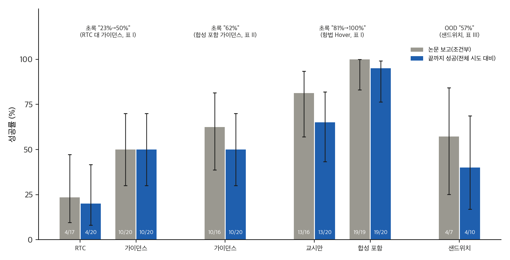
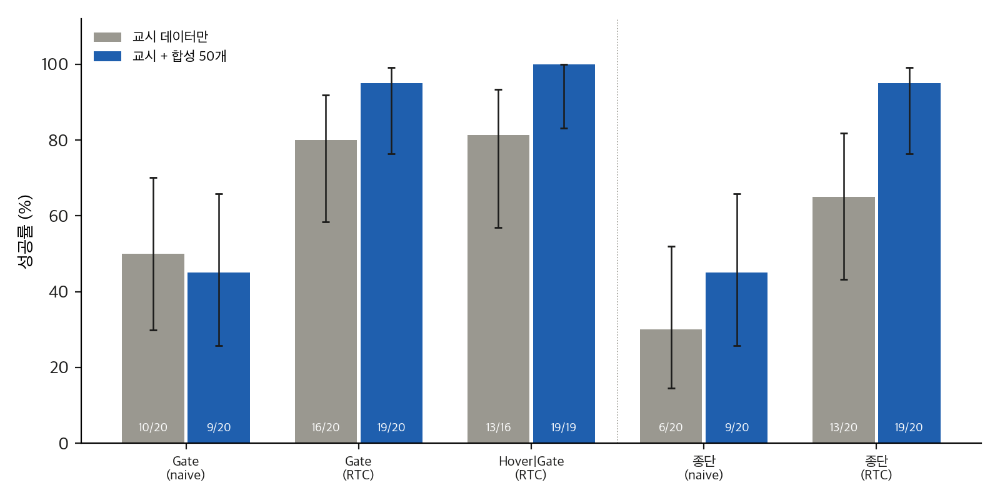
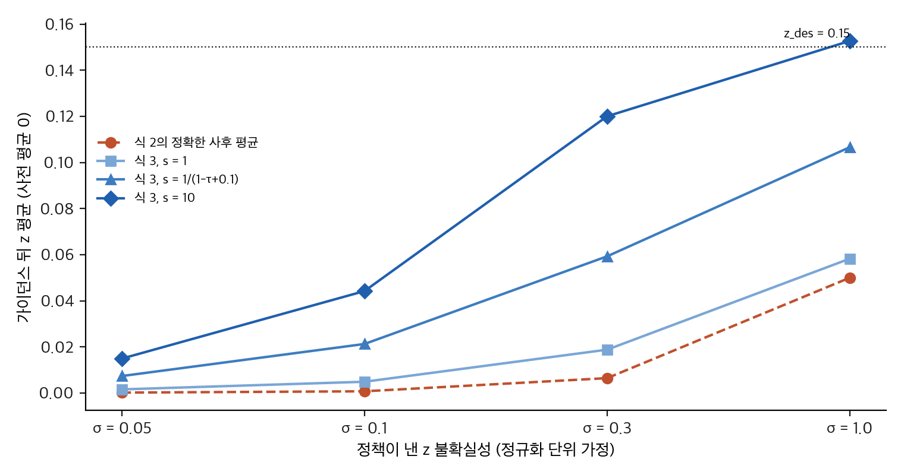

> **논문:** Johnathan Tucker, Denis Liu, Aiden Swann, Allen Ren, Javier Yu, Jiankai Sun, Brandon Kim, Lachlain McGranahan, Quan Vuong, Mac Schwager. *π, But Make It Fly: Physics-Guided Transfer of VLA Models to Aerial Manipulation.* CoRL 2026 포스터, arXiv:2603.25038 (v1, 2026-03-26).
> 공식 코드는 아직 없습니다(프로젝트 페이지에 "Coming Soon"). 이 글의 그림은 모두 우리가 그린 그래프입니다. 논문 그림은 실기체와 실험실 사진이 들어 있어 쓰지 않았습니다.

## 논문이 묻는 것

조작 데이터로 사전학습한 VLA(π0)를 쿼드로터에 그리퍼를 단 비행 조작기에 옮길 수 있는가가 질문입니다. 비행체는 저작동이라 작은 행동 오차가 큰 자세 오차가 되고, 물체를 집으면 질량이 갑자기 늘어 고도가 처집니다. 저자들은 π0를 교시 270개로 미세조정하고 두 가지를 더합니다.

- **페이로드 인식 가이던스.** 실시간 청킹(RTC)이 쓰는 속도장 보정을 일반화해, 고도 차원에만 "물체를 쥐고 있으면 조금 높게" 손실을 걸고 샘플링 중에 기울기를 얹습니다. 쥐었는지는 그리퍼 닫기 명령과 조리개로 만든 휴리스틱 가중치로 판단합니다.
- **3D 가우시안 스플랫 합성 데이터.** 실험실을 스플랫으로 복원하고, 그리퍼가 보이는 하방 영상에는 마스크로 딴 그리퍼를 얹어, 게이트 통과의 교정 궤적 50개를 만듭니다.

실기체 평가는 방법별 과제당 20회, 합계 460회입니다. 이 글은 그 표를 정수 시도 수로 복원해 다시 계산한 결과입니다.

## 확인한 것

**1. 초록의 숫자는 조건부 비율입니다.** 표의 Place는 Pick에 성공한 시도 중의 비율입니다. 초록의 "23%에서 50%"는 4/17 대 10/20이고, 20회 전체 대비 끝까지 성공한 비율은 4/20 대 10/20입니다. "62% 전체 성공"은 10/16이고 끝까지 간 시도는 10/20 = 50%입니다. "100% 대 81%"는 게이트 통과 뒤의 Hover(19/19 대 13/16)이며 종단은 19/20 대 13/20입니다.

*그래프 (우리가 그림). 막대 위 선은 Wilson 95% 구간입니다. 막대 안은 성공 수/분모입니다.*

**2. 가이던스의 효과는 방향은 일관되지만 개별 표로는 확정되지 않습니다.** 종단 Place 4/20 대 10/20은 Fisher p = 0.096입니다. 같은 비교가 세 설정(표 I, 표 II 교시만, 표 II 합성 포함)에 있고 모두 가이던스가 위입니다. 합치면 9/60 대 25/60으로 p = 0.002이지만 조건이 다른 시도를 풀링한 값입니다.

**3. 합성 데이터의 효과는 방향은 맞고 크기는 불확실합니다.** RTC 기준 게이트 통과는 16/20 대 19/20(p = 0.34), 종단은 13/20 대 19/20(p = 0.044)입니다. naive 정책에서는 효과가 없습니다. 비교 대상이 교시 150개 대 교시 150개와 합성 50개라서 데이터 양이 33% 늘어난 효과가 섞여 있습니다.

*그래프 (우리가 그림). 표 I에서 복원한 정수 시도 수와 Wilson 95% 구간입니다.*

**4. 같은 절차의 칸에서도 큰 차이가 납니다.** 가이던스는 그리퍼가 열려 있는 동안 RTC와 같아야 하는데, 표 II의 게이트 통과는 두 설정에서 모두 가이던스가 10 pp 낮습니다(14/20 대 16/20, 17/20 대 19/20). 항법 전용인 합성 데이터가 Place 종단을 5/20에서 10/20으로 바꿉니다. 20회 설계에서 15–30 pp 차이는 잡음 범위에 들 수 있습니다. 20%와 50%를 80% 검정력으로 가르려면 방법당 약 39회가 필요합니다.

**5. 표 II 한 칸은 정수로 만들 수 없습니다.** 교시만 π0 naive의 Pick 42.9%는 앞 단계 성공 6회가 분모여야 하는데 6 이하 어떤 분모로도 만들 수 없습니다(3/7 또는 6/14). 460회는 OOD 45회를 뺀 합계로 맞습니다.

**6. OOD 결론은 가장 좋은 칸의 조건부 값입니다.** 샌드위치 57%는 4/7이고 종단은 4/10입니다. 객체 전체는 5/30입니다. 항법 40%는 가장 좋은 영역(2/5)이고 전체는 2/15입니다.

## 가이던스를 토이로 다시 보기

식 2는 정책 분포에 exp(−Φ)를 곱한 사후 분포를 목표로 하지만, 구현은 식 3의 속도장 보정 v − s(τ)ξ입니다. 1차원 가우시안 정책에서 흐름 매칭 속도장이 해석적으로 알려져 있어, 부록의 값(λ_z = 0.5, 목표 오프셋 0.15, 오일러 10스텝)으로 시뮬레이션했습니다. 식 2를 정확히 따르면 정책의 z 표준편차가 0.1일 때 평균은 0.0008만 움직입니다. 논문이 보고한 큰 효과가 나오려면 보고되지 않은 세기 s(τ)가 크거나 정책 불확실성이 매우 커야 합니다.

*그래프 (우리가 그림). 1차원 가우시안 정책의 토이입니다. 실제 π0와는 무관하고 s와 σ에 대한 민감도만 보여 줍니다.*

가중치 α도 확인했습니다. 닫기 명령과 조리개를 곱하는 휴리스틱이라 "물체를 쥐었다"가 아니라 "그리퍼가 닫혔다"를 잽니다. 조리개를 열림 정도로 두는 가정에서 빈 손으로 완전히 닫으면 α = 1이 되고, 물체를 쥐어 조리개가 물체 폭만큼 열려 있으면 오히려 0.6입니다. 조리개를 점수로 바꾸는 사상이 논문에 없어 α의 실제 값은 재현할 수 없습니다.

## 검증하지 못한 것

- 가이던스가 고도 처짐을 줄인다는 직접 증거(고도 궤적)가 없습니다. 성공률만 보고합니다.
- naive 기준선은 5초 열린 고리, RTC는 2.5초 청크의 비동기 재계획이라 RTC 알고리즘 효과와 재계획 빈도 효과가 분리되지 않습니다.
- 본문은 가이던스 시간 가중이 RTC 소프트 마스크를 따른다고 하지만 부록은 뒤쪽 시간에 집중하는 반대 방향 가중을 씁니다. 행동이 상대 변위인데 목표 고도는 절대 고도에서 시작하는 단위 문제도 있습니다.
- 추론이 어디서 돌고 지연이 얼마인지, 학습이 과제별 모델인지는 쓰여 있지 않습니다. 모션 캡처에 의존합니다.
- 코드와 데이터가 공개되지 않아 시도별 기록과 하이퍼파라미터는 확인할 수 없습니다.

## 구현할 수 있는가

논문 결과의 재현은 실기체, 모션 캡처, 비공개 데이터, 3B급 미세조정이 필요해 불가능합니다. 반면 가이던스 샘플러 자체는 소형 정책으로 CPU에서 구현하고 민감도를 볼 수 있습니다. 소형 구현은 1–2일(추정), 3D 가우시안 스플랫 복원과 π0 미세조정은 CUDA가 필요합니다.

## 자료

분석 문서, 재계산 스크립트, 토이 스크립트는 같은 폴더의 git 자료에 있습니다. 논문은 arXiv에 CC BY 4.0으로 공개되어 있고(abs 페이지 license 링크 확인), 표 값은 인용과 재계산을 위해 옮겼습니다.

## 자료

- [통합 리포트 PDF](report/report_public.pdf)
- [01. 논문 분석: π, But Make It Fly (AirVLA)](analysis/01_paper_analysis.md)
- [02. 선행연구와 관련 자료](analysis/02_prior_work.md)
- [03. 수치 재계산과 토이 검증](analysis/03_analysis.md)
- [04. 주장 검증과 구현 가능성](analysis/04_claim_verification.md)
