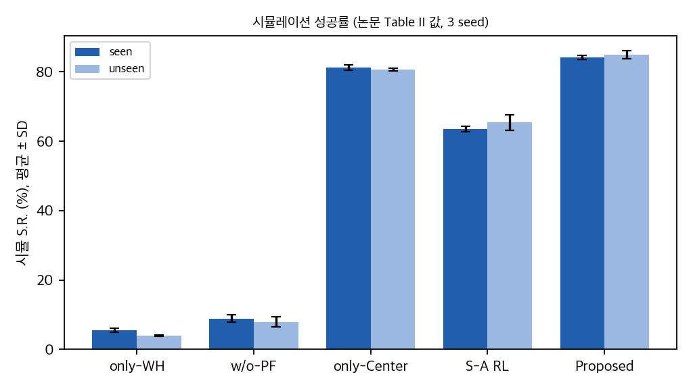
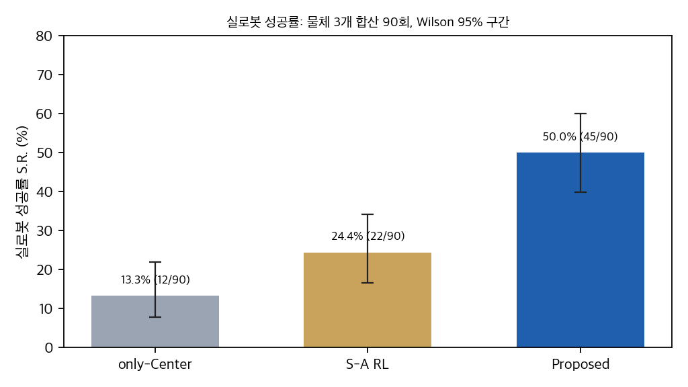
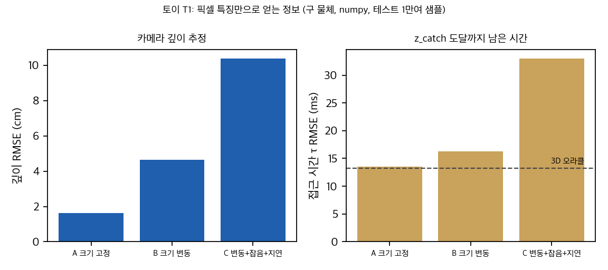

> **논문:** Seongyong Kim, Junhyeon Cho, Kang-Won Lee, Soo-Chul Lim. *Pixel2Catch: Multi-Agent Sim-to-Real Transfer for Agile Manipulation with a Single RGB Camera.* IEEE RA-L 2026 (arXiv:2602.22733, v1 2026-02-26).
> 공식 코드는 GitHub seongdrgn/pixel2catch-github에 있습니다. 라이선스 파일이 없습니다. 이 글의 그래프는 우리가 그렸습니다. 논문 그림은 라이선스(CC BY-NC-ND 4.0) 때문에 싣지 않았습니다.
> 이 글은 arXiv v1을 기준으로 합니다. 프로젝트 페이지의 실로봇 수치는 v1과 다릅니다.

## 논문이 묻는 것

공을 잡으려면 공의 3D 위치를 알아야 한다고 생각하기 쉽습니다. RGB-D 카메라나 모션캡처로 위치를 재고 제어하는 방식이 대부분입니다. 저자들은 사람이 던진 물체를 볼 때 정확한 거리보다 **화면 속 위치와 크기가 어떻게 변하는지**를 본다는 점에서 출발합니다. 그래서 단일 RGB 이미지에서 물체의 바운딩 박스 중심, 너비, 높이와 그 시간 차분만 정책에 넣습니다.

두 번째 축은 손입니다. 팔과 손을 한 정책으로 배우면 관절 수가 많아 학습이 불안정합니다. 저자들은 팔과 손을 역할이 다른 두 에이전트로 나누고, 각자 관측과 보상을 따로 두는 MAPPO 구조를 씁니다. 학습은 시뮬레이션에서만 하고, 시스템 식별과 도메인 랜덤화로 실로봇에 옮깁니다.

## 이 글에서 확인한 것

**1. 시뮬 결과는 방향이 맞고 대부분 유의합니다.** 세 seed의 평균과 SD로 보면, 픽셀 특징을 쓴 정책은 S-A RL보다 성공률이 약 20 pp 높습니다. 차이의 p는 0.01보다 작습니다. 중심 정보만 쓴 정책과의 차이는 성공률에서 3–4 pp로 작고, 추적률에서는 유의하지 않습니다(p = 0.09–0.17).

*그래프: 논문 Table II의 시뮬 성공률 (평균 ± SD, 3 seed). 우리가 그렸고 값은 논문에서 가져왔습니다.*

**2. 보고된 ± 값 절반이 평가 잡음보다 작습니다.** seed마다 1000회를 평가했다면 성공률 하나에도 약 1.1 pp의 이항 표준오차가 있습니다. 그런데 보고된 SD 20개 중 10개가 이보다 작습니다. 저자들이 ±를 무엇으로 계산했는지 확인해야 합니다.

**3. 실로봇 결과는 방향만 맞습니다.** 세 물체(Cube, L-block, Triangle)에서 물체당 30회씩, 합계 90회입니다. 성공률은 제안 방법 50%, S-A RL 24%, 중심 정보만 쓴 정책 13%입니다. 합계로 보면 차이는 통계적으로 확실합니다(Fisher p < 0.001). 그러나 물체별로는 Cube만 유의합니다. 반복 실험이 없고, 던지는 조건과 실패 사례 분석도 없습니다.

*그래프: 논문 Table III의 실로봇 성공률을 세 물체 합계로 보고 Wilson 95% 구간을 표시했습니다. 우리가 그렸습니다.*

**4. 논문 본문과 공식 코드의 정의가 다릅니다.** 추적률은 손바닥이 물체에 **닿은** 비율이라고 적혀 있는데, 코드는 8 cm 안에 한 번이라도 들어오면 성공으로 셉니다. 성공은 "떨어뜨리지 않음"인데 코드는 8 cm 안에서 20 스텝(0.67 s) 머무르는 것으로 정합니다. 던지기 분포도 논문은 무작위 방향과 속도라고 쓰지만, 코드는 목표 지점을 지나도록 속도를 계산합니다. 픽셀 특징에는 0–2 스텝의 무작위 지연이 있는데 논문에는 없습니다.

**5. 크기 정보는 접근 시각에는 쓸 만하지만 거리에는 쓰기 어렵습니다.** 물체 크기를 바꾼 토이에서 접근 시각 오차는 13.5 ms에서 16.3 ms로 거의 그대로였습니다. 상대 변화는 물체 크기와 무관하기 때문입니다. 반면 카메라에서 본 깊이 오차는 1.6 cm에서 4.6 cm로 커졌습니다. 지연과 잡음을 더하면 10 cm 수준입니다. 이 토이는 정책을 학습시키지 않았고 같은 분포 안에서만 시험했습니다.

*그래프: 토이 결과 (구 물체, 탄도 궤적, 핀홀 카메라, numpy). 우리가 그렸습니다.*

## 공식 코드로 재현할 수 있나

공식 저장소는 Isaac Lab 학습 환경과 설정, MAPPO 설정, 시뮬 자산만 공개합니다. 학습은 NVIDIA GPU와 Isaac Sim을 전제합니다. 체크포인트, 평가 스크립트, 기준선 구현, 실로봇 파이프라인은 없습니다. 그래서 M4 Pro 맥에서는 논문 실험을 재현할 수 없습니다.

할 수 있는 것은 두 가지입니다. 첫째, 팔 한 개와 구 물체로 줄인 축소 환경에서 MAPPO를 구현하는 것입니다. 저장소에 MuJoCo 모델이 없어서 UR5e와 Allegro의 모델을 준비하는 일이 먼저 필요합니다. 추정 노력은 1–2주이고, 측정하지 않았습니다. 둘째, 픽셀 특징의 정보량을 토이로 검사하는 것입니다. 이 글의 토이가 그 예입니다.

## 한계

- 실로봇 결과 한 번(물체당 30회)과 반복 없음
- 시뮬과 실로봇의 던지기 분포 차이, 물체 형상 차이
- 시뮬에서는 색 기반 분할, 실로봇에서는 SAM2 분할
- 이질 MARL의 효과를 분리하는 실험 없음 (S-A RL과 비교할 때 학습 알고리즘과 관측이 함께 바뀜)
- SAM2 추론 지연과 30 Hz 제어 루프의 여유를 보고하지 않음

## 출처와 라이선스

- 논문: arXiv:2602.22733, CC BY-NC-ND 4.0 (arXiv 초록 페이지 확인, 2026-11-17). 논문 그림은 싣지 않았습니다.
- 공식 코드: GitHub seongdrgn/pixel2catch-github, 라이선스 파일 없음. 코드는 싣지 않았고 실행, 설치하지 않았습니다.
- 그래프와 토이 스크립트, 재계산은 이 글의 작성자가 만들었습니다.
- 자세한 분석과 재계산 스크립트는 게시 패키지의 `git/` 폴더에 있습니다.

## 자료

- [통합 리포트 PDF](report/report_public.pdf)
- [Pixel2Catch: Multi-Agent Sim-to-Real Transfer for Agile Manipulation with a Single RGB Camera 분석](analysis/01_paper_analysis.md)
- [Pixel2Catch 선행연구와 공식 저장소](analysis/02_prior_work.md)
- [Pixel2Catch 수치 재계산, 일관성 검사, 토이 검증과 주장 판정](analysis/03_analysis.md)
- [Pixel2Catch 공식 코드 대조 (정적 읽기)와 구현 가능성](analysis/04_code_verification.md)
