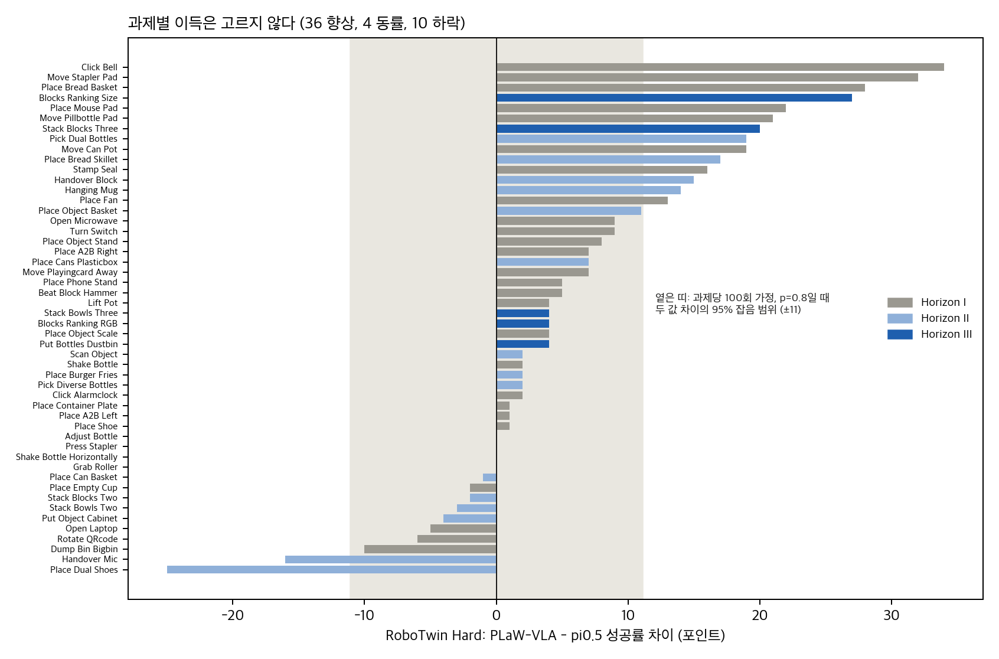
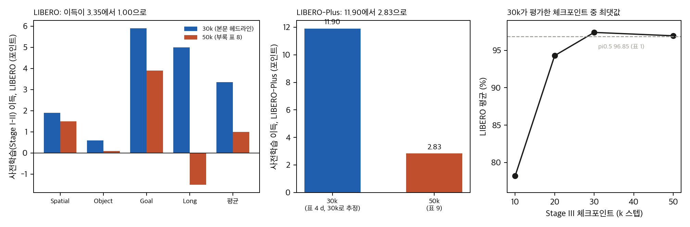
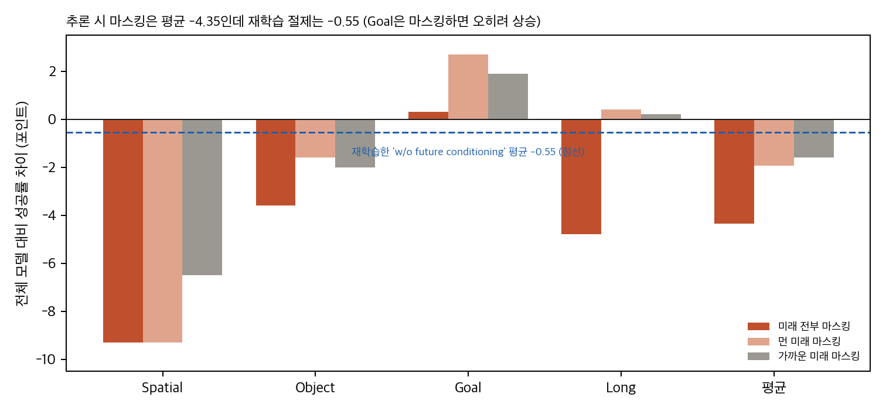
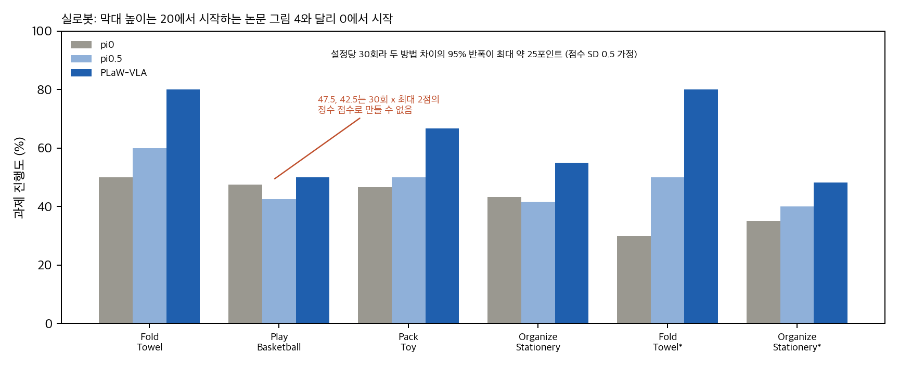

> **논문:** Yu Liu, Hetian Guo 외 12인. *PLaW-VLA: Predictive Latent World Modeling for Vision-Language-Action Policies.* CoRL 2026 포스터, arXiv:2610.12285 (v1, 2026-10-08).
> 공식 코드는 GitHub RainyRobo/PLaW-VLA(Apache-2.0)에 있고 사전학습 체크포인트는 아직 없습니다. 이 글의 그림은 모두 우리가 그린 그래프입니다. 논문의 arXiv 라이선스가 CC BY가 아니라서 논문 그림은 싣지 않았습니다.

## 논문이 묻는 것

VLA에 미래 예측을 넣을 때 두 가지를 정해야 합니다. **무엇을 예측할지**와 **예측을 행동에 어떻게 연결할지**입니다. 영상을 생성하는 방식은 외형까지 맞춰야 하니 비싸고, 외형 오차가 행동으로 새어 들어갈 수 있습니다.

PLaW-VLA는 π0.5의 VLM과 행동 전문가 옆에 **월드 모델 전문가**를 하나 더 둡니다. 고정된 V-JEPA 2 인코더가 만든 과거 프레임 잠재를 읽고, 학습 가능한 질의 토큰으로 미래 잠재를 **한 번에** 예측합니다. 행동 전문가는 이 예측을 블록 인과 어텐션으로 직접 읽습니다. 학습은 세 단계(행동 없는 영상 → 로봇 궤적 공동 학습 → 과제 적응)이고, 학습 중 월드 모델 가지를 30% 확률로 통째로 끕니다. 보고 성과는 RoboTwin 2.0 Hard Horizon III +11.8 pp(π0.5 대비), LIBERO-Plus 제로샷 72.7%, 그리고 Motus 대비 약 1/19 지연입니다.

## 이 글에서 확인한 것

**1. RoboTwin 평균 이득은 견고하지만 가장 큰 이득은 두 과제가 만듭니다.** 부록 표 7의 50과제로 다시 계산하면 Hard 평균 이득은 +6.48 pp(95% 구간 +3.2~+9.8, 쌍체 p = 2e-4)이고, "36과제 향상, 4 동률, 10 하락"도 정확히 맞습니다. 그런데 Horizon III의 +11.8은 5과제의 평균입니다. Blocks Ranking Size(+27)와 Stack Blocks Three(+20)가 59점 중 47점을 만들고, 나머지 세 과제는 과제당 100회로 가정할 때 구별되지 않습니다(p ≥ 0.5). 일부 과제는 크게 후퇴합니다(Place Dual Shoes −25, Handover Mic −16).

*그래프 (우리가 그림). 부록 표 7에서 Hard 과제별 (PLaW-VLA − π0.5) 성공률 차이입니다. 옅은 띠는 과제당 100회로 가정한 95% 잡음 범위입니다(표 값이 모두 정수 %라서 100회로 가정).*

**2. LIBERO 97.4는 평가한 체크포인트 중 최댓값입니다.** 본문 값은 30k 스텝 체크포인트(97.40)입니다. 부록 표 8의 50k는 96.95이고, π0.5(96.85) 대비 이득은 +0.55에서 +0.10으로 줄어듭니다. LIBERO-Long은 30k에서 94.6이지만 50k에서는 91.7로 π0.5(92.4)보다 낮아집니다. 본문의 "Long에서 가장 뚜렷한 개선"은 30k에서만 성립합니다.

**3. 사전학습 이득은 체크포인트에 크게 의존합니다.** Stage I–II를 뺀 모델과의 격차가 LIBERO에서 30k +3.35 → 50k +1.00, LIBERO-Plus에서 30k +11.90 → 50k +2.83입니다(표 4d, 8, 9). 같은 Stage II 데이터에서 월드 모델만 뺀 비교는 LIBERO −0.23(p = 0.51, 검출 한계 아래), LIBERO-Plus −3.56입니다. 초록과 표 4가 보여 주는 큰 이득에는 **수렴 속도의 차이**가 많이 섞여 있습니다.

*그래프 (우리가 그림). 표 8, 9, 그림 6의 수치로 그렸습니다. LIBERO-Plus의 30k 값은 표 4(d)를 30k로 보고 계산했습니다(추정).*

**4. 추론 시 마스킹은 의존도이지 효용이 아닙니다.** 표 4(e)는 학습한 모델에서 예측된 미래를 추론 때 가리면 LIBERO가 97.40에서 93.05로 떨어진다고 보입니다(−4.35). 그런데 같은 입력을 빼고 다시 학습한 "미래 조건화 제거"는 96.85(−0.55)입니다. 학습 중 가린 것은 가지 전체뿐이라, 한쪽만 가리는 입력은 학습 분포 밖입니다. Goal은 먼 미래를 가리면 97.1에서 99.8로 오릅니다. "먼 미래가 더 중요하다"는 서술의 근거인 95.45 대 95.80은 p = 0.35로 구별되지 않습니다.

*그래프 (우리가 그림). 표 10과 표 4의 값입니다. 점선은 재학습한 절제의 평균(−0.55)입니다.*

**5. 실로봇은 설정당 30회라 방향만 보입니다.** 두 방법의 차이에 대한 95% 반폭이 최악 약 25 pp입니다. Fold Towel은 π0.5 대비 +20(p = 0.16), Play Basketball은 +7.5(p = 0.58)입니다. Play Basketball의 47.5%와 42.5%는 30회 × 최대 2점의 정수 점수로는 만들 수 없는 값입니다(40회였다면 가능). 논문 그림 4는 세로축이 20에서 시작합니다.

*그래프 (우리가 그림). 그림 4와 프로젝트 페이지의 막대 값을 0에서 시작하는 축으로 다시 그렸습니다.*

**6. 가중 평균과 산술은 일관됩니다.** 표 3과 표 7의 평균 32개, 표 4의 변화량 20개, 표 8–10의 평균이 모두 맞습니다. LIBERO-Plus의 "공식 과제 수 가중" 평균은 9개 행에서 가중치를 역산하면 잔차 0.02 pp 이하로 정합입니다. 비가중 평균으로 읽으면 0.6~2.9 pp 높게 나옵니다.

## 공식 코드와 논문의 차이

코드는 논문 구조와 하이퍼파라미터(3단계 배치·스텝·학습률, 분기 드롭아웃 0.3, 정지 기울기 MSE, Beta(1.5, 1) 시간 분포, 블록 인과 어텐션)와 일치합니다. 다만 재현에 필요한 값이 논문에 없습니다.

- 행동 청크 10, 재계획 5, 예측 손실 가중 0.1(코드에 고정), V-JEPA 2 ViT-L 기본값, 로봇 상태를 입력하지 않는 설정.
- **미래 단위 수:** 논문은 K = 2(가까운, 먼 미래), 코드는 미래 3 튜블릿(768 슬롯 토큰).
- **역전파 경로:** 코드에서는 행동 손실이 예측값을 거쳐 월드 모델로 흐르고, 월드 모델 전문가가 한 제어 스텝에 두 번 통과합니다. 논문에는 없습니다.
- **파라미터 +0.9B:** 기본 설정(ViT-L)으로 세면 약 0.62B이고 ViT-H로 세면 0.95B입니다.
- **없는 것:** 사전학습 체크포인트, 표 4 절제(Cosmos VAE, 예측 손실 제거, 마스킹) 코드, 지연 측정 스크립트.

## 구현 가능성 (Apple M4 Pro, CUDA 없음)

- **공식 코드 실행과 학습: 불가.** README가 CUDA를 전제하고 V-JEPA 어댑터가 CUDA가 아니면 오류를 냅니다. 체크포인트도 없습니다.
- **재계산과 정적 대조: 가능, 완료.** 이 글의 모든 수치가 그 결과입니다.
- **소형 구조 재구현(예측 지향 대 재구성 지향 목표 비교): 가능.** 노력은 2–3주(근거 없는 추정)로 봅니다.

이 글은 재현 실험을 하지 않았습니다.

## 한계

- 학습 시드가 하나입니다. 모든 p는 평가 잡음만 반영합니다. 같은 모델의 체크포인트만 바꿔도 LIBERO 평균이 0.45 pp 움직입니다.
- RoboTwin 과제당 평가 횟수와 LIBERO-Plus의 전체 에피소드 수는 논문에 없어 가정을 썼습니다(가정은 `analysis/03_analysis.md` 머리에 적었습니다).
- RoboTwin 표 3은 같은 프로토콜을 쓴 더 강한 기준선(LingBot-VA의 자기 보고 92.9 / 91.6)을 싣지 않았습니다. 이 글에서 그 논문을 다시 대조하지는 않았습니다.

## 출처와 라이선스

- 논문: arXiv:2610.12285, arXiv 비독점 배포 라이선스(CC BY 아님). PDF에서 저작권 표시는 찾지 못했습니다. 논문 그림은 싣지 않았고, 그래프는 모두 우리가 다시 그렸습니다.
- 표 값은 인용과 재계산을 위해 옮겼습니다. 그래프, 분석 문서, 스크립트는 이 저장소 작성자가 만들었습니다.
- 공식 코드는 정적으로만 읽었습니다(커밋 5fb8f32, 2026-10-13). 실행·설치하지 않았고 가중치와 데이터는 받지 않았습니다.

## 자료

- [통합 리포트 PDF](report/report_public.pdf)
- [01. 논문 분석: PLaW-VLA (arXiv:2610.12285)](analysis/01_paper_analysis.md)
- [02. 선행연구, 구성 요소 출처, 관련 저장소](analysis/02_prior_work.md)
- [03. 수치 재계산, 일관성 검사, 주장 판정](analysis/03_analysis.md)
- [04. 공식 코드와 논문 대조, 구현 가능성](analysis/04_code_verification.md)
