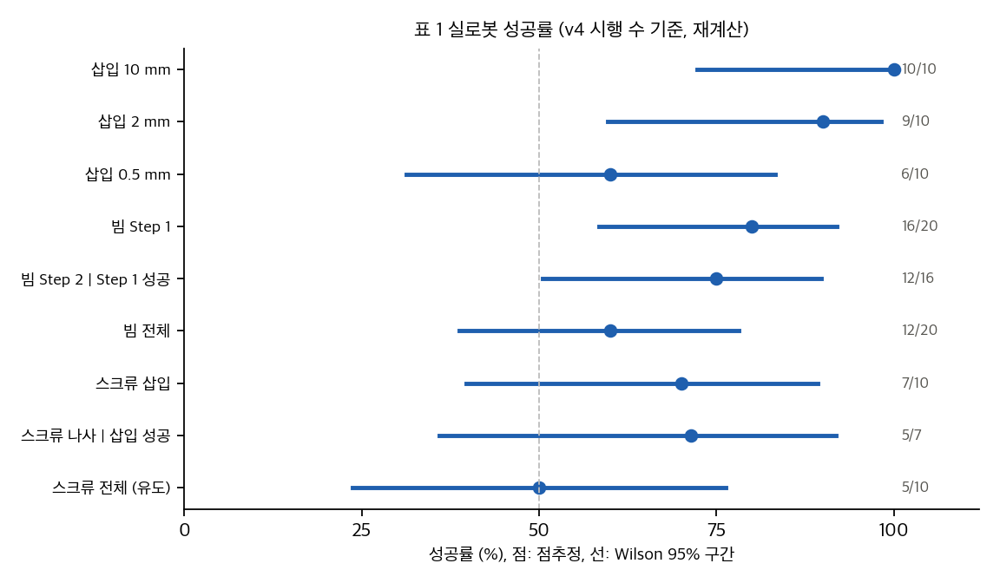
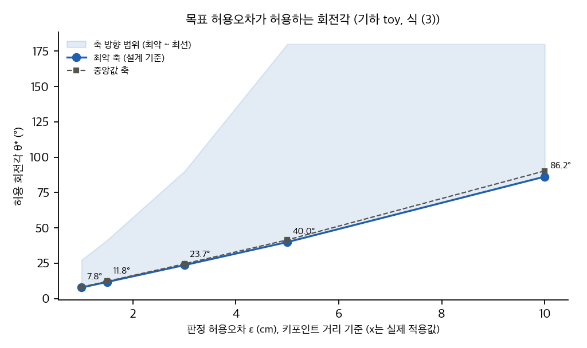

# Play2Perfect: 손 놀이 사전학습이 정밀 조립에 전이되는 조건

Play2Perfect(Lum, Kedia, Liu, Bohg; Stanford·Cornell, CoRL 2026)는 다지 손으로 정밀 조립을 하려는 연구입니다. 조립은 접촉이 많고 보상이 희소해서 처음부터 강화학습으로 배우기 어렵습니다. 이 논문은 먼저 자유 공간에서 여러 물체를 6D 목표 자세로 옮기는 "놀이" 정책을 사전학습하고, CAD에서 만든 희소 목표로 조립을 미세조정합니다.

이 글은 논문 v4(2026-10-15)를 분석한 결과입니다. 논문 그림은 arXiv 비독점 라이선스라서 싣지 않았고, 아래 그래프는 직접 그렸습니다.

## 무엇을 주장하나

- 사전학습 정책은 같은 성공률에 도달하는 시간이 **33배 짧습니다**(시뮬, 고정구 삽입 과제, §4.1).
- 사전학습 없이 희소 보상으로 학습하면 24시간 동안 성공 롤아웃이 없습니다.
- 실로봇(KUKA iiwa 14 + Sharpa 22자유도 손)에서 0.5 mm 틈 삽입, 두 단계 빔 조립, 스크류를 **실물 추가 학습 없이** 시뮬 정책으로 풉니다.

## 다시 계산해 보니

**33배는 벽시계 시간 기준입니다.** 논문은 scratch가 "100시간 이상"이고 Play2Perfect는 4시간이라고 쓰는데, 이 비율은 25배 이상입니다. 33배는 scratch 132시간일 때만 나옵니다. 사전학습 7일(168 GPU 시간)은 계산에서 빠져 있습니다. 과제가 두 개 이상이면 사전학습 비용을 나눠도 이득이지만, 한 과제만 보면 불리합니다.

**실로봇 성공률은 시행 수가 적습니다.** 0.5 mm 삽입은 6/10이고, 95% 신뢰구간은 31–83%입니다. 빔 두 단계는 12/20(60%)입니다.

그림 1. 표 1의 실로봇 셀별 성공률과 Wilson 95% 구간(v4 시행 수 기준). 직접 그린 그래프입니다.

**스크류 "50% 초과"는 맞지 않습니다.** 초록의 "over 50%"는 스크류 과제에서 점추정이 정확히 5/10 = 50%입니다.

**판본마다 평가 방식이 바뀌었습니다.** v1–v3에서 빔 Step 2는 Step 1과 독립적으로 리셋해서 평가했습니다(7/10). v4에서는 Step 1 이후 이어서 실행했고 12/16입니다. 최신 판본 수치를 인용해야 합니다.

## 허용오차가 실제로 무엇을 요구하나

논문의 목표 판정은 키포인트 최대 거리 d < ε입니다. ε = 1 cm일 때 짧은 축 회전은 약 8°까지만 허용합니다. 긴 축 회전은 27° 이상도 허용합니다. 즉 "정밀 목표"는 주로 손가락으로 뒤집는 방향의 정밀도를 요구합니다. 이 결과는 논문의 "in-hand 6D 제어가 전이의 핵심"이라는 주장과 맞습니다.

그림 2. 판정 허용오차 ε와 허용 회전각의 관계(키포인트 거리 기준, 기하 toy). 최악 축과 중앙값 축을 함께 그렸습니다.

## 공식 코드와 논문이 다른 곳

공식 저장소(MIT)는 대부분의 구조와 보상 상수를 논문과 맞춥니다. 그러나 다음 항목이 다릅니다.

- 성공 판정은 **ε × 1.5**(키포인트)이고, 사전학습 초반은 2 cm에서 시작하는 커리큘럼입니다. 논문의 "ε = 1 cm"와 다릅니다.
- 스크류 과제는 허용오차 5 mm를 씁니다. 논문 부록은 "모든 과제 1 cm"라고 씁니다.
- 물체 치수 잡음(90–110%)이 저장소 설정에서는 꺼져 있습니다.
- 사전학습 환경 수는 논문 24,576, 저장소 기본값 8,192입니다.

## 이 맥에서 재현할 수 있나

**공식 재현은 불가능합니다.** Isaac Sim은 NVIDIA RTX GPU가 필요합니다. 사전학습은 7일입니다. 실로봇과 FoundationPose 추적 코드도 저장소에 없습니다. 방법의 축소판(평행 턱 그리퍼나 소형 손 모델, 6D 목표, 허용오차 비교)은 CPU와 MPS로 조건부 가능합니다.

## 정리

Play2Perfect의 핵심 아이디어, 즉 놀이로 얻은 손 제어를 희소 보상 조립에 옮긴다는 생각은 설득력이 있습니다. 다만 수치를 옮길 때는 세 가지를 확인해야 합니다. 시간 기준(벽시계 대 샘플, 사전학습 포함 여부), 시행 수, 판정 허용오차입니다. 분석 전체는 `git/` 폴더의 01–04 문서에 있습니다.

## 출처

- 논문: Lum, Kedia, Liu, Bohg. *Play2Perfect: What Matters in Dexterous Play Pretraining for Precise Assembly?* arXiv:2606.26428 (v4). CoRL 2026.
- 공식 코드: https://github.com/kushal2000/play2perfect (MIT, 커밋 f67ef45, 2026-11-10 기준 정적 읽기).
- 라이선스: arXiv 비독점 배포(nonexclusive-distrib/1.0). 논문 그림은 싣지 않았습니다.
- 그림 두 장과 모든 수치 재계산은 이 글의 작성자가 `analysis/recompute.py`와 `analysis/toy_goal_tolerance.py`로 만들었습니다.

## 자료

- [통합 리포트 PDF](report/report_public.pdf)
- [Play2Perfect: What Matters in Dexterous Play Pretraining for Precise Assembly? (arXiv:2606.26428) 분석](analysis/01_paper_analysis.md)
- [Play2Perfect 선행연구와 이 저장소의 다른 논문과의 관계](analysis/02_prior_work.md)
- [Play2Perfect 수치 재계산·일관성 점검·toy 검증 (arXiv:2606.26428 v4)](analysis/03_analysis.md)
- [Play2Perfect 논문 ↔ 공식 코드 대조 (정적 읽기)](analysis/04_code_verification.md)
