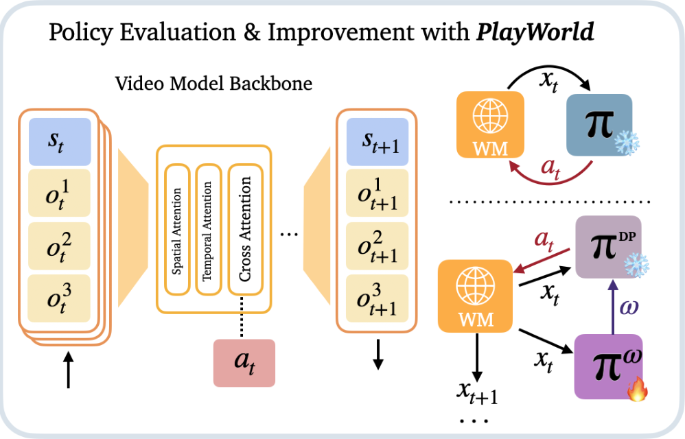
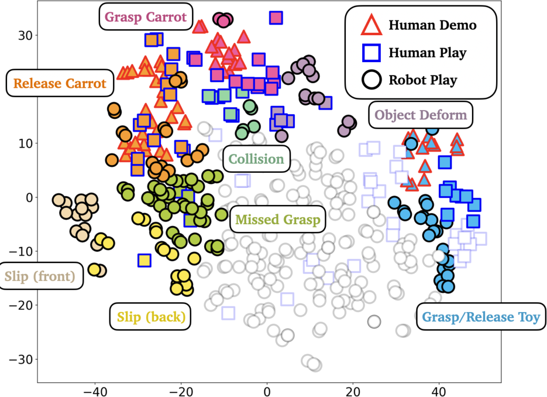
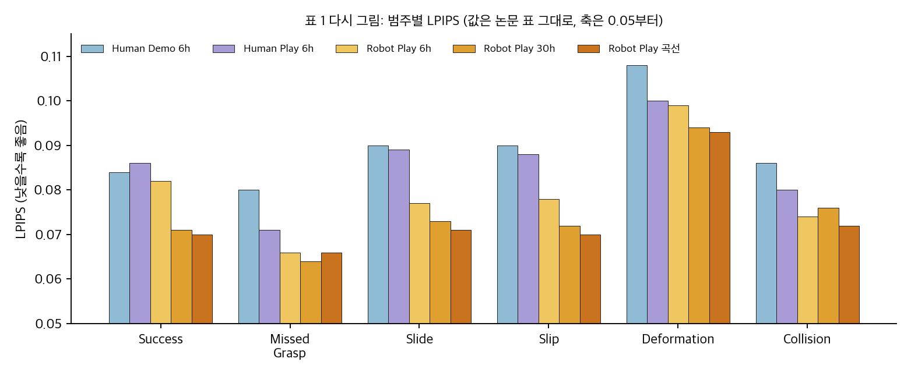
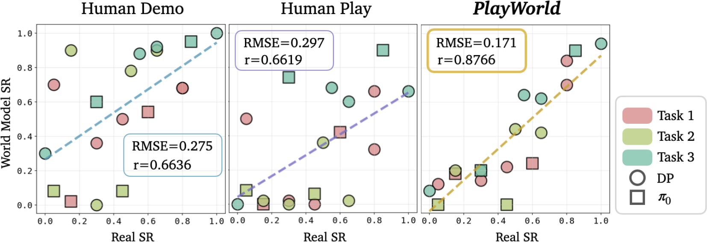
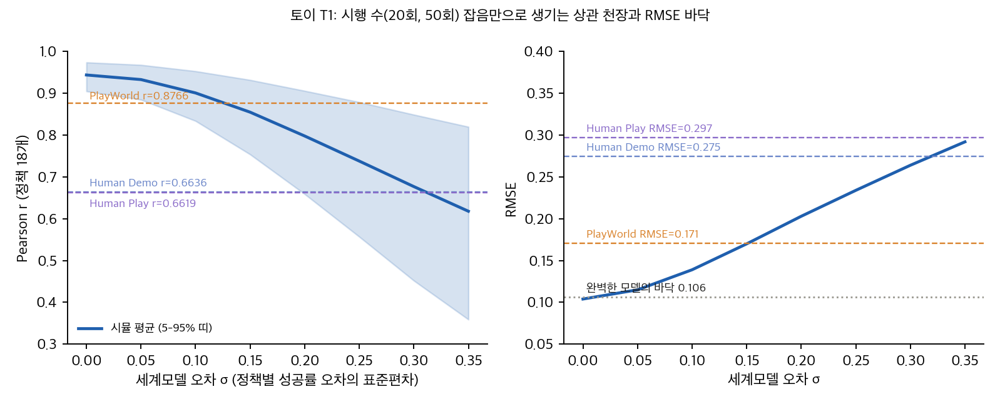
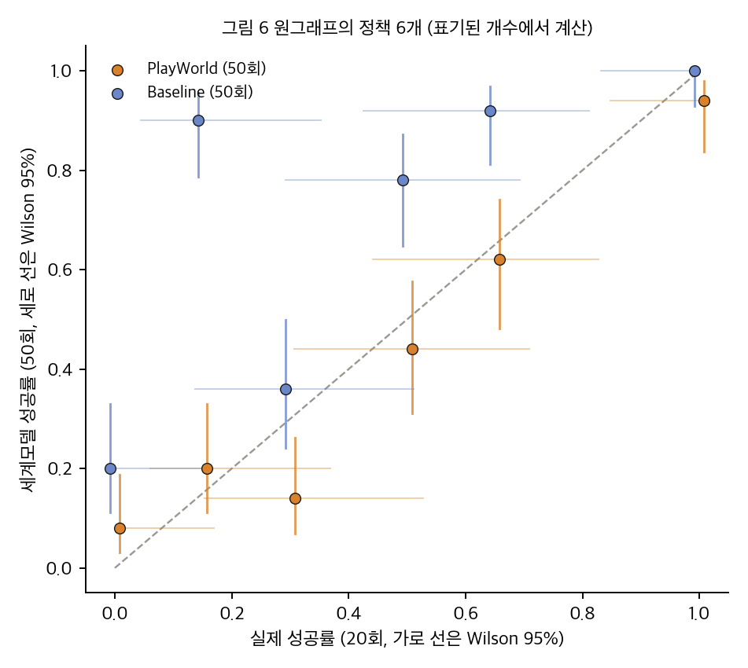
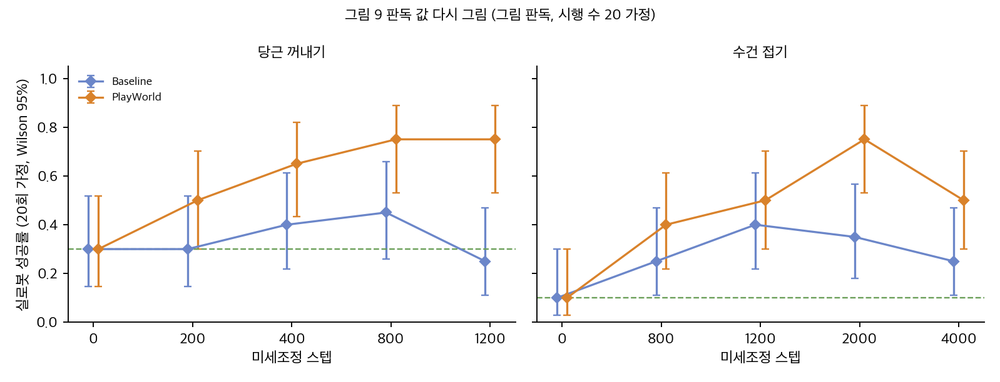
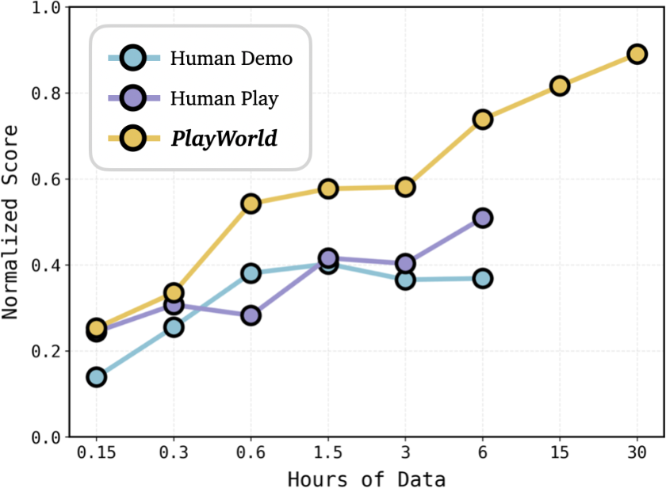

> **논문:** Tenny Yin, Zhiting Mei, Zhonghe Zheng, Miyu Yamane, David Wang, Jade Sceats, Samuel M. Bateman, Lihan Zha, Apurva Badithela, Ola Shorinwa, Anirudha Majumdar. *PlayWorld: Learning Robot World Models from Autonomous Play.* CoRL 2026 포스터, arXiv:2603.09030 (v3, 2026-04-06).
> 코드는 프로젝트 페이지가 가리키는 irom-princeton/open-world입니다(LICENSE 파일 없음). 이 글의 그림은 논문 그림 일부(출처 표기)와 우리가 그린 그래프입니다.

## 논문이 묻는 것

영상 모델로 만든 세계모델은 접촉이 많은 조작에서 물체가 복제되거나 사라지는 환각을 냅니다. 저자들은 원인을 모델 구조보다 **학습 데이터의 분포**에서 찾습니다. 사람 시연은 성공 경로 근처에 몰려 있어서, 놓치거나 미끄러지는 반사실 전이를 거의 보여 주지 않는다는 가설입니다. 처방은 로봇 자율 놀이입니다. VLM이 장면에 맞는 짧은 지시를 만들고 π0.5-DROID가 실행하며, 물체가 도달 범위를 벗어나면 VLM이 되가져오라고 지시해 사람 없이 최대 8시간 이어 갑니다.

*그림 (논문 원문 일부). © 저자, CC BY 4.0, 출처 arXiv:2603.09030.*

모델은 Ctrl-World를 따르는 SVD 세계모델(3시점, 5프레임 예측, 5 Hz)입니다. 새로운 것은 데이터 쪽입니다. 성공 궤적의 CLIP 임베딩에 K-means(K = 5)를 하고, 거리에 따라 놀이 데이터를 5개 순위로 나눈 뒤 학습이 진행될수록 어려운 순위의 샘플링 비중을 5배까지 올리는 곡선 학습을 씁니다. 로봇 놀이 30시간을 사람 시연 6시간, 사람 놀이 6시간과 비교합니다.

*그림 (논문 원문). © 저자, CC BY 4.0, 출처 arXiv:2603.09030.*

## 이 글에서 확인한 것

**1. 접촉 범주의 예측 지표는 개선되고, 곡선의 추가 이득은 작습니다.** 표 1에서 로봇 놀이 6h는 사람 시연 대비 LPIPS가 다섯 접촉 범주에서 8.3–17.5% 낮고, 30h는 11.6–20.0% 낮습니다. 성공 클립은 세 혼합이 0.082–0.086으로 비슷합니다. 곡선 행과 30h 행의 LPIPS 차이는 다섯 범주에서 0.001–0.004 낮고 Missed Grasp에서는 0.002 높습니다. 표에는 시드와 신뢰구간이 없어서 이 크기가 학습 변동 안에 드는지는 알 수 없습니다.

*그래프 (우리가 그림). 값은 논문 표 1 그대로입니다.*

**2. 정책 평가의 상관은 높지만, 정책 18개로는 차이가 확정되지 않습니다.** 그림 7에서 PlayWorld의 예측 성공률과 실제 성공률의 상관은 r = 0.8766, RMSE 0.171이고 사람 시연은 0.6636과 0.275, 사람 놀이는 0.6619와 0.297입니다. 정책 18개의 Fisher z 구간은 PlayWorld 0.69–0.95, 사람 시연 0.29–0.86이고, 독립 두 상관의 검정은 p ≈ 0.12입니다(같은 정책을 쓰는 종속 상관이라 보수적일 수 있고, 정책별 예측값이 없어 종속 검정은 하지 못했습니다). 그림의 점을 읽어 다시 계산하면 PlayWorld 패널은 r = 0.876, RMSE = 0.170으로 보고 값과 맞습니다(그림 판독).

*그림 (논문 원문, 왼쪽 과제 사진은 제외). © 저자, CC BY 4.0, 출처 arXiv:2603.09030.*

**3. 시행 수 잡음만으로 생기는 상관 천장과 RMSE 바닥이 있습니다.** 실제 20회, 세계모델 50회(본문 §4.4)에서 정책의 진짜 성공률을 그림 7의 실제 값으로 두고 모의하면(그림 판독 값, 이항 표본 가정), 세계모델이 완벽해도 r ≈ 0.94(5–95% 0.90–0.97), RMSE ≈ 0.105입니다. PlayWorld의 RMSE 0.171은 그 바닥 위 0.066이고, 정책별 독립 오차 표준편차 약 0.15에 해당합니다. 사람 시연과 사람 놀이는 약 0.32와 0.35입니다. 또 모든 정책을 +0.3 높게 평가하는 모델도 r은 0.91로 거의 유지되고 RMSE만 0.295로 커집니다. 그래서 정책 평가에서는 r과 함께 RMSE와 평균 편향을 보고하는 편이 낫습니다.

*그래프 (우리가 그림). 시행 수 20, 50회의 이항 잡음만으로 생기는 값이고 점선은 논문 보고 값입니다.*

**4. 정책 6개의 실패 모드 원그래프에서는 성공률 편향이 보입니다.** 그림 6에 적힌 개수로 계산하면 실제 성공률 대비 평균 차이는 PlayWorld −0.03(RMSE 0.084), baseline +0.26(RMSE 0.355)입니다. 정책별 Fisher 검정에서 실제와 구분되는 정책은 PlayWorld 0개, baseline 3개입니다. 확인이 필요한 점은 두 가지입니다. PlayWorld 5번째 원의 표기 합이 48이고, 실제 성공률 0인 정책의 baseline 예측이 그림 6에서는 0.20, 그림 7 사람 시연 패널 판독에서는 0.30입니다(그림 판독). 저자 확인이 필요합니다.

*그래프 (우리가 그림). 그림 6 원그래프에 표기된 개수에서 계산했고, 구간은 Wilson 95%입니다.*

**5. RL 미세조정의 "최대 65%"는 수건 과제의 최고 체크포인트 값으로 읽힙니다.** 그림 9를 읽으면(그림 판독, 체크포인트당 20회 가정) 수건 접기에서 초기 2/20, 2000 스텝 15/20이고 절대 차이가 65%p입니다. 같은 스텝의 baseline 7/20과는 +40%p(Fisher p = 0.025)이고, 마지막 체크포인트(4000)는 10/20입니다. 본문 §4.5는 baseline 모델에서의 미세조정과 비교한다고 쓰고 서론은 사전학습 정책과 비교한다고 써서 비교 대상이 문장마다 다릅니다. 체크포인트 4–5개 가운데 가장 좋은 값을 보고하는 방식이라 별도 평가 시행이 있는지도 확인이 필요합니다.

*그래프 (우리가 그림). 그림 9 판독 값, 체크포인트당 20회 가정.*

**6. 규모 곡선의 비교 가능 구간은 6시간까지입니다.** 사람 데이터는 6시간까지만 수집되었고(그림 10 x축), 로봇 놀이는 30시간까지 점수 0.89에 이릅니다. 식 (7)을 부호 그대로 쓰면 값이 [−1, 0]인데 그림 10의 축은 0–1이고, 표 1의 6범주 LPIPS 평균에 1 − (s − 0.072)/0.028을 적용하면 그림 판독 값과 0.003 안에서 맞습니다.

*그림 (논문 원문). © 저자, CC BY 4.0, 출처 arXiv:2603.09030.*

## 공식 코드와 구현 가능성

저장소는 세계모델 학습, 정책 평가, RL을 아우르는 범용 플랫폼(OpenWorld)이고, 논문의 새 기여에 해당하는 놀이 수집, 곡선 학습, LPIPS·SSIM 평가, DSRL 코드는 보이지 않았습니다(커밋 4579426을 정적으로 읽음). 학습 손실은 식 (3)의 ε 예측이 아니라 flow matching 속도 예측이고, RL 예제는 DSRL이 아닌 PPO입니다. 코드 쪽 학습 설정(학습률 1e-5, 스케줄러 없음, 과거 프레임 6)은 LIBERO용 설정이라 표 2와 직접 비교할 수 없습니다. 논문 수치를 이 저장소로 그대로 재현하기는 어렵고, 이 글의 계산은 표와 그림에 적힌 값을 다시 계산한 것입니다.

## 한계와 남는 질문

- 정책 평가에서 세계모델 롤아웃의 성공 판정 방법이 본문에 없습니다.
- 곡선의 거리 구간 경계, 총 학습 스텝, 보간 방식이 적혀 있지 않습니다.
- 표 1과 그림 7의 시드·반복 수가 적혀 있지 않습니다.
- 벤치마크 533개 중 22.9%가 놀이 실행기와 같은 계열(π0.5)의 롤아웃이고 출처별 점수는 없습니다.

## 자료

- [통합 리포트 PDF](report/report_public.pdf)
- [01. 논문 분석: PlayWorld (arXiv:2603.09030)](analysis/01_paper_analysis.md)
- [02. 선행연구와 관련 자료 (PlayWorld)](analysis/02_prior_work.md)
- [03. 수치 재계산과 해석 (PlayWorld)](analysis/03_analysis.md)
- [04. 코드 대조와 구현 가능성 (PlayWorld)](analysis/04_code_verification.md)
