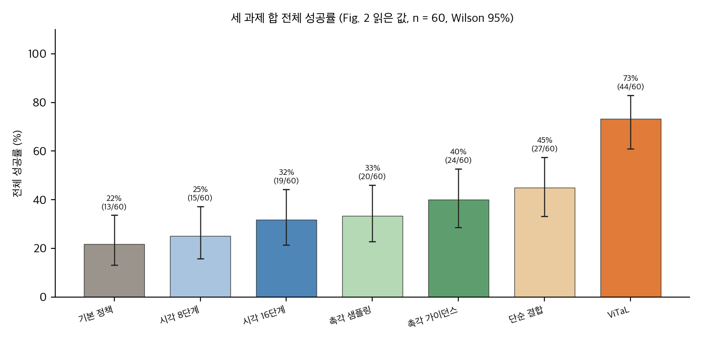
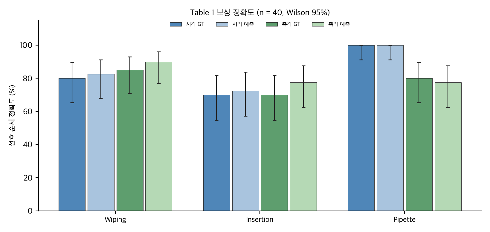

> **논문:** Yilin Wu, Zilin Si, Zeynep Temel, Oliver Kroemer, Andrea Bajcsy. *Inference-time Policy Steering via Vision and Touch.* CoRL 2026 포스터, arXiv:2606.14981 (v1, 2026-06-12).
> 공식 코드는 GitHub yilin-wu98/vital에 있고, 구성 요소별로 MIT와 Apache-2.0입니다. 이 글의 그림은 우리가 그린 것 두 장입니다. 논문 그림은 넣지 않았습니다.

## 논문이 묻는 것

확산 정책은 사전학습된 뒤에도 배포 중에 고쳐 쓸 수 있습니다. 후보 행동을 여러 개 뽑고, 각 후보가 낳을 결과를 예측해 점수를 매기고, 가장 나은 후보를 실행하는 방식입니다. 이를 **추론 시 steering**이라고 부릅니다.

지금까지 대부분의 steering은 예측 결과를 **영상**으로 보고 점수를 매겼습니다. 그런데 접촉이 많은 작업에서는 이것만으로 부족합니다. 피펫으로 액체를 옮길 때 고무 스포이트를 얼마나 세게 쥐었는지, 지우개가 칠판에 얼마나 세게 닿았는지는 손목 카메라에 잘 보이지 않습니다.

ViTaL은 이 문제를 두 단계로 나눕니다. 긴 시간 범위에서는 시각 보상으로 **어떤 행동을 할지** 고르고, 짧은 시간 범위에서는 촉각 보상으로 **그 행동을 어떻게 접촉할지** 다듬습니다.

## 방법: 두 시간 척도

- **시각 단계.** 기본 정책에서 후보 열 개를 뽑고, 잠재 세계 모델로 16 스텝 뒤까지 굴립니다. 예측 영상을 VLM 보상 모델(ROBOMETER-4B)로 점수 매기고 가장 나은 후보를 고릅니다.
- **촉각 단계.** 고른 후보의 앞 8 스텝을 부분적으로 잡음 처리한 뒤 역확산하면서, 촉각 보상의 기울기로 방향을 살짝 바꿉니다.
- **촉각 보상.** 예측된 촉각 임베딩과 "grasp lightly" 같은 문장 임베딩의 코사인 유사도입니다. 영상으로 다시 그리지 않고 잠재 공간에서 계산합니다.

세계 모델은 시각 인코더(DINOv3)와 촉각 인코더(AnyTouch 2)를 고정하고, 그 위에 인과 패치 트랜스포머를 학습합니다.

## 이 글에서 확인한 것

*그림 1. 논문 Fig. 2를 그림에서 읽어 다시 그렸습니다(우리가 그린 것). 기본 정책 22%, 촉각 가이던스 40%, 단순 결합 45%, ViTaL 73%입니다. 막대 값은 눈으로 읽었고 오차는 약 2.5%p입니다.*

**1. "51% 향상"은 %p입니다.** 세 과제 평균 전체 성공률이 21.7%에서 73.3%로 올랐습니다. 차이는 51.7%p이고, 상대 증가는 약 3.3배입니다.

**2. 세 과제 합에서는 우위가 확실합니다.** 60회 합계에서 ViTaL은 촉각 가이던스(24/60)보다 p = 0.0004, 단순 결합(27/60)보다 p = 0.003으로 나았습니다. 과제별로는 차이가 작습니다. 조건당 20회라서 과제별 검정력이 부족합니다. 같은 차이를 80% 검정력으로 보려면 조건당 35회 이상이 필요합니다.

**3. "단일 모달 대비 최소 33%"는 평균에서만 맞습니다.** 과제별로 보면 닦기는 30%p, 구멍 끼우기는 25%p입니다.

**4. 보상 정확도는 점추정이 높지만 구간이 넓습니다.** 선호 순서 정확도(과제당 40쌍)가 모든 셀에서 70% 이상이라고 보고합니다. 하지만 Wilson 95% 하한은 54.6%까지 내려갑니다.

*그림 2. 논문 Table 1을 다시 그렸습니다(우리가 그린 것). 시각과 촉각 보상, 실제 영상과 예측 영상, 세 과제입니다.*

## 공식 코드와 논문이 다른 부분

공식 저장소를 읽어 보니 몇 가지가 논문과 다릅니다.

- **촉각 보상의 형태.** 논문 식은 양성 문장의 코사인 하나입니다. 공식 코드의 주 방법은 양성 문장 점수에서 음성 문장 점수를 뺍니다.
- **단계 전환 임계값.** 논문은 시각 보상 0.7을 씁니다. 주 방법의 공식 프리셋은 기본값 0.64를 씁니다.
- **기준선의 목표 컵.** 단순 결합 기준선은 파란 컵, 주 방법은 노란 컵을 목표로 합니다. 비교가 같은 조건인지 확인하기 어렵습니다.
- **학습 설정.** 세계 모델 홀드아웃이 논문 본문에는 30, 설정 파일에는 50입니다. 행동 차원도 부록과 본문이 다릅니다.

이런 차이는 논문 결과를 뒤집을 정도는 아니지만, 그대로 재현하려면 값을 명시해 고정해야 합니다.

## 이 맥에서 할 수 있는 것

**재현은 불가능합니다.** 실로봇 세 과제는 Franka 로봇과 촉각 센서, 컨트롤러 스택이 필요하고, 기본 정책 가중치는 공개되지 않았습니다. 세계 모델 학습 코드는 CUDA를 전제하며, 피펫 데이터는 361 GB입니다. 시각 보상 서버도 공개되지 않았습니다.

**구조는 옮길 수 있습니다.** 두 단계 최적화와 촉각 확산 편집은 작은 2차원 연속 제어 토이로 옮길 수 있습니다. 그러면 "시각 선택 후 촉각 편집"이 단순 결합보다 나은지를 통제된 조건에서 볼 수 있습니다.

## 남는 질문

- 촉각 보상의 음성 항이 성능을 얼마나 바꾸는지 논문은 보고하지 않습니다.
- 시각 기본 정책의 기준선이 Fig. 2와 부록 C.2에서 1–3회 차이 납니다. 실행 세션이 달랐는지 확인이 필요합니다.
- 시각 보상이 추론 시간의 대부분(216 ms 대 471 ms)을 차지합니다. VLM을 호출하지 않고 잠재 공간 보상으로 바꾸면 얼마나 빨라지고 정확도가 얼마나 떨어질지 궁금합니다.

## 자료

- [통합 리포트 PDF](report/report_public.pdf)
- [01. 논문 분석: Inference-time Policy Steering via Vision and Touch (ViTaL)](analysis/01_paper_analysis.md)
- [02. 선행연구, 공식 저장소, 관련 분석](analysis/02_prior_work.md)
- [03. 수치 재계산, 검정, 일관성 검사](analysis/03_analysis.md)
- [04. 공식 코드 대조 (정적 읽기): 논문 ↔ 코드 차이 D1–D17](analysis/04_code_verification.md)
