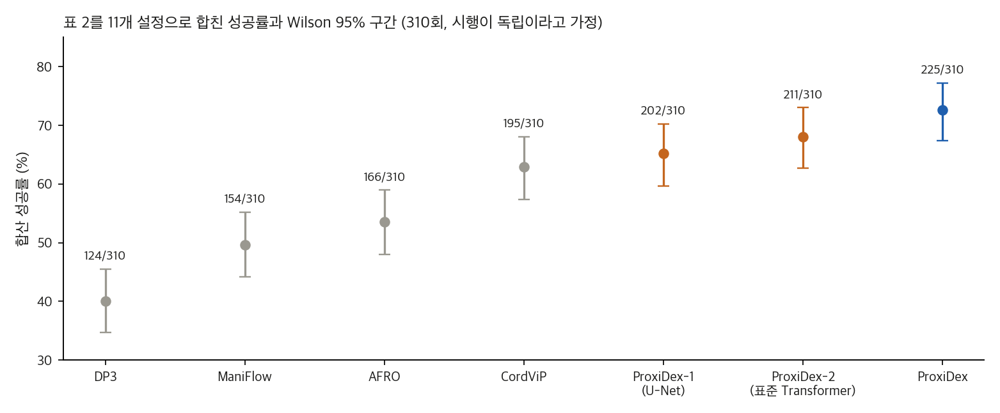
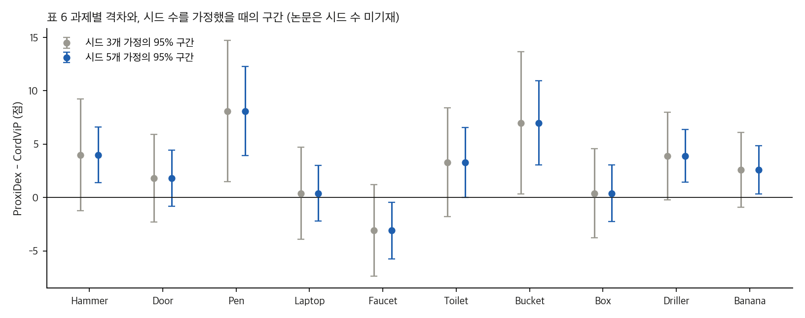
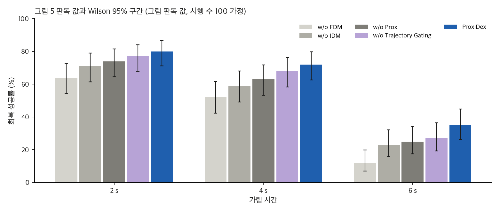
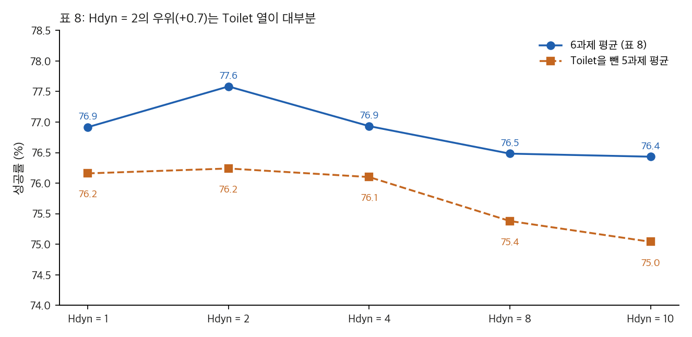
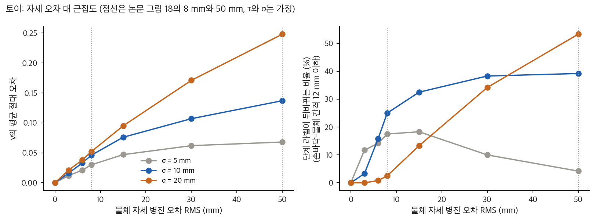

# 03. 수치 재계산과 일관성 검사: ProxiDex (arXiv:2609.16586 v1)

재계산 스크립트는 `analysis/recompute.py`(결과 `recompute_results.json`)이고 CPU에서 수 초 걸립니다. 토이는 `analysis/toy_proximity_noise.py`(결과 `toy_proximity_noise_results.json`, 약 15초)입니다. 번호는 V1–V11(재계산), K1–K8(일관성 관찰), T1(토이)입니다.

**읽는 법.** 논문이 시드 수, 시행 수를 적지 않은 곳은 가정을 문장에 밝혔습니다. "그림 판독 값"은 막대 위 숫자를 PDF에서 읽은 값입니다. 검정은 시행이 독립이라는 가정 위에 있습니다. 같은 정책을 여러 설정에서 평가한 시행은 엄밀히 독립이 아니므로 구간은 실제보다 좁을 수 있습니다.

## 요약

| 항목 | 결과 |
|---|---|
| 표 1 ↔ 표 6 | 묶음별 평균 15칸, 평균 칸 5개, 본문 차이(12.1, 9.7, 7.0, 2.9; 4.7, 1.9, 2.3)가 모두 일치합니다 (V1) |
| 표 7·8 평균과 본문 차이 | 평균 11칸과 차이 7.5, 7.0, 4.0, 2.3, 1.1, 15.1, 13.4, 8.4가 모두 일치합니다 (V2) |
| 표 2 | 합산, 평균 칸, 본문 85/120 대 77/120, 67/90 대 56/90이 일치합니다. 분모 20, 40, 30으로 모든 칸이 정수입니다 (V3) |
| CordViP 대비 (실로봇) | 합산 225/310 대 195/310, +9.7점 (구간 2.3–16.9, Fisher p = 0.013, 11개 설정 모두 높음). 설정별로는 어느 것도 구분되지 않습니다 (V4) |
| CordViP 대비 (시뮬) | 10과제 중 9과제에서 높고(평균 +2.84점, 과제 단위 Wilcoxon p = 0.020), 과제별로는 시드 수를 5개로 가정해도 Pen, Bucket 두 과제만 Holm 후 구분됩니다 (V5) |
| 가림 절제 (그림 5) | 정수 가능성으로 시행 수가 100의 배수여야 합니다. n = 100 가정에서 w/o FDM만 구분되고 w/o IDM, w/o Prox, w/o 게이팅은 구분되지 않습니다 (V6) |
| 표 8 (H_dyn) | H_dyn = 2의 우위 +0.67점의 90%가 Toilet 열이고, Toilet을 빼면 +0.08점입니다 (V7) |
| 표 사이 같은 값 | 표 8의 Toilet 열 네 칸이 표 7의 Toilet 열 네 칸과 평균±SD까지 같습니다 (V8, K1) |
| 학습 스케줄 | 시연 길이 100–200 프레임 가정에서는 게이트 α 상승(22,000 스텝)이 끝나기 전에 학습이 끝납니다 (V10) |

## V1. 표 1 ↔ 표 6 (시뮬 평균)

- 표 6의 과제별 값에서 묶음 평균(Adroit 3과제, DexArt 4과제, 자체 3과제)과 10과제 평균을 다시 계산하면 다섯 방법 모두 표 1과 소수 첫째 자리까지 일치합니다. 묶음별 SD 칸도 과제 SD의 평균과 일치합니다(예: ProxiDex Adroit 1.4 = (0.0 + 1.9 + 2.4)/3 ≈ 1.43).
- 본문 격차는 모두 맞습니다: 전체 평균 12.1, 9.7, 7.0, 2.9점(DP3, ManiFlow, AFRO, CordViP 대비)과 CordViP 대비 묶음별 4.7, 1.9, 2.3점.
- 표 1의 "Avg."는 10과제 평균이지 세 묶음 평균의 평균이 아닙니다. ProxiDex는 83.9(10과제)와 85.0(세 묶음 평균)로 다릅니다. 두 방식이 방법마다 1.1–1.4점 차이이므로 읽을 때 구분이 필요합니다.
- **"Avg. ±" 칸의 의미.** ProxiDex의 1.8은 과제 SD의 평균입니다(재계산 1.82). 과제가 독립이면 평균 성공률의 SD는 √ΣSD²/10 ≈ 0.63으로 더 작습니다(CordViP 0.62). 어느 쪽을 가리키는지는 논문에 적혀 있지 않습니다.
- **과제별 순위**(표 6, 소수점까지 비교): ProxiDex가 가장 높은 과제는 10개 중 8개입니다(Hammer는 DP3, ManiFlow와 공동 100.0, Laptop은 ManiFlow와 공동 93.0). **Faucet은 CordViP(56.5 대 53.4), Box는 AFRO(97.2 대 96.7)가 앞섭니다.** 본문(부록 C.2)은 Faucet만 적었습니다(K2).
- CordViP 대비 과제별 차이: +4.0, +1.8, +8.1, +0.4, −3.1, +3.3, +7.0, +0.4, +3.9, +2.6 (Hammer ~ Banana). 9과제 우위, 1과제 열위. 과제 단위 부호 검정 p = 0.021, Wilcoxon 부호 순위 p = 0.020, 단일 표본 t 검정 p = 0.022(과제 간 SD 3.27). 과제가 10개뿐이라 이 검정은 "과제 집합 위에서의 방향"만 말합니다.

## V2. 절제 표 7, 8과 본문 차이

- 표 7 평균 열(70.6, 70.1, 73.6, 75.3, 76.5, 77.6)과 표 8 평균 열(76.9, 77.6, 76.9, 76.5, 76.4)을 6과제 평균으로 다시 계산하면 모두 일치합니다. SD 평균 칸도 일치합니다.
- 본문 차이 7.5(Int.PC), 7.0(Prox), 4.0(FDM), 2.3(IDM), 1.1(Closed-Loop)은 반올림 전 값으로 7.53, 6.98, 3.97, 2.28, 1.12점이라 맞습니다. Bucket 15.1과 13.4점, Pen 8.4점도 맞습니다.
- 표 7의 ProxiDex 행은 표 6의 같은 과제 칸과 값이 같고, 표 8의 H_dyn = 2 행은 표 7의 ProxiDex 행과 같습니다(의도된 재사용).
- 표 7의 다섯 절제 행은 6과제 모두에서 w/o Prox ≤ w/o FDM ≤ w/o IDM ≤ w/o Closed-Loop ≤ ProxiDex로 같은 순서입니다. 인접 행의 차이는 1–3점이고 칸 SD의 중앙값은 약 1.7입니다. 순서가 일관된 것은 사실이지만, 인접 행 하나하나의 구분은 시드 수 없이 판단하기 어렵습니다(V5와 같은 이유).

## V3. 표 2 (실로봇) 산술

- 분모: In Distribution 20회 × 3 = 60, Unseen Objects 40 × 3 = 120, Perturbation 30 × 3 = 90, 접촉 과제 20 × 2 = 40. 방법당 **합계 310회**입니다. 모든 칸의 성공 횟수가 분모 이하 정수입니다.
- 합산 성공률: DP3 124/310 = 40.0, ManiFlow 154/310 = 49.7, AFRO 166/310 = 53.5(53.55), CordViP 195/310 = 62.9, ProxiDex-1 202/310 = 65.2, ProxiDex-2 211/310 = 68.1, ProxiDex 225/310 = 72.6. **표의 "Avg." 칸은 11개 칸 비율의 평균(예: ProxiDex 72.8)이 아니라 횟수를 합친 비율과 일치합니다.**
- 본문의 85/120과 77/120(Unseen), 67/90과 56/90(Perturbation)은 칸 합과 일치합니다. 본문 격차 9.7, 19.1, 22.9, 32.6점은 반올림한 평균의 차이이고 횟수로 계산하면 9.7, 19.0, 22.9, 32.6점입니다(AFRO만 0.1 차이, 53.55의 반올림).
- 백본 대조: 72.6 − 65.2 = 7.4, 72.6 − 68.1 = 4.5로 본문과 일치합니다.
- 본문의 "아홉 개 설정에서 최고 또는 공동 최고"(§5.2)는 4개 기준선 대비 11개 설정 모두에서 최고(또는 공동)이고, 변형 두 행을 포함해도 11개 모두 최고 또는 공동 최고입니다(엄격한 최고는 10개, Sweep In-Distribution은 ProxiDex-2와 18/20 동률). "아홉"이 어느 집합을 가리키는지는 적혀 있지 않습니다(K3).

## V4. 표 2 검정

**CordViP 대비 (가장 가까운 기준선)**

| 비교 | 합산 | 차이 (점) | 95% 구간 | Fisher p | CMH p (설정 층화) | 설정별 우위 | 부호 검정 p |
|---|---|---|---|---|---|---|---|
| ProxiDex 대 CordViP | 225/310 대 195/310 | +9.7 | 2.3–16.9 | 0.013 | 0.008 | 11/11 | 0.001 |
| 대 AFRO | 225 대 166 | +19.0 | 11.5–26.3 | 1.3e-6 | 3e-7 | 11/11 | 0.001 |
| 대 ManiFlow | 225 대 154 | +22.9 | 15.3–30.1 | 7e-9 | 1e-9 | 11/11 | 0.001 |
| 대 DP3 | 225 대 124 | +32.6 | 25.0–39.6 | 3e-16 | 3e-17 | 11/11 | 0.001 |
| 대 ProxiDex-1 (U-Net) | 225 대 202 | +7.4 | 0.1–14.6 | 0.056 | 0.039 | 11/11 | 0.001 |
| 대 ProxiDex-2 (표준 Transformer) | 225 대 211 | +4.5 | −2.7–11.6 | 0.25 | 0.20 | 10/11 (1 동률) | 0.002 |

- 구간은 Newcombe-Wilson 합산 구간입니다. 설정별 우위의 부호 검정은 11개 설정이 독립이라고 보는 근사입니다.
- **설정 하나씩 보면 CordViP 대비는 어느 칸도 구분되지 않습니다**(Fisher p = 0.33–1.0, 11칸 모두 0.05 초과). 가장 큰 차이는 Twist 10/20 대 6/20(p = 0.33)과 Flip 11/20 대 8/20(p = 0.53)입니다. 접촉 과제 두 칸을 합쳐도 21/40 대 14/40, p = 0.18입니다.
- DP3 대비는 6개 설정이 원시 p < 0.05, Holm 후 2개(Unseen Pick, Unseen Pinch)입니다. ManiFlow 대비는 원시 4개, Holm 후 0개입니다. AFRO 대비는 원시 1개, Holm 후 0개입니다.
- **검출력.** 합산 310회 대 310회에서 62.9% 대 72.6%(같은 차이가 참이라고 가정)를 5% 수준에서 가를 검출력은 약 0.73이고, 80% 검출력에는 방법당 약 364회가 필요합니다. 설정 한 칸(20회)에서 50% 부근의 차이를 80% 검출력으로 가르려면 약 44점 차이가 있어야 합니다. 그러므로 설정별 비교는 "방향" 증거이고, 합산(+9.7점)이 검정 가능한 가장 작은 단위입니다.
- **변형 행.** ProxiDex-1(U-Net)과의 합산 차이는 +7.4점(구간이 0.1점에서 시작)이고, ProxiDex-2와는 +4.5점(구간이 0을 포함)입니다. "제안한 백본이 낫다"는 서술은 U-Net 대비에서만 합산 구간이 0을 간신히 넘고, 표준 Transformer 대비는 실로봇 수만으로는 구분되지 않습니다.

그래프: 표 2를 11개 설정으로 합친 성공 횟수(방법당 310회)와 Wilson 95% 구간. 시행이 독립이라고 가정. 우리가 그린 그래프입니다.

## V5. 시뮬 격차와 시드 수 가정

표 1, 6의 "±"가 몇 번의 평가에서 나온 SD인지 논문에 없습니다(부록 C.2는 "repeated evaluations"). 시드 수 k를 3, 5, 10으로 가정하고 표의 SD를 표본 SD로 보면 ProxiDex 대 CordViP의 과제별 Welch 검정은 다음과 같습니다.

| 가정 | 원시 p < 0.05인 과제 | Holm 후 구분되는 과제 | 10과제 평균 격차 +2.84점의 p (과제 독립 합성 SD) | p (표의 Avg ± 칸을 SD로 본 경우) |
|---|---|---|---|---|
| k = 3 | Pen, Bucket | 없음 | 0.005 | 0.13 |
| k = 5 | Hammer, Pen, Faucet(CordViP 우위), Toilet, Bucket, Driller, Banana | Pen, Bucket | 1e-4 | 0.042 |
| k = 10 | 8과제 | 7과제 (Door, Laptop, Box 제외) | 7e-9 | 0.003 |

- Faucet은 부호가 반대(CordViP 우위)이고, 위 표의 "원시 p < 0.05" 목록에서 Faucet은 CordViP가 높은 쪽입니다. Laptop(+0.4)과 Box(+0.4)는 어느 가정에서도 구분되지 않습니다.
- "Avg. ±" 칸(1.8, 1.9)을 시드 SD로 읽으면 평균 격차 2.9점이 p < 0.05가 되려면 시드가 **5개 이상** 필요합니다(k = 4 이하에서는 p > 0.05).
- 따라서 표 1의 CordViP 대비 +2.9점은 "과제 단위로는 방향이 일관되고(9/10), 평균 격차의 통계적 확실성은 시드 수와 SD 정의에 달려 있다"로 읽는 것이 맞습니다.

그래프: 표 6의 과제별 ProxiDex-CordViP 차이(점)와 시드 3개, 5개 가정의 Welch 95% 구간(시드 수는 논문에 없음). 우리가 그린 그래프입니다.

## V6. 그림 5, 9에서 읽은 값의 정수 가능성 (그림 판독 값)

- **그림 5** (Adroit Pen, 가림 회복률, 막대 위 숫자): w/o FDM 64/52/12, w/o IDM 71/59/23, w/o Prox 74/63/25, w/o 궤적 게이팅 77/68/27, ProxiDex 80/72/35. 본문 인용(80, 72, 35, 71, 59)과 일치하고 화살표 라벨(+16, +20, +23)도 80 − 64, 72 − 52, 35 − 12와 일치합니다.
- 15개 값이 모두 정수 시행 수에서 나오려면 **시행 수가 100의 배수**여야 합니다(w/o FDM 행만 25의 배수로 충분). 논문은 이 실험의 시행 수를 적지 않았습니다. **n = 100 가정**에서 ProxiDex 대 각 절제의 Fisher p는 다음과 같습니다.

| 가림 | w/o FDM | w/o IDM | w/o Prox | w/o 게이팅 |
|---|---|---|---|---|
| 2 s | 0.018 | 0.19 | 0.40 | 0.73 |
| 4 s | 0.006 | 0.074 | 0.23 | 0.64 |
| 6 s | 0.0002 | 0.086 | 0.16 | 0.28 |

  w/o FDM과의 차이만 구분되고, 나머지 세 절제와의 차이(3–12점)는 n = 100에서 구분되지 않습니다. 본문 서술 "Removing FDM causes the largest drop"은 이 판독과 맞습니다. 그림의 오차 막대(약 ±2점)는 이항 분산(약 ±4점)보다 좁아, 막대가 반복 시드의 SD일 가능성이 있습니다.
- **그림 9** (촉각 대조, 그림 판독 값): PointCloud 85/70/85, +Proximity 95/75/90, +Tactile 96/75/92 (Pick/Pinch/Sweep). 표 2의 In Distribution(20회)에서 ProxiDex의 19/20, 15/20, 18/20은 95, 75, 90%로 +Proximity 행과 같습니다. 그러나 +Tactile의 96, 92%는 20회로 나올 수 없고(5의 배수만 가능), 모든 값이 정수가 되려면 시행 수가 100의 배수여야 합니다. PointCloud 행은 표 2의 어느 행과도 같지 않습니다(K4). 촉각과 근접도의 차이는 1, 0, 2점으로 막대의 ±2–5점 안에 있습니다.

그래프: 그림 5에서 읽은 가림 회복률(그림 판독 값)과 시행 수 100 가정의 Wilson 95% 구간. 우리가 그린 그래프입니다.

## V7. H_dyn 절제 (표 8)에서 Toilet 열

- 6과제 평균 H_dyn = 1, 2, 4, 8, 10은 76.9, 77.6, 76.9, 76.5, 76.4입니다. H_dyn = 2의 우위는 H_dyn = 1 대비 +0.67점입니다.
- **Toilet 열**은 80.7, 84.3, 81.1, 82.0, 83.4로 5점 안팎으로 흔들리지만 다른 다섯 열은 H_dyn에 거의 둔감합니다(예: Faucet 53.3, 53.4, 53.7, 53.4, 52.8). Toilet 열을 빼면 H_dyn = 1, 2, 4, 8, 10은 76.16, 76.24, 76.10, 75.38, 75.04입니다. **H_dyn = 2 대 1의 차이가 +0.08점으로 줄고, 우위의 약 90%가 Toilet 열에서 옵니다.** 6과제 평균의 SD는 칸 SD(중앙값 약 1.7)가 독립이면 약 0.9점이므로 0.7점 차이는 평균 수준에서 구분되기 어렵습니다.
- 본문은 "차이는 작지만(modest)" H_dyn = 2가 최고라고 적고, 짧은 horizon의 제한된 감독과 긴 horizon의 오차 누적으로 해석합니다(부록 D.2). 해석은 가능하지만 데이터가 가를 수 있는 것은 "H_dyn ≥ 8에서 Toilet을 뺀 평균이 약 1점 낮아진다" 정도입니다.

그래프: 표 8의 H_dyn별 6과제 평균과 Toilet을 뺀 5과제 평균. 우리가 그린 그래프입니다.

## V8. 표 사이 같은 값

모든 칸을 (평균, SD) 쌍으로 모아 서로 다른 행에서 반복되는 값을 찾았습니다(ProxiDex 행이 표 6, 7, 8에 다시 나오는 의도된 재사용과 100.0±0.0은 제외, 비교 대상 94칸).

| 같은 값 | 위치 |
|---|---|
| 80.7±1.6 | 표 7 w/o Prox Toilet = 표 8 H_dyn = 1 Toilet |
| 81.1±1.7 | 표 7 w/o FDM Toilet = 표 8 H_dyn = 4 Toilet |
| 82.0±1.8 | 표 7 w/o IDM Toilet = 표 8 H_dyn = 8 Toilet |
| 83.4±2.0 | 표 7 w/o Closed-Loop Toilet = 표 8 H_dyn = 10 Toilet |
| 80.3±1.2 | 표 6 ManiFlow Door = 표 7 w/o Int.PC Door |
| 84.7±1.7 | 표 6 CordViP Door = 표 7 w/o IDM Door |

표 8의 Toilet 열 네 칸이 표 7의 Toilet 열 중 w/o 행 네 칸과 값이 같습니다(대응 순서는 w/o Prox, w/o FDM, w/o IDM, w/o Closed-Loop). 다른 5개 열에서는 표 7과 표 8 사이에 같은 칸이 없습니다. 서로 다른 설정(H_dyn 변경과 모듈 제거)의 결과가 같은 값으로 나오는 이유는 논문에서 알 수 없습니다. **저자 확인이 필요합니다.** 이 관찰은 Toilet 열의 해석(V7)과 표 8 결론의 강도에 영향을 줍니다.

## V9. 데이터 크기 곡선과 사용자 연구

- 부록 D.3: 5, 10, 20, 30, 50, 100 시연의 6과제 평균(그림 판독 값에 가까운 "약" 값) 11.5, 40.0, 64.0, 77.5, 80.0, 81.8%. 본문 증가량 28.5, 24.0, 13.5점, 30 → 100 시연 4.3점, "30시연이 100시연의 94.7%"(77.5/81.8 = 94.7%)가 모두 산술적으로 맞습니다. 30시연 값 77.5는 표 7의 77.6과 반올림 안에서 맞습니다.
- 11.5%, 77.5% 같은 값은 한 과제 5회, 10회 같은 시행 수에서 6과제 평균으로 나오기 어렵고(6과제 평균이 0.5 단위가 되려면 시행 수가 정해져야 함), 시드 평균으로 보는 것이 자연스럽습니다. 시행 수는 논문에 없습니다.
- 사용자 연구(그림 13, 20명): 도움 정도 50, 45, 5%, 선호 75, 20, 5%는 모두 20명의 정수(10/9/1, 15/4/1)입니다. 선호 15/20의 Wilson 95% 구간은 53–89%이고, 세 선택지가 같다는 가정(1/3)에서 이항 p = 2e-4입니다. 시스템 사이 비교는 사용자 수 20과 참가자 내 설계라는 정보만 있고 완료 시간의 검정은 없습니다.

## V10. 학습 스케줄 대 학습 단계 수

표 5: 게이트 워밍업 2,000 스텝, α 상승 20,000 스텝(워밍업 후), τ 어닐링 50,000 스텝. 학습은 301 에폭, 배치 128입니다. 시연 길이는 논문에 없으므로 **평균 길이 L 프레임을 가정**하고 에폭당 스텝 = ⌈시연 수 × L / 128⌉로 계산했습니다.

| 시연 수 × 평균 길이 가정 | 총 스텝 (301 에폭) | α 상승 끝(22,000)에 도달 | τ 어닐링 끝(50,000)에 도달 | 학습 끝의 α |
|---|---|---|---|---|
| 30 × 100 | 7,224 | 아니오 | 아니오 | 0.26 |
| 30 × 200 | 14,147 | 아니오 | 아니오 | 0.61 |
| 30 × 400 | 28,294 | 예 | 아니오 | 1.0 |
| 30 × 800 | 56,588 | 예 | 예 | 1.0 |
| 50 × 100 | 12,040 | 아니오 | 아니오 | 0.50 |
| 50 × 200 | 23,779 | 예 | 아니오 | 1.0 |
| 50 × 400 | 47,257 | 예 | 아니오 | 1.0 |

- 30시연에서 α 상승이 끝나려면 시연 평균 길이가 약 316프레임 이상이어야 하고, τ 어닐링이 끝나려면 약 713프레임 이상이어야 합니다. Adroit와 DexArt의 에피소드 길이가 이보다 짧다면(저는 길이를 확인하지 못했습니다) 학습이 스케줄 끝에 닿지 않을 수 있습니다. 이때 α < 1이므로 게이트 g(p) = 1 − α + αp는 p에 덜 민감하고(α = 0이면 g = 1, 즉 게이팅 없음), "단계 확률로 근접도를 억제"하는 효과가 학습 중에는 부분적입니다. 단계 수를 에폭이 아니라 다른 단위(예: 시퀀스 중복 표본)로 세었다면 달라질 수 있습니다. **저자 확인이 필요합니다.**
- 실행 속도 산술: 정책 28 Hz 대 자세 추적 10 Hz이므로 정책 호출 한 번당 새 자세는 평균 0.36개입니다. Dream 모드의 신뢰 구간 약 3.5 s는 FDM 20 Hz에서 약 70번의 연쇄 예측입니다.

## V11. 본문 인용 부분집합과 절제 폭의 검출 가능성

- **본문이 인용한 두 부분집합**(CordViP 대비): 새 물체 85/120 대 77/120(+6.7점, Fisher p = 0.33), 교란 67/90 대 56/90(+12.2점, p = 0.11). In Distribution은 52/60 대 48/60(+6.7점, p = 0.46)입니다. 세 부분집합 모두 방향은 ProxiDex 쪽이지만 하나씩은 구분되지 않고, 합쳐야(V4) 구분됩니다. 본문의 "robustness to object variations and external disturbances"는 합산에서 지지되고 부분집합별로는 방향 증거입니다.
- **표 7 절제 폭.** 표의 "Avg. ±" 칸(1.4–2.2)을 시드 SD로 읽을 때 각 절제가 전체 모델과 p < 0.05로 구분되려면 필요한 시드 수는 w/o Prox 3개, w/o Int.PC 3개, w/o FDM 4개, w/o IDM 8개, **w/o Closed-Loop 24개**입니다. 다섯 절제 모두 6과제 전부에서 전체 모델보다 낮다는 방향은 일관됩니다(6/6). 닫힌 루프 확인의 +1.1점은 "일관된 방향의 작은 효과"로 읽는 것이 데이터가 허락하는 범위입니다.

## K. 일관성 관찰

| 번호 | 관찰 | 위치 |
|---|---|---|
| K1 | 표 8의 Toilet 열 네 칸이 표 7의 Toilet 열 네 칸과 평균±SD까지 같음. 표 6 ManiFlow Door = 표 7 w/o Int.PC Door, 표 6 CordViP Door = 표 7 w/o IDM Door도 같은 값 (V8) | 표 6, 7, 8 |
| K2 | "모든 묶음에서 최고"는 표 1에서 맞고, 과제별로는 Faucet(CordViP 우위), Box(AFRO 우위)가 있음. 본문은 Faucet만 적음 | 표 6, 부록 C.2 |
| K3 | "아홉 개 설정에서 최고 또는 공동 최고"는 표 2의 11개 설정 중 11개에서 성립. "아홉"의 기준이 불분명 | §5.2, 표 2 |
| K4 | 그림 9의 +Tactile 96%, 92%는 표 2의 In Distribution 20회와 양립하지 않고(시행 100의 배수 가정), PointCloud 행(85, 70, 85)은 표 2의 어느 행과도 같지 않음. 같은 칸 비교의 시행 수·행 정의가 논문에 없음 | 그림 9, 표 2 |
| K5 | IDM 입력이 식 (2)는 FDM 예측 차분 ẑ_{t+h} − ẑ_{t+h−1}, 식 (19)는 ẑ_{t+1} − z_t, 알고리즘 1(12행)은 인코더 잠재의 차분 z^in_t − z^in_{t−1}. 학습 입력(예측 잠재)과 Normal 모드 추론 입력(실제 인코딩)이 다를 수 있음 | 식 2, 19, 알고리즘 1 |
| K6 | 표 4(1단계)와 표 5(2단계)가 모두 "Training Epochs 301"이나, 1단계 301은 VAE 100 + 나머지 201의 합(부록 B.1)이라 정의가 다름. 배치(64 대 128)와 학습률(5e-5 대 1e-4)도 다름 | 표 4, 5, 부록 B.1 |
| K7 | 표 1 "Avg. ±" 1.8은 과제 SD의 평균. 평균 자체의 SD(과제 독립 가정 약 0.6)와 다른 양 | 표 1, 6 (V1) |
| K8 | 참고문헌 [14]의 URL이 `githu.com`(오타) | 참고문헌 |

## T1. 토이: 자세 오차가 근접도와 단계 라벨에 주는 영향

**무엇을 보는가.** 부록 D.6은 추적 오차가 0.8 m/s까지 ADD 약 8 mm, 1.2 m/s에서 약 50 mm이고 "추적 오차가 근접도 신뢰도를 직접 낮춘다"고 적습니다. 이 오차가 지역 근접도 γ(식 11–14)와 단계 라벨 I(γ_palm > τ_palm)(식 16)에 얼마나 전달되는지를 단순 기하로 계산했습니다. 구(반지름 40 mm)와 손바닥 평면 조각(60 × 60 mm, 간격 g = 0–60 mm), 점 4,000개와 400개, 병진 오차만(제곱평균제곱근 s)입니다. **σ와 τ_palm은 논문에 없어서 σ = 5, 10, 20 mm와 τ = 0.5를 가정했습니다.**

| σ | s = 8 mm에서 \|Δγ\| 평균 (간격 0–60 mm 평균) | s = 8 mm에서 단계 뒤바뀜 비율 (간격 ≤ 12 mm) | s = 50 mm에서 \|Δγ\| 평균 | s = 50 mm에서 뒤바뀜 (≤ 12 mm) |
|---|---|---|---|---|
| 5 mm | 0.030 | 0.18 | 0.068 | 0.04 |
| 10 mm | 0.046 | 0.25 | 0.137 | 0.39 |
| 20 mm | 0.052 | 0.03 | 0.248 | 0.53 |

- 8 mm 오차에서 γ의 평균 변화는 0.03–0.05이고 최댓값은 0.10–0.20입니다. 그러나 **접촉 근처(간격 12 mm 이하)에서 단계 라벨이 뒤바뀌는 비율은 σ = 10 mm에서 25%**입니다. 단계 라벨은 γ_palm과 임계값 하나의 비교라서 임계값 부근에서 오차에 민감합니다.
- σ가 클수록(20 mm) 8 mm 수준의 오차에는 라벨이 덜 흔들리지만 50 mm 오차에서는 53%로 커집니다. σ가 작을수록(5 mm) 접촉 근처 라벨이 작은 오차에도 흔들립니다.
- 이 토이는 해석의 방향을 보이는 것이고, σ, τ_palm, 영역 구성, 회전 오차, SDF 관통 처리를 넣지 않았으며 학습된 정책의 결과가 아닙니다. 논문이 σ와 τ_palm을 공개하면 같은 계산을 실제 값으로 반복할 수 있습니다(`04` C7).

그래프: 토이에서 물체 자세 병진 오차(제곱평균제곱근, mm)에 따른 γ의 평균 절대 오차(왼쪽)와 접촉 근처 단계 라벨 뒤바뀜 비율(오른쪽). σ와 τ_palm은 가정. 우리가 그린 그래프입니다.

