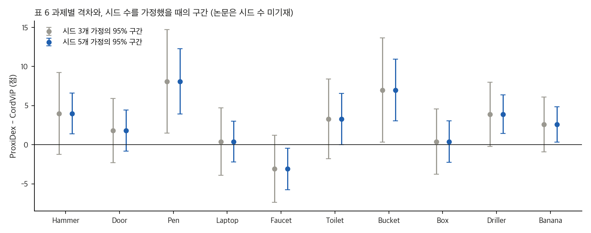
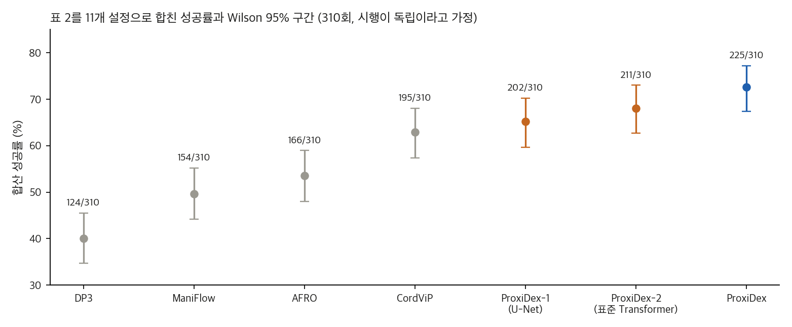
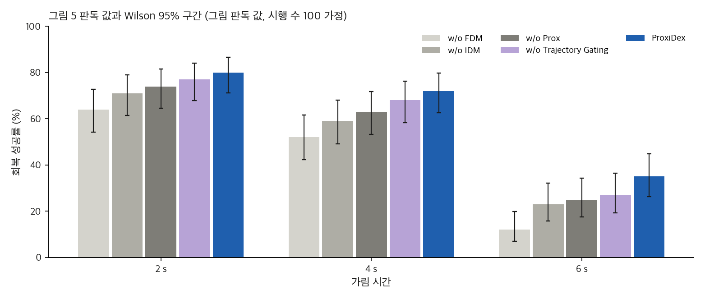
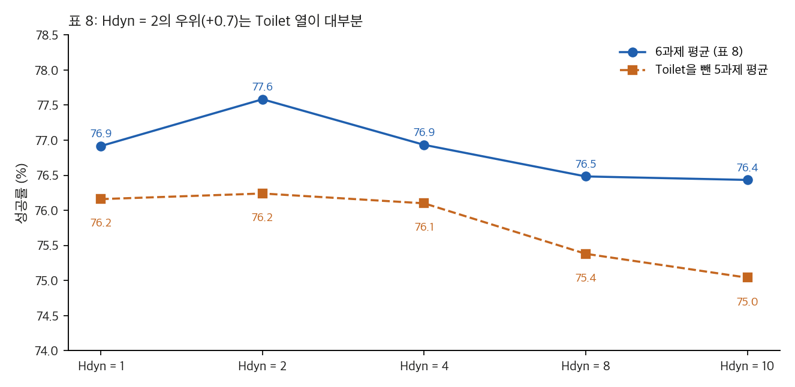
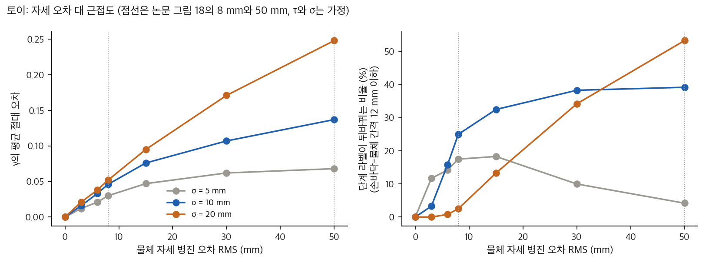

> **논문:** Yushan Bai, Boyu Zheng, Zhiyang Mao, Hongzheng Sun, Yuchuang Tong, En Li, Zhengtao Zhang. *ProxiDex: Learning Dynamics-Guided Proximity Policy for Dexterous Manipulation.* CoRL 2026 포스터, arXiv:2609.16586 (v1, 2026-09-15, 단일 버전).
> 공식 코드는 공개되지 않았습니다(프로젝트 페이지 "Code: Coming Soon"). 이 글의 그림은 모두 우리가 그린 그래프입니다. 논문 라이선스가 arXiv 비독점 배포라서 논문 그림은 싣지 않았습니다.

## 논문이 묻는 것

다지 손 조작에서는 손이 물체를 가려 접촉 영역이 보이지 않고, 촉각 센서는 하드웨어마다 달라 옮기기 어렵습니다. ProxiDex는 손 표면 점과 복원한 물체 표면 점 사이의 거리를 가우시안 커널로 바꾼 **지역 근접도**를 접촉의 대리 신호로 씁니다. 학습은 두 단계입니다. 먼저 근접도 VAE, 행동 조건 순방향 동역학(FDM), 잠재 변화에서 근접도를 복원하는 역방향 모듈(IDM), 접근/접촉 단계 헤드를 함께 학습하고, 다음으로 인코더를 고정해 근접도 토큰의 기여를 단계 확률로 조절하는 확산 정책을 학습합니다. 배포 중에는 FDM 예측과 실제 인코딩의 거리가 임계값을 넘으면 FDM이 잠재를 이어 가는 "dream 모드"로 바꿉니다. 시뮬 10과제 평균 83.9%, 실로봇 합산 72.6%를 보고합니다.

## 이 글에서 확인한 것

**1. 표 산술은 모두 일치합니다.** 표 6의 과제별 값에서 묶음 평균과 10과제 평균을 다시 계산하면 표 1과 같고, 표 7·8 평균과 본문 차이(7.5, 7.0, 4.0, 2.3, 1.1점 등)도 맞습니다. 표 1의 "Avg." 칸은 세 묶음 평균의 평균(ProxiDex 85.0)이 아니라 10과제 평균(83.9)입니다.

**2. 시뮬의 +2.9점(CordViP 대비)은 시드 수 가정에 달려 있습니다.** 10과제 중 9과제에서 높습니다(과제 단위 Wilcoxon p = 0.020). 반면 Faucet은 CordViP(56.5 대 53.4), Box는 AFRO(97.2 대 96.7)가 앞서고, 본문은 Faucet만 적었습니다. 표의 "±"가 몇 번의 평가에서 나온 값인지 논문에 없어서, 시드 수를 3개와 5개로 가정하고 계산했습니다(시드 수 가정). 5개로 가정하면 Pen과 Bucket 두 과제만 다중 비교 보정 후에도 구분됩니다.

*그래프 (우리가 그림). 표 6의 과제별 ProxiDex − CordViP 차이(점)와 시드 3개, 5개 가정의 Welch 95% 구간입니다. 시드 수는 논문에 없는 가정입니다.*

**3. 실로봇은 합산하면 구분되고, 설정 하나씩은 구분되지 않습니다.** 표 2의 11개 설정을 합치면 방법당 310회이고, ProxiDex 225/310 대 CordViP 195/310(+9.7점, 구간 2.3–16.9점, Fisher p = 0.013, 시행이 독립이라고 가정)입니다. 11개 설정 모두에서 ProxiDex가 높습니다. 그러나 CordViP 대비 설정별 p는 0.33–1.0입니다. 설정 한 칸(20회)에서 50% 부근의 차이를 80% 검출력으로 가르려면 약 44점 차이가 필요합니다. 새 물체 85/120 대 77/120(p = 0.33)과 교란 67/90 대 56/90(p = 0.11)도 부분집합으로는 방향 증거입니다. 백본 대조는 U-Net 대비 +7.4점(구간이 0.1점에서 시작), 표준 Transformer 대비 +4.5점(구간이 0을 포함)입니다.

*그래프 (우리가 그림). 표 2를 11개 설정으로 합친 성공 횟수(방법당 310회)와 Wilson 95% 구간입니다. 시행이 독립이라고 가정했습니다.*

**4. 가림 회복 절제는 FDM 제거만 확실합니다.** 그림 5의 막대 숫자를 읽으면 15개 값이 모두 정수 성공 횟수가 되려면 시행 수가 100의 배수여야 합니다(그림 판독 값, 논문에는 시행 수 없음). n = 100을 가정하면 전체 모델과 w/o FDM의 차이(2 s에서 +16점)만 구분되고, w/o IDM, w/o Prox, w/o 게이팅(+3–12점)은 구분되지 않습니다.

*그래프 (우리가 그림). 그림 5에서 읽은 가림 회복률(그림 판독 값)과 시행 수 100 가정의 Wilson 95% 구간입니다.*

**5. 표 8의 H_dyn = 2 우위는 한 열에 모여 있습니다.** 6과제 평균은 H_dyn = 2에서 77.6, H_dyn = 1에서 76.9로 +0.67점이고, 그 약 90%가 Toilet 열(84.3 대 80.7)입니다. Toilet을 뺀 5과제 평균은 76.24 대 76.16으로 +0.08점입니다. 또 표 8의 Toilet 열 네 칸(80.7±1.6, 81.1±1.7, 82.0±1.8, 83.4±2.0)이 표 7의 Toilet 열 네 칸(w/o Prox, w/o FDM, w/o IDM, w/o Closed-Loop)과 평균±SD까지 같습니다. 서로 다른 설정의 결과가 같은 값으로 나오는 이유는 논문에서 알 수 없습니다. 저자 확인이 필요합니다.

*그래프 (우리가 그림). 표 8의 H_dyn별 6과제 평균과 Toilet을 뺀 5과제 평균입니다.*

**6. 촉각과의 비교는 시행 수가 표 2와 맞지 않습니다.** 그림 9의 판독 값(PointCloud+Proximity 95/75/90, +Tactile 96/75/92)에서 근접도와 촉각의 차이는 1, 0, 2점입니다. 그러나 96%와 92%는 표 2의 20회 시행으로는 나올 수 없고, 같은 칸의 시행 수와 PointCloud 행의 정의가 논문에 없습니다.

**7. 근접도는 자세 추적 오차를 그대로 받습니다.** 논문은 추적 오차가 0.8 m/s까지 약 8 mm, 1.2 m/s에서 약 50 mm라고 적습니다(부록 D.6). 구 위의 손바닥 평면 조각으로 만든 토이(σ와 단계 임계값 τ는 논문에 없어 가정)에서, 8 mm 병진 오차는 σ = 10 mm 가정에서 접촉 근처(간격 12 mm 이하)의 단계 라벨을 약 25% 뒤바꿨습니다. 단계 라벨이 임계값 하나와의 비교라서 임계값 부근에서 오차에 민감하기 때문입니다.

*그래프 (우리가 그림). 토이에서 물체 자세 병진 오차(제곱평균제곱근, mm)에 따른 γ의 평균 절대 오차와 접촉 근처 단계 라벨 뒤바뀜 비율입니다. σ와 τ는 가정이며 학습된 정책의 결과가 아닙니다.*

## 코드 없이 알 수 없는 것

공식 코드가 없어서 논문 주장을 19개로 나눠 표와 본문 수치에 맞대어 보았습니다(`04`). 논문에서 알 수 없는 값은 가우시안 폭 σ, 단계 임계값 τ_palm, 영역 수와 분할, 표의 시드 수와 "±"의 정의, 그림 5와 9의 시행 수, 시뮬 시연 길이, dream 모드 임계값입니다. 시연 길이를 100–200프레임으로 가정하면 30시연, 301에폭, 배치 128에서 게이트 α 상승 스케줄(22,000 스텝)이 학습 안에 끝나지 않습니다(시연 길이 가정). 코드가 공개되면 대조로 갱신할 수 있습니다.

## 구현 가능성

논문의 시뮬·실로봇 결과를 재현하는 것은 지금 불가능합니다(코드, 시연 데이터, 자체 시뮬 과제, 체크포인트 없음, 실로봇 필요). 근접도 계산과 합성 접촉 과제에서의 소형 재구현은 일반 노트북 CPU나 Apple GPU에서 가능합니다.

## 정리

- 표 산술은 맞고, 실로봇 합산 +9.7점은 구분됩니다.
- 시뮬 격차, 가림 절제, H_dyn 절제는 시드 수와 시행 수가 없어서 방향 증거로 읽는 편이 맞습니다.
- 표 8의 Toilet 열과 표 7의 같은 값은 저자 확인이 필요합니다.
- 분석 문서, 재계산·토이 스크립트는 함께 공개한 저장소에 있습니다.

## 자료

- [통합 리포트 PDF](report/report_public.pdf)
- [01. 논문 분석: ProxiDex (arXiv:2609.16586)](analysis/01_paper_analysis.md)
- [02. 선행 연구와 공식 저장소: ProxiDex (arXiv:2609.16586)](analysis/02_prior_work.md)
- [03. 수치 재계산과 일관성 검사: ProxiDex (arXiv:2609.16586 v1)](analysis/03_analysis.md)
- [04. 주장 검증과 구현 가능성: ProxiDex (arXiv:2609.16586 v1)](analysis/04_claim_verification.md)
