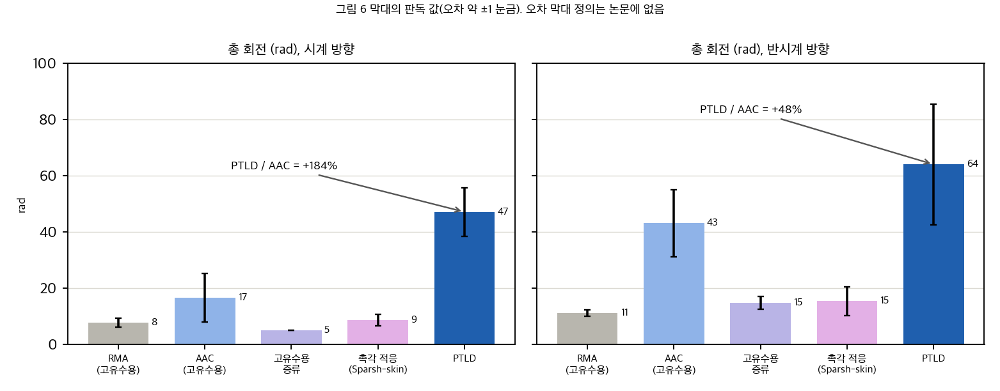
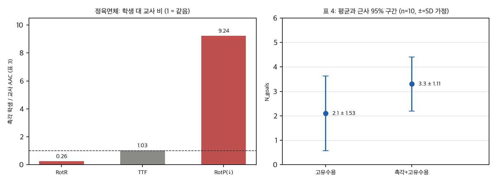

> **논문:** Rosy Chen, Mustafa Mukadam, Michael Kaess, Tingfan Wu, Francois R. Hogan, Jitendra Malik, Akash Sharma. *PTLD: Sim-to-Real Privileged Tactile Latent Distillation for Dexterous Manipulation.* CoRL 2026 포스터, arXiv:2603.04531 (v3, 2026-06-18).
> 프로젝트 페이지의 코드 링크는 확인 시점(2026-11-23)에 404였습니다. 이 글의 그림은 우리가 그린 그래프 두 장이며, 논문 그림은 arXiv 비독점 라이선스라서 싣지 않았습니다. 시행 수를 가정한 계산과 그림에서 읽은 값은 문장 안에 그렇다고 적었습니다.

## 논문이 하는 일

촉각 센서가 있는 손으로 물체를 돌리는 정책을 시뮬레이션 RL로 만들려면 촉각 시뮬레이터가 필요합니다. PTLD는 이 단계를 건너뜁니다. 시뮬레이션에서는 **물체 자세와 형상 같은 특권 센서**를 본 정책을 비대칭 액터-크리틱(AAC)으로 학습하고, 실제 로봇 셀에서는 카메라 네 대와 ArUco 마커로 물체 자세를 얻어 이 정책을 돌립니다. 그때 (촉각 값, 정책 내부 잠재) 쌍을 모아, 촉각 인코더가 특권 정책의 잠재를 따라가도록 MSE로 학습합니다(DAgger 3회, 정책당 약 180분). 배포 때는 촉각과 고유수용 감각만 씁니다.

실험은 Allegro 손에 Xela 촉각 스킨(368개 센서)을 단 구성에서 z축 회전과 목표 재배향으로 이루어집니다.

## 수치를 다시 맞춰 보니

그림: 논문 그림 6의 총 회전 막대를 400 dpi로 렌더링해 픽셀로 읽은 값(오차 약 ±1 눈금)입니다. 우리가 그린 그래프이며 논문 그림이 아닙니다.

- **"182% 개선"(초록).** 그림 판독 값으로 시계 방향 총 회전에서 PTLD 47.1 rad 대 AAC 고유수용 16.6 rad, +183.7%입니다. 같은 그림의 반시계 방향은 +48.5%이고 두 방향 평균은 +86.1%입니다. 초록에는 방향과 기준선이 적혀 있지 않아 이 조합이 182%의 출처라는 해석은 추정입니다.
- **총 회전과 낙하까지 시간.** 시계 방향에서 평균 총 회전을 평균 TTF로 나누면 PTLD 0.41, AAC 0.61 rad/s입니다(그림 판독 값, 평균의 비). 회전량의 증가는 TTF가 27 s에서 114 s로 늘어난 것과 함께 나타납니다. TTF 막대는 그림의 최대 에피소드 선에 닿아 있습니다.
- **통계.** 오차 막대의 정의(SD, SEM, 신뢰구간)가 캡션에 없어 세 가지로 계산했습니다(시행 수 10 가정). 시계 방향은 모두에서 PTLD가 앞섭니다. 반시계 방향 AAC 대비 회전은 p가 0.007에서 0.40까지, TTF는 0.12 이상으로 정의에 따라 갈립니다.
- **같은 데이터 양의 대조.** PTLD와 같은 파이프라인에서 촉각만 고유수용으로 바꾼 기준선보다 시계 방향 9.6배, 반시계 방향 4.3배입니다. 이 기준선은 제로샷 AAC의 0.30–0.34배여서, 실제 증류가 센서 정보 없이는 도움이 되지 않았다는 점도 같은 그림에서 읽힙니다.
- **재배향 57%(표 4).** 3.3 / 2.1 = +57.1%로 산술은 맞습니다. 시행 수 10과 ±=SD를 가정하면 Welch p ≈ 0.17이고, 평균 비의 근사 95% 구간은 [0.86, 4.23]입니다. 고유수용 행 2.1 ± 2.14는 정수 시행 10개로는 만들어지지 않습니다(합 21은 홀수인데 SD에 필요한 제곱합 90은 짝수). 시행 수나 N_goals의 정의가 본문과 다를 수 있어 저자 확인이 필요합니다.

그림: 표 3(정육면체)의 촉각 학생 대 교사 AAC 비와 표 4의 평균과 근사 95% 구간(n=10, ±=SD 가정)입니다. 우리가 그린 그래프입니다.

- **"교사보다 낫다"(§6.2).** 표 3에서 촉각 학생의 회전 보상은 4.5로 교사 AAC의 17.3보다 낮고, 회전 페널티는 50.8 대 5.5입니다(낮을수록 좋은 지표). 낙하까지 시간만 0.34 대 0.33으로 같은 수준입니다. 본문의 서술과 표를 나란히 보면 표는 같은 방향의 결론을 주지 않습니다.
- **표 2.** 촉각을 더하면 자세 복원 오차가 절대 −51%, 상대 −73%입니다. 입력 정보량이 더 많은 인코더와의 비교이고, v1에 있던 평가 창 표기(100 스텝, 4.5 s, 30 스텝)가 20 Hz에서 서로 맞지 않았으며 v3는 창 표기를 뺐습니다.

## 버전 사이에 바뀐 것

v1과 v2는 본문 수치가 같고, v3에서 정육면체 실험이 추가되었습니다. 표 1에서는 v1·v2의 "AAC (no distillation)+Pose" 행이 빠지고, 같은 수치에 대한 문장이 "비슷하게 수행"에서 "우월한 성능"으로 바뀌었습니다.

## 맥에서 해 볼 수 있는가

논문 시스템 전체는 이 맥(Apple M4 Pro, CUDA 없음)에서 어렵습니다. IsaacGym 학습은 NVIDIA GPU가 필요하고, 증류 데이터에는 Franka와 Allegro, 촉각 스킨, 카메라 네 대로 된 계측 셀이 필요합니다. 코드와 데이터도 확인되지 않습니다. 보고 수치 재계산은 끝냈고(수 초), 증류 구조를 작은 합성 환경에서 보는 장난감 검증은 제안 단계입니다.

## 읽을 때 기억할 점

- 촉각 대 고유수용 증류의 차이는 같은 파이프라인 안에서 크게 나타납니다.
- 재배향 표의 차이와 교사 초과 서술은 시행 수와 표의 값으로 뒷받침되는 범위가 좁습니다. 원자료(시행별 값, ± 의 정의)를 보기 전까지는 방향만 읽는 편이 낫습니다.
- 재현에 필요한 설정(병렬 환경 수, 증류 하이퍼파라미터, 평가 물체 분배)이 본문에 없고 코드도 확인되지 않아, 구현 비용을 가늠하기 어렵습니다.

## 자료

- [통합 리포트 PDF](report/report_public.pdf)
- [01. 논문 분석: PTLD (arXiv:2603.04531)](analysis/01_paper_analysis.md)
- [02. 선행연구, 코드 공개 상태, 관련 분석](analysis/02_prior_work.md)
- [03. 보고 수치 재계산과 일관성 검사](analysis/03_analysis.md)
- [04. 주장 검증 (공식 코드 없음)](analysis/04_claim_verification.md)
