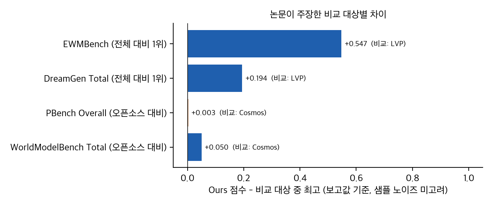
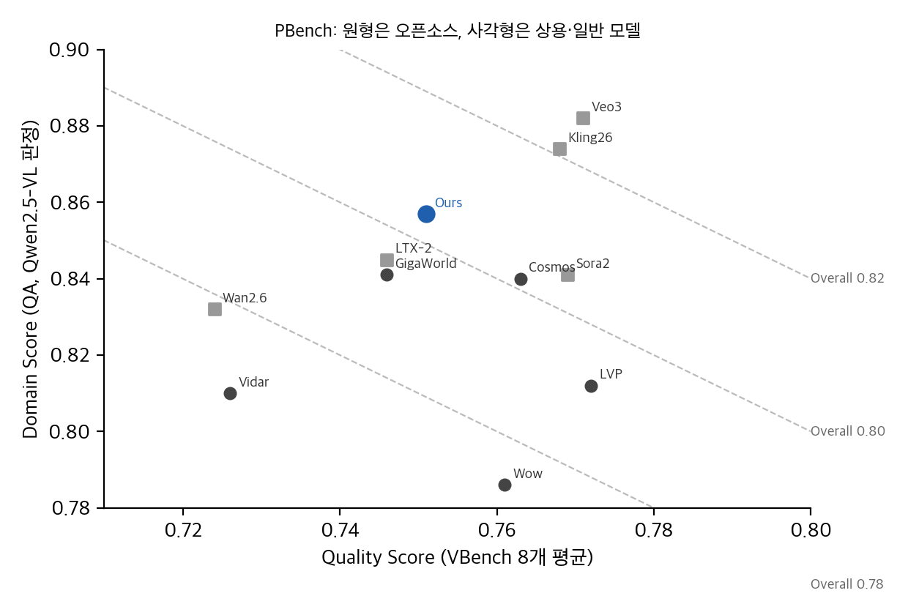

> **논문:** Qwen Team. *Qwen-RobotWorld Technical Report: Unifying Embodied World Modeling through Language-Conditioned Video Generation.* arXiv:2606.17030 (v3, 2026-06-17). 기술 보고서이며 학회 채택 표기가 없습니다. 라이선스는 arXiv 페이지 기준 CC BY 4.0입니다.
> 공식 코드와 가중치 링크는 찾지 못했습니다. 이 글의 그래프는 논문 표 값으로 우리가 그렸습니다. 논문 그림은 넣지 않았습니다.

## 논문이 묻는 것

로봇 세계모델은 보통 관절 각도나 말단 궤적 같은 로봇별 행동 표현에 묶입니다. 그래서 로봇이 바뀔 때마다 인터페이스를 다시 만들어야 합니다. Qwen-RobotWorld는 이 문제를 **자연어를 공통 행동 인터페이스로 쓰는 것**으로 풉니다. "오른손으로 분홍 병을 집어 꽃에 물을 붓는다" 같은 한 문장이 로봇 종류와 관계없이 다음 장면을 예측하는 조건이 됩니다.

## 구조와 데이터

- **백본.** 60층 double-stream MMDiT(약 20B)입니다. 동결된 Qwen2.5-VL-7B의 마지막 층 은닉 상태가 행동 조건이고, Wan-VAE 잠재가 장면 상태입니다. 두 흐름은 모든 층에서 joint attention으로 만납니다.
- **데이터 EWK.** 약 8.6M 영상–텍스트 쌍, 200M 넘는 프레임입니다. 임베디드 70%, 일반 영상 30%입니다. 매니퓰레이션, 주행, 내비게이션, 사람→로봇 전이가 들어 있습니다.
- **캡션.** 다섯 계층 주석(과제 목표, 행동 상세, 물리 결과, 종합 캡션 50–100단어, 짧은 명령 15–30단어)을 씁니다. 학습에서 두 종류를 같은 확률로 고릅니다.
- **학습.** 일반 영상으로 사전학습한 뒤 임베디드 데이터를 단계적으로 늘립니다. 단일 시점, 다시점, 다시점 연결, 고난도 과제 순서입니다.

## 확인한 것: 벤치마크 합계

논문 표 2–5의 합계를 구성 항목에서 다시 계산했습니다. 검사한 행은 39개(표 2 11행, 표 3 6행, 표 4 11행, 표 5 11행)이고, 한 행만 맞지 않았습니다. EWMBench의 LTX-2 행은 8개 지표의 합이 2.907인데 보고된 Overall은 3.01입니다. 순위에는 영향이 없지만 저자에게 확인이 필요합니다.

*그래프: 우리가 그렸습니다. 막대는 Ours 점수에서 비교 대상 최고 점수를 뺀 값입니다. EWMBench와 DreamGen은 전체, PBench와 WorldModelBench는 오픈소스가 비교 대상입니다. 샘플 노이즈는 고려하지 않았습니다.*

- **EWMBench 1위 (4.60, 샘플 21개).** 차이가 0.547로 큽니다. 샘플이 21개뿐이라 신뢰하기는 어렵습니다.
- **DreamGen Bench 1위 (4.952).** LVP(4.758)보다 0.194 높습니다.
- **PBench 오픈소스 1위 (0.804).** Cosmos(0.802)와 차이가 0.002입니다. 이 차이는 샘플 노이즈 안에 있을 가능성이 큽니다.
- **WorldModelBench 오픈소스 1위, 전체 3위 (8.99).** Cosmos(8.94)보다 0.05 높습니다. Wan2.6(9.27)과 Veo3(9.25)가 앞섭니다.

## 확인하지 못한 것

- **로봇 제어 성능.** 정책 성공률, 시뮬 정책 평가 상관, 합성 데이터로 학습한 정책 성능이 없습니다. 초록의 세 가지 응용은 주장만 있습니다.
- **구성 요소의 기여.** MLLM 인코더, 3D RoPE 분할, Scene2Robot, 학습 커리큘럼을 따로 떼어 본 실험이 없습니다.
- **낮은 점수의 원인.** 공통 상식과 미적 품질이 낮은 이유를 "낮은 출력 해상도"로 설명하지만 확인하지 않았습니다.
- **데이터 규모.** 주행 샘플이 본문 약 200K, 같은 논문 §2.2.3은 1,744,405 클립이라고 적습니다.

*그래프: 우리가 그렸습니다. 가로축은 VBench 8개 지표 평균, 세로축은 도메인 QA 점수입니다. 점선은 Overall 등고선입니다. 자체 모델은 도메인 점수에서 강하지만 품질 점수는 평균 근처입니다.*

## 재현 가능성

이 논문은 **재현할 수 없습니다.** 공식 코드, 가중치, 데이터 목록이 없습니다. 형제 저장소인 Qwen-RobotManip과 Qwen-RobotNav도 가중치 공개 계획이 없다고 명시합니다. 20B 규모의 모델을 학습하거나 다운로드하는 것도 개인 연구 환경에서는 어렵습니다. 대신 표 값 재계산과 주장 검증은 누구나 할 수 있습니다.

## 정리

Qwen-RobotWorld는 **벤치마크에서 강해 보이는 기술 보고서**입니다. 합계는 대부분 맞고, 자연어 행동 인터페이스라는 아이디어는 분명합니다. 그러나 1위 주장 가운데 차이가 작은 것이 있고, 로봇에서 쓸모가 있다는 증거는 아직 없습니다. 세계모델을 평가할 때는 샘플 수, 판정기, 차이의 크기를 함께 보아야 합니다.

## 자료

- [통합 리포트 PDF](report/report_public.pdf)
- [Qwen-RobotWorld Technical Report (arXiv:2606.17030) 분석](analysis/01_paper_analysis.md)
- [Qwen-RobotWorld 선행연구와 관련 자료](analysis/02_prior_work.md)
- [Qwen-RobotWorld 수치 재계산과 일관성 검사](analysis/03_analysis.md)
- [Qwen-RobotWorld 주장 검증 (C1–Cn)](analysis/04_claim_verification.md)
