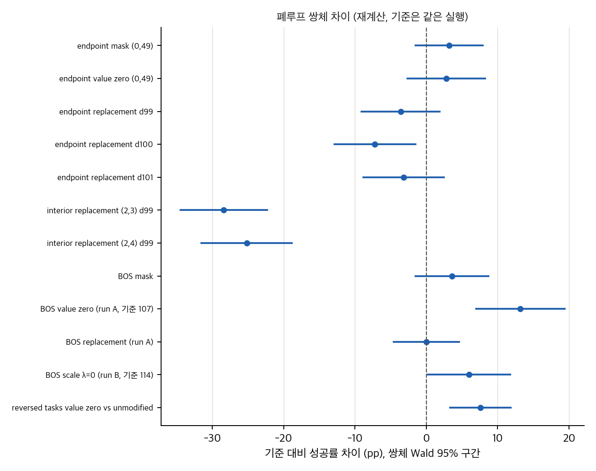
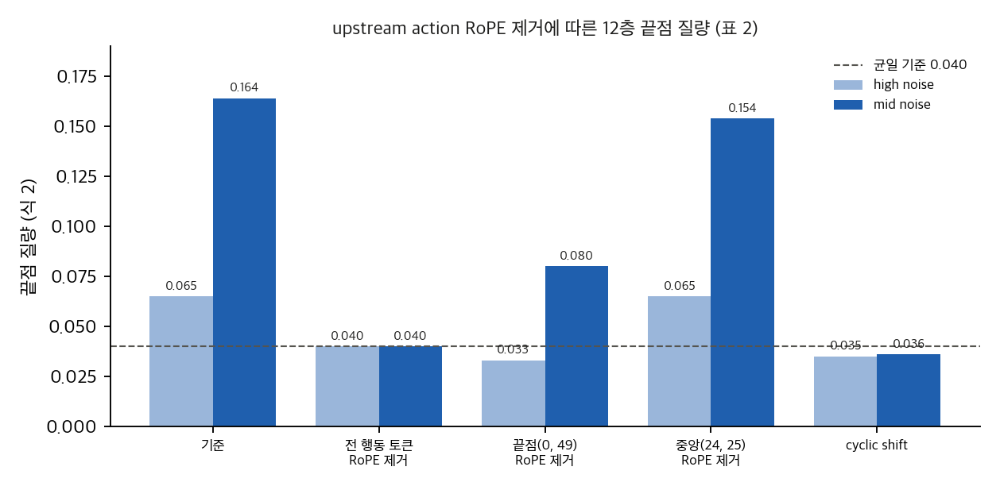
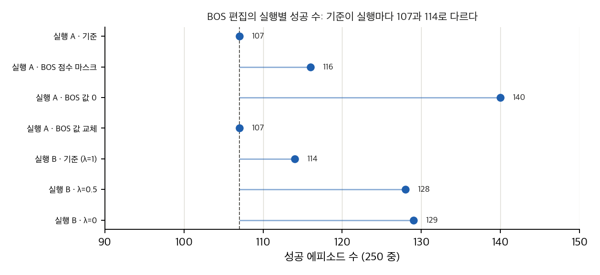

> **논문:** Yuxi Zheng, Yueqian Lin, Yudong Liu, Zijia Tang, Junyu Pan, Yiheng Wang, Hai Helen Li, Yiran Chen. *Beyond the Sink Interpretation: Radial Attention in Flow-Based VLA Policies.* arXiv:2611.26385 (v1, 2026-11-19). 학회 표기는 확인되지 않았습니다.
> 공식 코드는 확인되지 않았습니다. 논문 라이선스는 CC BY가 아니므로 이 글은 논문 그림을 싣지 않고 우리가 만든 그래프만 씁니다.

---

## 논문이 묻는 것

flow 기반 VLA의 action expert에서 행동 청크의 첫 토큰과 마지막 토큰은 다른 행동 토큰보다 많은 attention을 받습니다. 이전 연구는 이를 "radial action sink"라 부르고, 실행 horizon을 정하는 앵커로 썼습니다. 그런데 언어모델의 sink는 이름 이상의 뜻이 있습니다. attention을 많이 받으면서 value는 작고, 출력에 거의 영향을 주지 않는 토큰입니다.

이 논문은 그 세 조건이 행동 청크 끝점에서도 성립하는지 묻습니다. 실험은 π0.5 체크포인트 하나, RoboCasa 과제 다섯 개에서 같은 관측과 같은 초기 노이즈를 공유하는 쌍체 개입으로 이루어졌습니다. horizon 규칙 자체는 검증하지 않았다고 명시합니다.

## 이 글에서 확인한 것

논문의 폐루프 결과 열한 개를 표의 개수에서 다시 계산했습니다. 차이, 95% 구간, p 값이 모두 반올림 범위에서 맞았습니다. 과제별 칸을 더한 합계도 맞았습니다.

그래프: 쌍체 폐루프 차이와 Wald 95% 구간. 논문 표 4, 6, S5, S7, S8, S9의 개수로 다시 계산했습니다. 끝점 교체 d100의 p = 0.020은 보정하지 않은 값이며, 일곱 비교로 보정하면 유의하지 않습니다. 우리가 그린 그래프입니다.

결과를 세 줄로 요약하면 다음과 같습니다.

- 끝점 교체는 성공을 3–7 pp 낮추고, 실행된 중간 토큰 교체는 25–28 pp 낮춥니다. 끝점의 value가 아주 중요하지 않다는 뜻이지만, 끝점 49는 실행되지 않은 토큰이라 두 비교는 위치와 실행 여부가 섞여 있습니다. 논문도 이를 인정합니다.
- 끝점 value의 norm은 행동 토큰 평균과 비슷하고(비율 약 1.0), 출력 기여는 평균보다 큽니다. sink의 "작은 value" 조건을 만족하지 않습니다.
- prefix `<bos>`는 질량이 크고 value가 작아 sink 조건에 맞습니다. 그러나 이 토큰의 value를 0으로 두면 성공이 오르는데, 그 근거가 약합니다. 아래에서 설명합니다.

## 끝점 질량은 위치에서 온다

끝점에 쏠린 attention은 RoPE가 만든 위치 효과입니다. 상위 층의 행동 토큰 RoPE를 빼면 깊은 층의 집중이 균일 기준 0.040으로 돌아갑니다. 논문 표 2에서 중간 노이즈 값은 0.164에서 0.040으로 떨어집니다. prefix의 RoPE만 빼면 거의 변하지 않습니다.

그래프: 표 2의 12층 끝점 질량. 점선은 균일 기준 0.040입니다. 상위 층 행동 토큰 RoPE를 빼면 집중이 기준으로 돌아갑니다. 우리가 그린 그래프입니다.

## `<bos>` 이득을 읽을 때 조심할 것

prefix `<bos>`의 value를 0으로 두면 성공 수가 올라갑니다. 논문 표 6에서는 107에서 140으로, +13.2 pp입니다. 같은 방향의 두 번째 실행에서는 +6.0 pp이고, p는 0.058입니다.

그런데 같은 정책의 비조작 기준이 두 실행에서 107과 114로 다릅니다. 불일치 에피소드도 27개입니다. 두 기준의 차이 7 에피소드(2.8 pp)는 두 번째 실행 효과(+6.0 pp)의 절반 가까이 됩니다. 논문은 두 효과 크기의 차이가 실행 변동 안에 있는지 검정하지 않았다고 씁니다.

그래프: 표 6, S9, S10의 실행별 성공 수. 점은 성공 에피소드 수, 파선은 실행 A의 기준 107입니다. 두 실행의 비조작 기준이 다릅니다. 우리가 그린 그래프입니다.

이 결과는 "같은 방향이 두 번 나왔다"까지만 말할 수 있습니다. 크기를 말하거나 "재현되었다"고 하려면 세 번째 이상 실행과 실행 간 변동 측정이 필요합니다. 논문도 이 이득이 이 체크포인트에서만 관찰되었다고 씁니다.

## 라우팅은 상대 위치 구조를 따른다

행동 청크 안의 토큰이 서로 다르게 유지되는 것은 상대 오프셋 구조의 라우팅 덕분이라고 논문은 봅니다. 다른 과제에서 추정한 프로파일을 쓰면 spread가 기준의 75%를 유지하고, 폐루프 성공도 세 과제에서 기준과 비슷합니다(42.7% 대 38.7%). 그러나 차이 +4.0 pp의 p는 0.35이고, 불일치쌍 수가 보고되지 않아 확인할 수 없습니다. 학습에 쓰지 않은 두 과제에서는 성공이 줄었습니다.

## 정리

- 끝점 attention이 RoPE에서 온다는 주장은 표 안에서 일관됩니다.
- 끝점 value가 sink가 아니라는 주장은 재계산과 맞습니다. 다만 끝점과 중간 토큰의 비교는 실행 여부가 섞였습니다.
- `<bos>` value 0의 이득은 흥미롭지만 근거가 약합니다. 세 번째 실행이 필요합니다.
- 공식 코드가 없어 구현 검증은 못 했습니다. 측정 도구를 만드는 것은 가능하지만, 논문의 폐루프 재현은 GPU가 있어야 합니다.

## 자료

- [통합 리포트 PDF](report/report_public.pdf)
- [01. 논문 분석: Beyond the Sink Interpretation: Radial Attention in Flow-Based VLA Policies](analysis/01_paper_analysis.md)
- [02. 선행연구, 구성 요소의 출처, GitHub 자료](analysis/02_prior_work.md)
- [03. 수치 재계산과 일관성 검사](analysis/03_analysis.md)
- [04. 주장 검증 (공식 코드 없음)](analysis/04_claim_verification.md)
