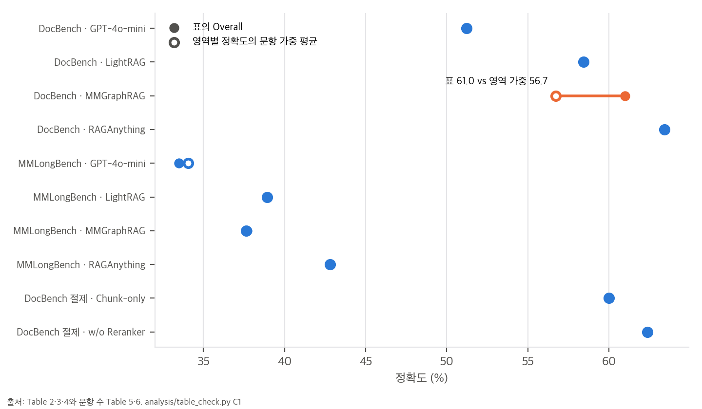
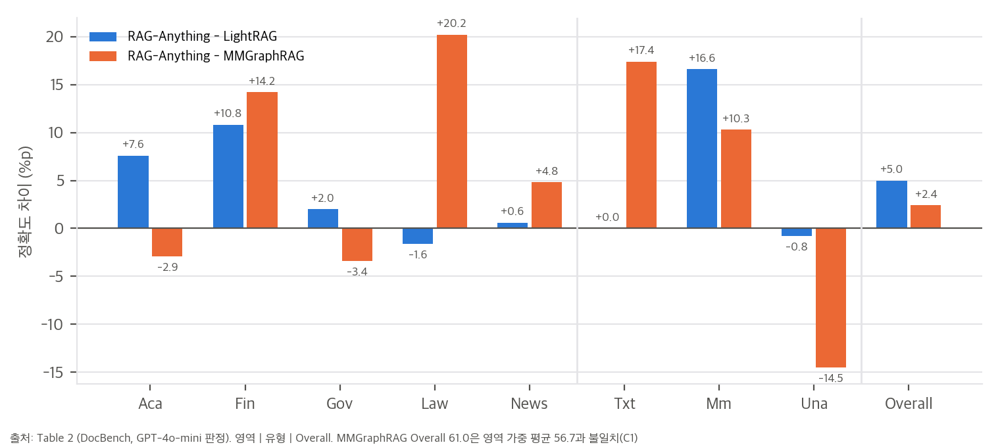
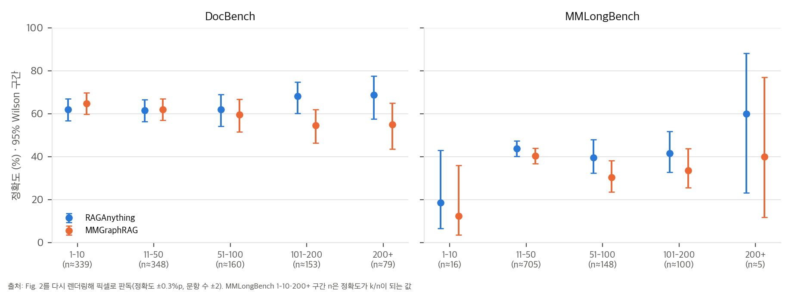

# 03. 수치 재계산과 해석

재계산 스크립트는 `analysis/table_check.py`(표·그림 수치, 결과 `table_check_results.json`)와 `analysis/code_logic_toy.py`(공식 코드 두 곳의 동작, 결과 `code_logic_toy_results.json`)입니다. 외부 API를 부르지 않고 CPU에서 몇 초 안에 끝납니다. 그래프는 `analysis/plot_figures.py`로 그렸습니다.

## 1. Overall은 영역 값의 문항 가중 평균이어야 한다 (C1)

DocBench의 Overall은 문항 1,102개의 정답률이므로, 영역별 정확도 a_d를 영역 문항 수 n_d(Table 5: 303, 288, 148, 191, 172)로 가중 평균한 값과 같아야 합니다.

```
Overall = Σ_d n_d · a_d / Σ_d n_d     (반올림 오차는 ±0.05%p 이내)
```

| 행 | 표의 Overall | 영역 가중 평균 | 차이 |
|---|---|---|---|
| GPT-4o-mini (T2) | 51.2 | 51.22 | 0.0 |
| LightRAG (T2) | 58.4 | 58.44 | 0.0 |
| **MMGraphRAG (T2)** | **61.0** | **56.73** | **+4.3** |
| RAG-Anything (T2) | 63.4 | 63.43 | 0.0 |
| Chunk-only / w/o Reranker (T4) | 60.0 / 62.4 | 60.00 / 62.38 | 0.0 |
| MMLongBench 네 방법 (T3) | 33.5 / 38.9 / 37.7 / 42.8 | 34.05 / 38.92 / 37.64 / 42.81 | GPT-4o-mini만 −0.55 |



**MMGraphRAG 행만 4.3%p 어긋납니다.** 칸 하나가 잘못 적혔다고 가정하고, Overall 61.0을 맞추려면 각 영역 값이 얼마여야 하는지 역산했습니다.

| 칸 | 표의 값 | 61.0이 되려면 | 그럴듯한가 |
|---|---|---|---|
| Aca | 64.3 | 79.8 | 낮음 |
| Fin | 52.8 | 69.2 | 가능 (그러면 Fin 1위가 MMGraphRAG) |
| Gov | 64.9 | 96.7 | 아님 |
| **Law** | **40.0** | **64.7** | **가능** (다른 방법의 Law는 59–62. 40.0이 유일한 이상값) |
| News | 61.5 | 88.9 | 아님 |

Fig. 2의 구간별 정확도를 그림의 문항 수로 가중 평균하면 MMGraphRAG는 60.9입니다(§3). Overall 61.0이 실제 계산값이고, 영역 칸 하나(Law나 Fin)가 잘못 적혔을 가능성이 큽니다. 이것은 가설입니다. Law가 64.7이었다면 RAG-Anything은 Law에서 2위가 아니라 3위이고, Fin이 69.2였다면 Fin 1위를 놓칩니다.

## 2. 이득은 어디서 오는가: 유형 분해 (C2, C7)

| 차이 (%p) | Txt. | Mm. | Una. | Overall |
|---|---|---|---|---|
| RAG-Anything − LightRAG | 0.0 | **+16.6** | −0.8 | +5.0 |
| RAG-Anything − MMGraphRAG | +17.4 | +10.3 | **−14.5** | +2.4 |



- **LightRAG 대비 이득은 전부 멀티모달 질문에서 나옵니다.** Txt는 85.0으로 같습니다. RAG-Anything이 텍스트 처리에서는 LightRAG를 그대로 쓴다는 코드 구조(`04` §1)와 정확히 맞습니다.
- **답할 수 없는 질문에서는 MMGraphRAG보다 크게 낮습니다.** 검색이 많은 근거를 가져오면 reader가 근거 없는 질문에도 답을 만들어 내는 경향으로 읽을 수 있습니다. 본문은 이 열을 다루지 않습니다.
- **유형 세 개만으로는 Overall을 맞출 수 없습니다.** Table 2·4의 7개 행에 공통 유형 비율(Txt, Mm, Una)을 비음수 최소제곱으로 맞추면 잔차가 최대 2.7%p(MMGraphRAG)입니다. DocBench 원 논문에는 메타데이터 질문 유형도 있는 것으로 아는데, 표에 없는 유형이 Overall에 섞여 있다면 설명됩니다. 원 벤치마크 유형 구성은 내 사전 지식이라 확인이 필요합니다. 그래서 이 맞춤에서 나온 유형별 문항 수 추정(259, 305, 538)은 믿을 만하지 않습니다.

## 3. Fig. 2 길이 구간: 작은 구간은 한두 문항 차이다 (C5)

Fig. 2를 300 dpi로 다시 렌더링하고, 막대 위끝과 표식 중심을 픽셀로 읽었습니다. 정확도 축은 64 px가 20%p, 문항 수 축은 DocBench 0.874 px/문항, MMLongBench 0.431 px/문항입니다.

- **본문 수치와 맞습니다.** 101–200쪽 68.1 vs 54.5(본문 68.2 vs 54.6), 200쪽 이상 68.7 vs 54.9(본문 68.8 vs 55.0), MMLongBench 차이 +3.4, +9.2, +7.9(본문 +3.4, +9.3, +7.9)입니다.
- **Overall도 재현됩니다.** 구간 정확도를 그림의 문항 수로 가중 평균하면 DocBench 63.2 / 60.9, MMLongBench 42.6 / 37.7입니다(표 63.4 / 61.0, 42.8 / 37.7).
- **MMLongBench 양끝 구간은 문항 수가 작습니다.** 막대가 6 px, 2 px 이하라 높이로는 셀 수 없어서, 두 방법의 정확도가 동시에 k/n이 되는 가장 작은 n을 찾았습니다.

| 구간 | n | RAG-Anything | MMGraphRAG | Fisher p |
|---|---|---|---|---|
| 1–10쪽 | 16 | 3/16 = 18.8%, 95% [6.6, 43.0] | 2/16 = 12.5%, [3.5, 36.0] | 1.0 |
| 200쪽 이상 | 5 | 3/5 = 60%, [23.1, 88.2] | 2/5 = 40%, [11.8, 76.9] | 1.0 |



그림에서 가장 극적으로 보이는 MMLongBench 200쪽 이상의 60% vs 40%는 한 문항 차이입니다. 긴 문서에서의 이득은 DocBench 101쪽 이상(약 230문항)과 MMLongBench 51–200쪽(약 250문항)에서만 근거가 있습니다.

- **그림 문항 수 합이 표와 다릅니다.** DocBench 약 1,079(표 1,102, −2%), MMLongBench 약 971(표 1,082, −10%)입니다. 막대 하나당 판독 오차 ±2로는 MMLongBench의 110문항 차이를 설명할 수 없습니다. 쪽수 정보가 없는 문서가 빠졌거나 다른 부분집합으로 그렸을 수 있습니다.

## 4. 차이의 표본 오차 (C3)

문항별 결과가 공개되지 않아서, 같은 n의 두 비율을 비대응 z 검정으로 근사했습니다. 같은 문항을 푼 대응 자료이므로 실제 McNemar 검정은 이보다 민감할 수 있습니다. 아래 p값은 보수적인 근사로 읽어야 합니다.

| 비교 | 차이 | p (비대응 근사) |
|---|---|---|
| DocBench vs MMGraphRAG | +2.4 | 0.25 |
| DocBench vs LightRAG | +5.0 | 0.016 |
| MMLongBench vs MMGraphRAG | +5.1 | 0.016 |
| MMLongBench vs LightRAG | +3.9 | 0.065 |
| Chunk-only → 전체 (Table 4) | +3.4 | 0.10 |
| w/o Reranker → 전체 | +1.0 | 0.63 |

RAG-Anything의 Overall 95% Wilson 구간은 DocBench [60.5, 66.2], MMLongBench [39.9, 45.8]입니다. "그래프 구성이 필수"(Sec. 3.3)라는 결론은 p ≈ 0.10인 3.4%p 차이 하나에 기대고 있습니다.

## 5. 코드가 만드는 그래프의 실제 모양 (G)

`modalprocessors.py`를 읽으면 그래프 구성 규칙은 다음과 같습니다(논문 시점 `806ac9b`와 HEAD 모두 같음).

1. 비텍스트 단위마다 앵커 노드를 만듭니다. 이름은 VLM이 준 이름에 `" (image)"`, `" (table)"` 같은 유형 접미사를 붙인 것입니다(HEAD 1139–1141행).
2. 상세 설명문을 하나의 청크로 저장하고, LightRAG의 일반 개체 추출(`extract_entities`)을 돌립니다.
3. 추출된 내부 개체마다 `개체 → 앵커`로 `belongs_to` 간선(weight 10.0)을 추가합니다.
4. 텍스트 쪽과 같은 그래프 저장소에 넣으므로, 이름 문자열이 정확히 같은 노드는 자동으로 합쳐집니다.

그래서 텍스트 쪽 개체에서 출발한 1-hop 탐색이 그림 앵커에 닿으려면, 앵커의 내부 개체 m개 중 하나 이상이 텍스트 개체와 이름이 정확히 같아야 합니다. 내부 개체 하나가 텍스트 개체와 같은 이름일 확률을 p라고 두면 다음과 같습니다.

```
P(앵커가 텍스트 그래프와 연결) = 1 − (1 − p)^m
```

| p \ m | 2 | 5 | 10 |
|---|---|---|---|
| 0.05 | 0.10 | 0.23 | 0.40 |
| 0.1 | 0.19 | 0.41 | 0.65 |
| 0.2 | 0.36 | 0.67 | 0.89 |
| 0.4 | 0.64 | 0.92 | 0.99 |

(시뮬레이션 2,000개 앵커로 확인, `code_logic_toy.py` G)

해석:
- p는 "같은 개념을 그림 설명과 본문에서 LLM이 똑같은 문자열로 부를 확률"입니다. 동의어나 대소문자, 단·복수 표기 차이가 있으면 떨어집니다. 실제 값은 데이터에 따라 다르고 이 toy로는 알 수 없습니다.
- 연결되지 않은 앵커도 버려지지는 않습니다. LightRAG의 개체 검색은 키워드 임베딩으로 개체 벡터 DB를 찾으므로(`operate.py _get_node_data`), 앵커나 내부 개체가 직접 벡터로 검색될 수 있습니다. 즉 이 시스템에서 그림에 닿는 주된 경로는 "그래프 탐색"보다 **개체 설명의 벡터 검색**일 가능성이 큽니다. 논문이 강조하는 "dual graph의 개체 정렬"이 실제로 얼마나 기여하는지 보려면, 병합을 끈 절제가 필요합니다.

## 6. 판정 fallback의 부분 문자열 버그 (E)

`reproduce/llm_answer_evaluator.py`의 `create_fallback_evaluation`(229–268행)은 판정 응답이 JSON으로 파싱되지 않을 때 쓰입니다. 순서는 다음과 같습니다.

1. `"accuracy": n`, `accuracy … n`, `correct … n`, `accurate … n` 패턴에서 첫 숫자를 찾습니다. 그 숫자가 0이나 1이 아니면 그 패턴은 버립니다.
2. 그래도 없으면 긍정 키워드(`correct`, `accurate`, `right`, `yes`, `true`, `match`)를 **부분 문자열로 먼저** 검사하고, 그다음 부정 키워드를 봅니다.

규칙을 그대로 옮겨 9개 응답에 적용한 결과입니다.

| 판정 응답 | 의도 | 채점 |
|---|---|---|
| "The generated answer is incorrect." | 0 | **1** |
| "Incorrect: the expected value is DKK 26,778 million, …" | 0 | **1** (첫 숫자 26이 0/1이 아니라 패턴을 버리고, "incorrect" ⊃ "correct") |
| "… does not match … (mismatch in the year)." | 0 | **1** |
| "Not accurate; the model chose the VAE panel." | 0 | **1** |
| "This is wrong." | 0 | 0 |
| "The generated answer is correct." | 1 | 1 |
| 닫는 괄호가 없는 `{"accuracy": 1, …` / `{"accuracy": 0, …` | 1 / 0 | 1 / 0 |
| "Accuracy: 0 because the panel is wrong" | 0 | 0 |

의도가 0인 응답 7개 중 4개가 정답으로 채점됩니다. 기본 판정 모드가 여러 지표를 함께 요구하는 `comprehensive`라서 JSON이 길어지고 깨질 여지도 커집니다. 다만 이 경로는 파싱이 실패할 때만 쓰이므로, 논문 수치에 실제로 얼마나 영향을 주었는지는 실패 빈도를 알아야 판단할 수 있습니다. 이 스크립트는 논문 이후에 추가되었으므로, 논문 수치를 이 스크립트로 냈다는 증거도 없습니다.

## 7. 비용의 자릿수 (C8)

논문에는 비용이 없습니다. 공개 설정(GPT-4o-mini, text-embedding-3-large, 청크 1,200 토큰, gleaning 1회, 질의 문맥 32,000 토큰)으로 **텍스트 처리만** 어림하면 다음과 같습니다. 가격(입력 $0.15/M, 출력 $0.60/M, 임베딩 $0.13/M)은 내 사전 지식이라 확인이 필요합니다.

| 벤치마크 | 문서 토큰 | LLM 입력 | LLM 출력 | 임베딩 | 합계(텍스트만) |
|---|---|---|---|---|---|
| DocBench (229문서, 1,102문항) | 10.6 M | 88.6 M | 10.6 M | 15.9 M | 약 $22 |
| MMLongBench (135문서, 1,082문항) | 2.9 M | 52.9 M | 2.9 M | 4.3 M | 약 $10 |

여기에 그림·표·수식마다 부르는 VLM 호출(이미지 토큰 포함)이 더해집니다. 문서당 그림 수가 논문에 없어서 이 부분은 추정하지 않았습니다. 방법 하나를 벤치마크 하나에 돌리는 비용은 수십 달러 수준으로 보입니다. 질의 입력(문항당 약 33,500 토큰)이 의외로 큽니다. DocBench에서는 색인 추출 입력(약 48 M)과 비슷한 규모(약 37 M)이고, 문서가 짧은 MMLongBench에서는 색인(약 13 M)의 세 배쯤 됩니다.
