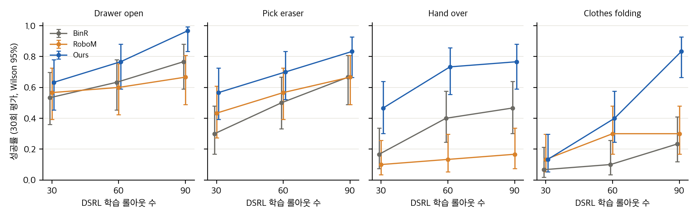
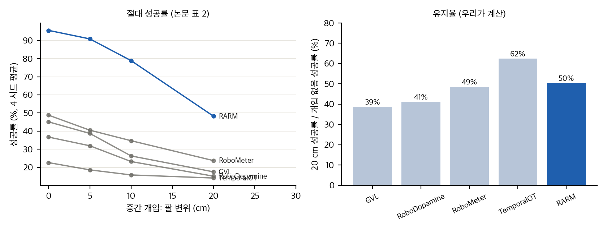
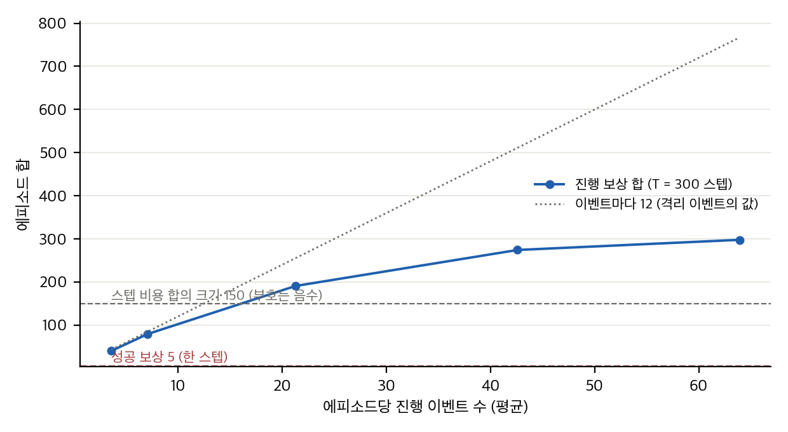
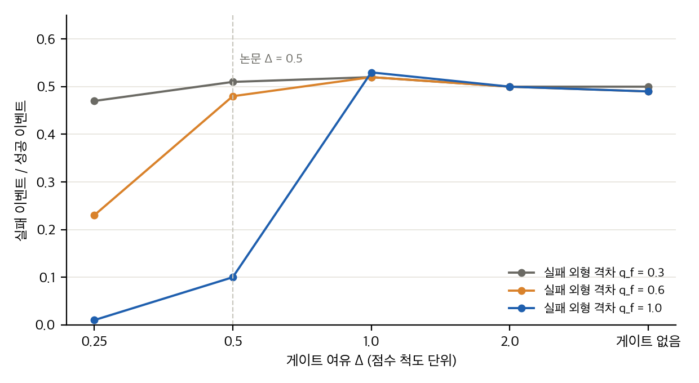

> **논문:** Pengzhi Yang, Xinyu Wang, Pengyu Jing, Kehan Wen 외. *RARM: Confidence-Gated Progress Reward Modeling for RL in Manipulation.* CoRL 2026 포스터, arXiv:2606.22027 (v5, 2026-10-12).
> 공식 코드(`pengzhi1998/rarm`)는 정적으로만 읽었고 실행하지 않았습니다. 코드에는 라이선스 파일이 없습니다. 논문 그림은 싣지 않고, 우리가 만든 그래프만 씁니다(arXiv 비독점 배포 라이선스).

## 논문이 묻는 것

로봇 RL에서 보상 설계는 여전히 병목입니다. 성공만 알려 주는 이진 보상은 긴 과제에서 신호가 약하고, 학습된 진행(progress) 보상은 "겉보기만 그럴듯한 실패"에 높은 값을 줘서 RL 에이전트가 이를 악용합니다. RARM은 **성공 시연 하나**를 기준으로 삼아 이 두 문제를 함께 풀려고 합니다.

방법은 세 부분입니다. (1) DAVIS와 MOSE 같은 일반 영상으로 5프레임 클립 비교기를 한 번만 대조 학습합니다. 음성은 같은 영상의 떨어진 구간, **시간을 뒤집은 클립**, 다른 영상입니다. (2) RL 중에는 롤아웃 클립을 기준 시연의 모든 클립과 비교해 "기준상 어디쯤인가"를 잡습니다. (3) 가장 닮은 기준 클립의 점수가 **기준 영상이 자기 자신과 일치하는 점수보다 Δ = 0.5 이내로만 낮을 때**(신뢰 게이트) 진행을 갱신하고, 새 최고 진행에 도달하면 +1을 줍니다.

시뮬레이션 9과제(MetaWorld 4, LIBERO-10 5)에서는 DrQ-v2를 처음부터 학습하고, 실로봇 4과제에서는 π0에 DSRL을 얹어 이 보상을 씁니다. 모든 비교에서 RARM이 가장 좋다고 보고하며, 천 옷 접기에서 격차가 가장 큽니다(90 롤아웃에서 25/30, 이진 보상 7/30).

## 실로봇 표 1: 점추정은 맞고, 칸별 구분은 일부

본문의 정량 주장(세 과제에서 BinR 대비 3–10 롤아웃 앞섬, 옷 접기에서 BinR의 3배 이상과 RoboMeter의 2.8배 등)은 표와 모두 맞습니다. 다만 평가가 칸당 30회라서 구간이 넓습니다. 12칸 중 이진 보상 대비 Fisher 검정 p < 0.05인 칸은 5개이고, 다중 비교를 보정하면 1개입니다. RoboMeter 대비는 5개(보정 후 3개)입니다. 네 과제를 합치면 세 예산 모두에서 유의합니다.

그래프: 표 1(실로봇 30회 평가)의 성공률과 Wilson 95% 구간. Hand over와 옷 접기 후반에서만 RARM이 확실히 분리되고, Drawer와 Pick은 구간이 겹칩니다. 우리가 그린 그래프입니다.

또 하나 눈에 띄는 점은 버전 사이의 변화입니다. v1(2026-06)의 실로봇 표는 평가가 10회였고 기준선은 이진 보상 하나였습니다. v3(2026-08)부터 평가가 30회로 늘고 RoboMeter가 기준선으로 들어왔습니다. v1과 v5의 28칸은 3배 관계에 가깝습니다(두 표가 독립 재수집이라는 가정에서 기대되는 카이제곱 통계량은 28 근처이고 관측값은 7.8). 같은 체크포인트를 더 많이 평가했을 가능성이 있고, 그렇다면 실로봇 "학습"은 예산마다 한 번뿐이어서 위의 p는 학습 실행 간 변동을 담지 못합니다. 논문은 평가 구성을 적지 않으므로 저자 확인이 필요합니다.

## 표 2: 회복 실험의 우위는 절대값에서 옵니다

v5에서 추가된 표 2는 LIBERO-10에서 에피소드 중간에 팔을 밀어낸 뒤의 성공률입니다. RARM은 모든 변위에서 가장 높습니다. 그러나 20 cm 변위에서 개입이 없을 때의 성공률로 나눈 유지율은 RARM 50%, RoboMeter 49%, TemporalOT 62%로 RARM이 더 낫지 않습니다. 우위의 대부분은 개입이 없을 때의 큰 격차(95.6% 대 48.8%)에서 옵니다.

그래프: 표 2의 절대 성공률(왼쪽)과 20 cm 변위 유지율(오른쪽). 우리가 그린 그래프입니다.

± 값의 정의와 시드별 값이 없고(4 시드), RARM의 95.6, 90.9, 78.9%는 시행 수 40–200의 정수 성공 수로는 만들 수 없습니다. 평균을 낸 단위가 따로 있을 가능성이 큽니다.

## 공식 코드: 일치하는 곳과 다른 곳

저장소는 두 가지로 나뉩니다. `main`은 보상 모델 학습·추론이고 `policy_training_RARM` 가지는 LIBERO-10 DrQ-v2 학습입니다. 식 (1)–(5)의 구현은 논문과 같습니다. 손실, Δ = 0.5, 자기 일치로 만든 문턱, 진행 고수위선 방식의 +1 보상이 확인됩니다. 다른 곳은 평가 조건과 보상 배치입니다.

- **평가는 기준 시연의 한 초기 배치에서 합니다.** LIBERO 표준 초기 분포 대신 기준 시연의 첫 상태에서 시작하고 물체 위치에 0.5 mm 잡음만 더합니다. 코드 주석은 표준 배치(최대 ±2.5 cm)에서는 보상 모델의 초기 클립 매칭이 어긋난다고 설명합니다. `--seed`는 기준 시연 번호도 정하므로 시드 변동에 시연 선택이 섞입니다. 논문은 이 처리를 적지 않습니다.
- **"처음부터 학습"에 데모가 들어갑니다.** 학습 에피소드를 데모 중간 상태에서 시작하고(확률은 1에서 0으로 선형 감쇠), 절반의 확률로 이후 70스텝의 데모 행동을 잡음과 함께 재생합니다. 논문 부록은 중간 상태 초기화만 씁니다. 기준선 구현은 공개되어 있지 않아 같은 보조를 줬는지 알 수 없습니다.
- **보상의 크기가 +1이 아닙니다.** 코드는 이벤트를 클립 중앙으로 옮기고, 앞의 두 샘플도 1로 채우고, 렌더 간격(4 환경 스텝) 동안 값을 유지해 스텝에 뿌립니다. 격리된 이벤트 하나의 에피소드 보상 합은 12입니다. 성공 보상(5)과 스텝 비용(−0.5)에 비해 진행 보상 합이 1–2자릿수 큽니다.

그래프: 공식 정책 학습 코드의 보상 배치 논리를 numpy로 다시 구현한 토이(코드는 실행하지 않음). 에피소드 길이 300 스텝과 이벤트의 독립 분포는 가정입니다. 우리가 그린 그래프입니다.

- **체크포인트가 원 설정과 다릅니다.** README는 원래 LIBERO 설정이 epoch-20 체크포인트를 썼고 공개본은 epoch-45이며 결과를 다시 확인하지 않았다고 밝힙니다. 논문은 학습 에폭, 영상 수, 정적 영상 필터를 쓰지 않고 코드에도 영상 목록과 필터가 없습니다.
- **공개 범위.** MetaWorld, 기준선 다섯 개, 실로봇 π0 + DSRL 코드, 표와 그림 스크립트는 저장소에 없습니다.

## 게이트는 점수 척도와 참조 길이에 달려 있습니다

Δ = 0.5는 학습 온도 τ = 0.1에서 소프트맥스 가중 비율 e^5 ≈ 148배까지를 "자기 일치만큼 믿을 만하다"고 받는 문턱입니다. 또 argmax는 M개 점수 중 최댓값을 고르므로 점수 잡음 σ가 있으면 선택된 점수가 σ·sqrt(2 ln M)만큼 부풉니다. σ = 0.25로 가정하면 M = 20–180에서 0.6–0.8로 Δ와 같은 크기입니다. 기준 영상이 길수록 같은 Δ가 느슨해진다는 뜻입니다.

보상은 진행량이 아니라 **진행 수준에 새로 도달한 횟수**를 셉니다. 한 번에 0에서 0.9로 뛰는 롤아웃은 +1, 조금씩 올리는 롤아웃은 훨씬 큽니다. 그림 5의 "실패/성공 보상 비율"이 이벤트 수의 비라는 점과 같은 성질입니다.

간단한 토이로 게이트의 민감도를 봤습니다(점수 척도는 우리 가정).

그래프: 토이에서 게이트 Δ에 따른 실패 이벤트 수와 성공 이벤트 수의 비. 실패의 외형 격차가 Δ를 충분히 넘을 때(격차 1.0)만 게이트가 비율을 크게 낮추고, 격차 0.6에서는 Δ = 0.5가 거의 작동하지 않습니다. 점수 척도는 가정이고, 우리가 그린 그래프입니다.

이 토이는 논문의 1.89 비율을 재현하려는 것이 아닙니다. 하나의 상수 Δ가 과제에 이전되는지는 실패가 만드는 점수 격차의 크기와 점수 잡음, 참조 길이에 달려 있다는 점만 보입니다.

## 이 맥에서 얼마나 걸릴까

구조가 같은 무작위 가중치 모델(ViT-B 인코더 + 교차 어텐션 비교기)로 Apple M4 Pro의 MPS에서 시간을 쟀습니다. 보상 질의 한 번(클립 5프레임 인코딩 + 기준 클립 70개 비교)이 약 0.19초로, 논문 표 7의 "프레임당 10 ms 미만"의 약 19배입니다. 환경 4스텝마다 질의하므로 10^6 스텝 한 번의 실행에서 보상 계산만 약 13시간입니다. 보상 모델 학습은 한 스텝이 약 2.5–3.8 PFLOP이고 45에폭이면 이 기기에서 약 6.5–9.8일(추정)입니다. 공개 정책 학습은 Linux, CUDA, EGL을 전제로 하므로 이 기기에서 논문 수치의 재현은 불가능합니다.

## 정리

- RARM의 핵심 설계(자기 일치로 만든 게이트, 진행 수준 도달 보상, 일반 영상으로 한 번만 학습한 비교기)는 코드와 일치하고, 실로봇 점추정 우위도 본문과 맞습니다.
- 그러나 칸별 구분은 일부이고, 표 2의 우위는 절대값에서 오며, LIBERO 평가 조건(한 초기 배치, 데모 상태·행동 재생)과 보상 크기는 논문이 적지 않은 부분입니다.
- 공개 체크포인트는 원 설정과 달라 논문 표 재현이 보장되지 않고, 기준선과 실로봇 코드는 공개되지 않았습니다.

저자에게 묻고 싶은 것: 평가의 초기 상태 분포, 데모 행동 재생이 기준선에도 적용되었는지, 표 2의 ± 정의와 평균 단위, 실로봇 예산의 체크포인트가 한 번의 학습 실행에서 나온 것인지.

## 자료

- [통합 리포트 PDF](report/report_public.pdf)
- [01. 논문 분석: RARM](analysis/01_paper_analysis.md)
- [02. 선행연구, 구성 요소, 관련 분석, 자료](analysis/02_prior_work.md)
- [03. 수치 재계산과 토이](analysis/03_analysis.md)
- [04. 논문 ↔ 공식 코드 정적 대조와 구현 가능성](analysis/04_code_verification.md)
