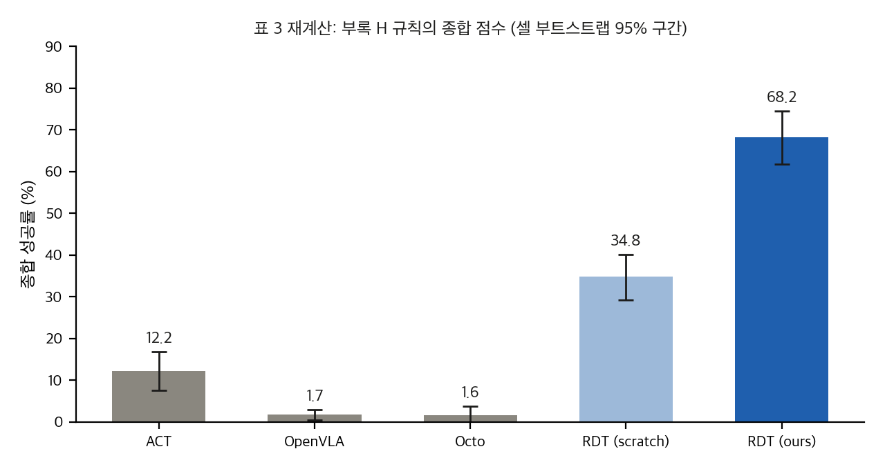
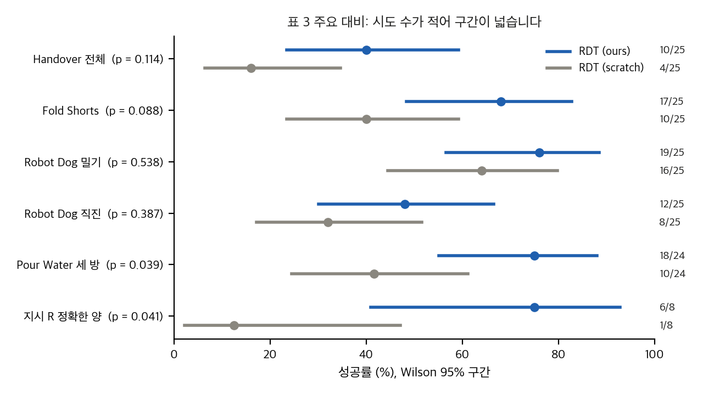

> **논문:** Songming Liu, Lingxuan Wu, Bangguo Li, Hengkai Tan, Huayu Chen, Zhengyi Wang, Ke Xu, Hang Su, Jun Zhu. *RDT-1B: a Diffusion Foundation Model for Bimanual Manipulation.* ICLR 2025, arXiv:2410.07864 (v2, 2025-03-01).
> 공식 코드는 GitHub thu-ml/RoboticsDiffusionTransformer(MIT)에 있습니다. 이 글의 그림은 우리가 그린 그래프 두 장입니다. 논문 그림은 arXiv 비독점 배포 라이선스라서 쓰지 않았습니다.

## 논문이 묻는 것

양팔 조작은 행동 공간이 두 배이고, 한 과제에 가능한 행동 모드가 여러 개입니다. 회귀로 학습하면 모드들의 평균이 나와 실패합니다. 그래서 이 논문은 행동 분포를 확산으로 모델링하는 정책을 씁니다. 여기에 데이터 부족 문제를 더합니다. 양팔 로봇 데이터는 1만 궤적 아래로 적습니다. 그래서 46개 데이터셋으로 사전학습하고, 자체 ALOHA 양팔 데이터 6K+ 에피소드로 파인튜닝합니다.

모델은 깊이 28, 폭 2048의 확산 트랜스포머 1.2B입니다. 세 군데를 고쳤습니다. QKNorm과 RMSNorm으로 큰 물리 입력의 발산을 막고, 마지막 디코더를 MLP로 바꾸고, 이미지와 언어를 층마다 번갈아 교차 어텐션으로 넣습니다. 여러 로봇을 한 정책에 넣기 위해 128차원 행동 공간도 씁니다. 로봇마다 물리 의미가 정해진 자리에 값을 넣고 빈 자리는 0으로 둡니다.

## 이 글에서 확인한 것

**1. 종합 점수는 셀에서 다시 맞습니다.** 그림 1의 종합 점수를 부록 H 규칙(과제 안 평균, 차원 평균, 전체 평균)으로 셀에서 다시 계산했습니다. RDT 68.2, RDT scratch 34.8, ACT 12.2, OpenVLA 1.7, Octo 1.6이 모두 맞습니다. 셀 부트스트랩 95% 구간은 RDT 61.7–74.4, ACT 7.6–16.8입니다.

*그래프: 우리가 그린 그래프. 논문 그림 1의 값을 셀로 재계산했습니다.*

**2. "56%" 향상은 기준을 정해야 합니다.** 서론의 56%는 68.2 − 12.2 = 56.0 %p(대 ACT)입니다. 그런데 ACT는 지시 과제가 없어 4개 차원으로 평균을 냅니다. 기준을 맞추면 50.2 %p, ACT 지시 차원을 0으로 넣으면 58.5 %p가 됩니다. 어느 쪽이든 RDT가 앞서지만, 숫자의 기준은 본문에 없습니다.

**3. 사전학습 효과는 일부에서만 유의합니다.** 과제별 시도는 8회 또는 25회입니다.
- 미지 물체(컵 3개 합 14/24 대 scratch 0/24)와 미지 장면(18/24 대 10/24, p = 0.039)은 유의합니다.
- 지시 R(정확한 양 6/8 대 1/8, p = 0.041)도 유의합니다.
- 소수 샷(Handover 10/25 대 4/25, p = 0.11; Fold 17/25 대 10/25, p = 0.09)과 정교 조작(로봇 개 밀기 p = 0.54, 직진 p = 0.39)은 유의하지 않습니다.

*그래프: 우리가 그린 그래프. 구간이 넓어 25회 이하 표본으로는 차이를 확정하기 어렵습니다.*

**4. 절제의 세 요소 결론은 근거가 약합니다.** 표 2는 세 변형을 8회씩 평가했습니다. 지시 따르기만 회귀와 소형 모델 대비 유의합니다(p = 0.001, 0.007). 미지 물체와 장면은 변형 사이에 차이가 없습니다. 그림 4의 구조 절제는 사전학습 없이 학습한 결과입니다.

## 공식 코드와 논문의 차이

공식 코드는 논문과 구조와 학습 설정이 대부분 맞습니다. 깊이 28, 폭 2048, 128차원 행동 공간, DDPM 1000 스텝과 DPM-Solver 5 스텝, 마스크 10%, 교대 조건 주입이 그렇습니다. 사전학습 데이터 가중치 46개도 논문 표 5와 정렬 비교에서 맞습니다. 파라미터 수도 블록 구조로 세면 약 1.17B로 1.2B와 맞습니다.

차이는 세 곳입니다. 파인튜닝은 논문 130K 스텝인데 스크립트는 200K입니다. 시작 체크포인트는 논문 부록이 500K라고 쓰지만 스크립트는 1M 체크포인트를 씁니다. 온보드 추론은 논문이 RTX 4090에서 돌렸다고 쓰지만, README는 그 GPU에서 T5-XXL을 올리기 어려우니 언어 임베딩을 미리 계산하라고 합니다. 실로봇 평가 코드와 자체 ALOHA 데이터는 공개되지 않았습니다.

## 구현 가능성 (이 맥)

이 분석은 Apple M4 Pro 24 GiB, CUDA 없음 기준입니다. 측정은 하지 않았습니다.

- **사전학습과 전체 파인튜닝: 불가.** 48 H100으로 한 달, 파인튜닝도 3일을 전제합니다.
- **추론: 조건부.** 2.46 GB 체크포인트, 언어 임베딩 사전계산, MPS bf16 지원을 확인해야 합니다. 노력은 1–3일로 추정합니다.
- **실로봇과 공식 평가 재현: 불가.** 하드웨어와 데이터가 필요합니다.

## 한계

- 본문에 한계 절이 없습니다. 실험의 시도 수, 한 로봇, 한 시드를 본문이 다루지 않습니다.
- 베이스라인 ACT와 OpenVLA는 같은 규모로 사전학습되지 않았고 과제별 파인튜닝만 했습니다.
- 재계산은 논문이 보고한 셀 값에 대해서만 했습니다. 원자료와 실로봇 영상은 확인하지 못했습니다.

## 출처와 라이선스

- 논문은 arXiv에 비독점 배포 라이선스(nonexclusive-distrib 1.0)로 공개되어 있습니다. CC BY가 아니어서 논문 그림을 쓰지 않았습니다.
- 공식 코드는 MIT 라이선스입니다. 이 글을 위해 실행하거나 설치하지 않았습니다. 정적으로만 읽었습니다.
- 표 값은 인용과 재계산을 위해 옮겼습니다. 그래프와 분석은 작성자가 만들었습니다.

## 자료

- [통합 리포트 PDF](report/report_public.pdf)
- [01. 논문 분석: RDT-1B](analysis/01_paper_analysis.md)
- [02. 선행연구와 공식 자료](analysis/02_prior_work.md)
- [03. 수치 재계산과 검정](analysis/03_analysis.md)
- [04. 공식 코드 대조: 논문 ↔ 저장소 (D1–D21)](analysis/04_code_verification.md)
