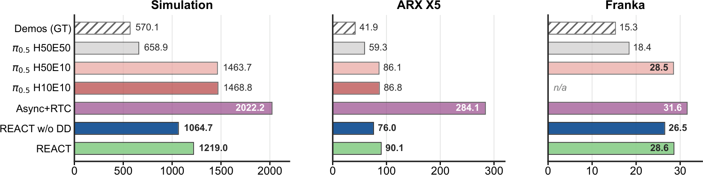
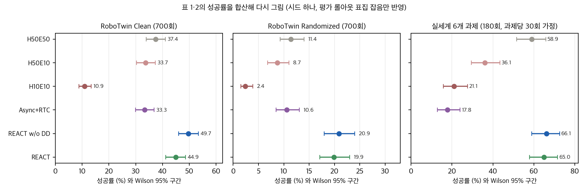
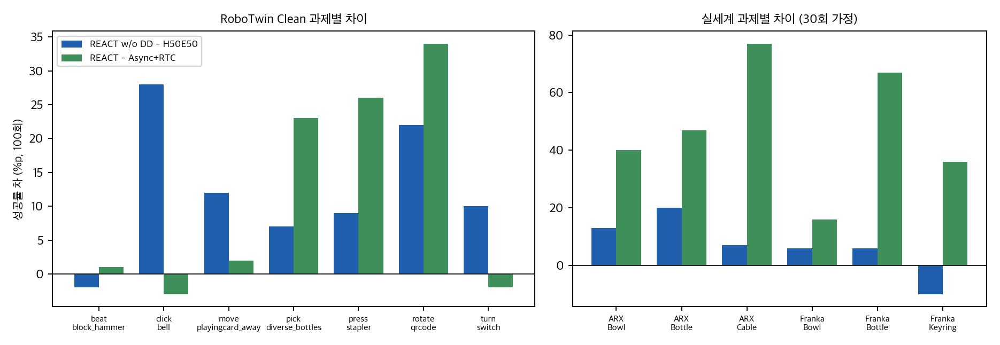
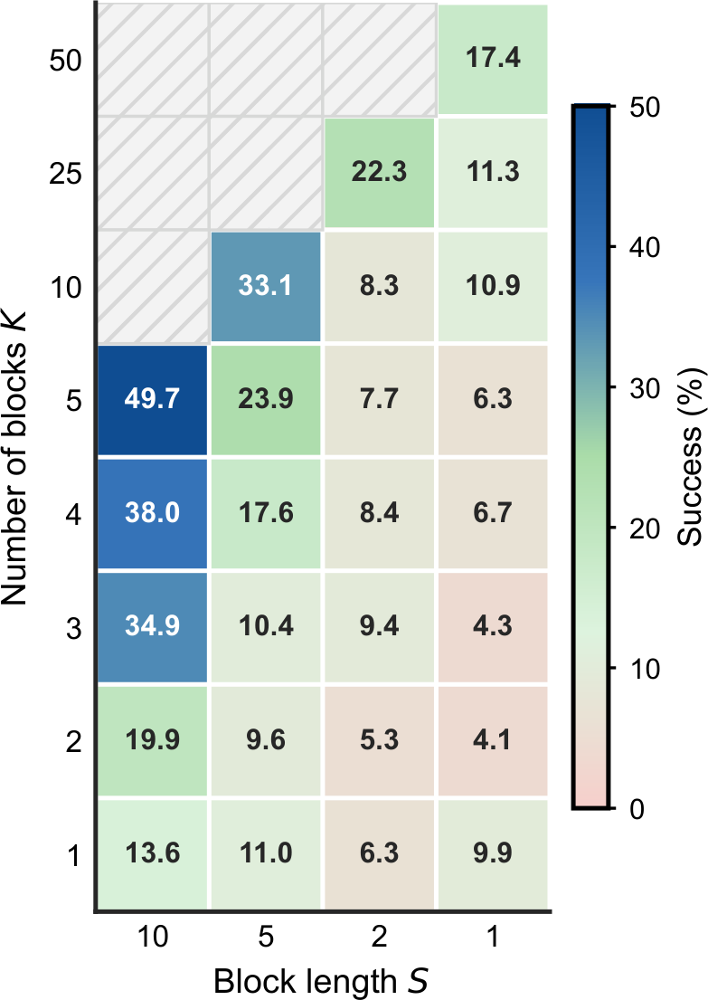
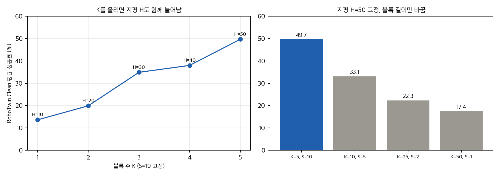
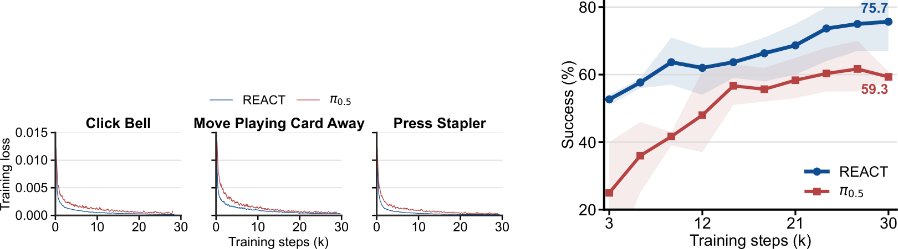
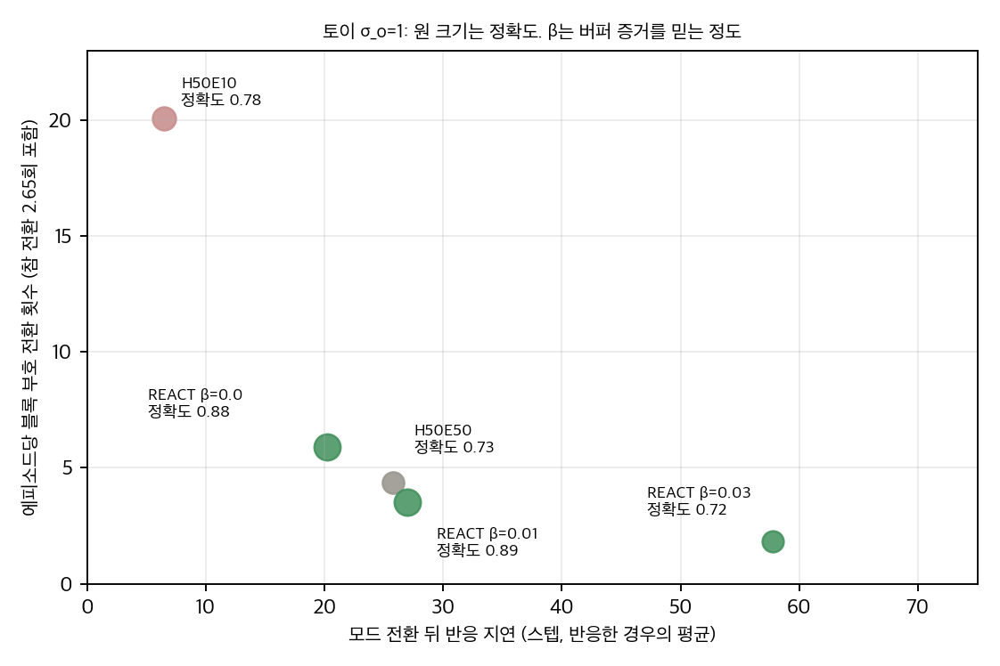

> **논문:** Houlong Xiong, Zhenqi Qiu, Zechen Wang 외. *REACT: Rolling Denoising and Dual Decoupling for Reactive Robot Control with VLA Models.* CoRL 2026 Spotlight, arXiv:2610.12007 (v1, 2026-10-08).
> 공식 코드는 GitHub houlong-xiong/REACT(Apache-2.0)에 있습니다. 이 글의 그림은 논문 그림 세 장(출처 표기)과 우리가 그린 그래프입니다.

## 논문이 묻는 것

청크 단위 flow VLA에서 긴 청크는 매끄럽지만 관측이 오래되고, 자주 다시 계획하면 반응은 빠르지만 청크 경계마다 모드가 바뀝니다. REACT는 H=50 구간을 K=5개 블록으로 나눠 블록마다 다른 flow 시간(계단형)을 주고, 갱신마다 새 관측으로 DiT를 한 번 돌려 Euler 한 단계만 진행합니다. 가장 깨끗한 앞 블록을 실행하고 나머지를 한 칸 당기며 뒤에 새 잡음을 붙입니다. Dual Decoupling은 센싱, VLM 인코딩, DiT, 실행을 나눠 처리량을 올립니다.

식을 따라가 보면 한 단계는 정확히 한 계단입니다. 속도가 목표와 같다면 블록 k는 시간 (k+1)/K에서 k/K로 가고, 맨 앞 블록은 마지막 관측과 버퍼를 함께 조건으로 한 깨끗한 예측으로 점프합니다. 그래서 새 관측이 실행 블록에 미치는 영향은 모델이 버퍼와 관측을 어떻게 섞도록 학습됐는지에 달려 있습니다.

*그림 3 (논문 원문). © 저자, CC BY 4.0, 출처 arXiv:2610.12007.*

## 이 글에서 확인한 것

**1. Async+RTC 대비 성공률 이득은 확실합니다.** 본문의 z = 4.44, 4.84, 9.10이 그대로 재현되고, 과제로 층을 나눈 검정에서도 유지됩니다(실세계 180회는 과제당 30회 가정). 다만 시뮬레이션 이득은 pick_diverse_bottles, press_stapler, rotate_qrcode 세 과제에 몰려 있습니다.

*그래프 (우리가 그림). 표 1, 표 2 값을 합산해 다시 그렸습니다. 실세계는 과제당 30회 가정, 시드는 하나입니다.*

**2. 청크 전체 실행 기준선(H50E50)과의 실세계 차이는 시행 수로 구분되지 않습니다.** REACT 65.0%와 H50E50 58.9%는 Fisher p = 0.28입니다(30회 가정). 이 차이를 80% 검정력으로 보려면 팔당 약 1000회가 필요합니다. 시뮬레이션에서는 REACT w/o DD가 H50E50보다 확실히 높습니다(+12.3%p). 반대로 H50E10은 시뮬에서 H50E50과 구분되지 않습니다(p = 0.15).

*그래프 (우리가 그림). 시뮬레이션 Clean은 과제당 100회, 실세계는 30회 가정입니다.*

**3. 반응 지연은 H50E50과만 구분됩니다.** Reaction Game의 REACT 734 ms는 H50E10, H10E10, Async+RTC, REACT w/o DD와 p = 0.08–0.71입니다(시행 수 20–50 가정, ±는 표본 SD 가정). 선택 관측률이 Async+RTC(H_e=10)와 같은 3 Hz여서 둘의 지연이 비슷한 것은 표 5의 산술과 맞습니다.

**4. jerk 우위는 Async+RTC 대비에서 견고합니다.** 모든 방법에 성공이 있는 과제만 비교하면 시뮬 0.60배, ARX 0.32배입니다. 자주 다시 계획하는 H50E10 대비는 시뮬에서만 낮고(0.83배) 실로봇에서는 같은 수준입니다(1.06배, 0.97배). jerk 평균은 방법마다 성공 에피소드 집합이 달라 이 점을 함께 봐야 합니다.

**5. 절제의 "K를 올리면 좋아진다"는 지평도 함께 늘어난 결과입니다.** 그림 11과 12의 26칸은 모두 맞습니다. 그러나 S=10에서 K를 1에서 5로 올리면 H도 10에서 50이 됩니다. H=50으로 고정하면 블록 길이가 짧을수록 내려갑니다.

*그림 11 (논문 원문). © 저자, CC BY 4.0, 출처 arXiv:2610.12007.*

*그래프 (우리가 그림). 그림 11 값을 다시 묶었습니다.*

**6. 학습 효율 주장은 추론 방식과 섞여 있습니다.** 그림 5(b)의 끝점 75.7과 59.3은 표 1의 세 과제 평균(REACT w/o DD의 롤링 추론, H50E50의 전체 청크 실행)과 같은 값입니다. 서로 다른 추론 방식을 비교한 것이라 학습 방식만의 효과로 읽기 어렵습니다. 학습 손실도 시간 분포가 달라 직접 비교에 한계가 있습니다.

*그림 5 (논문 원문). © 저자, CC BY 4.0, 출처 arXiv:2610.12007.*

## 토이로 본 것

롤링 버퍼가 모드 유지와 반응 사이에서 무엇을 하는지 해석적 모델로 확인했습니다(1차원, 두 갈래 모드, 베이즈 최적 흐름 정책, numpy). 버퍼 증거를 얼마나 믿는지를 β로 두었습니다.

- 정확한 베이즈 정책(β=1)은 첫 모드에 고착되어 참 모드가 바뀌어도 따르지 않았습니다(정확도 0.51).
- 증거를 낮게 믿는 영역(β=0.01)에서는 H50E10보다 블록 부호 전환이 5.7배 적고 정확도가 높았지만 반응 지연은 약 4배였습니다. H50E50과는 전환 횟수와 지연이 비슷하고 정확도가 높았습니다.
- 이득의 일부는 표본 대신 평균을 실행하는 효과입니다(버퍼를 무시한 β=0도 정확도 0.884). 실제 π0.5가 이 곡선의 어디에 있는지는 이 토이로 알 수 없습니다.

*그래프 (우리가 그림). 해석적 토이(σ_o = 1.0)이며 실제 VLA 결과가 아닙니다.*

## 공식 코드와 논문의 차이

공식 저장소(openpi PyTorch 포크)의 계단 시간, 한 단계 Euler, 버퍼 이동, 워밍업은 논문 식과 맞습니다. 시뮬 학습 하이퍼파라미터도 표 6과 같습니다. 다음은 다릅니다.

- 기준선(H50E10, H10E10, Async+RTC), RoboTwin 평가 스크립트, jerk와 Reaction Game 코드, 체크포인트가 저장소에 없습니다.
- Franka 행동의 회전은 코드 문서 기준 sin/cos 6개이고 논문은 6D 회전 표현입니다(차원 수는 20으로 같습니다).
- 코드 검증이 K=1을 거부해 그림 11의 K=1 칸은 공개 설정으로 만들 수 없습니다.
- 학습에서는 한 청크의 모든 블록이 같은 관측과 짝이고, 추론 시 버퍼 블록은 서로 다른 관측에서 옵니다. 부록 C.5의 일치 논증은 (시간, 위치) 쌍에 한정됩니다.

## 구현 가능성 (Apple M4 Pro, CUDA 없음)

- **실로봇, RoboTwin 평가, 공식 학습: 불가.** 장비와 GPU가 필요하고 체크포인트와 평가 코드가 공개되어 있지 않습니다.
- **정적 코드 대조, 표 재계산, 처리량 산술, 롤링 토이: 가능.** 이 글이 그 결과입니다.
- **소형 DiT와 작은 조작 시뮬에서 계단 학습과 롤링 추론의 축소판: 가능.** 2–4일로 추정합니다(측정 전).

이 글은 재현 실험을 하지 않았습니다.

## 한계

- 학습 시드가 하나라 모든 검정은 평가 롤아웃 표집 잡음만 반영합니다.
- 실세계 과제당 30회와 특수 과제 시행 수는 논문 기술과 가정에 의존합니다. 표의 소수 백분율 표기가 한 규칙이 아닐 가능성이 있어 저자 확인이 필요합니다.
- 토이는 해석 모델이며 학습된 VLA의 성질을 보이지 않습니다.

## 출처와 라이선스

- 논문: arXiv:2610.12007, CC BY 4.0(arXiv 라이선스 페이지 확인). 원문 PDF 저작권 표시는 찾지 못했습니다.
- 그림 3, 5, 11은 논문 원문에서 잘라 실었습니다(© 저자, CC BY 4.0). 로봇 사진과 시뮬 화면이 있는 그림은 싣지 않았습니다.
- 표 값은 인용과 재계산을 위해 옮겼습니다. 그래프, 토이, 분석 문서와 스크립트는 이 글의 작성자가 만들었습니다.
- 공식 코드와 체크포인트는 받아서 실행하지 않았습니다. 코드는 정적으로만 읽었습니다.

## 자료

- [통합 리포트 PDF](report/report_public.pdf)
- [01. 논문 분석: REACT (arXiv:2610.12007)](analysis/01_paper_analysis.md)
- [02. 선행연구와 관련 저장소](analysis/02_prior_work.md)
- [03. 수치 재계산, 일관성 검사, 토이, 주장 판정](analysis/03_analysis.md)
- [04. 공식 코드 대조와 구현 가능성](analysis/04_code_verification.md)
