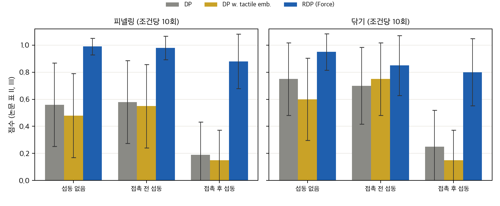
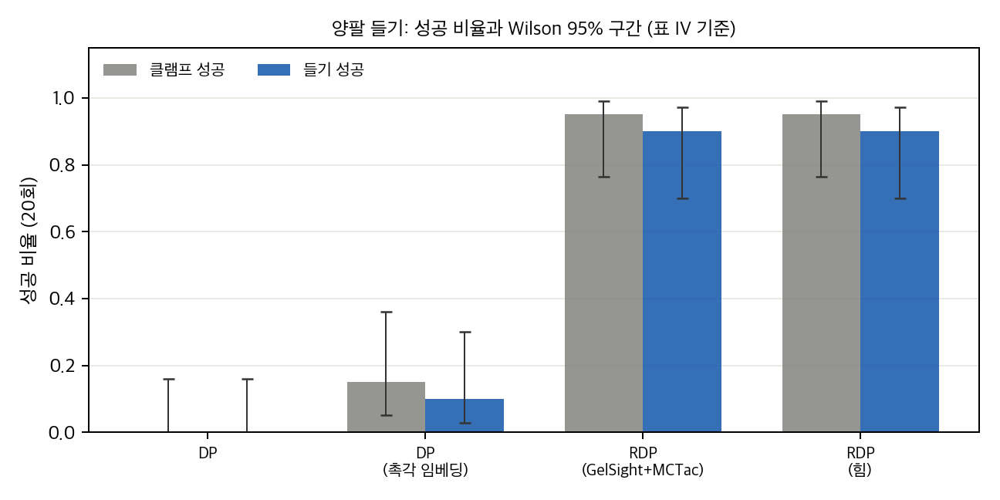
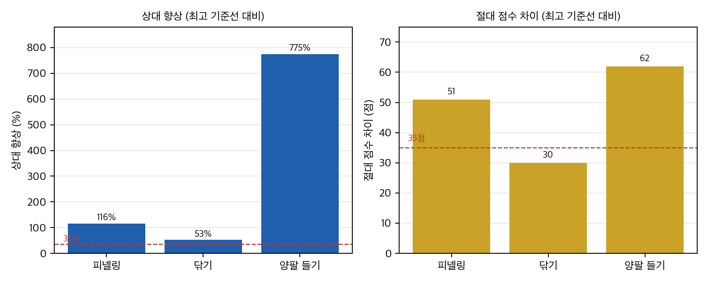

> **논문:** Han Xue, Jieji Ren, Wendi Chen, Gu Zhang, Yuan Fang, Guoying Gu, Huazhe Xu, Cewu Lu. *Reactive Diffusion Policy: Slow-Fast Visual-Tactile Policy Learning for Contact-Rich Manipulation.* RSS 2025, arXiv:2503.02881 (v3, 2025-04-23).
> 공식 코드는 GitHub xiaoxiaoxh/reactive_diffusion_policy에 있습니다(코드 MIT, 제3자 고지 포함). 이 글의 그림은 우리가 그린 그래프 세 장입니다. 논문 그림은 넣지 않았습니다(arXiv 비독점 라이선스).

## 논문이 묻는 것

접촉이 많은 작업은 눈으로만 하기 어렵습니다. 사람은 큰 흐름을 미리 계획하고, 접촉이 생기면 힘을 보고 바로 고칩니다. 최근의 시각 모방 학습은 행동 청크를 한꺼번에 예측합니다. 그래서 시간 일관성은 좋지만, 청크를 실행하는 동안에는 촉각 변화에 반응하지 못합니다.

RDP는 두 속도의 정책을 씁니다. 느린 잠재 확산 정책이 1–2 Hz로 청크를 예측하고, 빠른 **비대칭 토크나이저**가 24 Hz로 촉각을 보고 청크를 고칩니다. 토크나이저의 인코더는 행동만 보고, 디코더는 촉각만 봅니다. 잠재에는 큰 흐름만 남고 정확한 위치 보정은 촉각 쪽이 맡습니다.

## 무엇을 다시 계산했나

논문 표는 조건당 10회의 평균입니다. 시행별 점수가 없어서 두 가지 검정을 씁니다. 이진 성공은 Fisher 정확 검정과 Wilson 구간입니다. 점수는 [0, 1]이라는 가정에서 분산이 최대일 때의 Welch 검정입니다. 이 p값은 어떤 분포에서도 넘지 않는 상한입니다.

- 피넬링 전체(30회): 기준선보다 낫습니다. p_max는 10⁻⁵ 수준입니다.
- 닦기 전체(30회): 기준선보다 낫습니다. p_max = 0.009입니다.
- 양팔 들기(20회): 촉각을 넣은 DP는 들기 성공이 2/20이고 RDP는 18/20입니다. Fisher p = 5 × 10⁻⁷입니다.
- **촉각 입력만 추가한 DP는 RGB DP와 구분되지 않습니다**(피넬링 p = 0.70, 닦기 p = 0.59). 효과는 빠른 경로 구조에서 나옵니다.

## "> 35%"는 어떤 단위인가

논문 서론과 결과 절은 세 과제에서 "> 35%" 향상을 씁니다. 상대 향상으로 보면 피넬링 116%, 닦기 53%입니다. 절대 점수 차이로 보면 피넬링 51점, **닦기 30점**입니다. 닦기는 상대로는 넘지만 절대로는 35점에 못 미칩니다. 논문은 단위를 적지 않았습니다.

## 공식 코드는 논문과 얼마나 같은가

정적으로 읽었습니다(실행과 설치는 하지 않았습니다). AT의 비대칭 입력, L1과 KL 손실, 잠재 차원 4와 8, 예측 32, 학습률, 상대 행동 설정, 24 FPS 제어, PCA 15 차원은 논문과 같습니다. 다른 점도 있습니다.

- 표 VII의 LDP 추론 확산 반복은 8이지만, 코드 기본값은 100입니다. 표 I의 시간은 100에 더 가깝습니다.
- 학습률은 GPU 수에 따라 `lr × num_processes`로 바뀝니다. 논문에는 GPU 수가 없습니다.
- EMA, 관측 인코더 학습률 계수 0.1, 워밍업 값은 논문에 없습니다.

## 이 맥에서 할 수 있는 것

- **실로봇 재현: 불가.** Flexiv 로봇 두 대, 촉각 센서, Quest 3가 필요합니다.
- **공식 코드 학습: 조건부.** 설정에 `cuda:0`이 박혀 있고, 데이터는 Hugging Face에서 받아야 합니다. MPS 포팅을 하면 시도할 수 있지만 시간은 측정하지 않았습니다.
- **AT 구조의 작은 재구현: 가능.** 합성 접촉 신호에서 촉각을 디코더에만 줄 때와 인코더에도 줄 때를 비교하는 토이입니다. 아직 만들지 않았습니다.

## 정리

RDP의 핵심 주장, 즉 빠른 촉각 보정 경로가 접촉 작업을 바꾼다는 주장은 통계적으로 탄탄합니다. 조건당 10회라는 시도 수는 개별 조건의 차이를 말하기에는 적습니다. "> 35%"는 어떤 단위인지 확인하고 읽어야 합니다.

## 자료

- [통합 리포트 PDF](report/report_public.pdf)
- [01. 논문 분석: Reactive Diffusion Policy (arXiv:2503.02881)](analysis/01_paper_analysis.md)
- [02. 선행연구와 관련 자료](analysis/02_prior_work.md)
- [03. 재계산, 일관성 검사, 주장 판정](analysis/03_analysis.md)
- [04. 공식 코드 대조 (정적 읽기)](analysis/04_code_verification.md)
