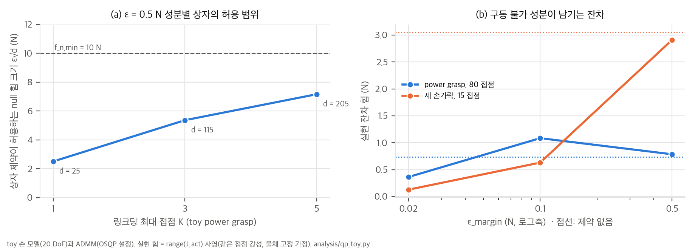
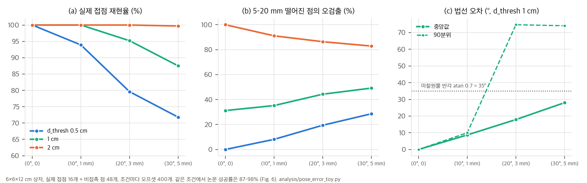

# 03. 핵심 식 해석과 toy 검증

스크립트는 `analysis/qp_toy.py`(QP 구조, 결과 `qp_toy_results.json`), `analysis/pose_error_toy.py`(자세 오차와 접점 추정), `analysis/table_check.py`(그림·표 재계산), `analysis/fig_digitize.py`(Fig. 4 판독)입니다. 모두 numpy·scipy, 단일 스레드, CPU에서 수 초 안에 끝납니다.

QP는 같은 연구실 공개 코드 `utils/grasping/force_gen.py: generate_contact_forces`의 형식을 그대로 옮겼습니다. 결정변수는 z = [f; w], 제약은 w = G f, 비용은 ½‖w‖²입니다. OSQP는 설치되어 있지 않아서, 같은 ADMM 반복(ρ = 0.1, σ = 1e-6, α = 1.6, 등식 행 ρ×10³, 0에서 시작, 1,000회, polish 없음)을 numpy로 구현했습니다.

toy 손은 반지름 4 cm 원통을 감싸는 5손가락 × 4관절(20 DoF) 직렬 사슬과 비구동 손바닥입니다. 실제 Robotis 5F 기구학이 아니라, "링크 j 위의 점은 그 손가락 j번째 관절까지에만 의존한다"는 Jacobian의 희소 구조만 살린 모델입니다.

## 1. 목적함수만으로는 힘 분배가 정해지지 않는다 (Eq. 3–6)

**구조.** G ∈ R^{6×3N}이므로 null(G)의 차원은 3N − rank(G) ≥ 3N − 6입니다. 마찰 원뿔 안에서 정확한 평형(G f = 0)을 이루는 조임이 가능하면 목적함수의 최솟값은 0이고, 최적해 집합은 다음과 같습니다.

```
S* = { f : G f = 0,  f_n ≥ 0,  |f_t1| + |f_t2| ≤ μ f_n,  Σ f_n ≥ f_min,  |J_actᵀ f_act| ≤ τ_max,  (Eq. 9) }
```

이 집합은 볼록 다면체이고, f ∈ S*이면 cf (c ≥ 1)도 토크 한계에 걸리기 전까지 모두 S*에 들어갑니다. 즉 **조임의 총량도 분배도 목적함수가 정하지 않습니다.** 어느 해가 나올지는 솔버가 정합니다. 공개 코드는 힘 크기 정규화 항을 기본으로 쓰지 않습니다(`contact_epsilon=None`).

**toy 결과 (E1, E2).** K = 3, 접점 48개(손바닥 3개 포함)입니다.

| 시작점 | 물체 잔차 | Σf_n | 최대 f_n | 0에서 시작한 해와의 상대 차이 |
|---|---|---|---|---|
| 0 (코드처럼 매 주기 새 솔버) | 0.000 N | 14.6 N | 0.57 N | — |
| 무작위 8개 | 0.000 N | 29.7–39.1 N | 2.4–4.4 N | 1.8–3.0배 |

- 0에서 시작한 ADMM은 최소 노름에 가까운 해를 고릅니다. 접점 위치를 1 mm 흔들면(기하 변화 2.5%) 해는 1.8% 바뀌었습니다(정규화 λ = 1e-3을 넣으면 1.3%). **비유일성 자체가 이 toy에서 떨림으로 이어지지는 않았습니다.**
- 대신 분배는 "물리적으로 정해진 값"이 아니라 솔버의 암묵적 정규화입니다. warm start를 켜거나 솔버 설정을 바꾸면 Σf_n이 2–2.7배인 해로 옮겨 갈 수 있습니다.
- 접촉력 측정값이 없는 이 제어기에서는 이 선택이 그대로 손이 쥐는 세기가 됩니다.

**힘과 토크의 같은 가중치.** 비용 ½(‖w_force‖² + ‖w_torque‖²)에서, 반지름 r에 작용하는 접선 힘 불균형 1 N이 만드는 토크 r N·m는 r²만큼만 벌점을 받습니다(r = 5 cm면 0.0025배). 정확한 평형이 가능할 때는 영향이 없습니다. 제약 때문에 평형이 불가능할 때는 QP가 회전 평형을 사실상 포기하고 병진 평형만 맞춥니다.

## 2. Actuation-consistency 제약 (Eq. 9)은 접점이 많을수록 느슨해진다

**유도.** 구동 접점의 힘을 f_act = f_R + f_N (f_R ∈ range(J_act), f_N ∈ null(J_actᵀ))로 나누면 τ = J_actᵀ f_act = J_actᵀ f_R입니다. **명령 토크는 f_N을 전혀 담지 못합니다.**

접점 강성이 모두 같고 물체가 고정되어 있다고 가정하면(준정적), 실제 접촉력은 Jᵀf = τ를 만족하는 해 중 탄성 에너지가 가장 작은 것, 즉 f_real = J(JᵀJ)⁻¹τ = P_R f_act입니다. 그러면 QP가 믿은 평형과 실제의 차이는 G_act P_N f_act로 남습니다. Fig. 5의 0.428 N이 이 잔차입니다.

**차원.** n_h = 20이므로 rank(J_act) ≤ 20이고, null 차원은 d = 3N_act − rank ≥ 3N_act − 20입니다. 성분별 상자 |N_uᵀ f| ≤ ε는 null 성분 크기를 최소 ε(기저 방향)부터 최대 ε√d(상자 꼭짓점)까지 허용합니다. 상자는 SVD가 고른 기저에 따라 달라지므로 회전 불변도 아닙니다.

| toy 파지 | 접점 (구동) | rank | d | ε√d (ε = 0.5 N) |
|---|---|---|---|---|
| power, K = 1 | 16 (15) | 20 | 25 | 2.5 N |
| power, K = 3 | 48 (45) | 20 | 115 | 5.4 N |
| power, K = 5 | 80 (75) | 20 | 205 | 7.2 N |
| 세 손가락, K = 5 | 15 (15) | 10 | 35 | 3.0 N |



**실현 잔차 (E3, E3b).** "실현 힘 = range 사영" 가정에서 남는 힘 잔차(N)입니다.

| toy 파지 | 제약 없음 | ε = 0.5 | ε = 0.1 | ε = 0.02 |
|---|---|---|---|---|
| power, K = 5 | 0.74 | 0.79 | 1.08 | 0.36 |
| 세 손가락, K = 5 | 3.05 | 2.91 | 0.63 | 0.13 (평형 잔차 0.21 N) |

- 논문 값 ε = 0.5 N에서는 두 toy 파지 모두 제약이 거의 작동하지 않습니다. 구동 불가 비율(‖P_N f‖/‖f‖)도 power에서 0.69 → 0.62, 세 손가락에서 0.39 → 0.39입니다.
- ε를 0.1 N 이하로 줄여야 잔차가 줄어듭니다. 대신 정확한 평형을 포기하는 지점이 생깁니다(ε = 0.02에서 0.21 N).
- **논문 결과와의 연결:** power grasp(접점 많음)에서 제약 유무가 성공률을 바꾸지 않은 것(100% vs 100%)과, 정밀 파지에서 차이가 작은 것(38.5 → 42.1%, 유의하지 않음)이 모두 이 구조로 설명됩니다. Fig. 5에서 효과가 컸던 것은 접점이 적은 예시였기 때문일 수 있습니다(가설).
- **toy의 한계:** 손 기구학과 접점 배치는 가정입니다. power의 ε = 0.1 값이 제약 없음보다 큰 것은, 제약에 따라 솔버가 다른 해를 고른 선택 효과입니다(§1). 경향만 읽어야 합니다.
- **개선 방향:** 차원에 따라 커지지 않으려면 ε를 1/√d로 줄이거나, 노름 제약 ‖N_uᵀ f‖ ≤ ε(2차 원뿔)을 써야 합니다. 후자는 QP가 아니라 SOCP라서 OSQP로는 풀 수 없습니다.

## 3. 계산 속도와 접점 수 (Fig. 7, C5)

K = 1(14 접점, 227 Hz)과 K = 7(91 접점, 66 Hz)로 t = a + b·N을 맞추면, **t ≈ 2.45 ms + 0.140 ms × N_contacts**입니다.

- 접점 수가 K에 비례한다고 보면 K = 5는 65 접점(변수 196개)이고, 예측 속도는 86 Hz입니다. 프로젝트 페이지의 "약 84 Hz"와 맞고, 84 Hz를 역산하면 68 접점입니다.
- QP 접점 수 14(K = 1)는 평균 14개 링크가 1 cm 안에 있다는 뜻입니다. K = 7의 91은 13개 링크 × 7에 해당해 K가 포화된 상태입니다.
- **실물 루프는 30 Hz입니다.** 추적 자세가 올 때마다 한 번 풀기 때문에, 시뮬레이션의 84 Hz가 실물 반응 속도는 아닙니다(Sec. IV-C.1).
- 표본 밀도 2점/cm²는 점 간격 약 7 mm(1/√2 cm)이고, d_thresh 1 cm는 그 1.4배입니다. 3,000점 ÷ 2점/cm²로 역산한 손 표면적은 약 1,500 cm²입니다(구현값으로부터의 역산).

## 4. 하중 시험은 마찰 용량에 비해 매우 작다 (C6)

- 마찰 용량은 μ·f_n,min = 0.7 × 10 = 7 N입니다. 피라미드는 원뿔보다 최소 1/√2배 보수적입니다.
- 시험 하중 0.1 mg가 7 N에 이르려면 물체가 7.1 kg이어야 합니다. 손으로 쥐는 YCB 물체는 대부분 이보다 훨씬 가벼우므로(사전 지식, 물체별 질량은 확인 필요), 하중 시험 자체는 용량의 수십분의 일 이하입니다.
- 반대로 Fig. 5에서 제약 없이 남은 잔차 0.428 N은 0.44 kg 미만 물체라면 시험 하중보다 큽니다. 0.044 kg 미만이면 물체 무게보다도 큽니다.
- 따라서 중력을 끈 이 시험의 실패는 대부분 **제어기가 만든 잔차가 물체를 밀어내는 사건**입니다. "실패 대부분이 자리 잡는 동안"이라는 저자 관찰(Sec. IV-A.2)과 맞습니다. 이 해석에서 접점을 매 주기 갱신하는 제안 방법이 고정 할당보다 유리한 이유는, 외란에 강해서라기보다 자기 잔차를 계속 0으로 다시 맞추기 때문입니다.

## 5. 자세 오차 아래 기하 접점은 얼마나 틀리는가 (Fig. 6 조건)

6×6×12 cm 상자로 조건마다 오프셋 400개를 시험했습니다. 실제 접점은 16개(엄지 3, 손가락 9, 손바닥 4)이고, 실제 표면에서 5–20 mm 떨어진 비접촉 점 48개를 함께 넣었습니다. 회전 중심은 물체 원점이고, 논문 규칙대로 부호 거리 < d_thresh(침투 포함)를 접점으로 봅니다. 아래는 d_thresh = 1 cm 기준입니다.

| 오프셋 (회전, 이동) | 실제 접점 재현율 | 비접촉 점 오검출 | 법선 오차 중앙값 / 90분위 | 논문 성공률 (Fig. 6) |
|---|---|---|---|---|
| (0°, 0) | 100% | 31% | 0° / 0° | 98% |
| (10°, 1 mm) | 100% | 35% | 9° / 10° | 97% |
| (20°, 3 mm) | 95% | 44% | 18° / 75° | 95% |
| (30°, 5 mm) | 88% | 49% | 28° / 74° | 93% |



- 회전 30°만으로 상자 표면 점은 최대 2·r_max·sin 15° = 3.8 cm 밀립니다. 시험한 어떤 d_thresh(0.5–2 cm)보다 큽니다.
- 오프셋이 없어도 d_thresh 1 cm는 5–20 mm 떨어진 점의 31%를, 2 cm는 100%를 접점으로 셉니다. 큰 임계값이 강건한 이유는 "닿을 것 같은 곳까지 미리 밀기" 때문입니다.
- (30°, 5 mm)에서 법선 오차 중앙값 28°는 마찰 원뿔 반각(atan 0.7 = 35°)에 가깝습니다. 명령한 힘이 실제 표면 기준으로 원뿔 가장자리까지 기울어 있다는 뜻입니다.
- 그런데도 성공률이 93%라는 것은, **이 시험에서 성공을 만드는 것이 정확한 접점 기하보다 마찰 여유가 큰 조임**이라는 해석을 지지합니다(§4). 실제 하중이 큰 상황에서도 같은 강건성이 나올지는 이 결과로 알 수 없습니다.

## 6. 그림·표 정합성 요약

| 확인 | 결과 |
|---|---|
| Fig. 3 막대 27개가 구간 n의 정수 k/n인가 | 모두 가능. 전체 Ours 729/790 = 92.3% [90.2, 93.9], Impedance 553/790 = 70.0%, Feedforward 511/790 = 64.7% |
| Fig. 3 본문 서술 | "3–5 구간 32–56% vs 82–95%", "약 1/3이 5개 이하(34.4%)" 모두 일치. 3–5 구간 Ours 195/221 vs Impedance 108/221, p ≈ 1×10⁻¹⁹ |
| Fig. 4 판독값과 시행 수 | 0° 값이 모두 2%의 배수(50 파지), 30–90° 값이 0.2%의 배수(500회)에 0.1%p 안에서 맞음 |
| Fig. 4 ↔ Fig. 7 | Ours의 30/60/90° 평균 92.7% vs Fig. 7 K = 5의 93.2%(같은 파지·각도, 반복 수 다름) |
| 정밀 파지 38.5% → 42.1% (68 파지) | 파지당 1회로는 불가능, 5회(340회)면 131 → 143. p ≈ 0.39 |
| Fig. 7 성공률(750회) | 682, 699, 689로 정수 가능. K = 1 vs 5 p ≈ 0.13 |
| Table I | 합계 201 s, 78회, 8회 놓침, 6회 회복으로 본문과 일치 |
