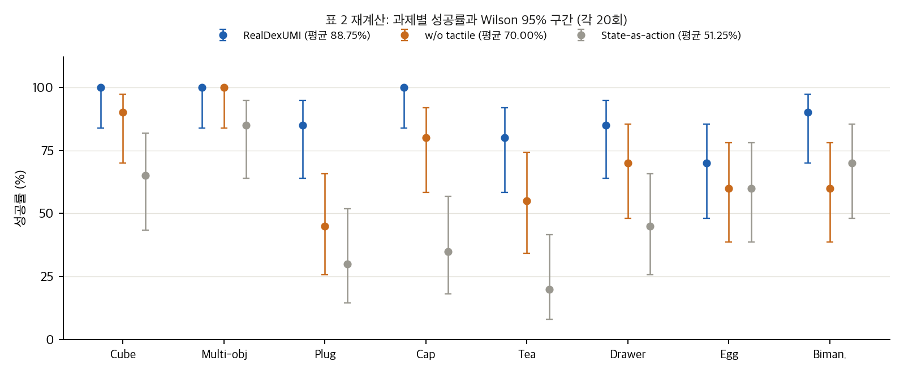
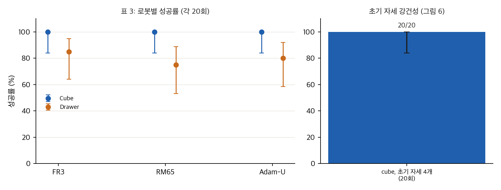
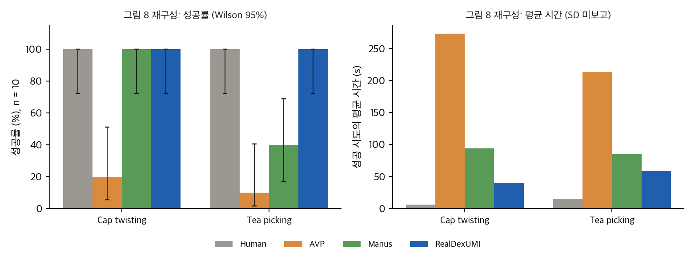

> **논문:** Chaoyi Xu, Yixuan Jiang, Jiahui Huan, Yuhui Fu, Haoyu Zhou, Weitian Yuan, Jiayi Yu, Wanpeng Zhang, Haoqi Yuan, Zongqing Lu. *RealDexUMI: A Wearable Universal Manipulation Interface for Dexterous Robot Learning.* CoRL 2026 포스터, arXiv:2606.06033 (v2, 2026-06-06).
> 공식 코드는 찾지 못했습니다. 이 글의 그림은 우리가 그린 그래프뿐입니다. 논문 그림은 arXiv 비독점 라이선스라서 싣지 않았습니다.

## 논문이 묻는 것

사람이 보여 준 손재주를 로봇이 실행할 수 있는 데이터로 바꾸는 일은 생각보다 어렵습니다. 사람 손 모션을 로봇 손으로 리타게팅하면 접촉이 왜곡되고, 로봇별 텔레옵은 장비에 묶이며, 사람 손에 끼우는 외골격은 손 상태를 재지만 로봇 손이 받을 명령과 접촉은 기록하지 않습니다.

RealDexUMI는 방향을 바꿉니다. **배포할 때 쓰는 손 모듈을 수집기로 씁니다.** 손바닥 쪽 등척 장갑이 손의 여섯 능동 DoF에 1:1로 대응하는 명령을 직접 냅니다. 관측(손 안 카메라, 손끝 촉각, 손 상태)과 행동(상대 엔드이펙터 행동, 손 명령)이 수집과 배포에서 같습니다.

## 이 글에서 확인한 것

**1. 표의 수치는 재현됩니다.** 8개 실로봇 과제(과제당 20회)의 평균 88.75%, 촉각 제거 70.00%, 상태 라벨 51.25%는 셀 값에서 그대로 나옵니다. 풀링 차이는 과제를 층으로 둔 검정에서도 확실합니다(촉각 제거 대 기본: p ≤ 1.5e-5).

**2. 과제별 차이는 약합니다.** 과제당 20회로는 약 30점보다 작은 차이를 잡기 어렵습니다. 과제별 Holm 보정 후 촉각 제거의 차이는 어느 과제에서도 유의하지 않습니다.

*그래프: 표 2의 과제별 성공률(각 20회)과 Wilson 95% 구간. 세 조건. 평균은 논문 값과 같습니다.*

**3. 상대 행동 식은 맞습니다.** 손 기준 상대 행동 ΔT = T_t^{-1}T_{t+k}는 로봇 기저 자세가 고정 변환만큼 바뀌어도 같습니다. 배포 때 T̂_t ΔT̂로 목표를 복원하는 순서가 맞아야 합니다. 순서를 뒤집으면 목표가 크게 어긋납니다(무작위 자세 검사). 손 기준 보정 오차 2 mm는 그대로 목표 오차가 됩니다.

**4. 교차 로봇 결과는 확인이 필요합니다.** 같은 체크포인트가 FR3, RM65, Adam-U에서 서랍 정리 75–85%, 큐브 100%를 보였습니다. 그런데 FR3 값이 표 2 값과 같아서 시도를 재사용했는지 논문에서 확인할 수 없습니다. 초기 자세 실험(큐브, 네 자세, 20/20)에는 상대 행동을 쓰지 않은 대조가 없습니다.

*그래프: 표 3의 로봇별 성공률과 Wilson 95% 구간(왼쪽), 그림 6의 초기 자세 20/20(오른쪽).*

**5. 수집 효율 비교는 성공률만 말할 수 있습니다.** 그림 8에서 차 집기는 RealDexUMI 10/10, Manus 4/10, AVP 1/10입니다(n = 10, Manus 대비 p = 0.011). 시간 평균은 성공 시도만 계산했고 분산이 없어서 검정할 수 없습니다.

*그래프: 그림 8의 막대 라벨에서 읽은 성공 횟수(n = 10, Wilson 95%)와 성공 시도 평균 시간(SD 없음).*

**6. 학습 실행은 하나로 보입니다.** 조건마다 체크포인트가 하나로 보이고, 시드 분산이 없습니다. 이 점이 가장 큰 한계입니다. 과제별 차이를 주장하기 전에 시드를 늘려야 합니다.

## 구현 가능성

- **이 맥(Apple M4 Pro, MPS, CUDA 없음)에서 전체 재현은 불가능합니다.** 손 모듈, 장갑, 촉각 센서의 설계와 데이터가 공개되지 않았고, 교차 로봇 세 종과 실로봇 시험이 필요합니다.
- **소프트웨어 일부는 구현할 수 있습니다.** 상대 행동 라벨과 배포 식은 numpy로 짧게 구현할 수 있고, 식 검사를 끝냈습니다. ACT 학습은 데이터가 공개된 뒤에 MPS에서 시간을 재 봐야 판단할 수 있습니다.

## 자료

- 원문: arXiv:2606.06033 (v2). 프로젝트 페이지: research.beingbeyond.com/realdexumi (GitHub 링크는 저자 조직 전체 페이지뿐입니다).
- 재계산과 식 검사 스크립트, 분석 문서는 `analysis/`에 있습니다. 실행 방법은 저장소 README에 있습니다.

## 자료

- [통합 리포트 PDF](report/report_public.pdf)
- [01. 논문 분석: RealDexUMI](analysis/01_paper_analysis.md)
- [02. 선행 연구와 공식 저장소](analysis/02_prior_work.md)
- [03. 수치 재계산, 통계 검정, 일관성 검사](analysis/03_analysis.md)
- [04. 주장 검증과 구현 가능성](analysis/04_claim_verification.md)
