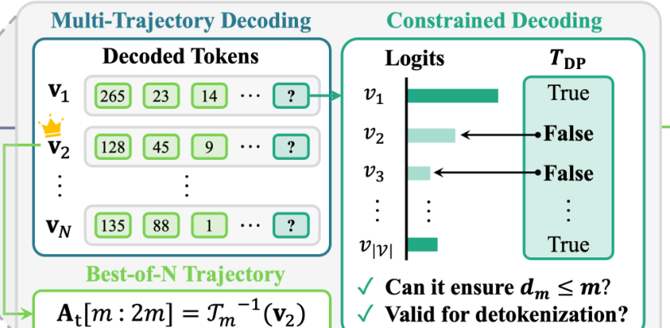
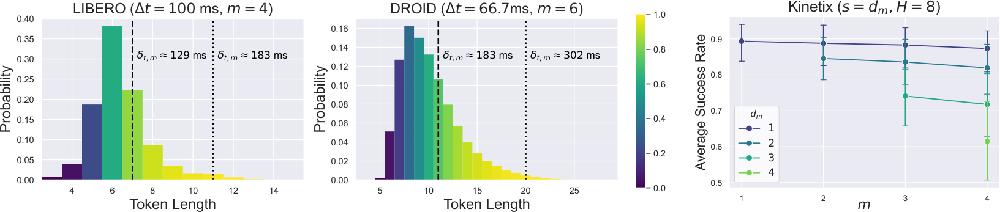
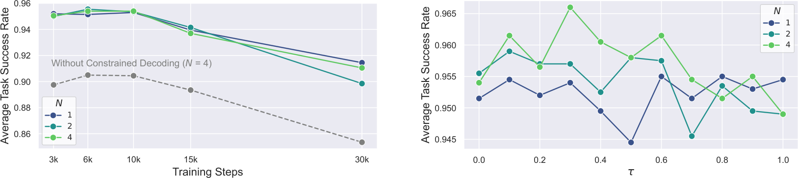
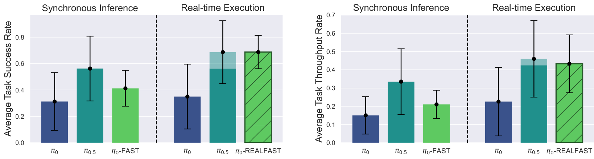
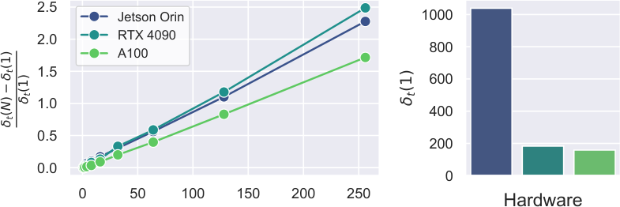

# 01. 논문 분석: Real-Time Execution with Autoregressive Policies (arXiv:2606.13355)

*Sangkyu Lee, Seohyeon Park, Tackgeun You, Avi Caciularu, Idan Szpektor, Hwasup Lim, Youngjae Yu* (한국과학기술연구원, 서울대학교, Google Research). 방법 이름은 **π0-REALFAST**입니다. arXiv comments에 "Published as a main conference paper at CoRL 2026"이 있고, corl.org 공식 채택 목록에는 포스터(Poster post-p2, 11월 10일 화, 포스터 11번)로 올라 있습니다. 분석 대상은 **arXiv v2**(2026-11-05, 20쪽)입니다. 쪽·표·식 번호는 v2 기준이고 `paper/paper.txt`의 줄 번호로 확인할 수 있습니다.

## 0. 버전 (v1 2026-06-11, 18쪽 / v2 2026-11-05, 20쪽)

abs 페이지에는 v1과 v2만 있습니다(제출 이력 확인). 두 PDF의 텍스트와 그림 벡터 값을 대조한 결과입니다. 변경 이유는 논문에 적혀 있지 않습니다.

| 번호 | 바뀐 곳 | v1 | v2 |
|---|---|---|---|
| W1 | 표 1의 기준선 행 (π0 + RTC, π0.5 + RTC 12행) | 예: π0 + RTC (m=1, s=1) 평균 89.4, (m=2, s=2) 92.8, (m=3, s=3) 93.6 | 같은 행이 94.0, 94.7, 94.7. 12행 중 11행의 평균 열이 바뀌고(평균 +1.0 %p, 최대 +4.6 %p, 감소 없음) π0-REALFAST 행과 m = 0 행은 그대로입니다 (`03` V12) |
| W2 | 시험 시 계산량 맞춤 실험 | 없음 | 본문 한 문단과 표 1 아래 블록(디노이징 30단계, 약 39 GFLOPs)이 추가됨 |
| W3 | §4.2 문장 | "LIBERO-Spatial을 뺀 성공률은 추론 빈도가 높을수록 감소하는 경향이 있고 특히 π0에서 그렇다"가 있었고, 결론 문장이 "가설(hypothesize)" | 이 문장이 삭제되고 "추론할 수 있다(can infer)"로 바뀜 |
| W4 | 그림 | 그림 2 없음, 부록 그림 C(LIBERO 평가 방식 도식) 있음 | 그림 2(행동 큐 예시)가 본문에 추가되고 부록 그림 C는 빠짐. 그림 번호가 밀려 v1 그림 2–5가 v2 그림 3–6 |
| W5 | 지표 이름 | task progress rate | task throughput rate (정의 문장도 같음: 성공 시각 이후 남은 시간 비율). 막대 값은 같음 |
| W6 | 한계 절 | "실험이 정적 단일 팔 환경에 한정" 위주 | 하드웨어별 지연(그림 7a, Jetson Orin·RTX 4090·A100)과 동적 과제(그림 7b, 트레드밀 위 물체, 430개 시연으로 추가 미세조정)가 추가됨 |
| W7 | 표·참고문헌 | 표 A(지연과 m)가 부록에 있으나 각주 3 없음 | 각주 3(N = 2, 4의 추가 지연 4, 7 ms와 8, 13 ms), AWQ [40] 추가 |

DROID 그림(v1 그림 4, v2 그림 5)의 막대 높이와 오차 막대 좌표는 두 버전에서 같습니다(PDF 벡터 도형 비교). 따라서 실로봇 수치는 그대로이고 LIBERO 기준선 행만 갱신된 것입니다. 이 사실이 표 1의 "RTC에서 d_m = m 성능 저하" 서술의 크기에 영향을 줍니다(`03` V5).

## 1. 한 줄 요약

자기회귀(AR) VLA(π0-FAST)는 순차 디코딩이라 지연이 길고 가변적이어서 비동기 실시간 실행(RTC 계열)의 대상에서 빠져 있었습니다. 이 논문은 (1) 토큰화 구간을 400 ms로 줄이고 (2) 직전 행동 청크를 접두로 조건화하고 (3) 동적계획법(DP)으로 "B 토큰 안에 복원 가능한 시퀀스"만 디코딩되게 막고 (4) 남는 시간에 여러 궤적을 병렬 디코딩해 가능도로 고르는 네 가지를 π0-FAST에 더해 π0-REALFAST를 만들고, LIBERO 시뮬레이션과 DROID 실로봇(제로샷)에서 π0 + RTC와 π0.5 + RTC에 견줍니다.

그림: 논문 그림 1의 가운데 블록(다중 궤적 디코딩과 제약 디코딩 도식). 양옆의 관측 사진은 잘랐습니다. © 저자, CC BY 4.0, 출처 arXiv:2606.13355 (v2).

## 2. 방법

### 2.1 실시간 실행의 정의와 필요조건 (§3.1, 그림 2)

- 정의: 클라이언트(제어기)가 매 시각 t에 서버가 만든 행동 a_t를 소비할 수 있으면 실시간 실행입니다. 생산자-소비자 문제로 보며, "엄격한 Δt 안의 응답"이 아니라 "행동 스트림이 끊기지 않음"만 요구합니다.
- 행동 큐 A_Q를 클라이언트에 두고, 지연 d_m := ⌊δ̃_{t,m}/Δt⌋ (δ̃ = 정책 지연 + 외부 지연 ε)로 정의합니다. **d_m ≤ m ≤ ⌊H/2⌋이면** 큐의 앞 m개를 수정 불가능한 접두로 두고, 그 뒤 m개 A_t[m:2m]를 비동기 추론으로 교체할 수 있어 큐가 비지 않습니다.
- 따라서 필요조건은 m의 선택에만 달려 있고, 응답성(반응 빈도)이나 궤적 부드러움과는 분리됩니다. 선행 연구([18–21])는 m = d_m을 가정했는데, 이 논문은 d_m ≤ s ≤ m인 경우(수정 불가능 구간이 추론 주기보다 긴 경우)를 새로 봅니다.

그림: 논문 그림 3 (a: LIBERO와 DROID의 400 ms 청크 토큰 길이 분포와 지연 점선, b: Kinetix에서 d_m과 m에 따른 성공률). © 저자, CC BY 4.0, 출처 arXiv:2606.13355 (v2).

### 2.2 토큰화 구간 축소와 접두 조건화 (§3.3 식 1, 부록 A.3, 그림 B)

- H = 2m으로 두고 FAST+ 토크나이저를 전체 H가 아니라 m 길이 청크마다 적용합니다(식 1): π_θ(T_H(A_t)|o_t) → π_θ(T_m(A_t[0:m])|o_t) · π_θ(T_m(A_t[m:2m])|o_t, T_m(A_t[0:m])).
- 실험은 m·Δt = 400 ms로 고정합니다(LIBERO m = 4, Δt = 100 ms. DROID m = 6, Δt = 66.7 ms). FAST+는 1초 청크로 학습된 토크나이저인데 400 ms에 그대로 쓰고, 정규화 행동의 복원 MSE가 LIBERO 약 3e-4, DROID 약 5e-4로 "원 논문의 1초 청크 수준과 비슷하다"고 적습니다(부록 A.3, 비교 대상 값은 적지 않음).
- 프롬프트 형식(그림 B): `Task: ..., State: ...; Action: <T_m(A_t[0:m])> Next Action: <T_m(A_t[m:2m])> [EOS]`. 손실은 행동 토큰과 헤더 토큰에만 겁니다.

### 2.3 제약 디코딩 (§3.3 식 2·3, 부록 A.1, 그림 A)

- 목표: 디코딩 토큰열 v가 (a) 길이 ≤ B이고 (b) 역토큰화 T_m⁻¹(v) ∈ R^{m×d}가 유효하도록 보장합니다. B := max{L | δ_L ≤ δ'}이고 δ' := sup{δ | ⌊(δ + sup ε)/Δt⌋ ≤ m}입니다.
- 유효 조건을 "토큰이 기여하는 용량 C_v의 합이 C = m × d와 같다"로 두면(FAST는 DCT 계수 수), 문제는 "B개 이하 동전으로 정확히 C를 만들기"(한정 동전 교환)입니다. 불리언 표 T_DP[i, c]를 식 2로 채우고, 디코딩 단계 j에서 T_DP[B−j, C − (지금까지 용량) − C_v] = 0인 토큰의 로짓을 가립니다(O(1) 조회).
- 공식 FAST 구현은 논문에 적힌 BPE가 아니라 **바이트 수준 BPE**(BBPE)이므로 C_v를 "UTF-8 연속 바이트(128–191)를 뺀 바이트 수"로 셉니다(부록 A.1, 그림 A). 누적 OR(식 3)로 "정확히 i단계"를 "i단계 이하"로 바꿉니다.
- 본문은 역토큰화(T_m⁻¹)가 실패하면 큐에 무행동(no-op)을 넣어야 한다고 적고, 각주 1은 π0-FAST의 기본 동작이 역토큰화 실패 시 데이터셋 통계로 계산한 행동을 내보낸다고 덧붙입니다.

### 2.4 다중 궤적 디코딩 (§3.3, 부록 A.4)

- 접두(관측 + 접두 토큰)의 KV 캐시를 N개 궤적이 공유해, 디코딩이 메모리 대역폭 제약이라는 점을 이용해 지연 증가를 작게 합니다. 각주 3: 11 또는 20 토큰에서 N = 2, 4이면 지연이 약 4, 7 ms 또는 8, 13 ms 늘어납니다.
- 제약된 지지 집합 위에서 가능도를 정확히 계산할 수 있다는 점을 이용해, 누적 로그 가능도가 가장 큰 궤적을 고릅니다(길이 정규화 없음). 샘플링 온도 τ = 0일 때는 N > 1이면 빔 서치를 씁니다(§4.1).
- 하이퍼파라미터(표 B): (N, τ) = (4, 0.3), m = 4 (LIBERO) / 6 (DROID), B = 11 / 20, 학습 6,000 스텝(LIBERO) / 300,000 스텝(DROID), 배치 256, AdamW (β = 0.9, 0.95), 가중치 감쇠 1e-8, 학습률 5e-5에서 5e-6으로 코사인, EMA 0.999, bfloat16. 학습 자원은 A100 80GB 4장(LIBERO), H200 141GB 8장(DROID)입니다(부록 A.5).

### 2.5 비동기 서버·클라이언트 (부록 A.2, 알고리즘 A·B)

서버는 관측 캐시가 있을 때마다 `A_Q[0:m]`을 접두로 추론하고 결과 `A_t[m:2m]`을 큐에 넣습니다. 클라이언트는 제어 주기마다 큐 앞의 행동 하나를 소비합니다. 실행 지평 s를 따로 두지 않고 항상 s = d_m인 경우와 같게 동작시키며, 이는 RTC가 실로봇에서 s_min = 25(H = 50)를 둔 것과 대비된다고 적습니다(RTC 쪽 설정은 이 분석에서 확인하지 않음).

## 3. 실험

### 3.1 LIBERO 시뮬레이션 (§4.1, 표 1, 부록 B)

- LIBERO 네 스위트(Spatial, Object, Goal, Long). 시뮬레이션은 지연을 직접 재지 않고, 정책이 행동 큐의 앞 s개를 수정할 수 없게 하는 방식으로 실시간 실행을 흉내 냅니다. s는 실측 지연 통계(표 A)와 외부 지연 ε ∈ {Δt, 2Δt, 3Δt}에서 정해지는 d_m의 상한입니다.
- 표 A로 만든 대응(`03` V7): REALFAST는 sup δ = 190 ms라 ε = 100, 200, 300 ms에서 s = 2, 3, 4이고, π0 + RTC(70 ms)와 π0.5 + RTC(74 ms)는 s = 1, 2, 3입니다. 즉 **같은 ε에서 REALFAST의 s가 RTC보다 1 큽니다.**
- 평가는 "서로 다른 세 시드"의 평균(± SD)입니다. 시행 수는 표에 없습니다.
- 학습 스텝은 [3k, 6k, 10k, 15k, 30k]를 훑어 가장 좋은 모델을 고르고, τ = 0에서 시작해 0–1.0을 0.1씩 훑습니다(§4.1). 같은 LIBERO 평가가 선택과 보고에 쓰입니다.

표 1 요약(v2, 평균 열, 3시드 평균 ± SD):

| 모델 | m, s | 평균 | | 모델 | m, s | 평균 |
|---|---|---|---|---|---|---|
| π0 (m = 0, s = 5) | | 94.2 | | π0-REALFAST | 4, 2 | 96.0 ± 0.7 |
| π0.5 (m = 0, s = 5) | | 96.9 | | π0-REALFAST | 4, 3 | 95.6 ± 0.3 |
| π0-FAST (m = 0, s = 5) | | 88.8 | | π0-REALFAST | 4, 4 | 95.7 ± 0.3 |
| π0 + RTC | 1, 1 / 2, 2 / 3, 3 | 94.0 / 94.7 / 94.7 | | π0.5 + RTC | 1, 1 / 2, 2 / 3, 3 | 96.5 / 97.2 / 97.2 |
| π0 + RTC | 4, 1 / 4, 2 / 4, 3 | 95.0 / 94.8 / 95.3 | | π0.5 + RTC | 4, 1 / 4, 2 / 4, 3 | 97.1 / 97.2 / 97.2 |
| 계산량 맞춤 π0 + RTC | 3, 3 / 4, 3 | 94.0 / 94.0 | | 계산량 맞춤 π0.5 + RTC | 3, 3 / 4, 3 | 96.9 / 97.0 |

π0와 π0.5의 m = 0 행은 openpi 저장소의 LIBERO README 값과 같습니다(`04` C21). 네 스위트 값은 논문 표 1 그대로 `analysis/recompute.py`에 들어 있습니다.

### 3.2 절제 (§4.2, 그림 4)

- 그림 4a: 학습 스텝별 평균 성공률(τ = 0). 6k–10k 스텝에서 최고이고 30k에서 N = 1 약 91.5%, N = 4 약 91.1%로 떨어집니다(그림 판독). 제약 디코딩을 빼면(B = 11 제한, N = 4) 모든 스텝에서 약 4.4–5.7 %p 낮습니다.
- 그림 4b: 6k 스텝 모델에서 τ별 성공률. N = 4의 최고점은 τ = 0.3(약 96.6%)이고 부록 표 B의 선택값입니다.

그림: 논문 그림 4 (LIBERO 절제: a 학습 스텝별, b 샘플링 온도 τ별). © 저자, CC BY 4.0, 출처 arXiv:2606.13355 (v2).

### 3.3 DROID 제로샷 (§4.2, 그림 5, 부록 C·D)

- Franka Research 3, Robotiq 2F-85, 외부 카메라 1대와 손목 카메라 1대. 8개 탁상 과제, 과제당 10회, 제한 시간 40초(600 제어 스텝). 정책은 DROID 데이터셋으로 미세조정한 것이고 추가 시연은 없습니다.
- 지표: 성공률과 "처리율(throughput)" = 성공 시각 이후 남은 시간 / 40초(실패는 0). 오차 막대는 90% 신뢰구간이라고만 적혀 있습니다.
- 그림 5(그림에서 읽은 값, 80회 환산): 동기 π0 25/80, π0.5 45/80, π0-FAST 33/80. 실시간 π0 28/80, π0.5 두 막대 45/80과 55/80, π0-REALFAST 55/80. 값이 정수 횟수로 환산됩니다(`03` V8).
- RTC 설정: π0-REALFAST m = 6 (δ 상한 약 302 ms, B = 20, N = 4일 때 δ̃ ≈ 324 ms), π0와 π0.5는 m = 2 (δ 70, 74 ms, ε ≈ 9 ms). 그림 5와 그림 C의 불투명도 설명이 §4.1과 맞지 않는 곳이 있습니다(`03` V8, `04` C3).

그림: 논문 그림 5 (DROID 제로샷 성공률과 처리율, 90% 신뢰구간). © 저자, CC BY 4.0, 출처 arXiv:2606.13355 (v2).

### 3.4 한계 절의 추가 실험 (§6, 그림 7)

- 그림 7a: 11 토큰 디코딩 지연 δ(1)이 Jetson Orin 약 1000 ms, RTX 4090 약 180 ms, A100 약 155 ms(그림 판독)이고 (δ(N) − δ(1))/δ(1)이 N에 거의 선형(N = 256에서 약 2.3, 2.5, 1.7)입니다.
- 그림 7b: 트레드밀 위 이동 물체 집기, DROID 정책 위에 시연 430개로 추가 미세조정. 20회 시행 성공 횟수: π0 11, π0.5 14, π0-FAST 6, π0 + RTC 15, π0.5 + RTC 16, π0-REALFAST 16. 제로샷은 모든 정책이 실패했다고 적습니다.

그림: 논문 그림 7a (하드웨어별 디코딩 지연의 N 의존성과 δ(1)). 오른쪽의 표 7b와 장면 사진은 잘랐습니다. © 저자, CC BY 4.0, 출처 arXiv:2606.13355 (v2).

## 4. 논문이 적은 한계

- 비교 하드웨어를 RTX 4090 한 종류로 고정했습니다. Jetson Orin처럼 메모리 대역폭이 낮은 장비에서는 m과 N 조정만으로 충분한 반응성을 얻기 어렵고, 가중치 양자화와 추측 디코딩이 필요하다고 적습니다.
- 정적 탁상 환경 위주이고, 동적 과제는 추가 미세조정이 있어야 풀립니다. 필요한 반응성의 일반 수준은 열린 질문으로 남깁니다.
- 지시 따르기 실패(분홍 그릇 대신 파란 그릇 등)는 AR 정책에도 남습니다(부록 E.2).

## 5. 논문의 서술과 근거의 간격 (요약)

자세한 계산과 판정은 `03`과 `04`에 있습니다.

1. **LIBERO의 π0-REALFAST 대 π0 + RTC 우위는 작고, 대응 방식에 따라 달라집니다.** 같은 s 기준 +1.2 %p(s = 2), +0.3 %p(s = 3)이며 시드 3개 Welch p는 0.087, 0.36입니다. 같은 ε로 묶으면 +1.0, +0.8, +0.4 %p입니다(`03` V4).
2. **π0.5 + RTC는 모든 설정에서 REALFAST보다 높습니다**(−1.1에서 −1.6 %p). 논문 표현은 "약간 낮다"입니다(`03` V4).
3. **표 1의 두 행에서 평균 열이 네 스위트 평균과 맞지 않습니다** (π0 + RTC m = 2, s = 2: 95.3 대 94.7. m = 4, s = 1: 94.8 대 95.0)(`03` V1).
4. **v2에서 기준선 행이 바뀌었습니다.** v1의 "d_m = m에서 성능 저하"는 최대 5.3 %p였고 v2에서는 최대 1.0 %p입니다(`03` V5, V12).
5. **DROID에서 π0-REALFAST 대 π0-FAST(동기)는 80회 환산으로 확실하고(Fisher p = 0.0008), π0.5와는 구분되지 않습니다.** 다만 8개 과제 안에서 보면 5개 우세, 0개 열세, 3개 동률이라 과제 단위 부호 검정은 p = 0.0625입니다(`03` V8).
6. **그림 4b의 선택값은 단일 평가의 최고점입니다.** 점마다 2000회 평가(표준오차 약 0.46 %p)라서 11개 τ 중 최고값은 평균보다 높게 나오기 쉽고, 표 1의 3시드 값(95.6–96.0)은 이보다 낮습니다(`03` V10).
7. **"엄격한 지연 상한 보장"은 토큰 수 상한에 대한 것입니다.** 토큰 수에 대한 보장은 DP로 성립하고(`03` K1, K2), 지연 상한은 RTX 4090에서 측정한 선형 지연 모델에 기대며 종단 지연 분포는 보고되지 않았습니다(`04` C25).
