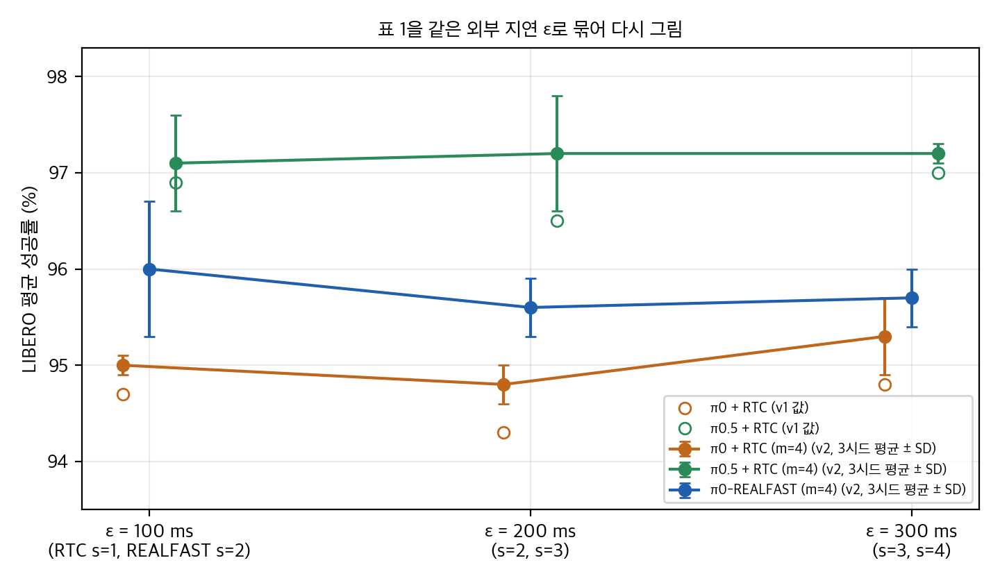
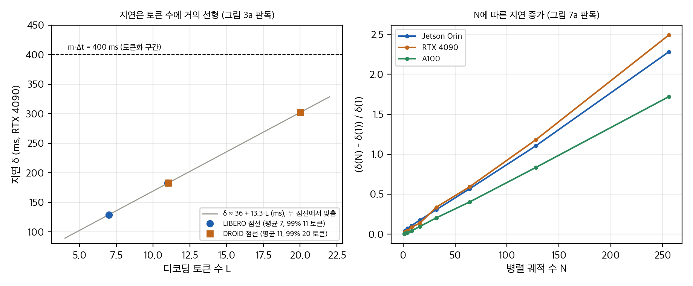
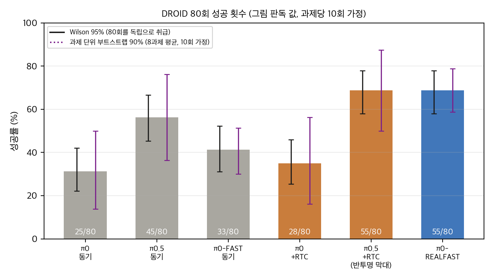
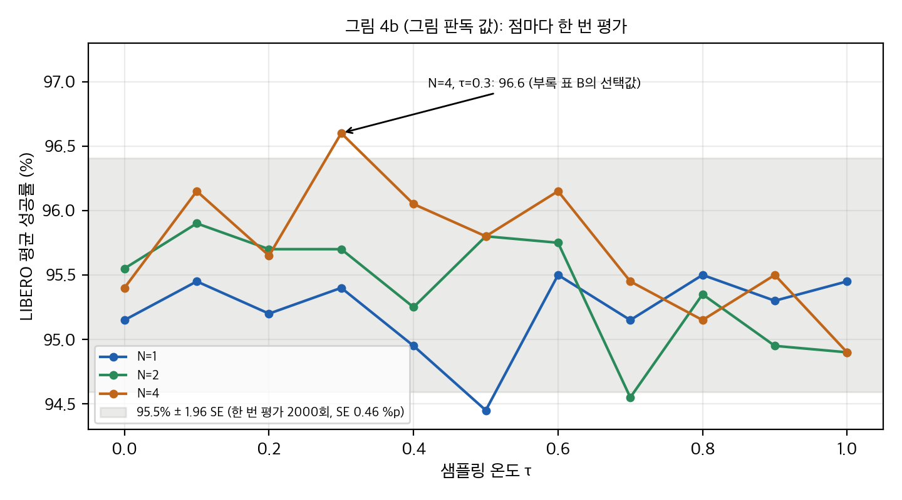

# 03. 수치 재계산, 일관성 검사, 토이

논문 표·그림의 수치를 다시 계산하고(`analysis/recompute.py`, 결과 `recompute_results.json`), 그림 값은 PDF의 벡터 도형에서 읽었습니다(`analysis/extract_figures.py`, 결과 `figure_values.json`). 재현 실험은 하지 않았습니다. 검사 번호는 V1–V14, 토이는 K1–K3입니다.

## 0. 읽는 법과 가정

- **LIBERO 시행 수.** 논문은 시행 수를 적지 않습니다. 이 분석은 스위트당 500회(10 과제 x 50회)로 가정합니다. 논문이 구현 기반으로 든 openpi의 LIBERO 평가 스크립트가 과제당 50회(`num_trials_per_task = 50`), 고정 초기 상태 사용(`get_task_init_states`), 기본 재계획 5스텝(`replan_steps = 5`)을 쓰기 때문입니다. 표 1의 m = 0 행이 모두 0.2 %p 격자 위에 있는 것도 500회와 맞습니다(V2).
- **표의 ± 값.** 논문은 "3 시드의 표준편차"라고만 적습니다. 표본 표준편차(n − 1)로 읽고 Welch 검정에 씁니다.
- **그림에서 읽은 값.** DROID 그림 5와 부록 그림 C는 막대 높이를 읽었고, 전체 막대가 80회(8 과제 x 10회) 기준 정수 횟수에 0.06회 이내로 맞습니다. 과제별 막대는 10회 기준 0.1 간격입니다. "그림 판독 값"이라고 표시합니다.
- **검정의 한계.** 시행을 독립으로 보는 Fisher·z 검정은 같은 초기 상태와 같은 과제를 재사용하는 평가에서 근사입니다. 가능하면 시드 단위(Welch) 또는 과제 단위(층별 검정, 부호 검정) 결과를 같이 적습니다.

## 1. 표 1의 내부 일관성

### 1.1 평균 열 (V1)

표 1의 22개 행(π0 + RTC 6, π0.5 + RTC 6, REALFAST 3, 계산량 맞춤 4, m = 0 세 행)에서 네 스위트 값의 평균을 평균 열과 비교했습니다(반올림 허용 0.1 %p).

| 행 | 네 스위트 평균 | 표의 평균 열 | 차이 |
|---|---|---|---|
| π0 + RTC, m = 2, s = 2 (96.7, 99.6, 97.7, 87.1) | 95.28 | 94.7 | +0.58 |
| π0 + RTC, m = 4, s = 1 (96.8, 99.4, 96.4, 86.7) | 94.83 | 95.0 | −0.18 |

나머지 20행은 0.075 %p 이내로 맞습니다. 첫째 행은 네 값 중 하나가 낮게 적혔거나 평균 열이 다른 값을 기준으로 했을 가능성이 있습니다(어느 쪽인지는 알 수 없고 저자 확인이 필요합니다). v1의 같은 행은 값과 평균이 서로 맞았습니다(92.8 = 평균 92.8).

### 1.2 정수 격자와 표준편차 (V2, V3)

- m = 0 행의 11개 스위트 값은 모두 0.2 %p 격자(500회) 위에 있습니다. 3시드 평균 셀은 1500회 격자(0.067 %p)가 표기 간격(0.1 %p)보다 촘촘해 정수 검사가 정보를 주지 않습니다.
- 평균 열의 SD는 네 스위트 SD의 평균(완전 동반 상관일 때의 상한)을 넘는 행이 없습니다(19행 중 0).
- 스위트 SD를 스위트당 500회 단일 시드의 이항 SD로 나눈 비의 중앙값은 0.60이고, 60개 셀 중 78%가 1보다 작습니다. 시드들이 같은 고정 초기 상태 위에서 돌아 정책 표집 잡음만 달라진다고 보면 설명되는 크기입니다(가능성). 이 경우 3시드 SD는 초기 상태 표집에 대한 불확실성을 담지 않으므로, 아래의 시드 단위 검정은 "같은 초기 상태에서의 재평가 변동"에 대한 것입니다.

## 2. 표 1: π0-REALFAST 대 RTC 기준선 (V4)

REALFAST의 s는 같은 외부 지연 ε에서 RTC보다 1 큽니다(π0·π0.5 + RTC의 sup δ가 70, 74 ms, REALFAST는 190 ms; 표 A로 d_m을 계산: ε = 100, 200, 300 ms에서 각각 s = 1, 2, 3 대 2, 3, 4). 표는 s 순서로 정렬돼 있어서 두 가지 대응으로 계산했습니다. 평균 열 차이(%p), Welch p(시드 3개), 풀링 z p(시행 6000개를 독립으로 취급, 상한 방향의 참고)입니다.

| 대응 | REALFAST 대 π0 + RTC | 차이 | Welch p | 풀링 p | REALFAST 대 π0.5 + RTC | 차이 | Welch p |
|---|---|---|---|---|---|---|---|
| 같은 s = 2 | 96.0 대 94.8 | +1.2 | 0.087 | 0.0017 | 96.0 대 97.2 | −1.2 | 0.089 |
| 같은 s = 3 | 95.6 대 95.3 | +0.3 | 0.36 | 0.43 | 95.6 대 97.2 | −1.6 | 0.0067 |
| 같은 ε = 100 ms | s = 2 대 s = 1: 96.0 대 95.0 | +1.0 | 0.13 | 0.0082 | 96.0 대 97.1 | −1.1 | 0.098 |
| 같은 ε = 200 ms | s = 3 대 s = 2: 95.6 대 94.8 | +0.8 | 0.024 | 0.040 | 95.6 대 97.2 | −1.6 | 0.027 |
| 같은 ε = 300 ms | s = 4 대 s = 3: 95.7 대 95.3 | +0.4 | 0.24 | 0.29 | 95.7 대 97.2 | −1.5 | 0.0078 |

- REALFAST의 평균 열은 π0 + RTC의 18개 비교 쌍(3 REALFAST 행 x 6 RTC 행) 모두에서 높고, π0.5 + RTC의 18쌍 모두에서 낮습니다. 크기는 π0에 대해 +0.3–+1.6 %p, π0.5에 대해 −1.1–−1.7 %p입니다.
- 스위트별로 보면 (m = 4, s = 3) REALFAST 대 π0 + RTC는 Spatial +2.0(p = 0.029), Object −0.3, Goal −1.1, Long +0.8입니다. 평균의 우위는 스위트마다 방향이 다릅니다.
- 논문 서술("π0-REALFAST consistently surpasses π0, yet slightly inferior compared to π0.5", §4.2)은 평균 열 방향과 맞지만, π0와의 차이는 s = 3과 ε = 300 ms에서 시드 3개 검정으로는 구분되지 않습니다.

그래프: 표 1의 평균 열을 외부 지연 ε로 묶어 다시 그림. 속이 빈 점은 v1의 기준선 값입니다. 우리가 그린 그래프입니다.

## 3. d_m = m 대 d_m ≤ m, 계산량 맞춤, 버전 사이 변화 (V5, V6, V12)

### 3.1 d_m = m의 성능 저하 (V5)

§4.2는 "d_m = m인 RTC는 낮은 추론 지연에서 성능이 저하된다"고 씁니다. 같은 s에서 m = s(d_m = m)와 m = 4(d_m ≤ m)를 비교한 평균 열 차이(m = 4 − m = s)입니다.

| | s = 1 | s = 2 | s = 3 |
|---|---|---|---|
| π0 + RTC (v2) | +1.0 (p = 0.0048) | +0.1 | +0.6 |
| π0.5 + RTC (v2) | +0.6 (p = 0.17) | 0.0 | 0.0 |
| π0 + RTC (v1) | +5.3 | +1.5 | +1.2 |
| π0.5 + RTC (v1) | +2.2 | −0.1 | −0.2 |

v2의 격차는 π0에서 최대 1.0 %p(s = 1), π0.5에서 최대 0.6 %p(s = 1)입니다. v1에서는 5.3, 2.2였습니다. 방향은 같고 크기가 크게 줄었으므로, "저하가 있다"는 서술은 v2 값으로는 π0 s = 1에서만 시드 단위로 구분됩니다.

### 3.2 계산량 맞춤 (V6)

디노이징을 5단계에서 30단계로 늘려 REALFAST(N = 4)와 계산량을 맞춘 π0 + RTC와 π0.5 + RTC의 평균 열은 5단계 값보다 낮거나 같습니다.

| 모델 | (m, s) | 5단계 | 30단계 | 차이 | Welch p |
|---|---|---|---|---|---|
| π0 | 3, 3 | 94.7 | 94.0 | −0.7 | 0.035 |
| π0 | 4, 3 | 95.3 | 94.0 | −1.3 | 0.016 |
| π0.5 | 3, 3 | 97.2 | 96.9 | −0.3 | 0.021 |
| π0.5 | 4, 3 | 97.2 | 97.0 | −0.2 | 0.48 |

REALFAST(s = 2) 96.0 대 30단계 π0: +2.0 (p = 0.025, 0.031), 30단계 π0.5: −0.9, −1.0 (p = 0.15, 0.12)입니다. 이 비교는 REALFAST s = 2 행을 s = 3인 RTC 행과 맞대 놓은 것입니다. 또한 30단계의 지연 증가는 시뮬레이션의 s에 반영되지 않았을 가능성이 있고(논문은 s를 같게 둠), 그렇다면 이 블록은 "같은 s에서 디노이징 단계 수만 늘린 효과"를 봅니다.

### 3.3 v1과 v2의 기준선 행 (V12)

π0 + RTC, π0.5 + RTC 12행 중 11행이 바뀌었습니다(v2 − v1 평균 +1.03 %p, 최대 +4.6 %p, 최소 0, 감소 없음). REALFAST 행과 m = 0 행은 같습니다. v1 기준 REALFAST − π0 + RTC(같은 s)는 s = 2에서 +1.7, s = 3에서 +0.8 %p였고, v2에서는 +1.2, +0.3 %p입니다. 갱신 이유는 논문에 적혀 있지 않고, 갱신 뒤에 REALFAST의 상대 우위는 작아졌습니다.

## 4. 지연 산술 (V7, V14)

### 4.1 표 A와 본문 수치의 정합

- 본문 §4.1: REALFAST의 δ가 LIBERO에서 약 183 ms(B = 11), DROID에서 약 302 ms(B = 20)로 묶인다고 적고, 표 A는 190 ms와 315 ms입니다. 각주 3의 N = 4 추가 지연 7 ms, 13 ms를 더하면 183 + 7 = 190, 302 + 13 = 315로 정확히 맞습니다. 즉 표 A는 N = 4 값이고 본문 값은 N = 1 값입니다(본문에 명시되어 있지 않아 처음 읽으면 불일치로 보임).
- DROID δ̃ ≈ 324 ms = 315 + ε(9 ms)도 맞습니다.
- d_m 계산(LIBERO, Δt = 100 ms): π0 + RTC(70 ms)는 ε = 100, 200, 300 ms에서 d_m = 1, 2, 3, π0.5 + RTC(74 ms)도 같고, REALFAST(190 ms)는 2, 3, 4입니다. 표 1의 s 설정과 모두 일치합니다.
- DROID: REALFAST d_m = ⌊(315 + 9)/66.7⌋ = 4 ≤ m = 6, π0·π0.5 + RTC d_m = 1. 40초는 66.7 ms에서 600 스텝이라 부록 C의 값과 같습니다.
- m·Δt는 LIBERO 400 ms, DROID 6 x 66.7 = 400.2 ms입니다.

### 4.2 지연 선과 N 의존성

그림 3a의 점선을 토큰 수에 환산하면(막대 눈금 기준) LIBERO 점선이 7토큰·129 ms와 11토큰·183 ms, DROID 점선이 11토큰·183 ms와 20토큰·302 ms입니다. 두 데이터셋이 거의 같은 직선 δ ≈ 36 + 13.3·L ms 위에 있습니다(LIBERO 기울기 13.5, DROID 13.2 ms/토큰, 절편 34.5와 37.6 ms). 이 선형 모델은 "B로 지연 상한을 정한다"(§3.3)가 성립한다는 것의 근거이고, 이 점선에서 읽은 두 점으로만 맞춘 것이라 오차 범위는 알 수 없습니다.

그림 7a(RTX 4090 선, N = 64에서 0.592, N = 256에서 2.49)에서 N당 증가율은 약 0.99%/궤적입니다. 이것으로 예측한 N = 2, 4의 추가 지연은 11토큰(183 ms)에서 1.8, 5.4 ms, 20토큰(302 ms)에서 3.0, 9.0 ms이고, 각주 3의 값은 4, 7 ms와 8, 13 ms입니다. 같은 자릿수이고 각주 값이 1.3–2.7배 큽니다(그림 7a의 N ≤ 4 점은 눈금 안에서 구분되지 않아 외삽입니다).

### 4.3 토큰 수 분포와 B (V14)

그림 3a 히스토그램 막대에서 읽은 분포입니다.

| 데이터셋 | 막대에서 읽은 평균 토큰 수 | 점선 위치 | B | B 이하 비율 | B 초과 비율 | 100번 추론 중 한 번 이상 B 초과 |
|---|---|---|---|---|---|---|
| LIBERO | 6.4 | 7 | 11 | 99.1% | 0.9% | 59% |
| DROID | 10.2 | 11 | 20 | 99.3% | 0.7% | 51% |

"B가 토큰 길이의 99%를 덮는다"(§4.1)는 그림과 맞습니다. 점선은 평균을 올림한 위치로 보입니다. 나머지 약 1%의 청크는 B 이내에 끝나도록 제약된 분포에서 디코딩되는데, 이때 성능에 미치는 영향은 보고되지 않았습니다(`04` C25).

그림 7a 오른쪽 막대의 Jetson Orin δ(1) ≈ 1035 ms(그림 판독)이면 d_m = ⌊(1035 + 9)/66.7⌋ = 15로 m ≤ ⌊H/2⌋ = 6을 넘습니다. 논문의 한계 서술(m과 N 조정만으로는 부족)과 산술이 맞습니다.

그래프: 왼쪽 그림 3a 점선에서 읽은 토큰 수 대 지연, 오른쪽 그림 7a에서 읽은 N 대 지연 증가율. 우리가 그린 그래프입니다.

### 4.4 계산량 39 GFLOPs (V13)

§4.2는 디노이징 30단계가 "REALFAST N = 4와 같은 약 39 GFLOPs"라고 적습니다. 계산 방법(어떤 부분을 세는지, 행동 길이 H, 매개변수 수)은 논문에 없습니다. 거친 추정(가정: 언어모델 비임베딩 약 2.0B, π0 행동 전문가 약 0.3B, FLOPs ≈ 2 x 매개변수 x 토큰 수)으로는 REALFAST N = 4, 11토큰 디코딩이 약 176 GFLOPs이고, π0 30단계는 행동 토큰 H = 2에서 36, H = 10에서 180 GFLOPs입니다. 39 GFLOPs는 H ≈ 2.2에 해당합니다. 이 추정은 정의를 모른 채 한 것이라 논문 값의 맞고 틀림을 말하지는 못하며, 계산 방법 확인이 필요합니다.

## 5. DROID (V8)

### 5.1 그림 5와 그림 C의 정합

부록 그림 C의 과제별 성공 막대(10회 기준 0.1 간격)를 읽어 합하면 그림 5의 여섯 막대 높이(80회 기준 환산)와 모두 맞습니다: π0 동기 25, 실시간 28, π0.5 동기 45, 실시간 55, π0-FAST 동기 33, REALFAST 55(각각 ±0.06회). 그림 5에서 π0.5 실시간에는 막대가 둘(45/80, 55/80)이고 마커와 오차 막대는 높은 쪽(55/80)에만 있습니다. 낮은 쪽 45/80은 π0.5 동기 값과 같습니다. 그림 C는 π0.5 실시간 막대를 55/80 쪽으로 그립니다.

과제별 값(그림 판독, 과제 #1–#8):

| 정책 | 동기 | 실시간 |
|---|---|---|
| π0 | 0.1 0.4 0.0 0.8 0.2 0.2 0.8 0.0 | 0.3 0.6 0.0 0.9 0.1 0.0 0.8 0.1 |
| π0.5 | 1.0 0.8 0.2 0.8 0.1 0.1 0.8 0.7 | 1.0 0.8 0.3 0.9 0.2 0.3 1.0 1.0 |
| π0-FAST (실시간 = REALFAST) | 0.0 0.3 0.3 0.6 0.5 0.5 0.6 0.5 | 1.0 0.6 0.6 0.6 0.9 0.5 0.8 0.5 |

어느 m의 RTC를 그렸는지가 문서 안에서 일치하지 않습니다: 그림 5 본문("d_m ≤ m = 6, 높은 불투명도"), 그림 C 캡션("π0는 m = 6, π0.5는 m = 2, 낮은 불투명도"), §4.1과 A.5("π0, π0.5 모두 m = 2")가 서로 다릅니다. 이 분석은 그림 C 캡션을 따라 π0 = m 6, π0.5 = m 2(55/80 쪽)로 읽었습니다.

### 5.2 검정

| 비교 | 횟수 | Fisher p (80회 풀링) | 과제 단위 (우세-열세-동률) | 부호 검정 p | 과제 층별 CMH p (10회 가정) |
|---|---|---|---|---|---|
| REALFAST 대 π0-FAST 동기 | 55 대 33 | 0.0008 | 5-0-3 | 0.0625 | 0.0009 |
| REALFAST 대 π0 + RTC | 55 대 28 | 3.3e-5 | 5-1-2 | 0.22 | 1.2e-5 |
| REALFAST 대 π0.5 + RTC (55/80 쪽) | 55 대 55 | 1.0 | 3-4-1 | 1.0 | 0.85 |
| REALFAST 대 π0.5 + RTC (45/80 쪽) | 55 대 45 | 0.14 | | | |
| π0.5 + RTC(55/80) 대 π0.5 동기 | 55 대 45 | 0.14 | 6-0-2 | 0.031 | 0.048 |
| π0 + RTC 대 π0 동기 | 28 대 25 | 0.74 | 4-2-2 | 0.69 | 0.66 |
| π0-FAST 동기 대 π0 동기 | 33 대 25 | 0.25 | 4-4-0 | 1.0 | 0.21 |

- 해석: 80회 풀링 기준으로 REALFAST가 π0-FAST 동기와 π0 + RTC보다 높은 것은 분명하고, π0.5와는 같은 55/80(또는 45/80)이라 구분되지 않습니다. 과제 8개 안에서 보면 π0-FAST 동기 대비 5개 과제가 높고 열세가 없지만 정확 부호 검정은 p = 0.0625입니다. 과제 #1(π0-FAST 0/10, REALFAST 10/10)이 차이의 큰 몫입니다. 과제 #1을 빼면 REALFAST 대 π0-FAST 동기는 45 대 33(70회 중)입니다.
- "π0-FAST가 π0보다 낫다"(33 대 25)는 p = 0.25로 구분되지 않고, 이 차이가 "AR의 지시 따르기 우위가 실시간에서 유지된다"(§4.2)의 근거로 쓰이는 점은 `04` C17에서 다룹니다.
- 오차 막대: 그림 5의 90% 구간(그림 판독)은 REALFAST [0.561, 0.815], π0-FAST 동기 [0.277, 0.549], π0 동기 [0.094, 0.532]입니다. 8개 과제를 재표집한 백분위 부트스트랩 90%는 REALFAST [0.588, 0.788], π0-FAST [0.300, 0.513], π0 [0.138, 0.500]으로 같은 크기이고 그림 쪽이 약간 넓습니다. 계산 방법은 논문에 적혀 있지 않습니다. 이 구간은 과제 수준 변동을 담고 있어 80회 Wilson 구간(REALFAST [0.58, 0.78])보다 π0.5와 π0 쪽에서 넓습니다.

그래프: DROID 80회 성공 횟수(그림 5와 부록 그림 C에서 읽은 값)와 두 가지 구간. 우리가 그린 그래프입니다.

### 5.3 처리율에서 환산한 성공 시 평균 소요 시간

처리율 = 성공 시 (40 − 소요 시간)/40의 80회 평균(실패는 0)이므로, 막대 높이(그림 판독)에서 성공 시 평균 소요 시간 = 40 x (1 − 처리율/성공률)을 환산할 수 있습니다.

| 정책 | 성공률 | 처리율 | 성공 시 평균 소요 시간 |
|---|---|---|---|
| π0 동기 / 실시간 | 25/80 / 28/80 | 0.151 / 0.226 | 20.7 s / 14.1 s |
| π0.5 동기 / 실시간(55/80) | 45/80 / 55/80 | 0.336 / 0.461 | 16.1 s / 13.2 s |
| π0-FAST 동기 / REALFAST | 33/80 / 55/80 | 0.211 / 0.434 | 19.6 s / 14.8 s |

실시간 실행의 성공 시 소요 시간 단축은 π0 −32%, π0.5 −18%, π0-FAST → REALFAST −24%입니다. 성공률 개선은 π0-FAST에서 가장 큽니다(+27.5 %p, π0.5 +12.5, π0 +3.8). 즉 AR에서 성공률 이득이 더 크지만 소요 시간 단축은 π0가 가장 크게 나옵니다. 성공한 과제의 구성이 정책마다 달라(예: REALFAST만 #1에서 성공) 정책 사이 직접 비교는 아니며, 환산값은 막대 읽기 오차(처리율 ±0.005)를 그대로 가집니다. 동기 π0-FAST가 실제로 얼마나 멈추는지(일시 정지 시간)는 논문에 보고되지 않았습니다.

## 6. 동적 과제와 절제 (V9, V10, V11)

### 6.1 그림 7b (V9)

성공 횟수 20회 기준 백분율은 모두 맞습니다(55, 70, 30, 75, 80, 80%). Wilson 95%: π0-FAST [0.145, 0.519], REALFAST [0.584, 0.919], π0 + RTC [0.531, 0.888]. Fisher: REALFAST 대 π0-FAST p = 0.0036, 대 π0 + RTC p = 1.0, 대 π0.5 + RTC p = 1.0, π0 + RTC 대 π0 동기 p = 0.32, π0.5 + RTC 대 동기 p = 0.72. 20회로 80% 검정력에 필요한 차이는 성공률 0.75 부근에서 약 0.38입니다. 따라서 "π0, π0.5 + RTC와 비슷하다"는 구분되지 않음의 의미이고 동등성의 증거는 아니며, π0-FAST 대비 향상만 확실합니다.

### 6.2 그림 4 (V10)

- 그림 4a: 제약 디코딩이 없을 때의 격차는 3k–30k 스텝에서 4.4–5.7 %p(N = 4, 같은 N = 4 비교). 한 번 평가의 표준오차(2000회, 성공률 약 95.5%)가 0.46 %p이므로 격차가 잡음보다 큽니다. 같은 스텝에서 N = 4 대 N = 1은 −0.4–+0.25 %p로 구분되지 않습니다.
- 그림 4b: N = 1, 2, 4의 τ 평균은 95.23, 95.40, 95.71%이고, τ에 따른 범위는 1.05, 1.35, 1.70 %p입니다. N = 4가 N = 1보다 높은 τ는 11개 중 9개(부호 검정 p = 0.065, 쌍체 t p = 0.025). 최고점은 N = 4, τ = 0.3의 96.6%로 N = 4 평균보다 0.9 %p 높습니다. 같은 평균을 가진 11개 독립 평가의 최댓값은 평균보다 평균 0.70 %p 높게 나오므로(모의), 최고점 선택에는 선택 편향이 섞일 수 있습니다. 표 1의 REALFAST 3시드 값(95.6–96.0)은 이 최고점보다 낮습니다.
- 그림의 모든 점은 한 번 평가(2000회 격자, 판독 오차 이내로 일치)이고 시드 반복이나 오차 막대가 없습니다.

그래프: 그림 4b를 그림에서 읽은 값으로 다시 그리고, 한 번 평가(2000회)의 95% 이항 범위를 겹침. 우리가 그린 그래프입니다.

### 6.3 그림 3b Kinetix (V11)

오차 막대 중점에서 읽은 평균: d_m = 1에서 m = 1–4가 0.889, 0.882, 0.875, 0.865. d_m = 2에서 m = 2–4가 0.845, 0.836, 0.816. d_m = 3에서 m = 3, 4가 0.737, 0.716. d_m = 4, m = 4가 0.617입니다. m = 4에서 d_m을 1에서 4로 올리면 24.8 %p 떨어지고, 같은 d_m에서 m을 최솟값에서 4로 키우면 2.1–2.9 %p 떨어집니다(90% 구간의 반폭 약 5–11 %p 이내). 논문의 "성능에 큰 영향을 주는 것은 d_m이고 m의 영향은 작다"와 맞습니다. 이 환경은 흐름 정책 + RTC의 2D 시뮬레이션이고(H = 8, s = d_m), AR 정책에 대한 결과가 아닙니다.

## 7. 토이: DP 제약 디코딩 (K1–K3)

`analysis/toy_constrained_dp.py`(numpy, 약 6초)는 논문 부록 A.1의 DP 표 구성(그림 A)과 §3.3의 마스킹 규칙을 합성 어휘에서 독립 구현했습니다. 학습된 정책이 아닌 무작위 언어 모델이라 논문의 성공률에 대한 증거는 아닙니다.

| 검사 | 결과 |
|---|---|
| K1: 그림 A의 벡터화 표 대 완전탐색 도달 가능성 (무작위 어휘 300개, C_v = 0 토큰 포함) | 300 / 300 일치 |
| K2: 표로 가린 디코딩의 유효율 (B = 11, C = 28 / B = 20, C = 48, 어휘 40, 각 3000회) | 제약 디코딩 100% / 100%. 제약 없는 디코딩(같은 B에서 자르기) 3.0% / 19.8%. 표 크기 12 x 29, 21 x 49 불리언, 구성 약 0.03–0.06 ms |
| K3: 단계별 재정규화 분포(국소)와 "유효 시퀀스 조건부" 분포(전역)의 총변동 거리 (B = 4, C = 6, 어휘 4, 문제 60개) | 평균 0.32, 중앙값 0.30, 최대 0.77 |
| K3b: 가능도 최대 시퀀스가 같은 비율 (문제 199개) | 102 / 199 |

- K1, K2는 논문 §3.3과 부록 A.1의 설계가 의도대로 작동한다는 확인입니다. 표 구성은 지연에 부담이 되지 않는 크기입니다.
- K3은 논문이 말하는 "제약된 지지 집합 위의 정확한 가능도"가 단계별 마스킹 후 재정규화한 (국소 정규화) 분포의 확률이라는 점에서, 유효 시퀀스에 대한 조건부 확률과는 다른 양임을 보입니다. 무작위 언어 모델은 엔트로피가 높아 이 차이가 크게 나오며, 학습된 정책(질량이 유효 시퀀스에 집중됨)에서의 크기는 이 토이로는 알 수 없습니다. best-of-N이 어느 쪽 가능도로 고르는지는 부록 A.4에 "제약된 지지 위의 누적 로그 가능도"라고만 적혀 있습니다.

## 8. 요약

| 번호 | 검사 | 결과 |
|---|---|---|
| V1 | 표 1 평균 열 | 22행 중 2행이 맞지 않음 (π0 + RTC 2, 2: +0.58 %p. 4, 1: −0.18 %p) |
| V2 | 정수 격자 | m = 0 행 모두 500회 격자와 일치 |
| V3 | SD 일관성 | 평균 열 SD는 상한 이내. 스위트 SD가 단일 시드 이항 SD보다 작은 셀 78% |
| V4 | REALFAST 대 RTC | π0 대비 +0.3–+1.6 %p (구분 안 되는 대응 있음), π0.5 대비 −1.1–−1.7 %p |
| V5 | d_m = m 저하 | v2 최대 1.0 %p, v1 최대 5.3 %p |
| V6 | 계산량 맞춤 | 30단계가 5단계보다 낮거나 같음 (π0 −0.7, −1.3) |
| V7 | 표 A와 d_m 산술 | 190 = 183 + 7, 315 = 302 + 13, d_m과 s의 대응 모두 일치. N = 2, 4 추가 지연은 그림 7a 기울기 예측의 1.3–2.7배 |
| V8 | DROID | 그림 5와 그림 C 정합, REALFAST는 π0-FAST와 π0 + RTC보다 높고 π0.5와 구분 안 됨 |
| V9 | 그림 7b | 비율 일치, π0-FAST 대비만 확실 |
| V10 | 그림 4 | 제약 디코딩 효과 확실, 다중 궤적 효과는 작고 최고점은 선택 편향 가능 |
| V11 | 그림 3b | d_m의 효과가 m보다 큼 (24.8 대 2.1–2.9 %p) |
| V12 | v1 대 v2 | 기준선 12행 중 11행 갱신 (평균 +1.03 %p) |
| V13 | 계산량 | 39 GFLOPs는 계산 정의가 없어 확인 안 됨 |
| V14 | 토큰 분포 | B가 99.1%, 99.3%를 덮음 |
| K1–K3 | DP 토이 | 표는 완전탐색과 일치, 유효율 100%, 국소와 전역 정규화는 다름 |
