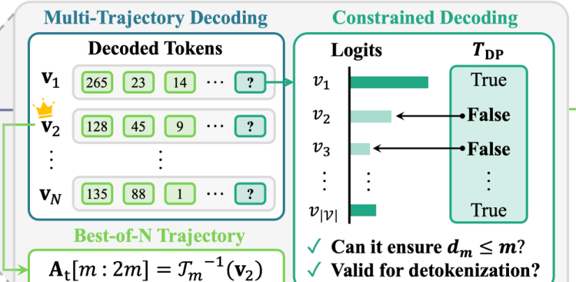
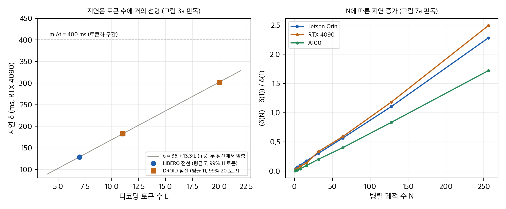
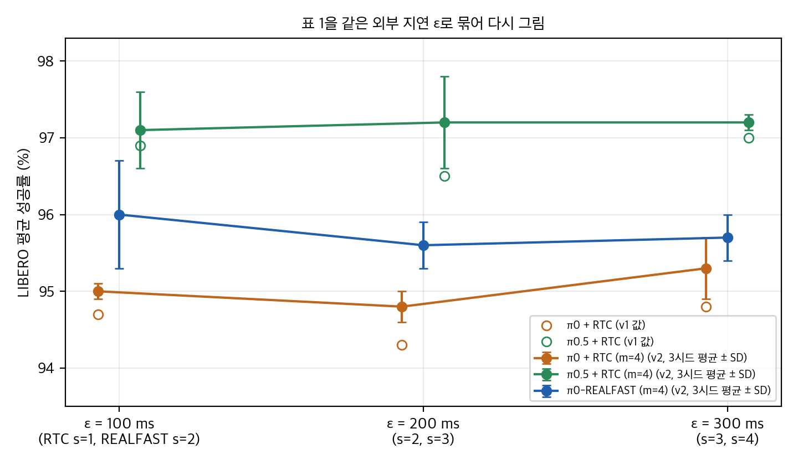
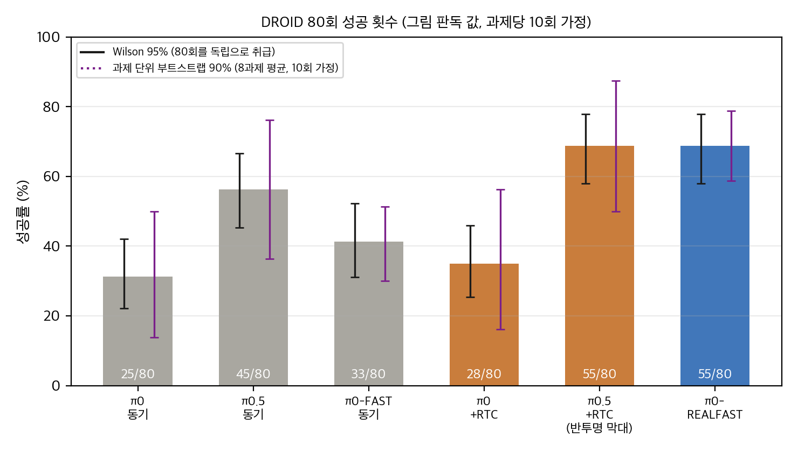
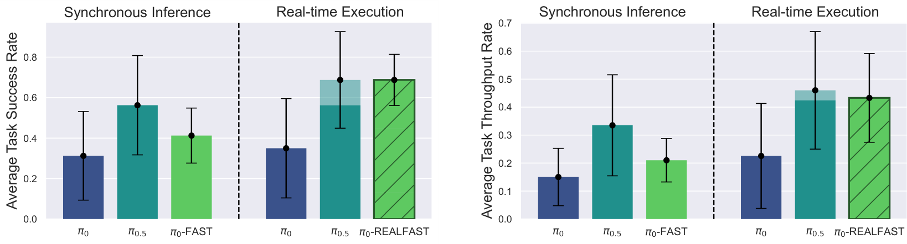
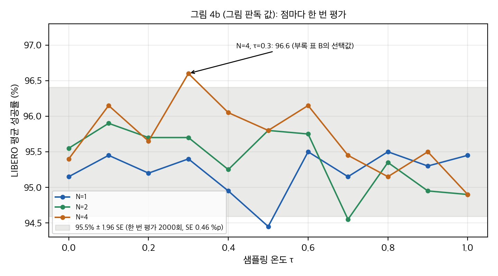

> **논문:** Sangkyu Lee, Seohyeon Park, Tackgeun You, Avi Caciularu, Idan Szpektor, Hwasup Lim, Youngjae Yu. *Real-Time Execution with Autoregressive Policies.* CoRL 2026 포스터, arXiv:2606.13355 (v2, 2026-11-05).
> 프로젝트 페이지는 있지만 방법 코드는 "Coming soon"입니다(2026-11-24 확인). 이 글의 그림은 논문의 차트·도식 두 장(출처 표기)과 우리가 그린 그래프입니다.

## 논문이 묻는 것

대형 VLA는 추론이 제어 주기보다 길어서, 동기 추론이면 행동 청크를 다 쓴 뒤 로봇이 멈춰 기다립니다. 비동기 추론은 행동 큐를 두고 추론과 실행을 겹쳐 이 멈춤을 없앱니다. 최근의 실시간 청킹(RTC) 계열은 모두 확산·흐름 정책을 대상으로 했습니다. 자기회귀(AR) 정책(π0-FAST)은 토큰을 하나씩 디코딩해서 지연이 길고 가변적이라 빠져 있었습니다.

논문의 핵심 관찰은 실시간 실행의 필요조건이 지연 자체가 아니라 **큐가 비지 않는 것**이라는 점입니다. 수정할 수 없는 접두 길이 m과 추론 지연 d_m이 d_m ≤ m ≤ ⌊H/2⌋만 만족하면 됩니다. 그러면 AR 정책에서도 m을 정하고, 그 안에 디코딩이 끝난다는 것을 보장하면 됩니다.

*그림 1의 가운데 블록 (논문 원문, 양옆의 관측 사진은 자름). © 저자, CC BY 4.0, 출처 arXiv:2606.13355.*

방법은 π0-FAST에 네 가지를 더합니다. 토큰화 구간을 400 ms로 줄이고(H = 2m), 직전 청크를 접두로 조건화하고, 동적계획법(DP)으로 "B 토큰 안에 복원 가능한" 토큰만 허용하는 제약 디코딩을 걸고, 남는 시간에 N개 궤적을 병렬로 디코딩해 가능도가 가장 큰 것을 고릅니다.

## 이 글에서 확인한 것

**1. 지연 산술은 정확히 맞습니다.** 본문 §4.1은 B = 11, 20 토큰에서 δ가 약 183 ms, 302 ms라고 적고 표 A는 190 ms, 315 ms를 적습니다. 각주 3의 N = 4 추가 지연 7 ms, 13 ms를 더하면 183 + 7 = 190, 302 + 13 = 315입니다. 즉 본문 값은 N = 1이고 표 A는 N = 4 값입니다(본문에 이 설명은 없습니다). 이 값으로 계산한 d_m(LIBERO 외부 지연 100, 200, 300 ms에서 REALFAST 2, 3, 4, RTC 1, 2, 3)이 표 1의 s 설정과 모두 일치합니다. 그림 3a의 점선을 토큰 수로 환산하면 두 데이터셋이 같은 직선 δ ≈ 36 + 13.3·L ms 위에 있습니다(그림 판독 값).

*그래프 (우리가 그림). 왼쪽은 그림 3a 점선에서 읽은 토큰 수와 지연, 오른쪽은 그림 7a에서 읽은 N별 지연 증가율입니다.*

**2. LIBERO에서 REALFAST와 π0 + RTC의 차이는 작습니다.** 표 1의 평균 열은 REALFAST가 π0 + RTC보다 높고(18개 비교 쌍 모두) π0.5 + RTC보다 낮습니다. 다만 REALFAST의 s는 같은 외부 지연에서 RTC보다 1 크므로(표 A), s로 정렬한 표를 그대로 읽으면 대응이 어긋납니다. 같은 외부 지연으로 묶으면 π0 + RTC 대비 +0.4–+1.0 %p이고, 시드 3개 Welch 검정으로 구분되는 것은 외부 지연 200 ms 한 곳(p = 0.024)입니다. π0.5 + RTC 대비 −1.1에서 −1.6 %p입니다. 논문의 "consistently surpasses π0, yet slightly inferior compared to π0.5"는 평균 열의 방향과 맞습니다.

*그래프 (우리가 그림). 표 1의 평균 열(3시드 평균 ± SD)을 외부 지연으로 묶었습니다. 속이 빈 점은 v1의 기준선 값입니다.*

표 1에는 두 가지 확인할 점이 있습니다. 첫째, π0 + RTC (m = 2, s = 2)의 네 스위트 평균은 95.28(스위트당 500회 가정)인데 평균 열은 94.7이고, (m = 4, s = 1)은 94.83 대 95.0입니다. 어느 값이 기준인지 저자 확인이 필요합니다. 둘째, v1과 v2를 비교하면 π0·π0.5 + RTC 12행 중 11행의 평균 열이 갱신되었습니다(평균 +1.0 %p, 최대 +4.6 %p, REALFAST 행은 그대로). 논문의 "d_m = m인 RTC는 낮은 지연에서 저하된다"는 서술의 근거 크기는 v1에서 최대 5.3 %p, v2에서 최대 1.0 %p입니다. 갱신 이유는 논문에 없어서 질문 목록에 넣었습니다.

**3. DROID에서 동기 π0-FAST 대비 이득은 분명하고 π0.5와는 구분되지 않습니다.** 그림 5와 부록 그림 C의 막대를 벡터 도형에서 읽어 80회(8과제 x 10회) 기준 정수 횟수로 복원하면 π0-FAST 동기 33/80, REALFAST 55/80, π0 + RTC 28/80, π0.5 + RTC 55/80(또는 45/80)입니다(그림 판독 값). Fisher 검정은 REALFAST 대 π0-FAST p = 0.0008, 대 π0 + RTC p = 3e-5, 대 π0.5 + RTC p = 1.0입니다. 과제 단위로 보면 π0-FAST 대비 5개 우세, 0개 열세, 3개 동률이고 정확 부호 검정은 p = 0.0625입니다. 과제 #1(0/10 대 10/10)이 차이의 큰 몫을 차지합니다. 처리율과 성공률에서 환산한 성공 시 평균 소요 시간은 19.6 s에서 14.8 s(−24%)입니다. 그림 5에서 π0.5의 실시간 막대는 두 개(45/80, 55/80)이고 RTC의 m 설정이 본문, 그림 캡션, 부록에서 서로 다르게 적혀 있어, 어느 쪽이 어느 설정인지는 저자 확인이 필요합니다.

*그래프 (우리가 그림). 그림 5와 부록 그림 C에서 읽은 성공 횟수(과제당 10회 가정). 검은 선은 Wilson 95%(80회를 독립으로 취급), 보라 점선은 8개 과제 단위 부트스트랩 90%입니다.*

*그림 5 (논문 원문). DROID 제로샷 성공률과 처리율, 90% 신뢰구간. © 저자, CC BY 4.0, 출처 arXiv:2606.13355.*

**4. 그림 4b의 선택값은 한 번 평가의 최고점입니다.** 6k 스텝 모델에서 τ별 성공률을 훑은 그림 4b의 점은 2000회 평가(표준오차 약 0.46 %p, 그림 판독 값)이고, 선택된 N = 4, τ = 0.3은 96.6%로 N = 4의 τ 평균(95.7%)보다 0.9 %p 높습니다. 같은 평균의 독립 평가 11개 중 최댓값은 평균 0.7 %p 높게 나오는 것이 기대치여서, 표 1의 3시드 값(95.6–96.0)이 이보다 낮은 것과 방향이 맞습니다. N = 4가 N = 1보다 높은 τ는 11개 중 9개입니다(부호 검정 p = 0.065). 반면 제약 디코딩을 빼면 4.4–5.7 %p 떨어지는 효과는 잡음보다 훨씬 큽니다.

*그래프 (우리가 그림). 그림 4b의 읽은 값과 한 번 평가(2000회)의 95% 이항 범위입니다.*

**5. DP 제약 디코딩은 의도대로 작동합니다.** 부록 A.1의 표 구성(그림 A)과 §3.3의 마스킹 규칙을 합성 어휘에서 독립 구현했습니다(numpy, 약 6초). 표는 완전탐색 도달 가능성과 300/300 일치하고, 마스킹 디코딩의 유효율은 100%입니다(제약 없는 디코딩은 같은 B에서 3.0%, 19.8%). 한 가지 열린 점은 가능도입니다. 단계별로 재정규화한 확률은 유효 시퀀스의 조건부 확률과 다른 양이어서, 작은 무작위 언어 모델 토이에서 두 분포의 총변동 거리가 평균 0.32였고 최대 가능도 시퀀스가 51%만 같았습니다. 학습된 정책에서의 크기는 모르고, 논문이 best-of-N에 쓰는 가능도가 어느 쪽인지 적혀 있지 않습니다.

## 코드와 구현 가능성

방법 코드는 공개되어 있지 않습니다. 프로젝트 페이지가 "Coming soon"이라고 적고, 저자 계정의 `oddqueue/realfast`는 openpi를 포크한 저장소(앞선 커밋 없음)와 프로젝트 페이지 가지뿐입니다. 그래서 코드 대조 대신 논문의 주장 26개를 표·그림 수치로 대조했습니다. 불일치는 표 1의 평균 열 2행, 버전 사이 변경은 기준선 행 갱신, 검증 불가는 "d_m = m에서 π0가 완전히 실패한다"(해당 막대가 그림에 없음)와 "AR의 지시 따르기 이점이 유지된다"(지시 따르기를 따로 측정하지 않음)입니다.

논문 수치의 재현에는 π0-FAST 체크포인트, JAX CUDA, 6k 스텝 학습(A100 4장), 공개되지 않은 RTC 기준선 구현이 필요하고, DROID 실험은 Franka 로봇과 H200 8장 학습이 필요합니다. CPU에서는 DP 제약 디코딩, 소형 AR 정책 + 행동 큐 + 합성 지연 같은 구조 검증만 가능합니다. 이 글의 토이는 그중 DP 부분입니다.

## 저자에게 묻고 싶은 것

- 표 1의 π0 + RTC (m = 2, s = 2)와 (m = 4, s = 1)의 평균 열은 어느 값이 기준입니까?
- v2에서 π0·π0.5 + RTC 행을 갱신한 이유와 변경 사항은 무엇입니까?
- LIBERO의 시행 수와 ± 값의 정의는 무엇입니까?
- 그림 5의 π0.5 실시간 막대 두 개는 각각 어느 m의 RTC입니까?
- 그림 4b의 점은 한 번 평가이고, 선택용 평가와 표 1의 평가는 같습니까?
- best-of-N의 가능도는 단계별 재정규화 확률입니까?

## 자료

- [통합 리포트 PDF](report/report_public.pdf)
- [01. 논문 분석: Real-Time Execution with Autoregressive Policies (arXiv:2606.13355)](analysis/01_paper_analysis.md)
- [02. 선행연구와 관련 자료](analysis/02_prior_work.md)
- [03. 수치 재계산, 일관성 검사, 토이](analysis/03_analysis.md)
- [04. 주장 검증과 구현 가능성: Real-Time Execution with Autoregressive Policies (arXiv:2606.13355)](analysis/04_claim_verification.md)
