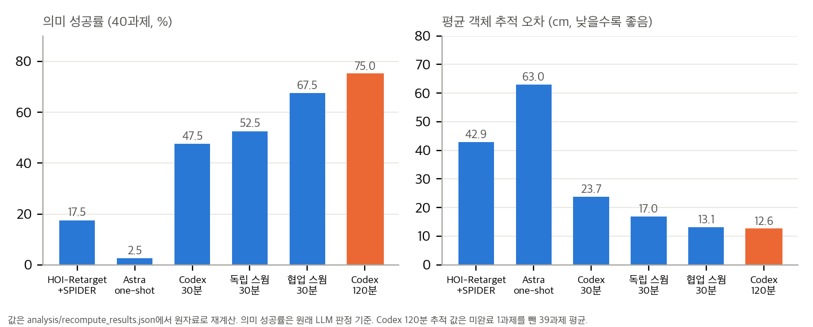
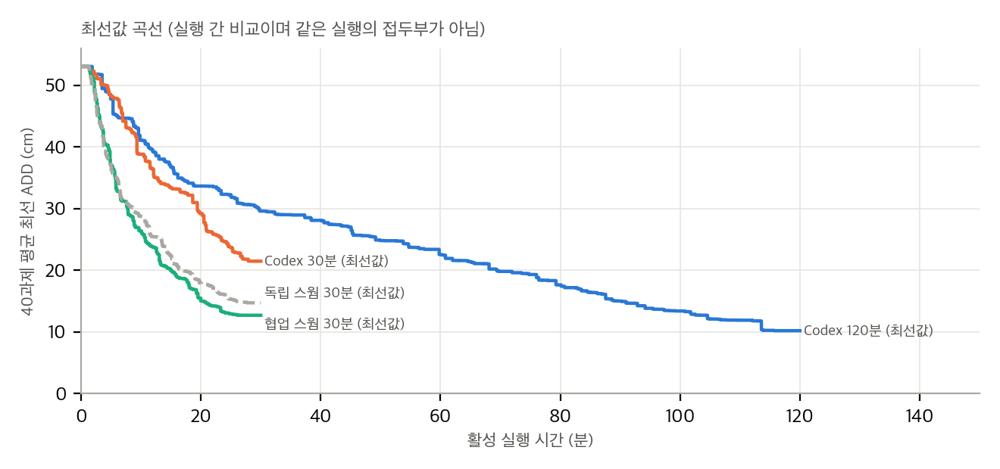
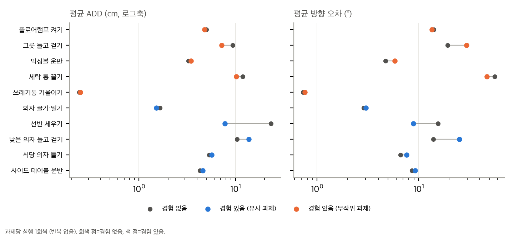
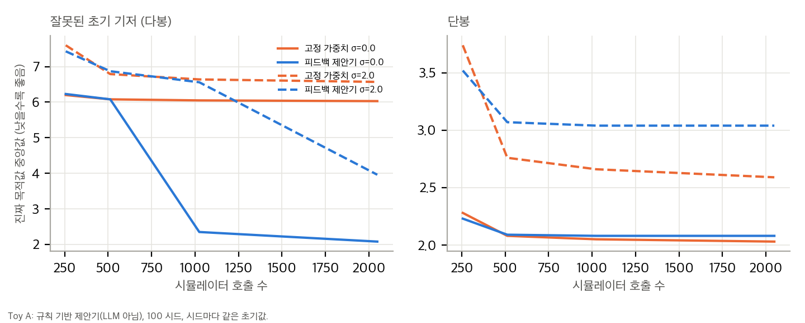
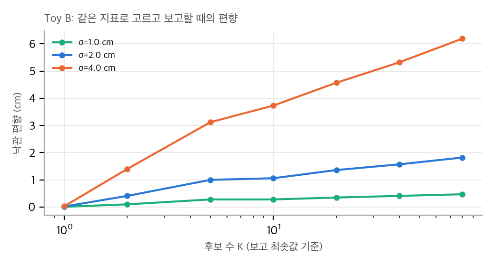

> **출처:** Narayanan Palghat Parameswaran 외, *Retargeting Through Reasoning for Humanoid–Object Interaction.* 프로젝트 블로그, 2026-11-06 게시, 2026-11-10 접근. https://narayananpp.github.io/semantic-humanoid-retargeting-blog/
> 심사를 거친 논문이 아닙니다. 블로그 원자료 저장소에는 라이선스 파일이 없어서, 이 글은 블로그 그림이나 영상을 싣지 않고 원자료의 **수치만** 다시 계산해 우리 그림으로 옮겼습니다.

## 한 줄 요약

블로그는 에이전트가 기준 모션과 제어 코드를 쓰고 시뮬레이션을 돌려 고치는 방식이 HOI-Retarget + SPIDER보다 낫다고 보고합니다. 원자료로 계산해 보니 **기준선보다 낫다는 주장은 강하게 뒷받침되지만**, 스웜과 단일 실행의 우열은 나지 않고, 경험 재사용 효과는 과제 한 개에 기대고 있었습니다.

## 1. 무엇을 하는가

- 입력은 사람 시연(SMPL), HOI-Retarget의 초기 운동학 기준, 장면, 객체 목표 궤적입니다.
- 에이전트는 Python으로 기준 모션과 제어 코드를 쓰고, MuJoCo에서 G1을 돌립니다. 제어는 SONIC이 맡고 손은 임피던스 제어입니다.
- 실행 후 에이전트는 이미지, 객체 추적 오차, 접촉 측정을 보고 다음 수정을 합니다. 트레이스에서 보이는 수정은 파지 전략 변경(한 손 → 두 손 → 단단한 한 손)과 놓는 조건의 변경(고정 시간 → 지지와 속도 조건)입니다.

## 2. 수치는 원자료와 일치한다

*40과제 의미 성공률과 평균 객체 추적 오차. 블로그 원자료에서 재계산했습니다. Codex 120분의 추적 평균은 미완료 1과제를 뺀 39과제 평균입니다.*

표 1–2의 추적 평균, 의미 성공률(17.5%, 2.5%, 75%), 최선값 곡선(30분 29.59 cm → 120분 10.21 cm), 경험 실험의 선반 과제(23.35 → 7.77 cm)는 모두 과제별 기록에서 다시 나옵니다.

## 3. 기준선보다 낫다는 주장은 강하다

120분 Codex 대 HOI-Retarget + SPIDER는 같은 40과제에서 한쪽만 성공한 과제가 24 대 1입니다. McNemar 정확검정 p ≈ 1.5e-6이고, 추적 차이 −30.4 cm의 95% 구간은 [−40.6, −20.5] cm입니다.

## 4. 스웜과 단일 실행은 가려지지 않는다

- 블로그의 "단일 120분 75%가 협업 스웜 67.5%보다 낫다"는 불일치 쌍 6 대 3, p = 0.51입니다. 추적 차이는 −0.4 cm [−4.8, 5.1]입니다. 두 방법을 구별할 근거가 없습니다.
- "독립 스웜 21과제 대 단일 19과제"는 원래 판정에 맞습니다. 그런데 저자가 같은 원자료에서 재검토한 판정(물체 관통 2과제를 실패로)을 쓰면 19 대 19가 됩니다.

*최선값 곡선 네 개. 실행 간 비교이며 같은 실행의 접두부가 아닙니다.*

## 5. 최선값은 같은 지표로 고른 값이다

블로그의 추적 곡선은 실행 중 시도 가운데 추적 오차가 가장 작은 것을 고르고, 그 값을 보고합니다. 보고 지표와 선택 지표가 같습니다. 최선값은 최종 제출 값보다 0.4–2.4 cm 낮았습니다. 시뮬레이션 잡음이 2–4 cm라고 가정하면, 같은 방식의 선택은 K = 10 후보에서 1–4 cm의 낙관 편향을 만듭니다(아래 toy B).

같은 30분 설정의 두 실행도 21.5 cm와 29.6 cm로 크게 달랐습니다. 그래서 "30분에서 120분으로 29.59 → 10.21"의 시간 효과가 실행 한 번씩의 차이일 수 있습니다.

## 6. 경험 효과는 한 과제에 기댄다

*경험 실험 10과제. 과제당 실행 1회씩입니다.*

집단 평균 ADD는 유사 과제 9.00 → 6.66 cm, 무작위 과제 5.94 → 5.18 cm로 줄어듭니다. 그런데 10과제 중 5개는 좋아지고 5개는 나빠지며(부호 검정 p = 1.0), 선반 한 과제를 빼면 유사 집단에서는 오히려 0.97 cm 나빠집니다. 방향 오차는 두 집단 모두 늘었습니다(9.50 → 10.80, 19.01 → 19.34°). 블로그가 쓴 "두 집단 모두 ADD와 위치 오차가 줄었다"는 문장은 맞지만, 이 결과를 일반화하기에는 근거가 부족합니다.

## 7. Toy로 본 두 가지

*규칙 기반 피드백 제안기와 고정 가중치 샘플링(numpy, 100 시드). 제안기는 LLM이 아니라 정체를 감지하면 새 앵커로 옮기는 규칙입니다.*

- 초기 기저가 틀렸을 때 고정 가중치 탐색은 6 cm 부근에 갇힙니다. 정체를 감지하는 제안기는 충분한 예산에서 2 cm대까지 내려갑니다.
- 단봉 함수에서는 재시작 비용 때문에 고정 가중치가 같은 예산에서 조금 더 낫습니다. 피드백 루프가 항상 이기지는 않습니다.

*같은 지표로 고르고 보고할 때의 낙관 편향. K는 후보 수, σ는 측정 잡음입니다.*

닫힌 형태로 쓰면 편향은 −c_K·σ²/√(σ² + τ²)입니다(c_K는 K개 표준정규 최댓값의 기댓값). σ = 4 cm, K = 10이면 약 −3.9 cm입니다.

## 8. 구현할 수 있나

이 맥(M4 Pro, CUDA 없음)에서는 **전체 재현이 불가능합니다**. 에이전트 루프는 외부 LLM API가 필요하고, 40과제 기준 단일 Codex 실행은 약 3억 토큰, 스웜은 약 10억 토큰입니다. 추적 지표 `object_path_v1`과 판정 프롬프트는 공개되지 않았습니다. SPIDER 기준선 한 과제는 MuJoCo 설치 뒤에 조건부로 가능하지만 GPU 의존 여부를 먼저 확인해야 합니다.

## 9. 읽을 때 주의할 점

- 비교 예산이 같지 않습니다. HOI-Retarget + SPIDER의 계산량은 보고되지 않았습니다.
- 판정은 생성 모델과 같은 계열의 모델이 했고, 인간 판정과의 일치는 보고되지 않았습니다.
- 저장소에 옛 수치(5%, 52.48 cm)가 남아 있습니다. 페이지와 원자료는 최신 값입니다.

## 재현 노트

재계산과 toy는 CPU에서 1분 안에 끝납니다. 원자료 저장소를 얕게 복제한 뒤 `analysis/recompute_blog.py`, `analysis/refinement_toy.py`, `analysis/plot_figures.py`를 실행하면 됩니다. 자세한 내용과 전체 근거는 게시 패키지의 `analysis/` 문서에 있습니다.

## 자료

- [통합 리포트 PDF](report/report_public.pdf)
- [01. 블로그 분석: 무엇을 주장하고 어떻게 측정했나](analysis/01_paper_analysis.md)
- [02. 선행연구와 관련 저장소](analysis/02_prior_work.md)
- [03. 수치 재계산, 통계 검정, 유도, toy 검증](analysis/03_analysis.md)
- [04. 코드·데이터 대조와 주장 검증](analysis/04_code_verification.md)
