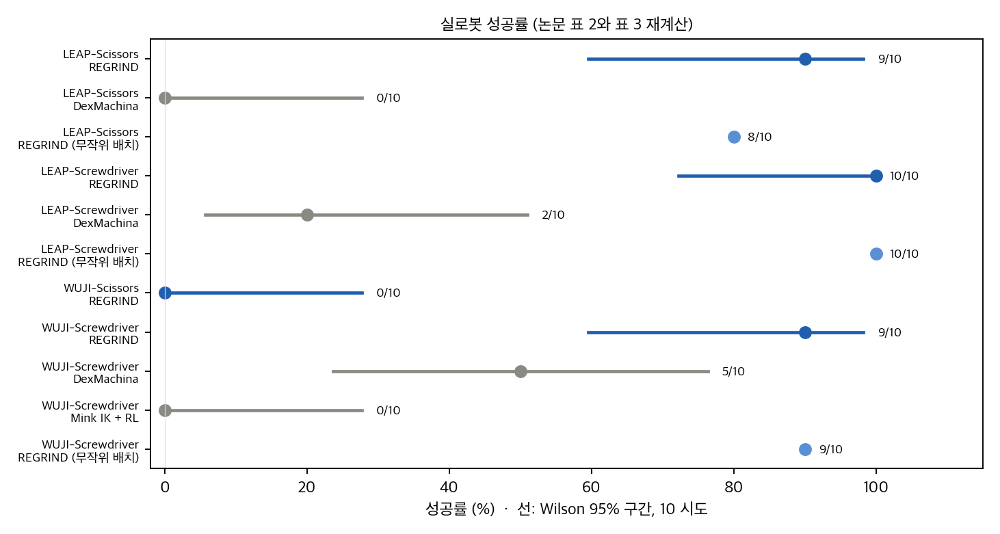
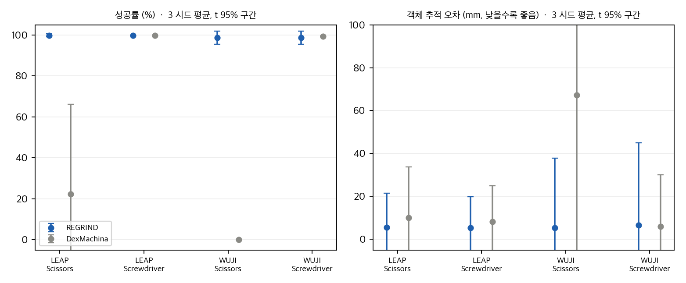
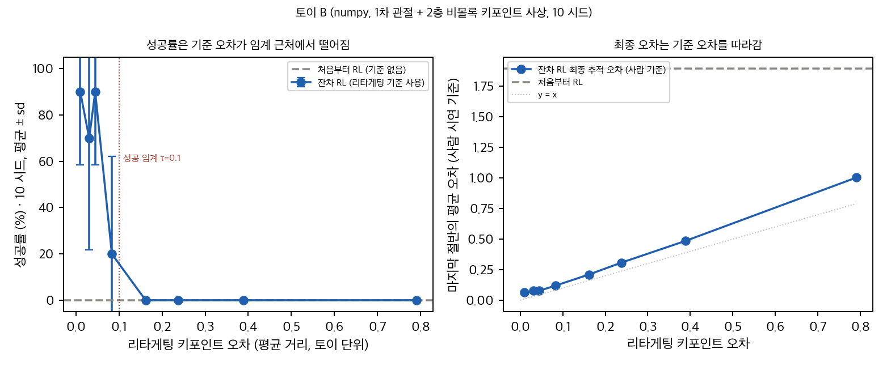

> **논문:** Yunhai Feng, Natalie Leung, Jiaxuan Wang, Lujie Yang, Haozhi Qi, Preston Culbertson. *A Minimalist Retargeting-Guided Reinforcement Learning Recipe for Dexterous Manipulation.* CoRL 2026 포스터, arXiv:2607.11874 (v1, 2026-07-13).
> 공식 코드(MIT)는 정적으로만 읽었고 실행하지 않았습니다. 논문 그림은 싣지 않고, 우리가 만든 그래프만 씁니다.

## 논문이 묻는 것

사람 손과 물체가 함께 움직이는 시연 하나로 로봇 다지 손에게 가위를 쓰게 하고 드라이버를 돌리게 할 수 있을까요? 논문의 답은 두 단계입니다. 먼저 손-물체 사이의 공간 관계와 접촉 관계를 보존하는 방향으로 사람 동작을 로봇 손에 옮깁니다. 그다음 그 로봇 궤적을 기준으로 두고 잔차 강화학습을 시뮬레이션에서 돌린 뒤, 시스템 식별을 거쳐 두 종류의 로봇 손에 zero-shot으로 옮깁니다.

이 접근의 핵심 주장은 "상호작용을 보존하는 리타게팅이 RL을 돕는다"입니다. 저자들은 기준 궤적을 탐색 분포로도 쓰고(RSI), 행동의 기준으로도 씁니다(잔차). 증강은 시작 물체 자세를 ±5 cm, ±30° 흔들고, 그 변환을 리타게팅을 다시 풀지 않고 궤적에 적용합니다.

## 이 글에서 확인한 것

- **재계산.** 실기 표 2의 REGRIND 9/10, 10/10, 9/10은 Wilson 95% 하한이 0.60–0.72입니다. DexMachina와의 Fisher 정확검정 p는 과제별로 0.00012, 0.00071, 0.14입니다. 10 시도로는 90%와 50%의 차이를 80% 검정력으로 보기 어렵습니다(팔당 약 20 시도 필요).

그래프: 실로봇 성공률과 Wilson 95% 구간. 10 시도씩이라 구간이 넓습니다. 우리가 그린 그래프입니다.

- **시뮬레이션.** 논문 표 1의 "±"는 정의가 없습니다. 3 시드 표준편차로 보면 추적 오차의 신뢰구간 반폭이 평균보다 큽니다. 드라이버 과제에서 DexMachina는 성공률이 같거나 높고 추적 오차는 낮습니다. "superior"라는 표현은 가위와 실기에 해당합니다.

그래프: 시뮬레이션 평균과 3 시드 기준 t 95% 구간. 우리가 그린 그래프입니다.

- **코드 대조.** 보상 가중치, PPO 설정, 중력과 밀기 교육과정, 증강 범위는 논문과 같습니다. 그러나 WUJI 보상 σ(0.015 대 0.02), 물체 편차 종료 임계(논문 0.15 m, 공개 설정은 네 과제 모두 1.0 m), WUJI 10 N 탁자 접촉 종료(두 과제에서 꺼짐), 객체 키포인트 수(코드 100, 논문 50)가 다릅니다.
- **빠진 것.** 시뮬레이션 성공 판정 코드, 기준선(SPIDER, DexMachina, Mink) 코드, 실기 배포와 시스템 식별 코드가 저장소에 없습니다. 증강을 끈 같은 정책과의 실기 비교도 없습니다.

## 토이로 본 기준의 역할

논문의 질문을 아주 작게 옮겼습니다. 6차원 관절과 비볼록 키포인트 사상, 접촉 없는 모델에서, 사람 시연에 맞는 기준 궤적을 주면 잔차 RL은 10 시드 중 9개에서 성공했습니다(기준 오차 0.01). 기준 없이 처음부터 학습한 정책은 10 시드 모두 실패했습니다. 기준 오차가 성공 임계 근처(0.1)를 넘으면 성공률은 급격히 떨어졌습니다.

그래프: 토이(numpy, 6차원 관절, 비볼록 키포인트 사상, 10 시드). 기준 오차에 따른 성공률과 최종 추적 오차. 우리가 그린 그래프입니다.

이 토이는 손의 접촉과 관통을 다루지 않습니다. 실제 과제의 성공률을 예측하지 않고, "기준 품질에 예산이 있다"는 점만 보여 줍니다.

## 이 맥에서 구현할 수 있는가

Apple M4 Pro와 CUDA 없는 환경에서 논문의 학습은 재현할 수 없습니다. 학습 코드는 Isaac Sim 5.1 기반이고, 실기 재현에는 두 종류의 로봇 손, 모션 캡처, 배포 코드가 필요합니다.

방법의 뼈대는 구현할 수 있습니다. 리타게팅 목적(손-물체 메시의 라플라시안 변형과 SQP)은 scipy와 솔버로 옮길 수 있습니다. 잔차 RL 구조와 증강은 numpy 토이 수준에서 확인했습니다. 손 접촉이 있는 MuJoCo 축소판은 조건부입니다. 처리량을 아직 재지 않았습니다.

## 읽을 때 조심할 것

- 실기 성공률은 10 시도입니다. 9/10을 "확실한 전이"로 읽으면 신뢰구간을 놓칩니다.
- 증강이 강건성을 높였다는 주장은 대조 없이 나옵니다. 증강과 리타게팅의 기여는 분리되지 않았습니다.
- 공개 저장소의 설정은 논문 본문과 여러 곳에서 다릅니다. 재현하려면 저자에게 확인할 질문이 적어도 일곱 개 있습니다.

## 정리

REGRIND는 "기준 궤적을 탐색과 행동의 기준으로 쓴다"는 단순한 레시피를 다지 손 조작에 적용했습니다. 실기 결과는 인상적이지만, 10 시도 실험과 빠진 대조 때문에 우위의 크기는 아직 열려 있습니다. 토이에서도 기준 품질이 성공 여부를 가른다는 점은 분명합니다. 기준 오차를 RL 전에 재는 일이 다음 단계로 보입니다.

## 자료

- [통합 리포트 PDF](report/report_public.pdf)
- [01. 논문 분석: A Minimalist Retargeting-Guided Reinforcement Learning Recipe for Dexterous Manipulation (REGRIND, arXiv:2607.11874)](analysis/01_paper_analysis.md)
- [02. 선행연구와 자료 지도: REGRIND (arXiv:2607.11874)](analysis/02_prior_work.md)
- [03. 수치 재계산, 일관성 검사, 토이: REGRIND (arXiv:2607.11874)](analysis/03_analysis.md)
- [04. 코드 대조: REGRIND 논문 ↔ 공식 저장소 (arXiv:2607.11874)](analysis/04_code_verification.md)
