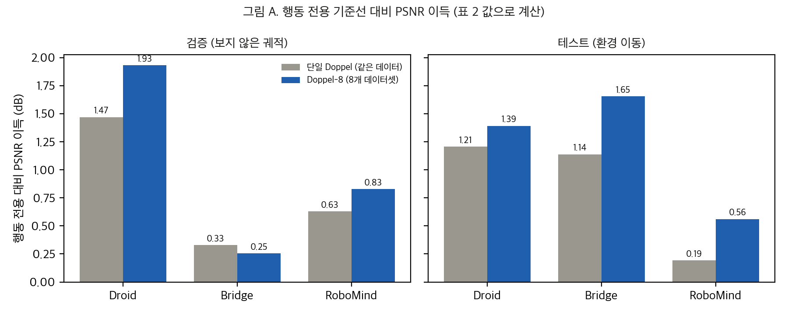
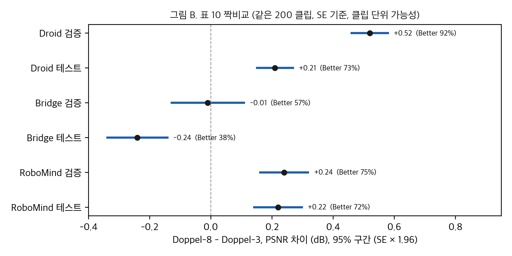
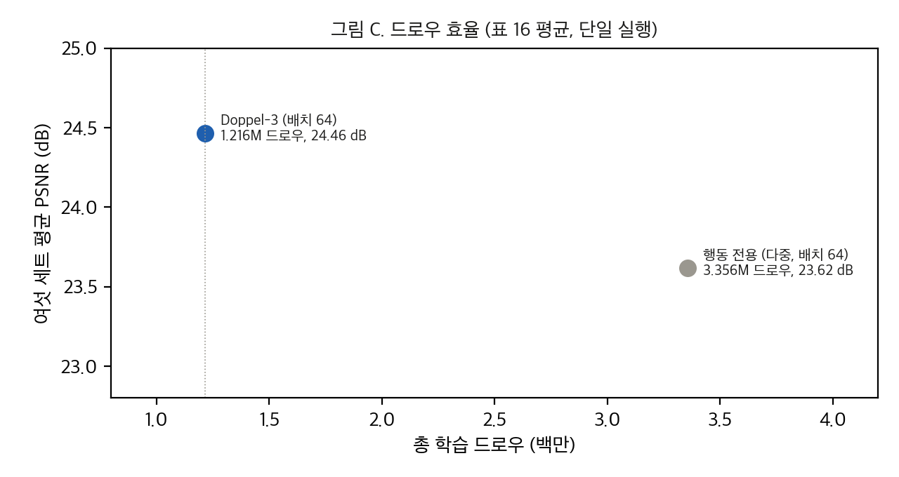

# Doppel: 로봇을 그려 주고 세계를 생성하기

*Render the Robot, Generate the World: One Video World Model Across Embodiments* (arXiv:2611.24925 v1)을 읽었습니다. 학회 표기는 확인하지 못했습니다(arXiv 전용).

## 한 줄 요약

행동 벡터만 보는 영상 world model에 **미래 로봇 몸의 렌더링**을 같이 넣으면, 같은 데이터에서 PSNR이 0.2–1.5 dB 오릅니다. 다만 초록의 1.00 / 1.20 dB는 8개 데이터셋 모델과 단일 데이터셋 기준선을 비교한 값입니다.

## 방법

- 로봇의 3D Gaussian 모델을 순기구학으로 움직이고, 카메라 외부 파라미터로 래스터화해 "로봇이 이렇게 움직일 것"을 영상으로 만듭니다.
- 카메라 외부 파라미터가 없는 데이터셋은 렌더러를 고정하고 카메라 포즈를 최적화해 복원합니다.
- 렌더 잠재와 행동 궤적을 교차 주의로 합치고, 그 결과를 flow timestep 임베딩에 토큰별로 더합니다. 백본(Wan 2.1 I2V 14B)의 구조는 그대로입니다.

*그림 A: 표 2 값으로 계산한 PSNR 이득입니다. 우리가 그린 그래프입니다.*

## 확인한 것

- 같은 데이터끼리 비교하면 렌더 입력의 이득은 평균 0.81 dB(검증), 0.85 dB(테스트)입니다.
- 초록의 1.00 / 1.20 dB는 Doppel-8과 단일 데이터셋 기준선 세 개의 평균입니다. 데이터 양이 섞여 있습니다.
- Doppel-8 대 Doppel-3는 Bridge 테스트에서 −0.24 dB입니다. Droid와 RoboMind에서는 +0.2~0.5 dB입니다.
- 63.8% 드로우 절감은 산술적으로 맞고, 여섯 세트 모두에서 앞섭니다. 학습은 시드 반복이 없는 단일 실행입니다.
- 공식 코드(MIT)는 어댑터 구조, 학습 설정, 스텝 수, 파라미터 수가 논문과 맞습니다. 추론 샘플러와 영역별 PSNR, 데이터 준비 스크립트는 빠져 있습니다.

*그림 B: 표 10의 Doppel-8 대 Doppel-3 차이와 SE 기반 95% 구간입니다. 클립 단위 SE일 가능성이 커서 구간이 좁게 나올 수 있습니다.*

*그림 C: 표 16의 여섯 세트 평균 PSNR을 총 드로우 수에 대해 그렸습니다. 단일 실행 값입니다.*

## 이 맥에서 재현할 수 있는가

아니요. 학습은 H100 8–32장이 필요하고, 추론은 80 GB GPU를 전제로 하며, Wan 14B 가중치만 bf16으로 약 30.5 GiB입니다. 카메라 보정도 CUDA를 씁니다. 재현 가능한 부분은 작은 CPU 토이 정도입니다.

## 남은 질문

- 표 10의 신뢰구간이 클립 단위인지 에피소드 단위인지.
- "약 51 pass씩"이라는 설명이 데이터셋 비율과 맞는지(Bridge 약 68, Droid 약 51 pass로 계산됩니다).
- DROID를 Franka Panda 모델로 렌더링했는지, 코드 목록의 FR3 모델을 썼는지.

자세한 근거는 리포트에 있습니다.

## 자료

- [통합 리포트 PDF](report/report_public.pdf)
- [01. 논문 분석: Render the Robot, Generate the World (Doppel)](analysis/01_paper_analysis.md)
- [02. 선행연구와 이 저장소의 관련 분석](analysis/02_prior_work.md)
- [03. 수치 재계산과 일관성 검사](analysis/03_analysis.md)
- [04. 논문과 공식 코드 대조 (정적 읽기만 함)](analysis/04_code_verification.md)
