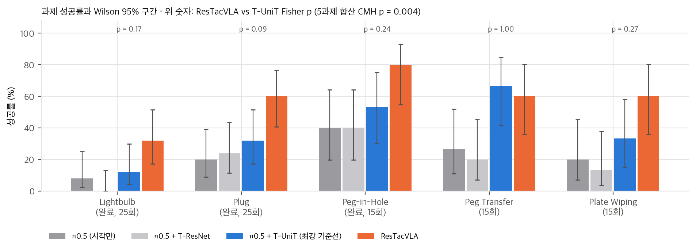

# 01. 논문 분석: ResTacVLA

- **논문:** Pengwei Zhang, Bin Xie, Xinpan Meng, Xinyu Guo, Ce Hao, Fang Deng, Long Cheng(교신), Tiancai Wang. *Feeling the Unexpected: ResTacVLA for Contact-Rich Manipulation via Residual Tactile Representation.* arXiv:2607.03387v3 (2026-07-19). 8쪽, 그림 6개, 표 3개.
- **소속:** 중국과학원대학 인공지능학원·중국과학원 자동화연구소, Zhongguancun Academy, Dexmal(1쪽 각주).
- **학회:** IROS 2026 채택(arXiv Comments: "Accepted by IROS 2026"). PDF 본문에는 IEEE 저작권 문구가 없습니다. "IEEE"는 참고문헌에만 나옵니다.
- **공개 자료:** 프로젝트 페이지 https://awilekong.github.io/ResTacVLA/ ("Code coming soon", "Data coming soon"). 웹페이지 저장소 `Awilekong/ResTacVLA` @ `09cdbcb`(2026-08-06)에는 `docs/`의 HTML·JS·CSS만 있습니다.
- **라이선스:** arXiv 비독점 배포(nonexclusive-distrib 1.0)입니다. CC BY가 아니어서 논문 그림은 개인용 리포트·PPT에만 넣었습니다.
- **판본:** v1(07-03), v2(07-07), v3(07-19). 단어 단위로 비교하면 v1 → v2는 arXiv 날짜 표기만, v2 → v3는 저자 순서만 바뀌었습니다. Ce Hao가 3번째에서 5번째로 옮겼고, 본문·표·그림(내장 이미지 101개)은 같습니다. 프로젝트 페이지는 아직 v1 순서입니다.

## 1. Abstract: 무엇을 주장하나

VLA에 촉각을 그냥 넣으면 고대역 시각 특징이 희소한 촉각 신호를 덮는 "modality collapse"가 생긴다고 봅니다(Sec. I, [9]). 저자들은 뇌가 예측 가능한 입력을 약화하고 예측에서 벗어난 자극(surprise)에 집중한다는 predictive coding [12–15]에서 착안했습니다.

1. 촉각을 원시 입력 대신 **잔차 촉각 표현** r_t = z_t − ẑ_t로 바꿉니다. 손목 영상으로 예측한 촉각 잠재와 실제 촉각 잠재의 차이입니다.
2. 잔차를 VQ 병목으로 이산화해 **Latent Contact Primitive**를 만듭니다.
3. 시각 예측의 불확실성 σ_t로 촉각 주입을 조절하는 **Surprise-Aware Gate(SAG)**를 둡니다.

주장은 세 가지입니다. 다섯 실물 과제에서 모든 기준선을 일관되게 앞서고, 예상 밖의 동적 교란에 강건하며, "최대 86.7% task success, 평균 34.6% 향상"입니다(Abstract, Sec. I 기여 3).

## 2. Method

### 2.1 문제 설정 (Sec. III 첫 문단)
관측은 O_t = {V_base, V_side, V_wrist, I_tac, s_t}이고 s_t ∈ R⁷는 고유 감각입니다. 정책 π(A_t | O_t, L)은 길이 H의 행동 chunk를 냅니다. 바탕 모델은 π0.5 [2]입니다. PaliGemma VLM [27]이 영상·지시·상태를 인코딩하고, action expert가 조건부 flow matching [26]으로 행동을 생성합니다(Sec. III-A).

### 2.2 Cross-Modal Predictor (Sec. III-B-1, Eq. 1)
- 손목 영상 V_wrist → 학습 가능한 ResNet-18 + MLP → 평균 μ_t ∈ R^{3×H′×W′}와 **스칼라** 표준편차 σ_t ∈ R를 냅니다. 둘은 예측 촉각 잠재 ẑ_t의 가우시안을 정의합니다.
- 실제 촉각 영상 I_tac는 UniT [21] 기반 촉각 인코더가 같은 공간의 z_t로 보냅니다. UniT는 VQVAE 기반 촉각 표현입니다.
- 잔차는 r_t = z_t − ẑ_t입니다. ẑ_t가 μ_t인지 표본인지는 적혀 있지 않습니다.
- 손실은 가중 NLL [28]입니다: L_pred = λ_σ log σ_t² + ‖z_t − μ_t‖² / σ_t² (Eq. 1). λ_σ는 "불확실성 붕괴"를 막는 가중치입니다.
- 논문은 "σ_t가 cross-modal surprise의 원리적 척도"라고 씁니다. 하지만 Eq. 1이 학습하는 σ_t는 Kendall & Gal [28]의 aleatoric 불확실성이고, **손목 영상만의 함수**입니다. 실제 촉각이 예측에서 얼마나 벗어났는지(예측 오차)는 σ_t에 들어가지 않습니다(`03` §2).

### 2.3 Latent Contact Primitive (Sec. III-B-2, Eq. 2)
- event encoder f_φ(conv residual block + global max pooling)가 r_t를 전역 사건 벡터 h_t ∈ R^D로 줄입니다.
- VQ [29] 코드북 C = {c_k}로 h_t를 q_t로 이산화합니다. 코드북 붕괴를 막으려고 네 가지를 씁니다: 저차원 코드 [30], 코사인 유사도 [30], EMA 갱신 [31], 비활성 코드 재초기화 [32].
- 복원 경로: q_t가 FiLM [33]으로 예측 사전 ẑ_t를 변조해 z̃_t를 만들고, decoder가 촉각 영상 Î_t로 되돌립니다.
- CMP 전체 손실은 L_CMP = L_rec + λ_p L_pred + L_vq입니다(Eq. 2). L_rec는 촉각 영상 MSE입니다.
- 정보 관점: q_t는 코드북 index 하나라서 프레임당 많아야 log₂K 비트입니다. 정책이 받는 촉각 정보는 모두 이 index를 거칩니다. K와 D는 논문에 없습니다.

### 2.4 Surprise-Aware Gate와 정책 주입 (Sec. III-C, Eq. 3–4)
- g_t = Sigmoid(MLP(σ_t)) (Eq. 3). 입력은 스칼라 σ_t 하나입니다.
- q_t를 선형층으로 p_t ∈ R^d에 투영하고, 학습되는 "접촉 없음" 토큰 e_0와 섞습니다: e_t = g_t p_t + (1 − g_t) e_0 (Eq. 4).
- e_t는 VLM 쪽이 아니라 **action expert의 noise 토큰 옆에 이어 붙입니다.** VLM의 사전학습 표현을 해치지 않으려는 선택입니다.
- **정책이 촉각을 받는 경로는 이 토큰 하나뿐입니다.** g_t → 0이면 e_t → e_0가 되어 정책은 촉각을 보지 못합니다.

### 2.5 학습 순서 (Sec. III-A, III-C)
1. CMP를 여러 과제의 상호작용 데이터로 따로 사전학습합니다.
2. CMP를 고정하고 촉각 확장 정책 전체를 flow matching으로 end-to-end 미세조정합니다. 게이트 MLP와 투영층도 이때 학습되므로, 게이트는 surprise를 직접 감독받지 않고 행동 손실만으로 배웁니다.

CMP 학습 데이터가 정책 데이터와 같은지는 적혀 있지 않습니다. 같다면 학습 중 잔차가 시험 때보다 작아지는 분포 차이가 생길 수 있습니다(`03` §3).

| 구성 요소 | 논문에 있는 것 | 없는 것 |
|---|---|---|
| CMP | ResNet-18 + MLP, 스칼라 σ, Eq. 1 | λ_σ, H′·W′, ẑ_t 정의(μ 또는 표본), 입력 해상도 |
| 촉각 인코더 | UniT 기반 | 사전학습 여부(공개 가중치 / 재학습), 고정 여부 |
| event encoder + VQ | 구조 서술, 붕괴 방지 4가지 | K, D, 코드 사용률, 재초기화 주기 |
| 게이트 | Eq. 3–4 | MLP 크기, 초기화, g 분포 통계 |
| 정책 | π0.5 + flow matching, e_t 주입 | H, 학습 step·batch, LoRA 여부, 추론 지연 |

## 3. Experiments

### 3.1 설정 (Sec. IV-A)
- **플랫폼:** Franka Research 3 + Robotiq 2F-85. **GelSight Mini 하나를 한쪽 손가락에만** 달았습니다. RealSense D435 세 대(정면, 측면, 손목)와 RTX 4090 워크스테이션 하나로 수집과 평가를 했습니다.
- **과제 다섯 개:** Lightbulb Screwing, Plug Insertion, Peg-in-Hole, Peg Transfer, Plate Wiping(Fig. 3). 과제마다 시연은 약 100개이고, 작업자는 실시간 촉각 영상을 보면서 시연했습니다.
- **평가 시행:** Lightbulb·Plug는 25회, 나머지 셋은 15회("롤아웃이 길어서")입니다. Lightbulb·Plug·Peg-in-Hole은 정렬(A)과 완료(I) 두 단계로 나눠 씁니다.
- **기준선 다섯 개:** DP w/o T, DP w/ T-ResTac, π0.5 w/o T, π0.5 w/ T-ResNet(ResNet-18 촉각 인코더), π0.5 w/ T-UniT(사전학습 UniT 특징).
  - 기준선의 촉각 주입 위치(VLM 입력 / action expert)와 게이트 유무는 적혀 있지 않습니다.
  - T-UniT는 ResTacVLA와 같은 촉각 인코더를 쓰므로, 둘의 차이가 CMP 잔차 + VQ + 게이트 + 주입 방식 전체입니다.

### 3.2 Q1: 주요 결과 (Table I)
- 평균 62.8%로 π0.5 28.2%보다 34.6, DP w/o T 18.8%보다 44.0 높다고 씁니다. 단위는 퍼센트포인트입니다.
- 이 평균은 **8칸 평균**입니다. A와 I를 같은 무게로 섞고, 두 단계 과제를 두 번 셉니다. 과제 성공(최종 단계) 기준 5과제 평균은 ResTacVLA 58.4%, T-UniT 39.5%, π0.5 22.9%입니다(`04` C3).
- "최대 86.7% task success"는 Peg-in-Hole의 **정렬(A)** 칸입니다. 과제 완료 기준 최고값은 Peg-in-Hole I의 80.0%입니다(`04` C1).
- Peg Transfer에서는 T-UniT 66.7%(굵게)가 ResTacVLA 60.0%(밑줄)보다 높습니다. 논문 표 자신의 강조 표시로도 "모든 과제에서 앞선다"(Abstract, Sec. IV-B)는 성립하지 않습니다(`04` C2).
- T-ResNet이 Lightbulb에서 "성능을 떨어뜨린다"(28.0 → 16.0)는 A칸 7/25 대 4/25이고 Fisher p = 0.50입니다.
- DP에 잔차 촉각을 넣으면 +19.2(38.0 대 18.8)입니다. DP w/ T-UniT 같은 "원시 촉각 DP" 칸이 없어서, 이 이득이 잔차 때문인지 촉각 자체 때문인지 가를 수 없습니다.

우리 분석: Table I의 과제 성공(최종 단계) 칸과 Wilson 95% 구간. 위 숫자는 ResTacVLA 대 T-UniT 과제별 Fisher p.

### 3.3 Q2: Ablation (Table II)
- Plug Insertion과 Plate Wiping 두 과제의 평균만 보고합니다: Full 60.0, w/o VQ(연속 잔차) 33.3, w/o Gating(g = 1 고정) 46.7, π0.5 20.0.
- 정성 설명: VQ가 없으면 "잦은 떨림과 파지 자세 민감도"가 생기고, 게이트가 없으면 "촉각 잡음과 초기 파지 오차로 궤적이 표류"합니다.
- **잔차 대 원시 촉각을 직접 비교한 ablation은 없습니다.** w/o VQ 33.3은 같은 두 과제의 T-UniT 평균 32.7과 거의 같습니다. VQ를 뺀 잔차 경로가 원시 UniT 특징보다 나은지 이 표로는 보이지 않습니다(`04` C5).
- 두 과제 평균(25회 + 15회)은 정수 조합이 여러 개라 과제별 값을 복원할 수 없습니다. 예를 들어 33.3은 (Plug, Wiping) = (0/25, 10/15), (5, 7), (10, 4), (15, 1) 중 하나입니다.

### 3.4 Q3: 해석 (Fig. 4, Fig. 5)
- **t-SNE(Fig. 4):** 자유 공간 프레임은 다섯 과제가 한 군집으로 모이고, 접촉 프레임은 과제·사건(충돌, 정렬 성공)별 작은 군집으로 갈라진다고 씁니다.
  - 정량 지표(군집 순도, 코드 사용률)는 없습니다.
  - 점들이 연속적으로 흩어져 있습니다. 양자화된 코드 q_t를 그렸다면 많아야 K개 위치에 겹쳐야 하므로, 실제로는 양자화 전 h_t를 그렸을 가능성이 있습니다. 논문은 이를 밝히지 않습니다.

**게이트 곡선(Fig. 5):** 성공한 Lightbulb 시행 **하나**의 g_t입니다. 그림에서 읽은 값은 다음과 같습니다.

| 단계 (진행도) | g_t |
|---|---|
| Approach (0–0.3) | 약 0.11–0.14 |
| Pre-contact (0.3–0.45) | 약 0.35로 뛰어오름 |
| Alignment | 약 0.55–0.60 |
| Screwing | 최고 약 0.78 |
| Success (0.81 이후) | 0 근처로 떨어짐 |

- 본문은 "접근 중 0 근처, 접촉하면 빠르게 포화"라고 쓰고, 캡션은 "점진적으로 오른다"고 씁니다. 그림은 캡션 쪽이고 포화(1)에 이르지 않습니다.
- g가 **접촉 전(pre-contact)부터** 오른다는 점이 중요합니다. 게이트가 실제 촉각의 놀람이 아니라 영상에서 "접촉이 가까움"을 읽는다는 뜻이며, σ_t의 정의(영상만의 함수)와 맞습니다(`03` §2).

### 3.5 Q4: 강건성 (Table III, Fig. 6)
교란 세 가지를 썼습니다: 초기 파지 교란(Plug, ±5 mm, ±10°), 동적 표적 이동(Peg-in-Hole, 3–5 cm), 표면 높이 ±2 cm(Plate Wiping). 비교 대상은 π0.5와 T-UniT 둘입니다.

| 조건 | π0.5 | T-UniT | ResTacVLA | 교란 없는 칸(Table I) 대비 하락 |
|---|---|---|---|---|
| Dynamic (Peg-in-Hole, 15회) | 26.7 | 40.0 | 66.7 | **세 방법 모두 −13.3** (−2/15) |
| Height + (Wiping, 15회) | 33.3 | 46.7 | 53.3 | π0.5·T-UniT +13.3, ResTacVLA −6.7 |
| Height − (Wiping, 15회) | 0.0 | 13.3 | 40.0 | **세 방법 모두 −20.0** (−3/15) |
| Grasp (Plug, 25회) | 8.0 | 20.0 | 52.0 | −12, −12, −8 |

교란에 따른 하락폭이 방법 사이에 같거나 비슷합니다. 그래서 표 III의 우위는 교란 없는 성능 차이가 그대로 옮겨 온 것으로 읽는 편이 맞습니다. "교란에 더 강건하다"는 근거는 되지 않습니다(`04` C7). 교란 조건의 시행 수(15·25회)는 따로 적혀 있지 않아, Table I과 같다고 가정했습니다. 모든 값이 그 분모와 정수로 맞습니다.

## 4. Limitations

논문에는 한계 절이 없습니다. 읽으면서 확인한 한계는 다음과 같습니다.

1. **게이트가 예상 밖 사건을 볼 수 없는 구조입니다.** g는 손목 영상만의 함수인 σ_t로 정해집니다. 그래서 영상으로 보이지 않는 자유 공간 충돌에서는 게이트가 닫힌 채로 남습니다. 제목의 "Feeling the Unexpected"와 Fig. 4의 "unexpected collision" 군집은 CMP 안의 표현이고, 정책까지 전달된다는 보장은 없습니다(`03` §2, toy).
2. **잔차의 기여가 분리되지 않았습니다.** 잔차 대 원시 ablation이 없고, Table II는 두 과제 평균입니다.
3. **통계 근거가 약합니다.** 과제당 15–25회이고 시드, 반복, 신뢰구간이 없습니다. 최강 기준선 T-UniT와는 과제별로 유의한 차이가 하나도 없습니다(최소 Fisher p = 0.088). 다섯 과제를 합치면 CMH p = 0.004입니다.
4. **이득이 대부분 정렬 단계에서 나옵니다.** T-UniT 대비 완료 성공 이득의 74%(로그 배율)가 정렬 성공률 차이입니다. "촉각이 상호작용 단계에서 시각의 빈틈을 메운다"는 서술(Sec. IV-B)과 결이 다릅니다(`03` §1).
5. **하드웨어 범위가 좁습니다.** GelSight Mini 하나, 한 손가락, 평행 그리퍼, 한 연구실 환경입니다.
6. **재현 정보가 부족합니다.** λ_σ, λ_p, K, D, H, 게이트 MLP, 학습 step, 기준선 조율 방법, 추론 지연이 없습니다.
7. **해석 그림이 정성적입니다.** Fig. 5는 시행 하나, Fig. 4는 정량 지표가 없습니다.

## 5. 한 줄 평가

"촉각을 시각 예측과의 차이로 표현하고, 접촉 국면에서만 주입한다"는 설계는 간단하고 옮기기 쉽습니다. 다만 논문의 증거는 **ResTacVLA 전체가 π0.5보다 낫다**까지만 보여 줍니다(5과제 합산 p < 10⁻⁶). 잔차·surprise라는 명명이 성능의 원인이라는 주장은 실험으로 분리되지 않았습니다. 게이트는 surprise 검출기라기보다 **영상 기반 접촉 국면 검출기**로 읽는 편이 정확합니다.
