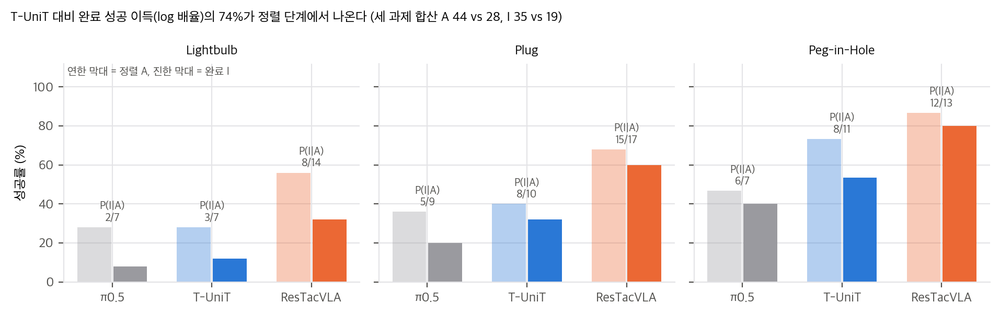
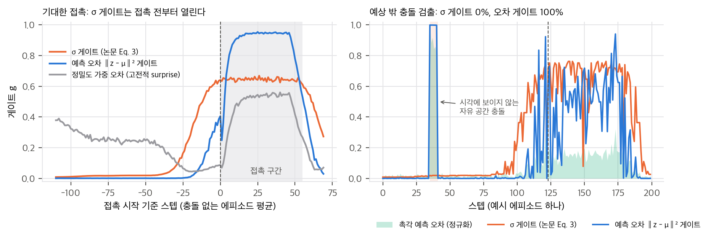
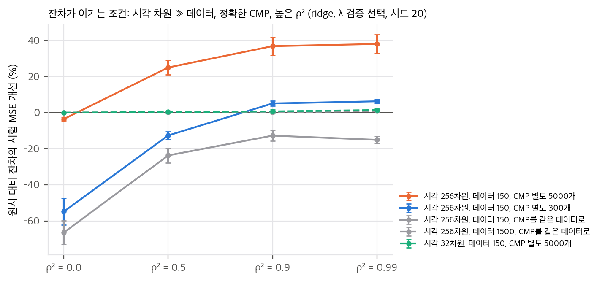
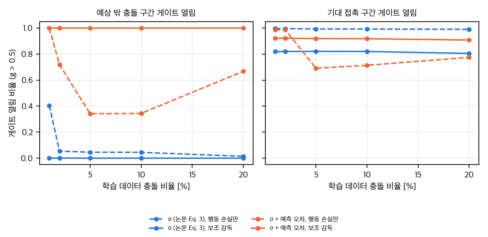
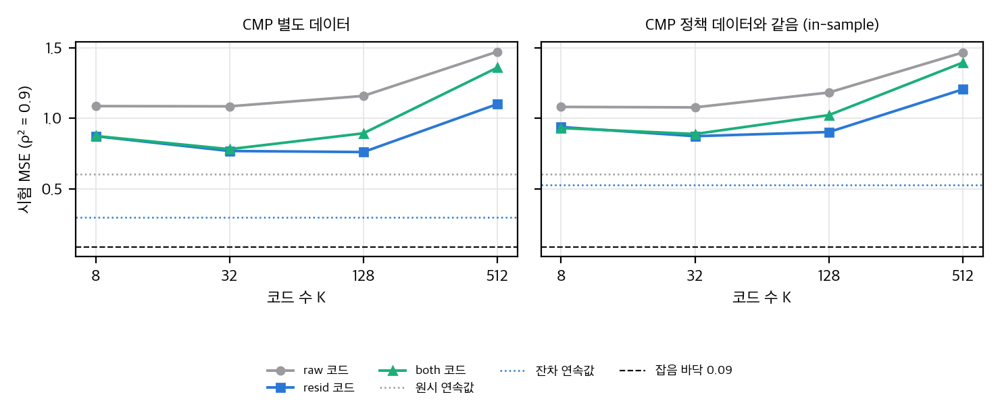

# 03. 재계산과 유도

스크립트는 `analysis/table_check.py`(표 재계산, 1초 미만)와 `analysis/gate_toy.py`(numpy toy, 1스레드 약 30초)입니다. 결과는 같은 이름의 `*_results.json`에 있습니다.

## 1. Table I 다시 읽기

### 1.1 성공 횟수와 평균
모든 칸이 25회(Lightbulb, Plug)·15회(나머지)와 정수로 맞습니다. 예를 들어 ResTacVLA는 14/25, 8/25, 17/25, 15/25, 13/15, 12/15, 9/15, 9/15입니다. 보고된 평균 여섯 개도 8칸 단순 평균과 모두 일치합니다.

| 방법 | 8칸 평균 (보고) | 과제 성공 5과제 평균 | 과제 성공 합산 (95회) |
|---|---|---|---|
| π0.5 (시각만) | 28.2 | 22.9 | 20/95 |
| DP w/o T | 18.8 | 12.5 | 12/95 |
| π0.5 + T-ResNet | 23.2 | 19.5 | 17/95 |
| π0.5 + T-UniT | 42.3 | 39.5 | 34/95 |
| DP + T-ResTac | 38.0 | 34.7 | 30/95 |
| **ResTacVLA** | **62.8** | **58.4** | **53/95** |

"+34.6%"는 π0.5 대비 퍼센트포인트 차이입니다. 상대 향상으로는 +123%입니다. 가장 센 기준선 T-UniT와 비교하면 8칸 평균으로 +20.5pp, 과제 성공으로 +18.9pp입니다.

### 1.2 유의성
과제 성공(최종 단계) 칸에 Fisher 정확검정과 Holm 보정을 적용하고, 다섯 과제를 Cochran–Mantel–Haenszel(CMH)로 합쳤습니다.

| 과제 | ResTacVLA | π0.5 | p (π0.5 대비) | T-UniT | p (T-UniT 대비) |
|---|---|---|---|---|---|
| Lightbulb (I) | 8/25 | 2/25 | 0.074 | 3/25 | 0.17 |
| Plug (I) | 15/25 | 5/25 | **0.0086** (Holm 0.043) | 8/25 | 0.088 |
| Peg-in-Hole (I) | 12/15 | 6/15 | 0.060 | 8/15 | 0.25 |
| Peg Transfer | 9/15 | 4/15 | 0.14 | 10/15 | 1.00 |
| Plate Wiping | 9/15 | 3/15 | 0.060 | 5/15 | 0.27 |
| **5과제 CMH** | | | **p = 4.7×10⁻⁷**, OR 5.5 | | **p = 0.0039**, OR 2.5 |

- π0.5 대비 우위는 확실합니다. 과제별로 Holm 뒤에 유의한 것은 Plug 하나지만, 다섯 과제 방향이 모두 같고 합산 p가 매우 작습니다.
- T-UniT 대비로는 **과제별로 유의한 것이 하나도 없습니다.** 합산하면 p = 0.004입니다. 이 차이에는 잔차, VQ, 게이트, 주입 방식이 모두 섞여 있습니다.
- DP + T-ResTac 대 DP w/o T: 과제별 p는 0.14–0.50이고, 합산하면 p = 5.6×10⁻⁴입니다.

### 1.3 정렬(A)과 완료(I)로 분해
두 단계 과제에서 완료 성공은 P(I) = P(A) · P(I|A)입니다(I가 A의 부분집합이라고 가정).

| 과제 | π0.5 A → I | T-UniT A → I | ResTacVLA A → I |
|---|---|---|---|
| Lightbulb | 7 → 2 (0.29) | 7 → 3 (0.43) | 14 → 8 (0.57) |
| Plug | 9 → 5 (0.56) | 10 → 8 (0.80) | 17 → 15 (0.88) |
| Peg-in-Hole | 7 → 6 (0.86) | 11 → 8 (0.73) | 13 → 12 (0.92) |

세 과제를 합산하면 ResTacVLA 대 T-UniT는 A 44 대 28, I 35 대 19입니다. 완료 성공 배율 1.84 = 정렬 배율 1.57 × 조건부 배율 1.17입니다. **로그 기준으로 이득의 74%가 정렬 단계에서 나옵니다.** 조건부 성공률 P(I|A) 차이(35/44 대 19/28)는 Fisher p = 0.28입니다. π0.5 대비로는 65%가 정렬 몫입니다.

논문은 "시각 정책은 정렬은 그럭저럭 하지만 상호작용에서 무너지고, ResTacVLA는 상호작용 내내 유지된다"고 해석합니다(Sec. IV-B). 하지만 수치상 가장 큰 차이는 **정렬을 더 자주 성공시키는 데** 있습니다. 정렬은 게이트가 0.35–0.6으로 반쯤 열린 국면입니다(Fig. 5). 그래서 촉각 접촉 사건보다 "접촉 직전의 미세 접근"에서 효과가 났을 수 있습니다. 시행별 기록이 없어서 더 가를 수는 없습니다.

우리 분석: Table I의 정렬(연한 막대)·완료(진한 막대) 성공률과 P(I|A).

## 2. 게이트가 실제로 보는 것

### 2.1 Eq. 1의 최적해
손목 영상 v가 주어졌을 때 n = 3H′W′차원 잠재 z에 대해 기대 손실은 E[λ_σ log σ² + ‖z − μ‖²/σ² | v]입니다. 이를 최소화하면 다음을 얻습니다.

- μ*(v) = E[z | v]
- σ*(v)² = E[‖z − μ*(v)‖² | v] / λ_σ (σ²로 미분: λ_σ/σ² − E[‖·‖²|v]/σ⁴ = 0)

λ_σ = n이면 σ²가 차원당 분산이 되어 보정된 값이 됩니다. 다른 값이면 배율만 달라지고, 그 배율은 게이트 MLP가 흡수합니다. 핵심은 **σ*가 v만의 함수**라는 점입니다. 이 σ는 "이 영상에서 촉각이 얼마나 퍼져 있을지"(기대 불확실성, aleatoric)를 나타냅니다. 지금 들어온 촉각이 예측에서 얼마나 벗어났는지(예측 오차)와는 다른 양입니다. predictive coding의 surprise는 정밀도로 가중한 예측 오차 (z − μ)/σ이고, 실제 z가 있어야 계산됩니다.

결과적으로 g_t = Sigmoid(MLP(σ_t))는 다음 성질을 가집니다.
1. 영상이 "접촉이 가까움"을 보이면 촉각이 실제로 어떻든 열립니다. Fig. 5에서 접촉 전(pre-contact)부터 0.35로 오르는 것과 맞습니다.
2. 영상이 자유 공간처럼 보이면 예상 밖 충돌이 있어도 닫혀 있습니다. 예상 밖 사건이 가장 중요한 순간에 촉각 경로를 낮춥니다.
3. Sigmoid는 0이 되지 않으므로 "차단"이 아니라 감쇠입니다. Fig. 5의 접근 단계 g ≈ 0.12는 p_t를 약 8배 줄인 것입니다. 정책이 이 신호를 다시 키워 쓸 수 있는지는 학습에 달렸습니다.

### 2.2 toy: σ 게이트 대 예측 오차 게이트
1차원 접근 → 접촉 → 해제 에피소드(200스텝)를 만들었습니다. 접촉 시점은 ±8스텝 흔들리고, 접촉 근처에서는 시각 오차가 커집니다(가림). 촉각 잠재는 8차원이고 접촉력은 에피소드마다 0.5–1.5입니다. 에피소드 절반에는 **시각으로 보이지 않는 자유 공간 충돌**(6스텝)을 넣었습니다.

CMP는 분위수 구간 평균으로 Eq. 1의 최적해(μ*, σ*)를 근사했습니다. 게이트 네 개는 모두 같은 로지스틱 회귀로 "접촉 중(기대 + 예상 밖)" 라벨에 맞췄습니다. 따라서 차이는 입력 특징에서만 납니다.

| 게이트 입력 | 기대 접촉 열림 | 예상 밖 충돌 열림 | 자유 공간 오개방 | 접촉 전 10스텝 평균 g | 열림 지연 (중앙값) |
|---|---|---|---|---|---|
| σ (논문 Eq. 3) | 0.88 | **0.00** | 0.039 | **0.60** | 0스텝 |
| 원시 예측 오차 ‖z − μ‖² | 0.93 | 1.00 | 0.001 | 0.28 | 1스텝 |
| 정밀도 가중 오차 (고전적 surprise) | 0.50 | 1.00 | 0.082 | 0.07 | 8스텝 |
| σ + 오차 | 0.93 | 1.00 | 0.001 | 0.27 | 1스텝 |

- **σ 게이트는 예상 밖 충돌을 하나도 열지 못합니다.** 게이트 보정 데이터에 충돌이 절반 있어도, CMP 학습 데이터의 충돌 비율을 0.5로 올려도 0%입니다. 구조적 한계라서 데이터로 해결되지 않습니다.
- 대신 σ 게이트는 접촉 **전부터** 열립니다(접촉 전 평균 0.60). 이것이 Fig. 5의 pre-contact 상승과 같은 현상입니다. 기대 접촉에는 유리합니다.
- 고전적 surprise(정밀도 가중 오차)는 기대한 접촉에서 오히려 닫힙니다. 예측대로 일어난 접촉은 놀랍지 않기 때문입니다. 접촉 과제에 필요한 신호는 "놀람"이 아니라 "촉각에 정보가 있음"이고, 이는 σ와 오차를 함께 봐야 얻어집니다. 이 게이트가 접근 초반에 0.3–0.4로 높은 것은 분위수 구간 가장자리의 σ 추정 잡음 때문입니다(toy 인공물).
- **센서 잡음 스윕:** σ_n = 0.03 → 0.3으로 키우면 원시 오차 게이트의 충돌 검출은 1.00 → 0.68로, 기대 접촉 검출은 0.94 → 0.47로 떨어집니다. σ 게이트는 0.8 이상을 유지합니다.
- σ + 오차 게이트의 충돌 검출은 σ_n = 0.2에서 0.33, 0.3에서 0.01로 무너집니다. 로지스틱이 흔한 기대 접촉을 맞추려고 σ에 무게를 싣기 때문입니다. 게이트를 행동 손실만으로 학습하면(논문 Sec. III-C) **드문 예상 밖 사건은 손실에서 차지하는 몫이 작아** 같은 일이 생길 수 있습니다. 예상 밖 사건 검출이 목적이면 별도 감독이나 가중이 필요합니다.

우리 toy: (왼쪽) 충돌 없는 에피소드를 접촉 시점에 맞춰 평균한 게이트. (오른쪽) 충돌이 있는 예시 에피소드. 오차 게이트는 기대 접촉 중에도 예측과 맞는 순간에 닫혔다 열리기를 반복한다.

## 3. 잔차 대 원시 촉각

### 3.1 선형 재매개화라는 점
CMP가 고정된 함수 ẑ = f(v)이면 잔차 특징 [v, r] = [v, z − f(v)]는 원시 특징 [v, z]의 가역 변환입니다. 정책이 v와 z를 모두 받는다면 정보량은 같습니다(데이터 처리 부등식에서 등호). f가 선형이면 OLS 예측이 정확히 같습니다. toy에서 최대 차이는 6×10⁻¹³이었습니다.

그래서 잔차화의 이득은 다음 세 경로로만 생길 수 있습니다.
1. **정규화·최적화의 귀납 편향.** 모달리티별로 표준화하면 원시 z에서는 시각으로 예측되는 성분이 분산을 차지합니다. 그러면 촉각 고유 성분의 계수가 1/√(1 − ρ²)배로 커져야 하고, ridge나 weight decay가 이를 더 강하게 누릅니다.
2. **정책이 f를 스스로 배우기 어려울 때.** ResNet-18 CMP가 별도 데이터로 배운 f를 정책이 공짜로 받습니다.
3. **VQ 병목과의 결합.** 원시 z를 K개 코드로 자르면 대부분의 비트가 예측 가능한 성분에 쓰입니다. 잔차를 자르면 비트가 예측 불가능한 성분에 갑니다(§5).

반대로 잔차가 손해인 경우도 있습니다. CMP가 정책 데이터와 같은 데이터로 학습되어 과적합하면, 학습 중 잔차는 작고 시험 중 잔차는 큽니다.

### 3.2 toy: ridge, 유한 데이터, CMP 품질
y = w_v·v + w_u·u + 잡음, z = Cv + √(1 − ρ²) u로 두었습니다. ρ²는 촉각 중 시각으로 예측되는 비율입니다. 특징 열마다 표준화하고 ridge λ는 검증 세트로 골랐습니다. 시드 20개 평균이고, 값은 원시 대비 잔차의 시험 MSE 개선(%)입니다.

| 조건 | ρ² = 0 | 0.5 | 0.9 | 0.99 |
|---|---|---|---|---|
| 시각 32차원, 데이터 150, CMP 별도 5000 | −0.0 | +0.3 | +0.6 | +1.4 |
| 시각 256차원, 데이터 1500, CMP 별도 5000 | −0.1 | +0.1 | +0.1 | +0.7 |
| **시각 256차원, 데이터 150, CMP 별도 5000** | −3.6 | **+25.0** | **+36.8** | **+38.0** |
| 시각 256차원, 데이터 150, CMP 별도 300 | −54.8 | −12.7 | +5.1 | +6.3 |
| 시각 256차원, 데이터 150, **CMP를 같은 데이터로** | −66.4 | −23.7 | −12.8 | −15.1 |

- 시각 차원이 데이터보다 작으면 잔차든 원시든 거의 같습니다(|차이| ≤ 1.4%).
- 시각 차원이 데이터보다 훨씬 크고(256 대 150), **CMP가 별도의 큰 데이터로 정확하게 학습되고, ρ²가 높을 때만** 잔차가 크게 이깁니다(25–38%). 논문이 말하는 "고대역 시각이 희소 촉각을 덮는" 상황이 바로 이 조건입니다.
- CMP가 부정확하면(300개) 낮은 ρ²에서 잔차가 크게 집니다. CMP 오차가 잔차에 시각 잡음을 섞기 때문입니다.
- CMP를 정책 데이터로 학습하면 모든 ρ²에서 집니다. 학습 쪽 잔차 분산이 시험 쪽의 0.0배(시각 256차원, 데이터 150)–0.69배(데이터 1500)로 줄어드는 분포 차이 때문입니다.

우리 toy: 원시 대비 잔차의 시험 MSE 개선(%)과 95% 구간(시드 20).

논문의 CMP는 다섯 과제 시연 약 500개로 학습한 ResNet-18입니다. 정책 데이터와 같은지, 시험 데이터에서 예측 오차가 얼마인지는 보고되지 않았습니다. toy 기준으로는 이 두 값이 잔차의 득실을 가르는 변수입니다. 그래서 "잔차 표현이 필수"(Sec. IV-B)라고 결론 내리려면 같은 조건의 원시 대 잔차 ablation과 CMP 일반화 오차가 필요합니다.

## 4. Table II·III

- **Table II:** 두 과제 평균은 정수 조합이 여러 개입니다. Full 60.0 = (Plug, Wiping) ∈ {(5, 15), (10, 12), (15, 9), (20, 6), (25, 3)}이고, Table I의 (15, 9)와 맞습니다. w/o VQ 33.3과 w/o Gating 46.7도 각각 네·다섯 조합이 가능합니다.
  - Plug 25회 + Wiping 15회를 합치면 차이 −13.3pp(게이트)는 약 5–6회 차이입니다.
  - Full 24/40 대 w/o Gating 18–20/40을 단순 비교하면 Fisher p = 0.26–0.50입니다(조합에 따라 다름).
  - w/o VQ 33.3은 같은 두 과제의 T-UniT 평균 32.7과 거의 같습니다.
- **Table III:** 교란 없는 Table I 칸 대비 하락폭은 다음과 같습니다. 방법 사이 차이가 교란 전의 차이와 같습니다. 같은 방법 안에서도 교란 전후 차이는 Fisher p ≥ 0.22로 구분되지 않습니다.
  - Dynamic: 모두 −13.3
  - Height −: 모두 −20.0
  - Height +: π0.5와 T-UniT는 오히려 +13.3, ResTacVLA는 −6.7
  - Grasp: −12, −12, −8

## 5. VQ 병목의 정보량

정책이 받는 촉각은 코드 index q_t 하나를 선형 투영한 토큰입니다. 그래서 프레임당 정보는 많아야 log₂K 비트입니다(K = 64면 6비트, 512면 9비트). 접촉 위치, 방향, 힘 크기를 모두 이 index 하나에 담아야 합니다. Plate Wiping처럼 연속적인 힘 조절이 필요한 과제에서는 K단계 양자화가 해상도 상한이 됩니다.

Table II에서 VQ를 빼면 성능이 떨어지므로, 이 병목은 잡음 제거로서는 이득입니다. 다만 초록의 "희소 촉각을 조밀한 정보 이득으로 바꾼다"와는 방향이 반대입니다. 정책이 받는 것은 **조밀한 신호가 아니라 이산 사건 라벨**입니다. K와 코드 사용률이 없어서 이 상한을 계산할 수는 없습니다.

## 추가 검증 (2026-11-11)

### 추가 검증 1: 행동 손실만으로 학습한 게이트는 드문 예상 밖 충돌을 여는가

**목적.** §2.2에서 σ 게이트가 예상 밖 충돌을 못 본다는 것을 확인했다. 여기서는 게이트를 행동 손실만으로 학습할 때(논문 Sec. III-C), 학습 데이터의 충돌 비율(1–20%)에 따라 충돌 구간에서 게이트가 열리는지, 보조 감독(게이트 라벨의 BCE)과 입력(σ만, σ와 예측 오차)을 바꾸면 달라지는지 본다.

**설정.** `analysis/extra_gate_rare.py` (numpy, 약 3분, 단일 스레드). `gate_toy.py`의 에피소드(200스텝, 접촉 시작 ≈120, 충돌은 접촉 전 20–90 스텝 사이 6스텝)와 CMP(분위수 구간 평균)를 그대로 썼다.
- 게이트: g = Sigmoid(MLP(입력)), MLP는 2→4→1(tanh). 입력은 log σ(논문 Eq. 3) 또는 [log σ, log 예측 오차]. 입력은 학습 데이터로 표준화한다.
- 정책: p = w₀ + w₁·v + w₂·g·‖z‖ + w₃·g·‖z‖·v. 처음에는 w₃ 항이 없었는데, 그때는 게이트를 완전히 열어도 충돌 구간 출력이 후퇴 쪽으로 내려가지 않아서 상호작용 항을 추가했다.
- 행동 목표 a*: 기대 접촉 +1(밀기), 예상 밖 충돌 −1(후퇴), 그 밖 0. 손실은 행동 MSE다. 보조 감독 변형은 여기에 "접촉 또는 충돌" 라벨의 BCE(가중 1)를 더한다.
- 학습: 에피소드 200개, Adam 800스텝, 학습률 0.03. 시험은 에피소드 200개이고 절반에 충돌을 넣었다. 시드 3개(표준편차를 표에 같이 적었다).

**결과.** 시험 구간에서 게이트 값 g > 0.5인 비율.

| 게이트 입력 | 학습 | 충돌 1% | 2% | 5% | 10% | 20% | 기대 접촉 (1%→20%) |
|---|---|---|---|---|---|---|---|
| σ (논문 Eq. 3) | 행동 손실만 | 0.41 | 0.05 | 0.05 | 0.04 | 0.01 | 1.00 → 0.99 |
| σ (논문 Eq. 3) | 보조 감독 | 0.00 | 0.00 | 0.00 | 0.00 | 0.00 | 0.82 → 0.81 |
| σ + 예측 오차 | 행동 손실만 | 1.00 | 0.72 | 0.34 | 0.34 | 0.67 | 0.99 → 0.78 |
| σ + 예측 오차 | 보조 감독 | 1.00 | 1.00 | 1.00 | 1.00 | 1.00 | 0.92 → 0.91 |

- 행동 손실만 쓴 σ+오차 게이트의 충돌 열림 비율은 시드 간 표준편차가 0.40–0.47로 컸다(1%만 0.00). 충돌 비율과 단조 관계가 없었다.
- 후퇴 반응(정책 출력 < −0.5)은 어떤 조건에서도 0%였다. 게이트를 강제로 열어도(g = 1) 충돌 구간 출력은 대체로 0.3–2.7의 양수(밀기) 쪽이었다. 이 정책 형태로는 후퇴를 표현하기 어렵다. 그래서 "충돌에 반응한다"는 행동 수준의 결론은 이 toy에서 내리지 못했다.

직접 그림(추가 검증 1): 학습 데이터 충돌 비율에 따른 시험 구간 게이트 열림 비율(g > 0.5). 왼쪽은 예상 밖 충돌, 오른쪽은 기대 접촉 구간이다. 시드 3개.

**결론.**
- σ 게이트는 행동 손실만으로도, 보조 감독을 주어도 충돌을 거의 열지 못했다. 입력에 충돌 정보가 없어서이고, 감독은 이를 바꾸지 못한다. §2.2의 "구조적 한계" 결론과 맞는다.
- 예측 오차를 입력에 더하면 보조 감독이 있을 때 충돌 열림이 시험 전 구간에서 1.00이었다. 행동 손실만으로는 충돌 비율에 따라 0.34–1.00으로 흔들렸다. 드문 사건을 행동 손실에만 맡기면 신뢰할 수 없다는 §2.2의 우려와 맞는다.
- 한계: 시드 3개, 정책은 선형 + 한 개의 상호작용 항이다. 충돌 비율 효과를 단조 곡선으로 말하기에는 분산이 너무 크다. 그리고 후퇴 반응을 제대로 재려면 정책 표현력을 먼저 키워야 한다.

### 추가 검증 2: 비선형 CMP와 VQ 병목에서 잔차 대 원시 촉각

**목적.** §3.2의 선형 toy 결론(잔차 이득은 CMP가 별도 데이터로 정확하고 시각 차원이 클 때만 나온다)이 비선형 CMP와 VQ 병목(§5)에서도 유지되는지 본다. K에 따른 힘 해상도 손실도 함께 본다.

**설정.** `analysis/extra_residual_vq.py` (numpy, 약 100초, 단일 스레드).
- 세계: 시각 v ∈ R²⁵⁶, 촉각 z ∈ R⁸ = √ρ²·p(v) + √(1−ρ²)·u. p(v)는 tanh 비선형 함수(표준화). 행동 y = w_v·v + w_u·u + 잡음(0.3).
- CMP: MLP 256→32→8(tanh), 전체 배치 Adam 800스텝, 가중치 감쇠 0.1. 감쇠 없이 학습하면 과적합해서(시험 MSE 0.91, 이상적 0.5) 감쇠를 넣었다. 감쇠를 넣은 뒤 단일 시드 점검에서 시험 MSE는 0.55였다.
- CMP 데이터: 별도 5000개, 또는 정책 데이터와 같은 600개(in-sample).
- 정책: 표준화한 ridge(λ는 검증 세트 300개로 선택). 학습 600개, 시험 3000개, 시드 5개. 원시 입력 [v, z], 잔차 입력 [v, r = z − ẑ], VQ 입력은 k-means 코드북(K = 8, 32, 128, 512)의 one-hot이다. 코드북은 정책 학습 데이터의 비지도 특징으로 적합했다.
- 잡음 바닥은 0.09다.

**결과.** 시험 MSE(시드 5개 평균). 괄호는 잔차 − 원시의 짝지은 차이(시드 5개 중 잔차가 이긴 수).

| ρ² | CMP | 연속값: 원시 / 잔차 | VQ 8: 원시 / 잔차 | VQ 128: 원시 / 잔차 | VQ 512: 원시 / 잔차 |
|---|---|---|---|---|---|
| 0.5 | 별도 5000 | 0.233 / 0.194 (−0.04, 5/5) | 0.952 / 0.831 (−0.12, 5/5) | 0.874 / 0.674 (−0.20, 5/5) | 1.296 / 0.989 (−0.31, 5/5) |
| 0.5 | in-sample 600 | 0.233 / 0.693 (+0.46, 0/5) | 0.958 / 0.919 (−0.04, 5/5) | 0.866 / 0.845 (−0.02, 4/5) | 1.284 / 1.091 (−0.19, 5/5) |
| 0.9 | 별도 5000 | 0.606 / 0.300 (−0.31, 5/5) | 1.087 / 0.873 (−0.21, 5/5) | 1.159 / 0.761 (−0.40, 5/5) | 1.472 / 1.100 (−0.37, 5/5) |
| 0.9 | in-sample 600 | 0.606 / 0.529 (−0.08, 5/5) | 1.081 / 0.939 (−0.14, 5/5) | 1.183 / 0.903 (−0.28, 5/5) | 1.467 / 1.205 (−0.26, 5/5) |

직접 그림(추가 검증 2): ρ² = 0.9에서 코드 수 K에 따른 시험 MSE. 가로선은 연속값 입력이다. 점선 검은 선은 잡음 바닥 0.09다.

**결론.**
- 별도 CMP에서는 비선형 CMP와 VQ 병목 모두에서 잔차가 원시보다 나았다(VQ 전 구간, 시드 5/5). 선형 toy의 "별도 CMP + 시각이 클 때 잔차가 이긴다"와 방향이 같다.
- in-sample CMP의 결론은 조건에 따라 다르다. ρ² = 0.5의 연속값에서는 잔차가 크게 졌다(+0.46). 그러나 ρ² = 0.9와 VQ 입력에서는 잔차가 여전히 이겼다. 선형 toy에서 "in-sample CMP면 모든 ρ²에서 진다"던 결론은 비선형 CMP와 VQ에서는 그대로 유지되지 않았다.
- VQ는 K가 커질수록 개선되지 않았다. K = 512에서는 600개 데이터에 비해 코드가 너무 많아 오히려 나빠졌다. 잔차 VQ는 K = 32–128에서 가장 나았고(MSE 0.67–0.77), 연속값 잔차와의 차이(0.4–0.5)가 남았다. 힘 해상도 손실은 이 데이터 규모에서 K에 따라 커졌다.
- 한계: 정책 데이터가 600개로 시각 차원(256)보다 적다. 그래서 MSE는 잡음 바닥(0.09)보다 한참 위에 있고, 차이의 상당 부분은 추정 분산일 수 있다. ρ² = 0.9의 원시 연속값(0.61)이 ρ² = 0.5(0.23)보다 나쁜 이유도 이 toy로는 구분하지 못했다. 실물 데이터의 CMP 일반화 오차는 여전히 보고되지 않았다.
