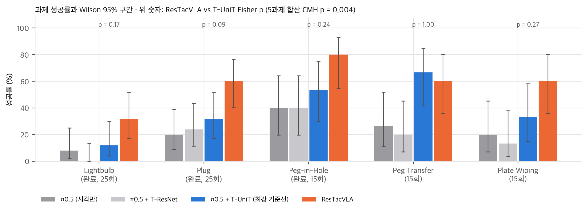
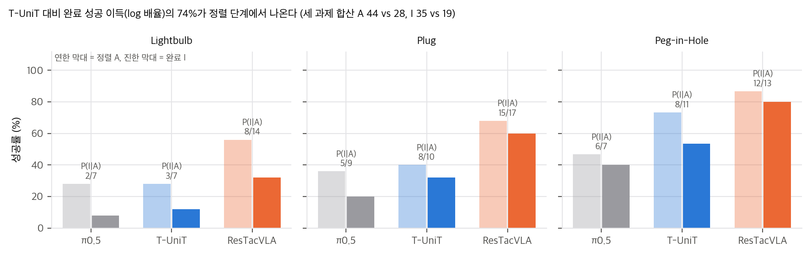
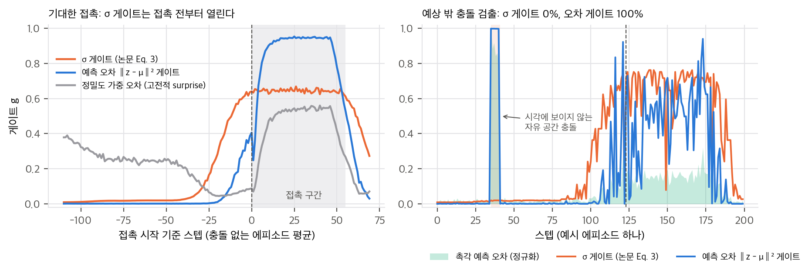
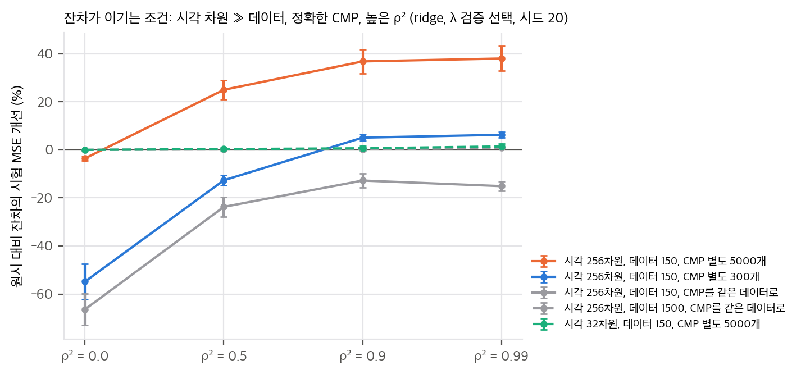

> **논문:** Zhang, Xie, Meng, Guo, Hao, Deng, Cheng, Wang. *Feeling the Unexpected: ResTacVLA for Contact-Rich Manipulation via Residual Tactile Representation.* IROS 2026, arXiv:2607.03387 (v3).
> 논문 그림은 라이선스(arXiv 비독점 배포) 때문에 싣지 않았습니다. 그림과 영상은 [프로젝트 페이지](https://awilekong.github.io/ResTacVLA/)에서 볼 수 있습니다. 이 글의 그래프는 논문 표의 수치와 직접 만든 toy로 그렸습니다. 코드와 데이터는 "coming soon"입니다(2026-11-09 확인).

## 한 줄 요약

π0.5에 촉각을 넣는 방법입니다. 원시 촉각 대신 **손목 영상으로 예측한 촉각 잠재와 실제 촉각 잠재의 차이**(잔차)를 VQ 코드로 바꿔 action expert에 토큰 하나로 붙이고, 시각 예측의 불확실성 σ로 그 토큰의 세기를 조절합니다. 다섯 실물 과제(전구 조이기, 플러그 꽂기, 펙 옮기기, 접시 닦기, 펙 꽂기)에서 평균 62.8%로 π0.5(28.2%)를 크게 앞선다고 보고합니다.

## 1. 아이디어: 보이는 만큼은 빼고 넣는다

VLA에 촉각 영상을 그냥 넣으면 고대역 시각 특징이 희소한 촉각 신호를 덮어 버린다는 것이 출발점입니다("modality collapse"). 저자들은 뇌가 예측 가능한 감각을 약화하고 예측에서 벗어난 자극에 집중한다는 predictive coding에서 답을 찾습니다.

1. **Cross-Modal Predictor(CMP):** ResNet-18이 손목 영상만 보고 촉각 잠재의 평균 μ와 스칼라 표준편차 σ를 예측합니다. 가중 NLL λ_σ log σ² + ‖z − μ‖²/σ²로 학습합니다(Eq. 1).
2. **잔차 VQ:** 실제 촉각 잠재 z(UniT 인코더)에서 예측을 뺀 r = z − ẑ를 event encoder와 VQ 코드북으로 이산화합니다(Eq. 2).
3. **Surprise-Aware Gate:** g = Sigmoid(MLP(σ))로 코드 토큰과 학습되는 "접촉 없음" 토큰을 섞어 action expert에 붙입니다(Eq. 3–4).

## 2. 표를 다시 계산하면

모든 칸이 시행 수(25회, 15회)와 정수로 맞고, 보고된 평균도 8칸 단순 평균과 일치합니다. 다만 헤드라인 세 개는 읽는 법이 다릅니다.

- **"최대 86.7% task success"**는 Peg-in-Hole의 정렬(A) 칸입니다. 과제 완료 기준 최고값은 80.0%입니다.
- **"평균 34.6% 향상"**은 π0.5 대비 퍼센트포인트이고, 정렬과 완료를 섞은 8칸 평균입니다. 같은 UniT 인코더로 원시 촉각을 넣은 가장 센 기준선(T-UniT)과 비교하면 +20.5pp입니다.
- **"모든 과제에서 앞선다"**는 Peg Transfer에서 성립하지 않습니다. 논문 표에서도 T-UniT 66.7%가 굵게, ResTacVLA 60.0%가 밑줄로 표시되어 있습니다.

유의성은 기준선마다 다릅니다. 논문에는 검정이 없어서 Fisher 정확검정과 다섯 과제 합산 Cochran–Mantel–Haenszel 검정을 했습니다.
- π0.5 대비: 합산 p = 4.7×10⁻⁷로 확실합니다.
- T-UniT 대비: 과제별로 유의한 차이가 하나도 없습니다(p = 0.088–1.0). 합산하면 p = 0.004입니다.

정렬과 완료로 나눠 보면 이득이 어디서 나오는지 보입니다. 두 단계로 평가한 세 과제를 합치면 T-UniT 대비 완료 성공 배율은 1.84입니다. 이 가운데 정렬 성공률 배율이 1.57이고, 정렬 뒤 완료율 배율은 1.17입니다. **로그 기준 74%가 정렬 단계 몫**입니다. "시각은 정렬은 하지만 상호작용에서 무너지고, 촉각이 그 빈틈을 메운다"는 서술보다 "정렬을 더 자주 성공시킨다"가 수치에 맞습니다.

## 3. 게이트는 "놀람"을 보지 않는다

Eq. 1을 영상 v가 주어졌을 때 최소화하면 μ*(v) = E[z | v], σ*(v)² = E[‖z − μ*‖² | v]/λ_σ입니다. **σ는 손목 영상만의 함수**입니다. 지금 들어온 촉각이 예측에서 얼마나 벗어났는지는 σ에 들어가지 않습니다. 이 σ는 Kendall & Gal의 aleatoric 불확실성, 곧 "이 장면에서는 촉각이 얼마나 퍼져 있을까"라는 예상입니다. predictive coding의 surprise인 정밀도 가중 예측 오차와는 다른 양입니다.

그래서 게이트는 다음과 같이 움직입니다.
- 영상이 "접촉이 가깝다"고 보면 열립니다. 논문 Fig. 5에서 g가 접촉 전부터 약 0.35로 오르는 것과 맞습니다. 최고값은 약 0.78이고, 본문이 쓴 "빠르게 포화"까지는 가지 않습니다.
- 영상이 자유 공간처럼 보이면, 예상 밖 충돌이 있어도 닫혀 있습니다.

이를 toy로 확인했습니다. 1차원 접근 → 접촉 → 해제 에피소드의 절반에 시각으로 보이지 않는 자유 공간 충돌을 넣었습니다. 게이트 네 개를 같은 로지스틱 보정으로 맞추고 입력만 바꿨습니다.

| 게이트 입력 | 기대 접촉 열림 | 예상 밖 충돌 열림 | 접촉 전 평균 g |
|---|---|---|---|
| σ (논문) | 0.88 | **0.00** | 0.60 |
| 예측 오차 ‖z − μ‖² | 0.93 | 1.00 | 0.28 |
| 정밀도 가중 오차 (고전적 surprise) | 0.50 | 1.00 | 0.07 |
| σ + 오차 | 0.93 | 1.00 | 0.27 |

σ 게이트는 충돌을 한 번도 열지 못합니다. 학습 데이터에 충돌을 절반 넣어도 마찬가지입니다. 고전적 surprise는 반대로 기대한 접촉에서 닫힙니다. 예상대로 일어난 접촉은 놀랍지 않기 때문입니다. 접촉 과제에 필요한 신호는 "놀람"이 아니라 "지금 촉각에 정보가 있다"이고, 이를 잡으려면 σ와 예측 오차를 함께 봐야 했습니다. ResTacVLA의 게이트는 surprise 검출기라기보다 **영상 기반 접촉 국면 검출기**로 읽는 편이 정확합니다.

## 4. 잔차는 원시 촉각보다 정말 나은가

CMP가 고정된 함수라면 [v, z − f(v)]는 [v, z]의 가역 변환입니다. 정보량은 같고, f가 선형이면 OLS 예측도 정확히 같습니다(toy에서 차이 6×10⁻¹³). 잔차의 이득은 정규화·정칙화, 정책이 f를 스스로 배우기 어려운 상황, VQ 병목과의 결합에서만 생길 수 있습니다.

논문에는 잔차 대 원시 ablation이 없습니다. VQ를 뺀 연속 잔차(Table II, 33.3%)는 같은 두 과제에서 원시 UniT 특징을 쓴 T-UniT(32.7%)와 거의 같습니다.

선형-가우시안 toy에서 ridge λ를 검증으로 고르고 시드 20개로 비교했습니다.

- 시각 차원이 데이터보다 작으면 둘은 거의 같습니다(차이 1.4% 이하).
- 시각이 256차원이고 데이터가 150개일 때, CMP를 별도 데이터 5000개로 정확하게 학습하고 예측 가능 비율 ρ²가 높으면 잔차가 MSE를 25–38% 줄입니다. "고대역 시각이 촉각을 덮는다"는 상황이 바로 이 조건입니다.
- CMP를 정책 데이터로 학습하면 잔차가 오히려 집니다. 학습 중 잔차가 시험 때보다 작아지는 분포 차이 때문입니다. 논문은 CMP 학습 데이터가 정책 데이터와 같은지, CMP 시험 오차가 얼마인지 밝히지 않습니다.

## 5. 그 밖에

- **강건성(Table III):** 교란 없는 칸 대비 하락폭이 세 방법 모두 같습니다(동적 표적 이동 −13.3pp, 표면 높이 −2 cm −20.0pp). 표가 보여 주는 것은 교란 전 성능 차이입니다.
- **VQ 병목:** 정책이 받는 촉각은 코드 index 하나라 프레임당 많아야 log₂K 비트입니다. "희소 촉각을 조밀한 정보로 바꾼다"기보다 "이산 사건 라벨로 바꾼다"에 가깝습니다. K는 논문에 없습니다.
- **판본:** v1 → v3 사이에 바뀐 것은 저자 순서(Ce Hao 3번째 → 5번째)뿐입니다.

## 6. 구현할 수 있을까

- **논문 그대로:** 불가능합니다. 코드·가중치·데이터가 공개되지 않았습니다. Franka FR3, 한 손가락의 GelSight Mini, RealSense 세 대와 과제당 시연 약 100개가 필요합니다. π0.5 LoRA 미세조정에는 openpi 기준 22.5 GB 이상의 CUDA GPU가 필요합니다.
- **아이디어:** 쉽습니다. CMP 손실, 잔차 VQ, 게이트 토큰은 기존 정책 위에 수백 줄이면 됩니다. 옮긴다면 두 가지를 같이 하기를 권합니다. 게이트 입력에 실제 예측 오차를 넣는 것, 그리고 잔차 대 원시 ablation을 CMP 데이터 분리 여부와 함께 보고하는 것입니다. 다만 작은 폐루프 점검에서는 예측 오차를 더한 게이트가 σ 게이트보다 낫지 않았습니다(벽 성공률 0.31 대 0.40, 시드 3개로 편차가 큽니다). 그래서 예측 오차 입력은 아직 가설로 남습니다.

## 정리

ResTacVLA 전체가 π0.5보다 낫다는 것은 표로 충분히 보입니다. 하지만 이득의 원인을 "잔차"와 "surprise"로 돌리는 주장은 실험으로 분리되지 않았습니다. 수치로 보면 이득은 주로 정렬 단계에서 나오고, 게이트는 영상이 예상하는 접촉 국면을 따라 움직입니다. 제목의 "예상 밖을 느낀다"를 실제로 하려면 게이트가 예측 오차를 봐야 한다는 것이 toy의 결론이었습니다. 작은 폐루프 점검은 이 점을 확인하지 못했고, 시각만 쓰는 정책도 벽 충돌에서 성공률이 낮았습니다.

분석 문서, 재계산·toy 스크립트, 리포트 PDF는 함께 공개한 저장소에 있습니다.

## 자료

- [통합 리포트 PDF](report/report_public.pdf)
- [01. 논문 분석: ResTacVLA](analysis/01_paper_analysis.md)
- [02. 선행연구와 관계](analysis/02_prior_work.md)
- [03. 재계산과 유도](analysis/03_analysis.md)
- [04. 주장 검증: 표 재계산, toy, 구현 가능성](analysis/04_claim_verification.md)
