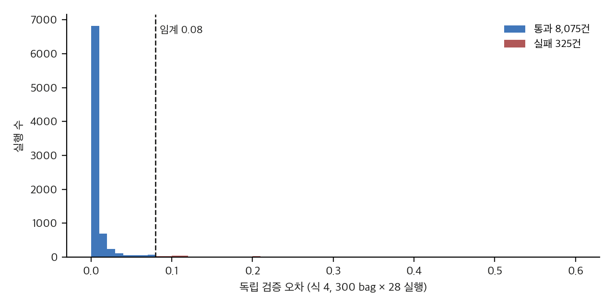
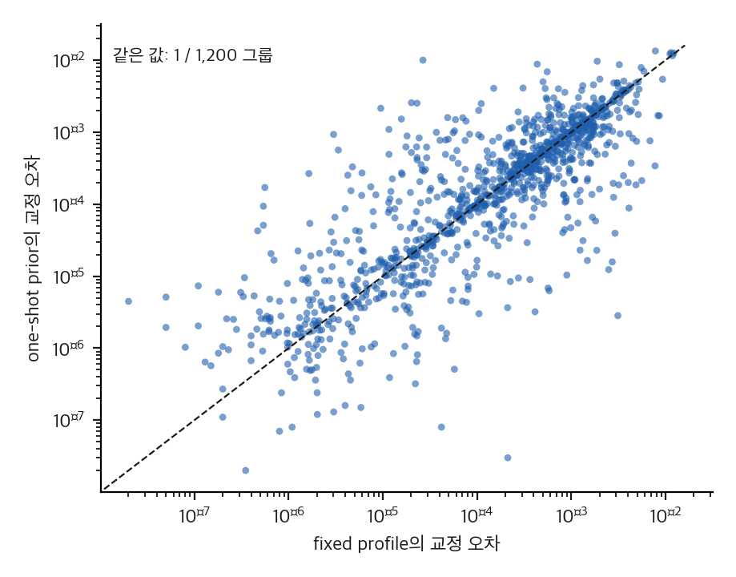
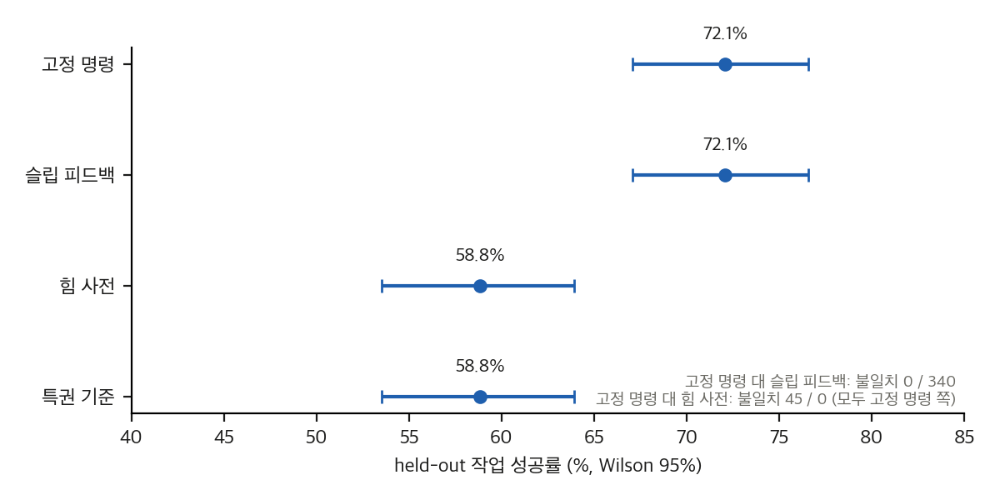

> **논문:** Jiarui Guo, Saining Zhang 외. *RFW-S: Everyday Deformable Objects with Independent Simulation Verification.* arXiv:2611.23056 (v2, 2026-11-18). 학회 표기는 찾지 못했습니다.
> 공식 코드(Apache-2.0, RoboFlywheel-com/RoboFlywheel-Soft)는 정적으로만 읽었고 실행하지 않았습니다. 논문 그림은 non-exclusive 라이선스라서 싣지 않았고, 아래 그래프는 공개 CSV에서 우리가 다시 그린 것입니다.

## 논문이 하는 일

시뮬레이션으로 로봇 학습을 하려면 물리적으로 움직이는 변형 물체가 많이 필요합니다. 기존 3D 자산 모음은 대부분 모양과 질감이 다양하고, 물리 파라미터는 확인하지 않습니다. RFW-S는 생성, 물리 구성, 검증을 묶어 83,365개 자산을 만듭니다. 천, 셸, 옷, 가방, 부드러운 고체의 다섯 구조 가족을 씁니다.

핵심 설계는 **보정과 검증을 분리한 것**입니다. 파라미터 보정 루프가 후보를 고른 뒤에는 기하, 파라미터, 수치 설정을 고정하고, 보정에 쓰지 않은 다른 자극(압축 후 방출)으로 한 번 더 검사합니다. 보정이 맞춘 것이 다른 자극에서도 맞는지를 보겠다는 뜻입니다.

## 공개 CSV로 다시 계산한 것

저장소에는 논문 표의 파생 CSV가 들어 있습니다. 해시 21개가 모두 맞았고, 표 값의 대부분을 같은 숫자로 다시 만들었습니다(57개 검사 중 56개 일치, 남은 하나는 반올림 차이).

*그림 1. 필터 실험 300개 bag의 독립 검증 오차 분포. 우리가 공개 CSV에서 그린 그래프입니다. 실패 325건은 대부분 임계에서 멀리 떨어져 있습니다.*

독립 검증에서 교정 통과 후보의 3.87%가 떨어졌다는 수치는 실행 수 8,400으로 나눈 값입니다. 그러나 실행은 같은 300개 자산의 28개 셀입니다. 325건은 26개 자산에 몰려 있어서, 자산 단위 비율은 **8.67%(95% 구간 약 6–12%)**입니다. 독립 표본 수는 8,400이 아니라 300에 가깝습니다.

## 같은 후보인데 결과가 다릅니다

논문은 방법들이 같은 자산과 예산 안에서 같은 초기 파라미터를 쓴다고 합니다. 피드백이 없는 두 방법(고정 프로파일과 사전 한 번 추정)은 같은 후보를 평가해야 합니다. 공개 CSV에서 1,200개 그룹을 비교하면 교정 오차가 정확히 같은 그룹은 1개뿐입니다. 독립 검증 결과가 뒤집힌 그룹은 26개입니다.

*그림 2. 자산과 예산이 같은 그룹에서 고정 프로파일(가로)과 one-shot 사전(세로)의 교정 오차. 우리가 공개 CSV에서 그린 그래프입니다. 차이의 중앙값은 1e-4 수준이라 수치 잡음처럼 보입니다. 후보 파라미터가 공개되지 않아 원인을 확정할 수 없습니다.*

## 파지 실험: 쌍을 맞추면 차이가 보입니다

파지 실험은 작업 성공과 "무손상" 성공을 나눕니다. 340개 held-out 인스턴스에서 작업 성공률은 고정 명령 72.1%, 슬립 피드백 72.1%, 힘 사전 58.8%입니다. 독립 비율만 보면 신뢰구간이 겹칩니다. 그러나 같은 인스턴스로 짝지으면 힘 사전이 성공한 200건은 모두 고정 명령도 성공했습니다(45 대 0, McNemar).

*그림 3. held-out 340개 인스턴스의 작업 성공률. 우리가 공개 CSV에서 그린 그래프입니다. 고정 명령과 슬립 피드백은 결과가 한 건도 다르지 않습니다.*

무손상 성공은 4,000건 모두 0입니다. 손상 점수 최소값 0.2653이 임계 0.25를 넘기 때문입니다. 저자도 이를 한계로 인정합니다. 손상 지표 ‖F − I‖_F는 순수 회전에도 값이 생깁니다.

## 코드와 논문

공식 저장소에서 프로브 밴드, 임계 0.05와 0.08, 파지 손상 지표의 분위수와 밴드, 슬립 피드백의 3 mm와 2%, 특권 기준의 닫힘 비율이 논문과 맞았습니다. 차이는 몇 가지입니다. 정착 판정이 두 곳에서 다른 정의를 씁니다(절대 속도 0.05 m/s와 꼬리/최고 비율). 부트스트랩 시드도 두 개입니다.

## 재현 가능성

이 분석의 판단은 **논문 전체 재현은 이 맥에서 불가능하다**입니다. 100K 자산 생성에 GPU와 생성 모델이 필요하고, 물리 사전은 유료 API를 씁니다. 실로봇과 사람 평가도 필요합니다. 재계산은 공개 CSV로 끝냈습니다. 축소판(보정과 검증을 분리하는 MuJoCo 실험)은 CPU로 1–2주 정도면 시작할 수 있지만, 논문 수치를 재현하는 것은 아닙니다.

## 한계

- 재료 파라미터는 측정값이 아니라 시뮬레이터 유효값입니다.
- 옷 구성 비교는 4개 물체입니다. 방향은 4/4로 같지만 통계적으로는 약합니다.
- 전문가 평가는 클립당 평가자 1명이고, 같은 데이터로 밴드를 맞췄습니다.
- 프로젝트 페이지는 "코드와 데이터 SOON"이라고 적혀 있지만, 저장소와 데이터 링크는 이미 공개되어 있습니다.

## 자료

- [통합 리포트 PDF](report/report_public.pdf)
- [01. 논문 분석: RFW-S](analysis/01_paper_analysis.md)
- [02. 선행 연구, 구성 요소 출처, 저장소 관련 분석, GitHub 자료](analysis/02_prior_work.md)
- [03. 수치 재계산과 일관성 검사](analysis/03_analysis.md)
- [04. 논문 ↔ 공식 코드 대조 (코드 검증)](analysis/04_code_verification.md)
