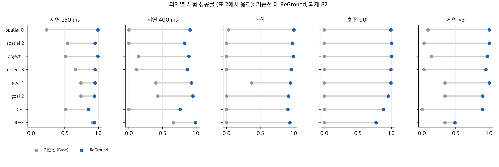
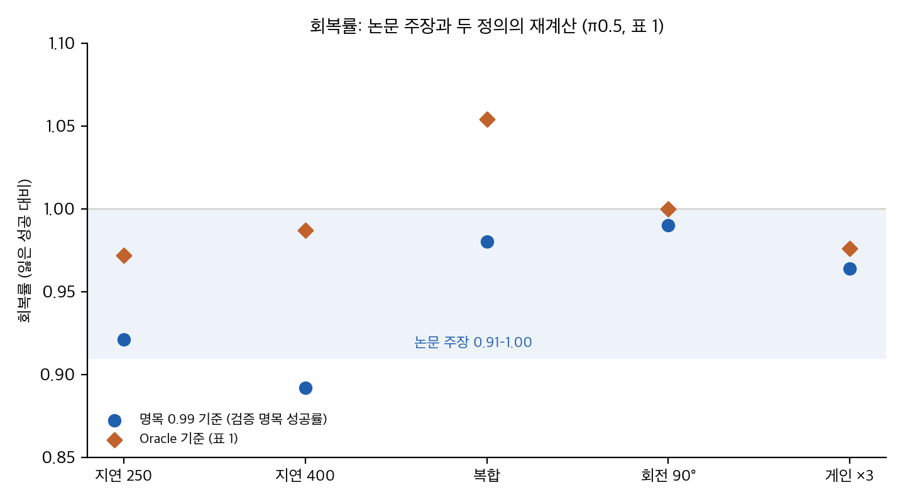

> **논문:** Umer Siddique, Peilang Li, Yongcan Cao. *Right Goal, Wrong Body: Re-grounding Frozen VLAs under Actuation Shift.* arXiv:2611.20244 (v1, 2026-11-15). SPAIS 워크숍 @ CoRL 2026 spotlight(워크숍 공식 채택 목록에서 확인).
> 공식 코드는 GitHub에 있으나 라이선스 파일이 없습니다. 이 글은 코드를 복사하지 않고 읽기만 했습니다. 실행하지 않았습니다.
> 논문 라이선스는 arXiv non-exclusive라서 논문 그림은 싣지 않았습니다. 그래프 두 장은 표 값으로 우리가 그렸습니다.

## 논문이 묻는 것

정책은 한 로봇에서 배우고 다른 로봇에서 돌립니다. 재장착, 기계 마모, 명령 지연 때문에 같은 명령이 다른 움직임을 만들면 과제는 실패합니다. 논문은 이를 **액추에이션 시프트**라고 부르고, 과제와 관측은 같은데 명령에서 움직임으로 가는 사상이 바뀌었다고 정의합니다.

재학습이나 시연 추가는 가중치와 데이터가 필요합니다. ReGround는 가중치를 고정하고 추론 시점에 세 가지를 합칩니다. 학습 몸의 모델로 VLA 청크를 굴려 **의도한 경로**를 읽고, 배포 몸의 모델을 모터 바빙(OU 잡음)으로 맞추고, 신뢰 영역이 있는 MPC로 그 경로를 따라갑니다. 시프트를 감지하기 전에는 VLA 행동을 그대로 씁니다.

## 이 글에서 확인한 것

**1. 표 1은 과제 표에서 대체로 다시 맞습니다.** 표 2의 과제별 시험 성공률 여덟 개로 IQM을 다시 계산하면, 기준선 값은 다섯 셀 모두 맞습니다. ReGround는 두 셀(지연 250 ms, 복합)에서 0.0125 차이가 납니다. 논문의 IQM이 과제-시드 단위로 계산되었다면 이 정도 차이는 자연스럽습니다.

*그래프: 우리가 그린 것. 표 2의 과제별 시험 성공률을 셀마다 기준선(회색)과 ReGround(파랑)로 나타냈습니다. 다섯 셀 모두 여덟 과제에서 ReGround가 높습니다. 다섯 셀에 대한 부호 검정은 p = 0.0078입니다(과제 8개로 얻을 수 있는 가장 작은 값).*

**2. "0.91–1.00 회복"은 우리가 계산한 두 정의 어느 쪽과도 정확히 맞지 않습니다.** 논문은 잃은 성공의 0.91–1.00을 회복한다고 씁니다. 그러나 회복의 정의가 없습니다. 명목 성공률 0.99를 기준으로 쓰면 범위는 0.89–0.99이고, Oracle을 기준으로 쓰면 0.97–1.05입니다. 복합에서 1을 넘는 것은 Oracle이 부분적이기 때문입니다.

*그래프: 우리가 그린 것. 논문 회복률 주장(0.91–1.00)과 두 정의의 재계산 값입니다. 명목 기준은 검증 분할의 명목 성공률 0.99입니다.*

**3. 복합 시프트의 Oracle은 강성을 역변환하지 않습니다.** 공식 코드에서 복합 시프트의 역변환은 회전만 되돌리고 지연을 다시 맞춥니다. 강성 ×0.33은 보정하지 않습니다. 코드 주석에도 "해석적 역함수가 없어 그대로 둔다"고 적혀 있습니다. 그래서 "ReGround 0.97이 Oracle 0.92를 넘는다"는 비교는 완전한 역변환과의 비교가 아닙니다.

**4. 데이터 규모 서술이 주 실험과 다릅니다.** 논문은 "1분 바빙"을 강조합니다. 그러나 주 실험의 기본 설정은 약 10k 전이(바빙 60%, VLA 구동 40%)입니다. 20 Hz에서 약 5–8분입니다. 명목 모델은 100k 전이로 약 83분입니다. 1분 값은 250 ms 셀 그림의 한 점입니다.

**5. SmolVLA에서는 Intent가 두 셀에서 낫습니다.** 논문 표 1의 SmolVLA 행(재조정 없음)에서 회전 30°와 게인 ×2는 Intent가 성공률과 안전성 모두 ReGround보다 높습니다. 본문은 이를 다루지 않습니다. 재조정하지 않은 설정 때문인지는 논문만으로 알 수 없습니다.

**6. 안전성 주장은 맞습니다.** "선형 보정보다 안전하다"는 두 VLA의 아홉 셀 모두에서 맞습니다.

## 구현 가능성

- **이 맥에서 논문 실험을 재현하는 것은 불가능합니다.** 공식 코드는 CUDA를 전제하고, π0.5는 3B 규모라 게이트된 라이선스와 LIBERO 설정이 필요합니다.
- **할 수 있는 것은 작은 토이입니다.** 지연 추정, 잔차 기반 모니터, 추적 MPC를 numpy로 구현하는 것은 가능합니다. 노력은 1–2일로 추정합니다(측정 전).

## 빠진 것

- 셀마다 앵커(VLA 청크 밀기, 선형 사상, IDM), horizon, λ가 다릅니다. 선택 방법을 논문이 밝히지 않습니다.
- 신뢰구간이 본문과 표에 없습니다. 방법은 부트스트랩을 쓴다고 적었지만 결과는 싣지 않았습니다.
- 복합 시프트의 정의가 본문에 없습니다. 프로젝트 페이지와 코드에서 "회전 45° + 지연 100 ms + 강성 ×0.33"으로 확인했습니다.
- 검증 분할 수치, 오경보율 2.1%, 불안전률 검증값은 원자료가 없어 확인하지 못했습니다.
- 실로봇 실험은 없습니다. 모두 LIBERO 시뮬레이션입니다.

## 정리

ReGround의 생각 자체는 간단합니다. 보상 대신 학습 몸에서 읽은 경로를 목표로 쓰고, KL 대신 앵커 주변의 신뢰 영역을 씁니다. 그리고 시프트가 없으면 아무것도 바꾸지 않습니다. 반면 숫자를 믿으려면 셀마다 다른 설정, 부분적인 Oracle, 데이터 규모 서술을 같이 봐야 합니다. 표 1의 큰 차이는 과제 8개 모두에서 같은 방향이라 방향성은 믿을 만합니다. 회복률의 0.91 하한이나 Oracle 대비 우위는 그대로 인용하기 어렵습니다.

## 자료

- [통합 리포트 PDF](report/report_public.pdf)
- [Right Goal, Wrong Body: Re-grounding Frozen VLAs under Actuation Shift (arXiv:2611.20244) 논문 분석](analysis/01_paper_analysis.md)
- [02 선행연구와 자료 계보](analysis/02_prior_work.md)
- [03 수치 재계산, 일관성 검사, 검정](analysis/03_analysis.md)
- [04 공식 코드 정적 대조와 구현 가능성](analysis/04_code_verification.md)
