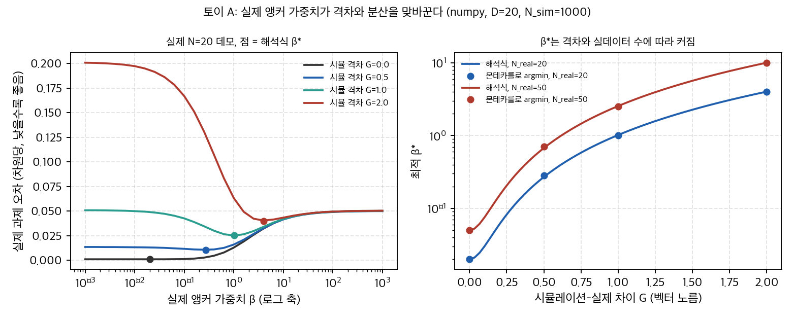
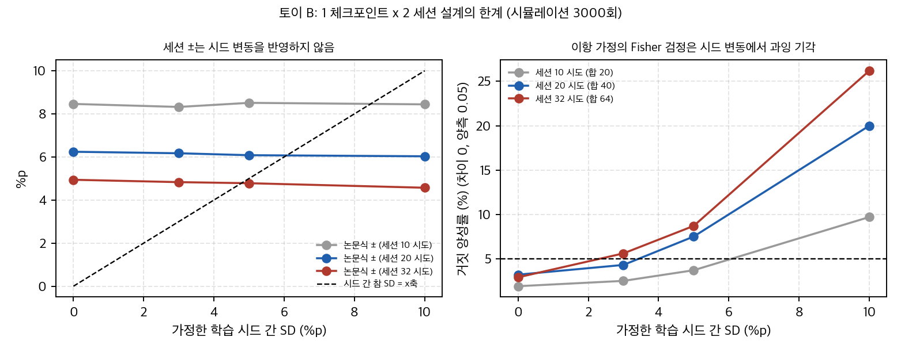

# 03. 수치 재계산, 일관성 검사, 토이: RL-Co (arXiv:2602.12628 v5)

## 요약

1. **표 1의 셀은 모두 정수 성공 수 쌍으로 맞습니다.** 세션 2개의 성공 수를 되살려 보면 각 셀에 쌍이 하나씩 나옵니다. 그래서 값 자체는 믿을 만합니다.
2. **그러나 Avg 열의 ±가 두 곳에서 정의와 맞지 않습니다.** OpenVLA RL-Co는 보고 ±0.7, 재계산 ±10.7입니다. π0.5 실데이터만은 보고 ±1.4, 재계산 ±6.1입니다. 평균은 맞습니다.
3. **통계 검정으로 확인되는 차이는 일부입니다.** RL-Co 대 SFT에서 Holm 보정 후 유의한 곳은 OpenVLA PnP와 π0.5 OD입니다. π0.5 PnP와 Push는 방향만 맞습니다. 데이터 효율(20 시연 RL-Co 대 200 시연 실데이터)과 자세 이동 강건성은 20 시도로 구별되지 않습니다.
4. **일관성 문제 두 가지:** Fig. 5b의 40.3%는 2 세션 x 32 시도로 나오지 않습니다. Fig. 6의 SFT 20 시연 값(약 5%)은 표 1·6의 10%와 다릅니다.
5. **토이 A(numpy):** 실제 앵커 가중치의 최적값 β*는 해석식 c/b로, 몬테카를로 결과와 대부분 1% 안에서 맞습니다. β*는 시뮬레이션-실제 격차가 커지고 실데이터가 많을수록 커집니다. 고정된 β(예: 1)는 격차가 크면 시뮬레이션만 학습한 것과 비슷해집니다.
6. **토이 B(numpy):** 세션 ±는 학습 시드 변동을 전혀 반영하지 않습니다(시드 SD가 0에서 10pp까지 바뀌어도 같은 값). 이항 가정의 Fisher 검정은 시드 SD 5pp에서 거짓 양성이 8.7%, 10pp에서 26%입니다(세션 32 시도 기준, 목표 5%).

재계산 결과 파일: `analysis/recompute_results.json`, `analysis/toy_mixing_results.json`, `analysis/toy_eval_results.json`.

## 1. 표 재계산

### 1.1 표 1 셀 재구성과 정수 쌍 (세션 2 x 시도 수)

가정은 `analysis/recompute.py` 머리말과 01 §2.3에 있습니다. 각 세션의 성공률 r = 평균 ± ±값(모집단 SD)입니다. 세션별 성공 수 쌍 (k1, k2)를 전수 검색해 평균과 SD를 보고 자릿수로 반올림했을 때 맞는 쌍만 남겼습니다. 모든 셀에 쌍이 **정확히 하나** 있었습니다.

| VLA | 방법 | PnP (32) | Push (30) | OD (10) | CD (10) |
|---|---|---|---|---|---|
| OpenVLA | 실데이터만 | 2, 2 | 2, 10 | 0, 0 | 0, 2 |
| OpenVLA | SFT | 6, 9 | 14, 17 | 0, 0 | 8, 9 |
| OpenVLA | RL-Co | 15, 22 | 17, 24 | 2, 5 | 9, 10 |
| π0.5 | 실데이터만 | 20, 26 | 0, 0 | 0, 0 | 2, 5 |
| π0.5 | SFT | 19, 25 | 2, 4 | 1, 1 | 9, 10 |
| π0.5 | RL-Co | 23, 29 | 5, 6 | 6, 7 | 10, 10 |

- 쌍에서 보면 π0.5 PnP 실데이터만의 두 세션(20/32, 26/32)은 62.5%와 81.3%입니다. 평균 71.9, SD 9.4와 맞습니다.

### 1.2 Avg 열 재계산 (정의: 세션별 과제 평균의 평균과 모집단 SD)

| VLA | 방법 | 재계산 평균 ± SD | 보고값 | 판정 |
|---|---|---|---|---|
| OpenVLA | 실데이터만 | 9.06 ± 5.83 | 9.1 ± 5.8 | 일치 |
| OpenVLA | SFT | 40.03 ± 3.67 | 40.0 ± 3.7 | 일치 |
| OpenVLA | **RL-Co** | **64.04 ± 10.65** | **64.0 ± 0.7** | **SD 불일치** |
| π0.5 | 실데이터만 | **26.72 ± 6.09** | **26.7 ± 1.4** | **SD 불일치** |
| π0.5 | SFT | 45.94 ± 4.43 | 45.9 ± 4.4 | 일치 |
| π0.5 | RL-Co | 66.15 ± 4.01 | 66.1 ± 4.0 | 일치 |

- **OpenVLA RL-Co:** 세션 1 = (68.8 + 80.0 + 50.0 + 100.0)/4 = 74.7, 세션 2 = (46.9 + 56.7 + 20.0 + 90.0)/4 = 53.4. 차이의 절반은 10.65입니다. 보고 ±0.7은 이 정의로는 나올 수 없습니다. 세션 간 차이가 21pp인데 ±0.7로 쓰면 독자가 변동을 과소평가합니다.
- **π0.5 실데이터만:** 세션 1 = (81.3 + 0 + 0 + 50)/4 = 32.8, 세션 2 = (62.5 + 0 + 0 + 20)/4 = 20.6. 차이의 절반 6.1입니다. 보고 ±1.4는 나올 수 없습니다.
- 두 SD 모두 v1·v4에서도 같은 값이었습니다. 정정은 v5에서 평균만 바뀌었습니다(01 §6).

### 1.3 RL-Co 대 SFT, 실데이터만 대 RL-Co (세션 합산 시도, Fisher 양측)

세션 합산(과제당 2n 시도)으로 한 번에 검정합니다. 같은 초기 조건을 공유하므로 짝지은 설계이지만 짝지은 결과가 없어 독립 가정으로 계산했습니다. 이 가정은 검정력을 보수적으로 만듭니다(정확하지는 않음). 8개 과제·모델 쌍에 Holm 보정을 적용했습니다.

| 모델·과제 | RL-Co | SFT | 실데이터만 | p (RL vs SFT) | Holm | p (RL vs 실데이터) |
|---|---|---|---|---|---|---|
| OpenVLA PnP | 37/64 | 15/64 | 4/64 | 0.0001 | 0.001 | <0.001 |
| OpenVLA Push | 41/60 | 31/60 | 12/60 | 0.093 | 0.47 | <0.001 |
| OpenVLA OD | 7/20 | 0/20 | 0/20 | 0.008 | 0.0499 | <0.01 |
| OpenVLA CD | 19/20 | 17/20 | 2/20 | 0.60 | 1.00 | <0.001 |
| π0.5 PnP | 52/64 | 44/64 | 46/64 | 0.15 | 0.61 | 0.30 |
| π0.5 Push | 11/60 | 6/60 | 0/60 | 0.30 | 0.89 | <0.001 |
| π0.5 OD | 13/20 | 2/20 | 0/20 | 0.0008 | 0.005 | <0.001 |
| π0.5 CD | 20/20 | 19/20 | 7/20 | 1.00 | 1.00 | <0.001 |
| 합계 OpenVLA | 104/164 | 63/164 | 18/164 | 9e-6 | | |
| 합계 π0.5 | 96/164 | 71/164 | 53/164 | 0.008 | | |

- 확인되는 차이: OpenVLA PnP, π0.5 OD, 그리고 합계. OpenVLA OD는 Holm 0.0499로 경계입니다.
- 방향만 맞는 곳: π0.5 PnP(81 대 69, p = 0.15), π0.5 Push(18 대 10, p = 0.30), OpenVLA Push(68 대 52, p = 0.09).
- 실데이터만 대비는 대부분 확인됩니다. 예외는 π0.5 PnP(p = 0.30)입니다.

### 1.4 검정력: 같은 차이를 80%로 잡으려면 팔당 시도 수

정규 근사, 양측 0.05. 차이가 작은 셀일수록 시도가 많이 필요합니다.

| 비교 | 필요 팔당 시도 |
|---|---|
| OD π0.5, 65 대 10 | 11 |
| OpenVLA 평균, 64 대 40 | 67 |
| Push π0.5, 18 대 10 | 276 |
| PnP π0.5, 81 대 69 | 187 |

- 논문의 세션 2개 x 10–32 시도는 OD(20 시도 합)에서 큰 차이만 잡습니다. 과제별 차이를 주장하려면 수백 시도가 필요한 곳도 있습니다.

### 1.5 그림 4 (분포 이동, 시도 수 가정)

| 조건 | 실데이터만 | SFT | RL-Co | RL 대 SFT p | RL 대 실데이터 p |
|---|---|---|---|---|---|
| 처음 물체 (n=64 가정) | 16/64 | 20/64 | 36/64 | 0.007 | 0.0006 |
| 처음 자세 (n=20, App. D.5) | 8/20 | 11/20 | 14/20 | 0.51 | 0.11 |

- 처음 물체 이동은 RL-Co가 확실히 높습니다. 처음 자세 이동의 "가장 강함"과 "가장 작은 하락"은 검정되지 않습니다. 20 시도 중 세 개 차이는 한 번의 성공 차이로 바뀝니다.

### 1.6 표 2, 5, 6, 그림 6 검정

| 항목 | 값 | p |
|---|---|---|
| 표 2: RL-Co(52/64) 대 영상 증강(43/64) | 81.3 대 67.2 | 0.11 |
| 표 2: RL-Co 대 강한 DR 무(7/64) | 81.3 대 10.9 | <0.001 |
| 표 5: RL-Co(26/32) 대 RialTo식(24/32) | 81.3 대 75.0 | 0.76 |
| 표 6: RL-Co(13/20) 대 롤아웃 SFT(4/20) | 65 대 20 | 0.010 |
| 표 6: RL-Co(13/20) 대 MimicGen SFT(2/20) | 65 대 10 | 0.0008 |
| 그림 6: RL-Co@20(13/20) 대 실데이터@200(10/20) | 65 대 50 | 0.52 |
| 그림 6: RL-Co@20(13/20) 대 SFT@200(14/20) | 65 대 70 | 1.00 |
| 그림 6: RL-Co@50(11/20) 대 SFT@200(14/20) | 55 대 70 | 0.51 |
| 표 4 (Peg, n 미기재, n=40 가정): 13/40 대 17/40 | 32.5 대 42.5 | 0.49 |

- 표 5의 RialTo식 값과 RL-Co 값은 한 번 평가입니다. 두 값 사이 차이는 두 시도 정도입니다.
- 표 4는 시도 수가 없어서 n=40을 가정했습니다. 이 가정이 틀리면 결론이 달라질 수 있습니다.

## 2. 일관성 검사

### 2.1 산술 (논문 수치 사이의 관계)

| 검사 | 결과 |
|---|---|
| 표 1의 ±는 세션 2개의 모집단 SD(Eq. 9) | 모든 셀에서 정수 쌍과 맞음. Avg 열 두 곳만 틀림(1.2) |
| 초록 +24% (OpenVLA) | 64.0 − 40.0 = 24.0pp, SFT 공동 학습 대비. 실데이터만 대비는 +54.9pp. 기준선은 초록에 없음 |
| 초록 +20% (π0.5) | 66.1 − 45.9 = 20.2pp, SFT 대비. 실데이터만 대비는 +39.4pp |
| 표 2 DR 무(zero-shot) 10.9 ± 7.8 | 세션 값 3.1%(1/32)와 18.8%(6/32)와 맞음 |
| 표 2 영상 증강 67.2 ± 1.6 | 세션 값 65.6%(21/32)와 68.8%(22/32)와 맞음 |
| 표 6 OD 10 / 20 / 65 | 시도 20 기준 2/20, 4/20, 13/20. 정수 |
| 표 5 75.0 / 81.3 | 32 시도 기준 24/32, 26/32. 정수 |

### 2.2 본문 주장과 표의 대조

| 본문 주장 | 표·그림 | 판정 |
|---|---|---|
| "consistent improvements over real-only and SFT" (초록) | 표 1: 실데이터만 대비는 대부분 확인. RL-Co 대 SFT는 과제 4 + 4 중 2개만 Holm 보정 후 유의 | 부분적으로 맞음. 방향은 맞지만 일관된 유의성은 아님 |
| "실데이터 SFT는 OpenVLA에서 20% 이하" (§5.2.1) | 표 1: 6.3, 20.0, 0.0, 10.0 | 맞음 |
| "SFT 공동 학습은 CD에서만 도움" (§5.2.1) | 표 1 OpenVLA: PnP 23.4 대 6.3, Push 51.7 대 20.0, CD 85 대 10으로 세 과제에서 도움. π0.5: Push 10 대 0, OD 10 대 0, CD 95 대 35로 도움, PnP만 68.8 대 71.9로 낮음 | 본문의 "CD에서만"은 과소 서술. 네 과제 중 π0.5 PnP 한 곳만 낮음 |
| "RL-Co가 대부분 과제에서 가장 높음" (§5.2.1) | 표 1: OpenVLA 4/4, π0.5 4/4(CD는 100 대 95) 모두 RL-Co가 최고 | 맞음. 다만 과제별 검정 결과는 1.3 참조 |
| "처음 자세와 처음 물체 모두 RL-Co가 가장 강함" (§5.2.2) | 그림 4: 처음 물체 확인, 처음 자세는 n=20으로 검정 불가 | 물체는 맞음. 자세는 말할 수 없음 |
| "시각 다양성만으로는 설명 안 됨" (§5.2.3) | 표 2: RL-Co 대 영상 증강 p=0.11 | 방향은 맞지만 확인은 약함 |
| "Stage I은 단순 데이터 혼합이 아니라 필요" (§5.3.1) | 그림 5a: 실데이터 초기화 RL은 정체 | 정성적으로 맞음(곡선만, 시드 없음) |
| "α에 따라 SFT는 다르고, β는 범위 안에서 견고" (§5.3.3) | 그림 5c: PnP SFT 0.69 대 0.36–0.49, RL 0.77–0.81 | 맞음. OD에서 SFT의 α=0.8이 0.15로 표 7의 α=0.95(0.10)보다 높음 |
| "RL-Co는 적은 시연으로 기준선과 같거나 높다" (§5.4) | 그림 6: 20 시연 RL-Co 0.65 대 200 시연 실데이터 0.50 | 방향은 맞지만 p=0.52 |
| "Stage II 실데이터 정규화가 필요" (§5.3.2) | 그림 5b: 81.3 대 40.3 | 방향 맞음. 40.3이 격자에 맞지 않음(2.3) |
| "시뮬 RL의 탐색이 롤아웃 SFT보다 낫다" (H.3) | 표 6: 65 대 20, p=0.010 | 맞음(OD 한 과제, 20 시도) |

### 2.3 그림 5b의 40.3%

- 2 세션 x 32 시도면 세션 성공률은 1/32(3.125%) 간격이고, 평균은 1/64 간격입니다. 40.3 = 25.8/64로 정수 성공 수가 아닙니다. 40.6(26/64)이나 39.1(25/64)이 가까운 값입니다. 시도 수가 다르거나(예: 3 세션, 또는 다른 샘플), 값을 옮기는 과정에서 반올림이 잘못되었을 가능성이 있습니다. 나머지 세 값(6.3, 12.5, 81.3)은 격자에 맞습니다.

### 2.4 그림 6과 표 1·6의 SFT 20 시연 값

- 그림 6 SFT 20 시연은 약 0.05(1/20)로 읽힙니다. 표 1 π0.5 OD SFT는 10.0 ± 0.0(세션 2개 모두 10%)이고, 표 6의 "SFT with MimicGen"도 10.0이며 둘 다 실시연 20 조건입니다. 그림의 0.05와 표의 0.10은 한 시도 차이입니다. 그림 점의 시도 수와 세션 구성을 확인해야 합니다.

### 2.5 버전 차이와 정정 (v1·v4 대 v5)

- v4의 표 1 OpenVLA 평균 16.5 ± 13.3은 v5의 9.1 ± 5.8로 바뀌었습니다. 세션 값 3.2%와 14.9%에서 나오는 평균 9.1과 SD 5.8이 맞습니다. 16.5는 어떤 세션 쌍에서도 나오지 않습니다.
- v4의 OpenVLA RL-Co PnP 58.8 ± 10.0은 정수 쌍으로 맞지 않습니다(두 세션 값 68.8%와 48.8%에서 48.8%는 32 시도로 나오지 않음, 15.6/32). v5의 57.8 ± 10.9(15/32, 22/32)는 맞습니다.
- v4의 π0.5 RL-Co Push 18.4 ± 1.7은 정수 쌍으로 맞지 않습니다(30 시도에서 18.3이 맞음). v5의 18.3이 맞습니다.

## 3. 토이 A: 실제 앵커 가중치는 격차와 분산을 맞바꾼다

### 3.1 설정

- 코드: `analysis/toy_mixing_weight.py`(numpy, 단일 프로세스, 약 0.5초), 결과: `analysis/toy_mixing_results.json`.
- 차원 D=20. 실제 목표 y_r ~ N(0, I). 시뮬 목표 y_s = y_r + g, ||g|| = G(고정 방향).
- 실제 데모 N_r ∈ {20, 50}의 평균 ŷ_r = y_r + 잡음(분산 σ²/N_r), 시뮬 데이터 N_s = 1000의 평균 ŷ_s = y_s + 잡음(σ²/N_s), σ = 1.
- **Stage II 가정:** RL이 시뮬 최적 ŷ_s로 수렴하고, 실데이터 앵커를 β로 섞습니다. θ(β) = (ŷ_s + β ŷ_r)/(1 + β). 이것은 식 (2)의 가장 단순한 2차 형태입니다.
- 해석식: 차원당 실제 오차 E(β) = (c + β² b)/(1+β)², c = G²/D + σ²/N_s, b = σ²/N_r. 최적 β* = c/b = N_r(G²/(Dσ²) + 1/N_s), E* = cb/(c+b).
- 반복: 몬테카를로 4000회. β 격자 10^-3 ~ 10^3(121점).

### 3.2 결과

| N_real | G | β* (해석식) | β* (MC 최소) | E* (해석식) | E(β=0) 시뮬만 | E(β→∞) 실제만 | E(β=1) |
|---|---|---|---|---|---|---|---|
| 20 | 0.0 | 0.020 | 0.020 | 0.0010 | 0.0010 | 0.050 | 0.0129 |
| 20 | 0.5 | 0.27 | 0.28 | 0.0106 | 0.0135 | 0.050 | 0.0160 |
| 20 | 1.0 | 1.02 | 1.00 | 0.0252 | 0.0510 | 0.050 | 0.0251 |
| 20 | 2.0 | 4.02 | 3.98 | 0.0400 | 0.2010 | 0.050 | 0.0631 |
| 50 | 0.0 | 0.050 | 0.050 | 0.0010 | 0.0010 | 0.020 | 0.0052 |
| 50 | 0.5 | 0.675 | 0.708 | 0.0081 | 0.0135 | 0.020 | 0.0083 |
| 50 | 1.0 | 2.55 | 2.51 | 0.0144 | 0.0510 | 0.020 | 0.0178 |
| 50 | 2.0 | 10.05 | 10.00 | 0.0182 | 0.2010 | 0.020 | 0.0553 |

- 해석식과 몬테카를로의 E*는 대부분 1% 안에서 맞습니다(예외: G=0, N_r=50에서 절대값 0.0010 대 0.0009). β* 최소 위치는 격자 간격 안에서 맞습니다.
- 격차가 없으면(G=0) β*는 N_r/N_s로 작습니다. 시뮬이 정보를 주므로 앵커를 약하게 둡니다.
- 격차가 커질수록 β*가 커집니다. G=2에서 시뮬만(β=0) 오차는 0.201이고, 최적 β*=4에서 0.040입니다.
- 실데이터가 많을수록(N_r 20 → 50) β*가 커집니다. 실데이터의 분산이 줄면 그만큼 앵커를 세게 둘 가치가 큽니다.
- β=1은 격차 1 이하에서는 괜찮지만 격차 2에서는 0.063으로 최적(0.040)과 차이가 납니다. 그래서 고정 β는 과제마다 달라야 합니다.

*그림: 토이 A의 실제 오차 곡선(왼쪽)과 β*의 격차 의존(오른쪽). 점은 몬테카를로 최소, 선은 해석식. 우리가 그린 그래프입니다.*

### 3.3 해석과 한계

- **이 모형이 보여 주는 것:** 실데이터 SFT 손실의 가중치는 격차와 데이터 수에 맞춰 골라야 합니다. 논문의 β(표 7, 0.01–1.0)가 과제마다 다른 것과 같은 방향입니다.
- **이 모형이 보여 주지 않는 것:** (1) RL은 수렴하지 않습니다. 탐색과 보상 잡음이 있습니다. (2) 정책은 선형이 아닙니다. (3) 손실 척도가 다릅니다. 논문의 β는 PPO 손실과 SFT 손실의 상대 크기에 따라 바뀌므로, 토이의 β와 같다고 볼 수 없습니다. 공개 코드는 `train/loss_ratio`를 기록해서 1e5를 넘으면 경고합니다(04 §3, D3).
- **가정이 결과를 만듭니다.** 시뮬 최적을 정확히 안다고 두었으므로 E(β→∞)와 E*의 차이는 과대평가될 수 있습니다. 결과는 "방향과 형태"로만 읽고 수치는 과제에 옮기지 않습니다.

## 4. 토이 B: 1 체크포인트 x 2 세션 설계의 한계

### 4.1 설정

- 코드: `analysis/toy_eval_design.py`(numpy, scipy, 약 19초), 결과: `analysis/toy_eval_results.json`.
- 체크포인트 참 성공률은 μ + N(0, s²)(0–1로 자름), s ∈ {0, 3, 5, 10}pp. 세션 2개 x n_s ∈ {10, 20, 32}, 이항 샘플링. 3000회.
- (1) 논문식 ±(두 세션의 모집단 SD)와 시드 간 참 SD를 비교합니다. μ = 0.6.
- (2) 거짓 양성률: 두 팔 모두 μ = 0.5. Fisher 양측 0.05, 시도 2n_s 합산(논문 분석과 같은 방식).
- (3) 검정력: μ_A = 0.65, μ_B = 0.45.

### 4.2 결과

| 세션당 시도 n_s | 시드 SD 0pp: 논문식 ± | 시드 SD 5pp: 논문식 ± | 시드 SD 10pp: 논문식 ± | 시드 SD 10pp의 참 SD |
|---|---|---|---|---|
| 10 | 8.5 | 8.5 | 8.4 | 9.8 |
| 20 | 6.2 | 6.1 | 6.0 | 9.9 |
| 32 | 4.9 | 4.8 | 4.6 | 10.3 |

| n_s | 거짓 양성률 (차이 0): 시드 0 / 3 / 5 / 10pp | 검정력 (Δ = 0.20): 시드 0 / 3 / 5 / 10pp |
|---|---|---|
| 10 | 0.019 / 0.025 / 0.037 / 0.097 | 0.14 / 0.17 / 0.17 / 0.24 |
| 20 | 0.032 / 0.043 / 0.075 / 0.200 | 0.36 / 0.38 / 0.38 / 0.44 |
| 32 | 0.029 / 0.056 / 0.087 / 0.262 | 0.57 / 0.55 / 0.54 / 0.55 |

*그림: 토이 B. 왼쪽은 시드 SD에 따른 세션 ±(변하지 않음), 오른쪽은 차이 0일 때 거짓 양성률. 우리가 그린 그래프입니다.*

### 4.3 해석과 한계

- **± 는 시드 변동을 재지 않습니다.** 세션 ±는 시도 수에만 좌우됩니다(10 시도 8.5, 20 시도 6.2, 32 시도 4.9pp). 시드 변동이 10pp여도 같은 값입니다. 따라서 논문의 ±로 "체크포인트 간 변동"을 읽으면 안 됩니다. 논문 자신도 이 점을 App. D.1에서 인정합니다.
- **이항 검정은 시드 변동이 있으면 과잉 기각합니다.** 32 시도 세션에서 시드 SD 5pp면 거짓 양성이 8.7%, 10pp면 26%입니다. 논문식 설계(체크포인트 1개씩)에서 Fisher 검정 결과를 확정 근거로 쓰면 과장될 수 있습니다.
- **검정력은 낮습니다.** Δ = 0.20을 32 시도 세션에서 잡는 확률은 0.57입니다. 20 시도 세션에서는 0.36입니다. OD(세션 10 시도, 합 20)에서 65 대 10이 유의한 것은 차이가 매우 커서입니다.
- **한계:** 시도 독립과 초기 조건 독립을 가정했습니다. 논문은 초기 조건을 방법 간에 공유하므로 실제 검정력은 달라질 수 있습니다. 시드 SD는 가정값입니다. 실제 값은 여러 시드를 학습해야 알 수 있습니다.

## 5. 재계산에서 빠진 것

- **원자료(시도별 성공 기록)가 없습니다.** 세션 성공 수는 ±와 평균에서 되살린 것이고, 짝지은 분석(McNemar 등)은 불가능합니다.
- **학습 시드, 체크포인트 간 변동이 없습니다.** 토이 B가 보여 준 것처럼 이 부분이 가장 큰 불확실성입니다.
- **그림에서 읽은 값:** Fig. 4(막대 위 숫자, 정확), Fig. 5b(숫자, 정확), Fig. 5c(곡선, ±0.02), Fig. 6(곡선, ±0.025). 그림 값으로 만든 결론은 이 오차 안에서만 씁니다.
- **시도 수가 없는 값:** Table 4(Peg), Fig. 4의 처음 물체 이동(64 가정). 
- **공개 저장소로 확인하지 못한 것:** 표 1의 실험 설정 전체(OpenVLA Stage II는 Liu 외 [12]의 구현이고, 저장소에 없습니다).
- 결과적으로, 표 1–6의 값은 정수 쌍과 맞고 검정 결과는 재현되었지만, **표의 불확실성은 세션 2개가 말하는 것보다 훨씬 큽니다.**
