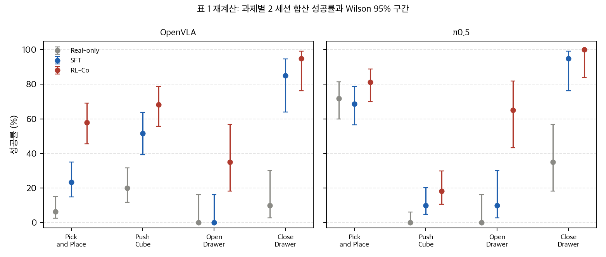
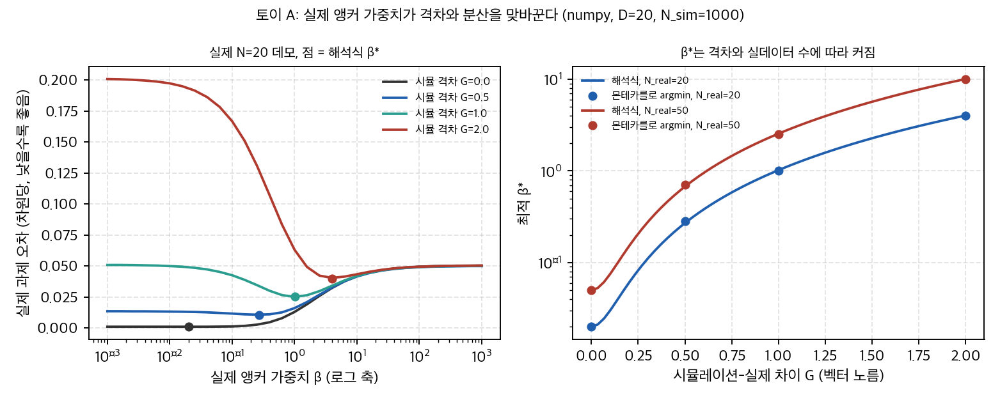
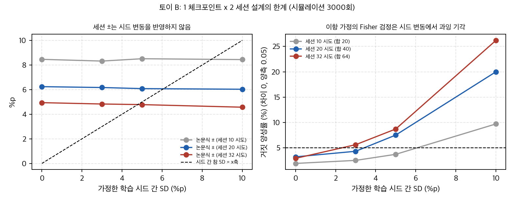

> **논문:** Liangzhi Shi, Shuaihang Chen 외. *Beyond Imitation: Reinforcement Learning-Based Sim-Real Co-Training for VLA Models.* CoRL 2026 포스터, arXiv:2602.12628 (v5, 2026-10-22).
> 공식 코드(Apache-2.0, RLinf)는 정적으로만 읽었고 실행하지 않았습니다. 논문 그림은 싣지 않고, 우리가 만든 그래프만 씁니다.

## 논문이 묻는 것

VLA 모델은 실로봇 시연으로 SFT하면 성공률이 금방 한계에 부딪힙니다. 시뮬레이션 데이터를 섞는 공동 학습(co-training)은 흔한 해법인데, 시뮬 데이터를 "정적인 시연 묶음"으로만 씁니다. 이 논문은 시뮬레이션에서 **RL로 상호작용**하게 하고, 실데이터의 SFT 손실을 RL 손실에 더해 잊기를 막는 방법(RL-Co)을 제안합니다.

구조는 두 단계입니다. 먼저 실시연과 MimicGen 시뮬 궤적을 섞어 SFT로 초기화하고, 그다음 시뮬에서 RL을 돌리면서 실데이터 손실을 β로 더합니다. 손실은 `L = L_RL + β L_SFT(실데이터)` 한 줄입니다. 실험은 OpenVLA와 π0.5에서 네 가지 과제(그릇에 담기, 큐브 밀기, 서랍 열기, 서랍 닫기)로 했습니다.

## 이 글에서 확인한 것

- **재계산.** 표 1의 값은 세션 2개의 성공 수로 되살리면 모두 정수 쌍과 맞습니다. 그러나 Avg 열의 ±는 두 군데가 정의(세션 값의 모집단 SD)와 맞지 않습니다. OpenVLA RL-Co는 보고 ±0.7이고 재계산은 ±10.7입니다. π0.5 실데이터만은 보고 ±1.4이고 재계산은 ±6.1입니다.
- **검정.** RL-Co와 SFT 공동 학습의 과제별 차이는 Holm 보정 후 OpenVLA PnP와 π0.5 OD에서만 확인됩니다. π0.5 PnP(81 대 69, p = 0.15)와 Push(18 대 10, p = 0.30)는 방향만 맞습니다.

그래프: 표 1의 과제별 성공률을 세션 합산 시도로 다시 그린 것. 구간은 Wilson 95%입니다. 시도가 20–64라 구간이 넓습니다. 우리가 그린 그래프입니다.

- **일관성.** 그림 5b의 40.3%는 2 세션 x 32 시도로는 나오지 않는 값입니다. 그림 6의 SFT 20 시연 값(약 5%)은 표 1과 표 6의 10%와 다릅니다.
- **데이터 효율.** 그림 6에서 20 시연 RL-Co(13/20)와 200 시연 실데이터(10/20)의 차이는 p = 0.52입니다. 이 시도 수로는 "적은 시연으로 충분하다"는 주장을 확인할 수 없습니다.

## 토이로 본 실데이터 앵커

논문의 질문 하나를 작게 옮겼습니다. 목표 행동 20차원, 시뮬레이션과 실제의 차이 G, 실데이터 수 N_real, 시뮬 데이터 수 1,000을 두고, 시뮬 RL이 시뮬 최적에 수렴한다고 가정했습니다. 그러면 실데이터 가중치 β가 실제 오차를 어떻게 바꾸는지 식으로 적을 수 있습니다.

결과는 간단합니다. 최적 가중치는 `β* = N_real (G²/(Dσ²) + 1/N_sim)`입니다. 격차가 커지고 실데이터가 많을수록 앵커를 세게 둬야 합니다. 몬테카를로 결과는 이 식과 대부분 1% 안에서 맞습니다. 고정 β = 1은 격차가 2일 때 최적보다 나쁩니다. 그래서 논문이 과제마다 다른 β를 쓴 것은 방향으로 보면 자연스럽습니다. 다만 이 토이는 RL의 탐색과 정책 표현을 빼 버린 모형이라, 수치를 실제 과제에 옮기지 않습니다.

그래프: 왼쪽은 실제 N=20 데모에서 β에 따른 실제 오차, 오른쪽은 격차 G에 따른 β*. 점은 몬테카를로 최소, 선은 해석식입니다. 우리가 그린 그래프입니다.

## 평가 설계의 한계

논문은 체크포인트 한 개를 세션 두 개로 평가하고, ±는 두 세션의 SD입니다. 이 ±는 학습 시드 변동을 담지 않습니다. 두 번째 토이에서 시드 변동을 넣어 보면 세션 ±는 시드 SD가 0에서 10pp로 바뀌어도 같은 값으로 나옵니다. 이항 가정의 Fisher 검정은 시드 SD가 5pp면 차이가 없을 때도 거짓 양성이 약 9%, 10pp면 26%까지 올라갑니다(목표 5%). 한 체크포인트의 비교로 결론을 내리면 과장되기 쉽습니다.

그래프: 왼쪽은 시드 SD에 따른 세션 ±(변하지 않음), 오른쪽은 차이가 없을 때 거짓 양성률입니다. 3000회 시뮬레이션. 우리가 그린 그래프입니다.

## 공식 코드에서 확인한 것

공식 저장소 RLinf에는 π0.5 공동 학습 예시 설정이 있습니다. 손실은 `total_loss = loss + sft_loss_weight * sft_loss`로 식 (2)와 같습니다. 실데이터 SFT가 쓰는 데이터는 실시연 경로뿐입니다. π0.5는 action expert만 학습하도록 VLM을 얼립니다. 이 점은 논문 v5의 정정과 맞고, v1과 v4의 "full-parameter"와는 다릅니다.

희소 보상도 맞습니다. 저장소는 파지 +1, 성공 +5, 성공 후 실패 −2를 5로 나눠 0.2, 1, −0.4로 씁니다. 부록 E.2의 값과 같습니다.

반면 공개 예시는 논문 표 7과 다릅니다. β는 0.2이고(표 7은 과제에 따라 0.1–1.0), 과제는 그릇이 아니라 접시 놓기이며, 시뮬 데이터는 1,499개입니다. OpenVLA 공동 학습 설정은 없고, 실로봇 배포와 평가 판정 코드도 없습니다. 방법의 구조는 확인되지만, 논문 표의 숫자를 저장소로 재현할 수는 없습니다.

## 이 맥에서 구현할 수 있는가

Apple M4 Pro와 CUDA 없는 환경에서 논문의 학습은 재현할 수 없습니다. 공식 π0.5 Stage II는 Linux와 CUDA, GPU 시뮬을 씁니다. OpenVLA 코드는 공개되지 않았고, 실로봇 재현에는 하드웨어가 필요합니다.

두 단계 손실 결합 자체는 축소판으로 옮길 수 있습니다. numpy 토이는 이미 돌렸고, 접촉이 있는 MuJoCo 과제로 넓히는 것은 새 설치 없이 가능합니다. 노력은 2–3주 정도로 봅니다(추정).

## 읽을 때 조심할 것

- 표의 ±는 체크포인트 간 변동이 아니라 같은 체크포인트의 두 세션 차이입니다.
- 초록의 +24%와 +20%는 SFT 공동 학습 평균 대비 절대 차이입니다. 실데이터만 대비가 아닙니다.
- 공개 저장소의 설정(β, 과제, 데이터 수)은 논문 표 7과 다릅니다. 재현할 때 어느 쪽을 쓸지 먼저 정해야 합니다.

## 정리

RL-Co는 "시뮬 RL + 실데이터 앵커"라는 단순한 틀을 두 VLA에 적용했습니다. 평균 차이는 크지만, 시도 수와 시드 수를 보면 과제별 주장은 아직 열려 있습니다. 토이에서 보듯 앵커 가중치는 격차와 데이터 수에 따라 달라져야 하므로, 실험을 설계할 때 β를 고정하지 말고 격차를 재는 쪽이 더 믿을 만합니다.

## 자료

- [통합 리포트 PDF](report/report_public.pdf)
- [01. 논문 분석: Beyond Imitation: Reinforcement Learning-Based Sim-Real Co-Training for VLA Models (RL-Co, arXiv:2602.12628)](analysis/01_paper_analysis.md)
- [02. 선행연구와 자료 지도: RL-Co (arXiv:2602.12628)](analysis/02_prior_work.md)
- [03. 수치 재계산, 일관성 검사, 토이: RL-Co (arXiv:2602.12628 v5)](analysis/03_analysis.md)
- [04. 코드 대조: RL-Co 논문 ↔ 공식 저장소 RLinf (arXiv:2602.12628 v5)](analysis/04_code_verification.md)
