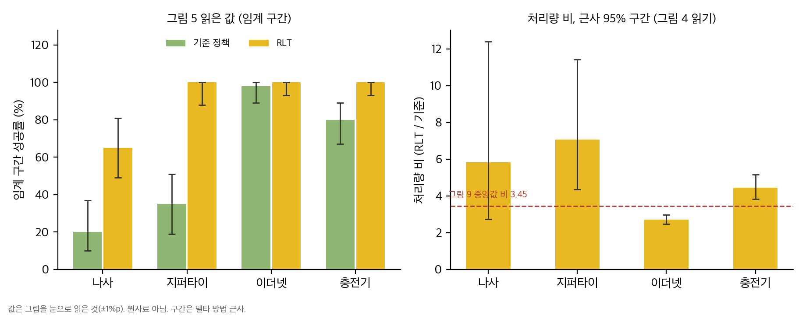
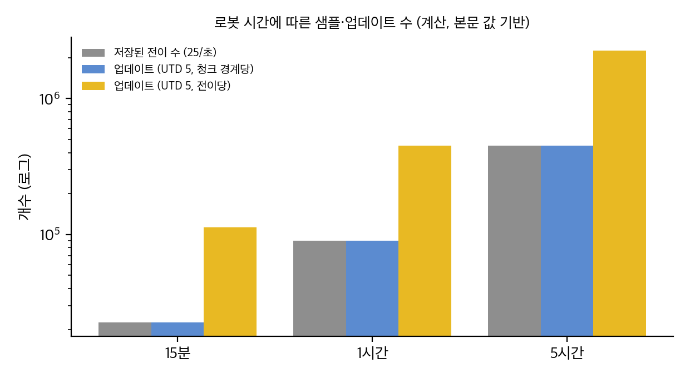
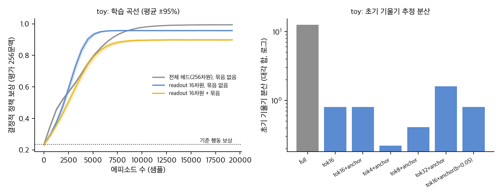

# 03. 보고 수치 재계산과 토이

> 재계산: `analysis/table_check.py` → `table_check_results.json` (scipy). 토이: `analysis/toy_readout.py` → `toy_readout_results.json` (numpy, 약 70초, 단일 프로세스).
> 입력 수치는 본문에 있는 값(임계 구간 50 에피소드, 중앙값 146/228/66, 25 샘플/초, UTD 5, 5시간)과 **그림에서 눈으로 읽은 값**입니다. 원자료 표가 없으므로 읽기 오차는 ±1%p(성공률)와 ±2–3%(처리량)로 둡니다. 재계산은 근사이며 정확한 검정이 아닙니다.

## 1. 보고 성공률 재계산 (그림 5)

그림 5의 막대와 오차 범위를 읽었습니다. 임계 구간 평가는 본문에 따라 과제당 에이전트별 50 에피소드로 가정합니다.

그래프: 그림 5의 임계 구간 성공률 읽은 값과 오차 범위(왼쪽), 그림 4 처리량 비와 근사 95% 구간(오른쪽). 우리가 그린 그래프이며 논문 그림은 넣지 않았습니다.

| 과제 (임계 구간, n=50 가정) | 기준 정책 | RLT | Fisher 정확 검정 p |
|---|---|---|---|
| 나사 | 20% (막대 10–37%) | 65% (막대 49–81%) | 1.5×10⁻⁵ |
| 지퍼 타이 | 35% (막대 19–51%) | 100% (막대 88–100%) | 2.5×10⁻¹³ |
| 이더넷 | 98% (막대 89–100%) | 100% (막대 93–100%) | 1.0 |
| 충전기 | 80% (막대 67–89%) | 100% (막대 93–100%) | 1.2×10⁻³ |

- **검정 방식:** 독립 시도가 과제당 50번이라고 가정하고 Fisher 정확 검정을 했습니다. 시드 간 변동은 반영하지 않습니다. 논문이 실행 횟수를 적지 않았으므로, 이 p값은 **한 번의 실행 안에서 시도 간 차이**만 말합니다.
- **정수 확인:** 나사 RLT 65%와 지퍼 타이 기준 35%는 n=50에서 정확한 정수 비율이 아닙니다(32.5/50, 17.5/50). 읽기 정밀도(±1%p)로는 32/50(64%)과 33/50(66%)을 구분할 수 없어 확정하지 못합니다(`04` K7).
- **전체 과제(그림 5 왼쪽):** 에피소드 수가 없습니다. 나사 기준 7% 대 RLT 47%, 지퍼 타이 27% 대 87%입니다. n을 20, 30, 50으로 바꿔 보니 나사의 Fisher p는 n=20에서 0.008, n=30에서 0.0009입니다. 지퍼 타이는 n=20에서 0.0003입니다(`table_check_results.json`의 `success_full_sensitivity`). 세 n 모두에서 차이의 방향은 같지만, 실제 에피소드 수가 20 안팎이면 결론의 강도는 달라집니다.
- **본문 주장과 대조:** 나사 20→65%(§I)와 전체 과제 +40%p, +60%p(§VI-C Q1)는 그림 읽은 값과 맞습니다(`04` C2, C3).

## 2. 처리량과 "3배 속도"의 차이 (그림 4, 9)

| 과제 (임계 구간) | 기준 처리량 (성공/10분) | RLT | 비 (근사 95% 구간) |
|---|---|---|---|
| 나사 | 6.7 (3.2–12.8) | 39 (29–48) | 5.8 (2.7–12.4) |
| 지퍼 타이 | 17 (9–25) | 120 (108–133) | 7.1 (4.4–11.4) |
| 이더넷 | 148 (140–156) | 400 (370–430) | 2.7 (2.5–3.0) |
| 충전기 | 135 (118–155) | 600 (562–640) | 4.4 (3.8–5.2) |

- 그림 9 중앙값으로 보면 이더넷 속도 비는 228 ÷ 66 = **3.45**입니다. 본문의 "최대 3배"와 맞습니다.
- 처리량 비는 6–7배까지 가지만, 이는 **성공률 증가**와 **속도 증가**가 함께 든 값입니다. 나사와 지퍼 타이는 기준 성공률이 낮아서(20%, 35%) 처리량 비가 커집니다. "3배 속도"라는 표현을 처리량 비와 혼동하면 안 됩니다(`04` C1).
- 사람 원격조작 중앙값 146 대 RLT 66은 2.2배입니다(`04` C5).

## 3. 실로봇 샘플 산술

본문 값: 제어 주기 50 Hz, 2스텝 스트라이드로 1초에 25개 샘플(부록 B), 과제당 RL 에피소드 400–1,000, 데이터 15분–5시간, UTD 5.

그래프: 로봇 데이터 시간에 따른 저장 전이 수와 업데이트 수(UTD 5의 두 해석). 본문 값에서 계산한 것이며 측정값이 아닙니다.

| 데이터 시간 | 저장 전이 (25/초) | 업데이트, UTD 5를 전이당으로 해석 | 업데이트, UTD 5를 청크 경계당으로 해석 |
|---|---|---|---|
| 15분 | 22,500 | 112,500 | 22,500 |
| 1시간 | 90,000 | 450,000 | 90,000 |
| 5시간 | 450,000 | 2,250,000 | 450,000 |

- UTD 정의가 모호해서(`04` K1) 업데이트 수는 5배까지 차이 납니다. 샘플 효율을 비교할 때는 전이 수와 업데이트 수를 따로 보고해야 합니다.
- 에피소드 예산: 임계 구간 5–20초이므로 1,000 에피소드는 약 1.4–5.6시간입니다(`table_check_results.json`의 `episode_budget_hours`). 15분 하한은 짧은 에피소드나 적은 에피소드를 가정해야 맞습니다(`04` K5).
- 사람 시간(개입, 리셋, 레이블)은 이 산술에 없습니다. "몇 분에서 몇 시간"은 로봇 시간만 셉니다(`01` §8).

## 4. 일관성 검사 요약

자세한 판정은 `04`의 K1–K8에 있습니다. 여기서는 재계산에서 나온 것만 씁니다.

- 처리량 ≈ 성공률 × 600초 ÷ 에피소드 시간(중앙값 근사): 기준 예측 129 대 관측 148(1.15배), RLT 예측 455 대 관측 400(0.88배). 대략 일치합니다.
- 청크 크기 14 × 10 = 140, 스트라이드 2 → 25/초는 모두 맞습니다.
- 이더넷 기준 중앙값 228스텝(4.6초)은 본문의 임계 구간 하한 250스텝(5초)보다 짧습니다.

## 5. 토이: 저차원 readout과 묶음이 학습을 어떻게 바꾸는가

**질문.** 고정된 임베딩 위에서 (a) 저차원 readout에 잔차 정책을 얹고 기준 행동에 묶는 방식과 (b) 전체 임베딩에 잔차 헤드를 얹고 묶지 않는 방식(전체 헤드 미세조정)은 정책 개선 속도와 기울기 분산이 어떻게 다른가?

**설계** (`analysis/toy_readout.py`, 모든 설정은 파일 상단에 있음)
- 문맥 s ~ N(0, I₁₆). 임베딩 z ∈ R²⁵⁶은 s를 세 배 크기로 담은 16차원과 과제와 무관한 잡음 64차원을 섞은 것입니다. 목표 행동 a* = Ts(4차원). 기준 행동 ã = a* + Us + b(체계적 선형 편향과 상수 편향).
- 보상 r = exp(−‖a−a*‖²/(2·0.4²)). 기준 정책의 보상은 약 0.24, 최적은 1.0입니다.
- 정책 μ = ã + Θφ, a ~ N(μ, 0.1²I). 특징 φ는 (i) 전체 임베딩 256차원, (ii) 임베딩의 PCA m차원(라벨 없는 2,000개로 계산), 여기에 상수항을 붙입니다. 모두 단위 분산으로 맞춥니다.
- 묶음 방식: β‖μ−ã‖² 페널티(식 (5)의 근사). 기본 β=0.5, 작은 값 β=0.05도 확인.
- **업데이트는 재매개변수화 기울기**를 씁니다: a = μ+σε에서 ∇_μ E[r] ≈ 평균 ∇_a r(a). 논문 식 (5)가 Q의 행동 기울기를 쓰는 것과 같은 꼴입니다. 다만 **Q 대신 실제 보상의 행동 기울기를 쓰는 오라클**입니다. 그래서 **critic 학습 문제는 검증하지 않습니다**.
- 배치 16 에피소드, 1,200번 업데이트(19,200 에피소드). 평가는 별도 256 문맥으로 샘플 수에 넣지 않았습니다. 평가는 40 에피소드마다 합니다.
- 학습률은 {0.001, 0.003, 0.01, 0.03, 0.1, 0.3}에서 **튜닝 시드 10개의 최종 보상**으로 고르고, 평가 시드 40개(각각 다른 세계)에서 다시 측정했습니다.
- 지표: 최종 보상, 기준에서 최적까지 거리의 90%(0.92)에 도달한 에피소드 수, 초기 정책(Θ=0)에서 기울기 추정(배치 16, 300회)의 분산 대각 합.

그래프: 토이의 학습 곡선(평균 ±95%, 평가 시드 40개)과 방법별 초기 기울기 분산(로그). 설계 가정에 따른 결과이며 논문 값에 맞추지 않았습니다.

**결과** (평가 시드 40개, 최종 보상 평균 ±95%)

| 방법 | 선택된 학습률 | 최종 보상 | 90% 도달 에피소드 (도달 비율) | 초기 기울기 분산 (대각 합) |
|---|---|---|---|---|
| 전체 헤드 (257 매개변수) | 0.001 | 0.994 ± 0.000 | 7,616 (100%) | 12.6 |
| readout 16차원, 묶음 없음 | 0.003 | 0.957 ± 0.003 | 5,024 (100%) | 0.80 |
| readout 16차원 + 묶음 β=0.5 | 0.003 | 0.899 ± 0.005 | 14,720 (2.5%) | 0.80 |
| readout 16차원 + 묶음 β=0.05 | 0.003 | 0.957 ± 0.003 | 5,232 (100%) | 0.80 |
| readout 4차원 + 묶음 | 0.01 | 0.465 ± 0.018 | 도달 안 함 | 0.22 |
| readout 8차원 + 묶음 | 0.003 | 0.568 ± 0.017 | 도달 안 함 | 0.41 |
| readout 32차원 + 묶음 | 0.003 | 0.909 ± 0.004 | 10,133 (15%) | 1.61 |

**학습률에 따른 속도 (튜닝 시드 10개, 90% 도달 에피소드의 중앙값)**
- 전체 헤드: 0.001에서 7,680, **0.003에서 3,200**, 0.01에서 8,960(60% 도달). 0.003의 최종 보상은 0.982로 0.001(0.994)보다 약간 낮습니다.
- readout 16차원: 0.001에서 13,120, 0.003에서 4,480, 0.01에서 1,920, **0.03에서 640**(100% 도달). 0.03의 최종 보상은 0.946입니다.
- 묶음 β=0.5: 튜닝 시드 10개에서는 어떤 학습률에서도 90%에 도달하지 못했습니다. 평가 시드 40개에서는 학습률 0.003에서 2.5%만 도달했습니다. 최종 보상은 튜닝 시드 기준 0.84–0.90입니다.

**해석**
1. **속도:** 같은 방법 안에서 가장 빠른 학습률끼리 비교하면 readout 16차원은 640, 전체 헤드는 3,200 에피소드로 약 5배 빠릅니다. 각 방법에서 최종 보상이 가장 높은 학습률끼리 보면 readout이 전체 헤드보다 약간 낮습니다(0.957 대 0.994). 즉 readout은 **속도를 얻고 천장을 낮춥니다**(readout의 천장은 최소제곱 해 0.96과 같습니다).
2. **분산:** 초기 기울기 분산의 대각 합은 전체 헤드가 약 16배 큽니다(12.6 대 0.80). 하지만 **매개변수당 분산은 거의 같습니다**(12.6/257 = 0.049, 0.80/17 = 0.047). 줄어든 것은 차원 수이지 좌표별 노이즈가 아닙니다. 논문의 "저차원 토큰이 분산을 줄인다"는 주장은 이 토이에서 **매개변수 수 효과**로 설명됩니다.
3. **차원 선택:** readout이 과제 신호를 덜 담으면 천장이 낮아집니다(4차원 0.47, 8차원 0.57). 과제 신호를 다 담는 16차원에서는 천장이 0.96입니다. 32차원은 잡음 차원이 들어와 속도와 분산 모두 나빠집니다. 과제 신호의 차원을 모르면 과하게 줄이는 쪽이 위험합니다.
4. **묶음:** β=0.5는 정책을 기준 근처에 묶어 최종 보상을 0.90으로 낮추고 속도도 떨어뜨립니다. β=0.05에서는 묶음이 결과를 거의 바꾸지 않습니다. 묶음의 효과는 강도에 민감합니다. 논문에서 β를 밝히지 않은 것(`04` M1)이 재현을 어렵게 만듭니다.

**토이의 한계 (결과를 넓게 해석하지 말 것)**
- 한 스텝 밴딧입니다. 논문의 청크 크레딧 할당 문제와 긴 지평은 없습니다. 청크 효과는 이 토이로 검증하지 않았습니다.
- 오라클 기울기를 씁니다. critic을 학습하면 결과가 달라질 수 있습니다(연구 질문으로 남김).
- RL token은 재구성 손실로 학습하지 않고 PCA로 대신합니다. 학습된 병목이 PCA보다 나은지는 검증하지 않았습니다.
- 평가 간격(40 업데이트 = 640 에피소드) 때문에 90% 도달 에피소드는 640 단위로만 나옵니다. 차이가 640 미만인 비교는 판단하지 않습니다.
- 학습률 그리드의 가장자리(전체 헤드 0.001)를 썼습니다. 더 낮은 학습률은 시도하지 않았습니다.
- 평가 시드 40개는 튜닝 시드 10개와 다릅니다. 튜닝 결과와 평가 결과는 일치합니다(예: readout 16차원 0.956 대 0.957).

## 6. 이 장에서 얻은 것

- 보고 수치는 대부분 그림과 맞고, 주장 중 일부는 정의(처리량 대 속도, UTD, 전체 과제 n)에 따라 달라집니다(`04` C1, C4, C7, K1).
- 샘플 산술은 UTD 해석에 따라 5배 차이 납니다.
- 토이는 "저차원 readout은 빠르지만 천장이 낮고, 묶음은 강도에 민감하다"를 보여 줍니다. 분산 감소는 매개변수 수 효과입니다.
