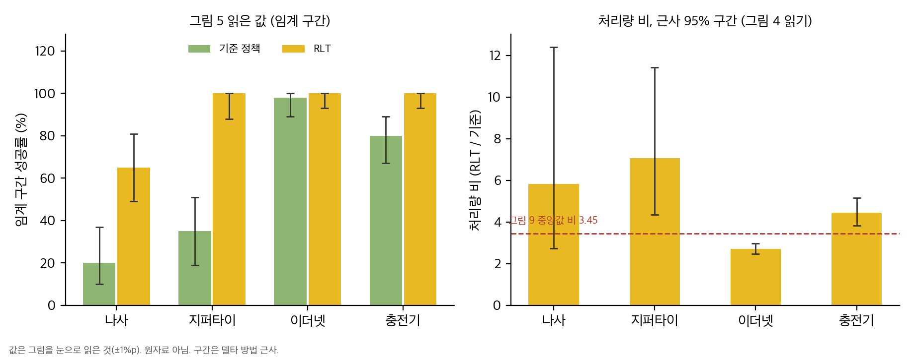
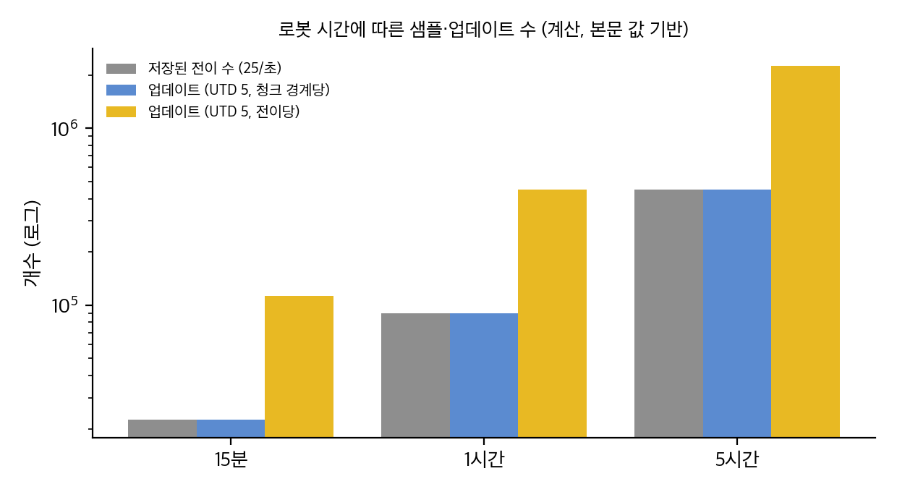
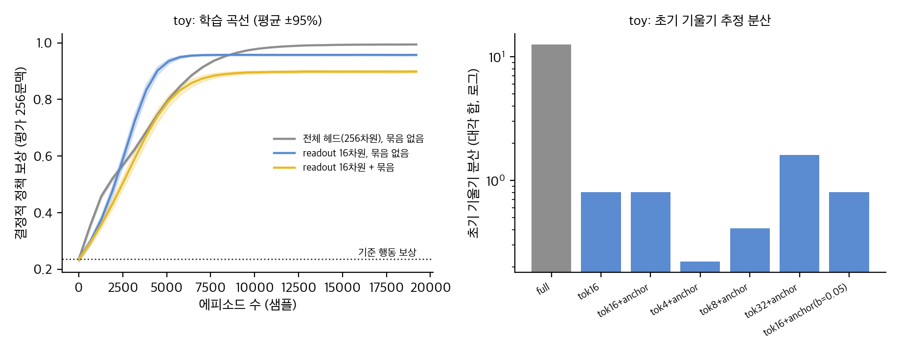

> **논문:** Charles Xu, Jost Tobias Springenberg, Michael Equi, Ali Amin, Adnan Esmail, Sergey Levine, Liyiming Ke (Physical Intelligence). *RL Token: Bootstrapping Online RL with Vision-Language-Action Models.* CoRL 2026 구두 발표, arXiv:2604.23073 (v2, 2026-04-30).
> 논문 배포 조건은 arXiv non-exclusive distribution입니다(CC 라이선스 아님). 그래서 이 글에는 논문 그림을 넣지 않았습니다. 그래프는 논문 그림에서 읽은 값과 직접 만든 토이로 그렸습니다. 공식 코드는 확인하지 못했고, 실행하거나 복제하지 않았습니다.

---

## 논문이 묻는 것

정밀 조작 과제에서 사전학습 VLA는 대체로 잘하지만, 마지막 밀리미터에서 느리고 재시도가 많습니다. 이를 온라인 RL로 고치고 싶지만, VLA 전체를 RL로 학습하려면 계산과 로봇 시간이 너무 듭니다. 작은 모델을 처음부터 RL하면 빠르지만 VLA의 일반화를 잃습니다.

저자들은 두 가지를 같이 씁니다.

1. **RL token:** VLA의 내부 임베딩을 2048차원 토큰 하나로 압축합니다. 작은 인코더-디코더가 자기회귀 재구성으로 이 토큰을 학습합니다.
2. **기준 행동에 묶인 작은 actor-critic:** actor는 VLA가 낸 행동 청크를 입력으로 받고, β‖a−ã‖²로 기준 근처에 묶입니다. 전체 과제가 아니라 가장 어려운 임계 구간만 RL합니다.

## 숫자를 다시 세 보니

그림 5에서 임계 구간 성공률을 읽어 보면, 나사 설치가 20%에서 65%로 올라가는 주장과 전체 과제에서 +40%p, +60%p라는 주장은 그림과 맞습니다. 이더넷의 "최대 3배 속도"는 그림 9의 에피소드 길이 중앙값(228 대 66 스텝, 3.45배)과 맞습니다.

그러나 처리량 비는 6–7배까지 나옵니다. 이는 성공률 증가가 섞인 값이라서 속도와 같은 말이 아닙니다. 또 RL token을 뺐을 때의 "처리량 50% 감소"는 그림 7의 어떤 시점과도 맞지 않습니다(60–71% 감소).

그래프: 그림 5의 임계 구간 성공률(왼쪽)과 그림 4의 처리량 비(오른쪽), 읽은 값과 근사 구간. 논문 수치를 눈으로 읽은 것이며 원자료가 아닙니다.

## 샘플 산술: UTD 정의가 5배를 바꿉니다

본문에는 제어 주기 50 Hz, 2스텝 간격 저장(1초에 25개), UTD 5가 있습니다. 여기서 UTD가 전이당인지 청크 경계당인지에 따라 5시간 데이터의 업데이트 수가 45만에서 225만으로 달라집니다. 사람의 개입과 리셋 시간은 예산에 없습니다. 그래서 "몇 시간이면 된다"는 말은 로봇 시간만 센 것입니다.

그래프: 데이터 시간에 따른 저장 전이 수와 업데이트 수(UTD 5의 두 해석). 본문 값에서 계산했으며 측정값이 아닙니다.

## 토이: 저차원 readout과 묶음이 학습을 어떻게 바꾸는가

논문의 핵심 주장 하나는 저차원 토큰이 학습을 빠르게 하고, 기준 행동 묶음이 안전하게 한다는 것입니다. 이를 확인하려고 numpy로 한 스텝 밴딧 토이를 만들었습니다. 여기서 임베딩은 256차원이고 과제 신호는 16차원에 있습니다. 정책은 전체 임베딩에 잔차를 얹거나, PCA readout 16차원에 잔차를 얹습니다. 업데이트는 재매개변수화 기울기를 씁니다. Q 대신 실제 보상의 행동 기울기를 쓰는 오라클이라서 critic 학습은 검증하지 않았습니다.

결과(평가 시드 40개, 학습률은 튜닝 시드로 선택):

- **속도:** 각 방법에서 가장 빠른 학습률끼리 보면, 90%에 도달하는 데 readout 16차원은 640 에피소드, 전체 헤드는 3,200 에피소드가 걸립니다.
- **천장:** 최종 보상은 readout이 0.957, 전체 헤드가 0.994입니다. 속도를 얻는 대신 천장이 낮아집니다.
- **분산:** 초기 기울기 분산의 대각 합은 전체 헤드가 16배 큽니다. 하지만 매개변수당으로 나누면 거의 같습니다. 줄어든 것은 차원 수입니다.
- **묶음:** β=0.5는 최종 보상을 0.90으로 낮추고 속도도 떨어뜨립니다. β=0.05에서는 결과가 거의 같습니다. 논문이 β 값을 밝히지 않아서 재현이 어렵습니다.

그래프: 토이의 학습 곡선(평균 ±95%, 평가 시드 40개)과 방법별 초기 기울기 분산(로그 눈금). 설계 가정에 따른 결과이며 논문 값에 맞추지 않았습니다.

## 구현할 수 있는가

알고리즘 자체는 구현할 수 있습니다. RL token 인코더-디코더, 청크 actor-critic, 기준 행동 묶음은 PyTorch로 350–500줄, 3–5일 정도(추정)입니다. 맥(M4 Pro, MPS, CUDA 없음)에서 돌릴 수 있는 부분은 이 정도입니다.

결과를 재현하는 것은 불가능합니다. 실로봇 4과제, 원래 VLA의 가중치, 양팔 로봇이 필요합니다. 또 β, σ, 워밍업 길이, 업데이트 비율 같은 값이 본문에 없어서, 같은 방법을 구현해도 같은 곡선이 나오리라는 보장이 없습니다.

## 라이선스와 출처

- 논문은 arXiv non-exclusive distribution 라이선스입니다. PDF에 저작권 문구는 없습니다.
- 논문 표와 그림에서 읽은 값은 인용과 재계산을 위해 옮겼습니다. 문장과 그림은 옮기지 않았습니다.
- 공식 코드는 확인하지 못했습니다. 제3자 RLinf 구현은 문서만 읽었고 복제하지 않았습니다.
- 그래프와 토이 코드는 이 글의 작성자가 만들었습니다. 토이의 파라미터는 설계 가정입니다.

## 자료

- [통합 리포트 PDF](report/report_public.pdf)
- [01. 논문 분석: RL Token (arXiv:2604.23073)](analysis/01_paper_analysis.md)
- [02. 선행연구와 관련 자료](analysis/02_prior_work.md)
- [03. 보고 수치 재계산과 토이](analysis/03_analysis.md)
- [04. 주장 검증과 구현 가능성](analysis/04_claim_verification.md)
