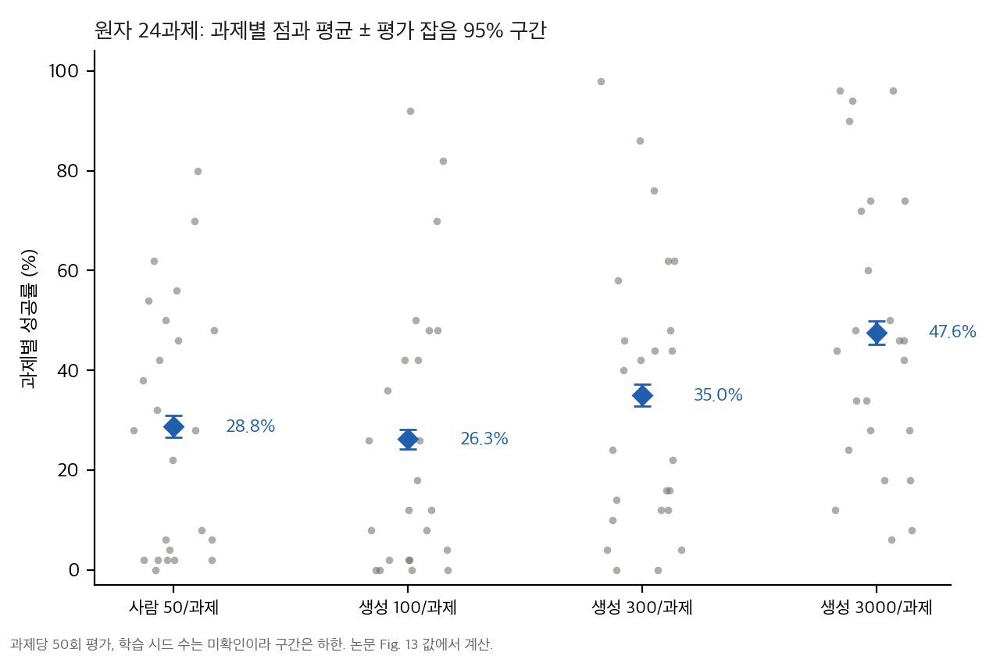
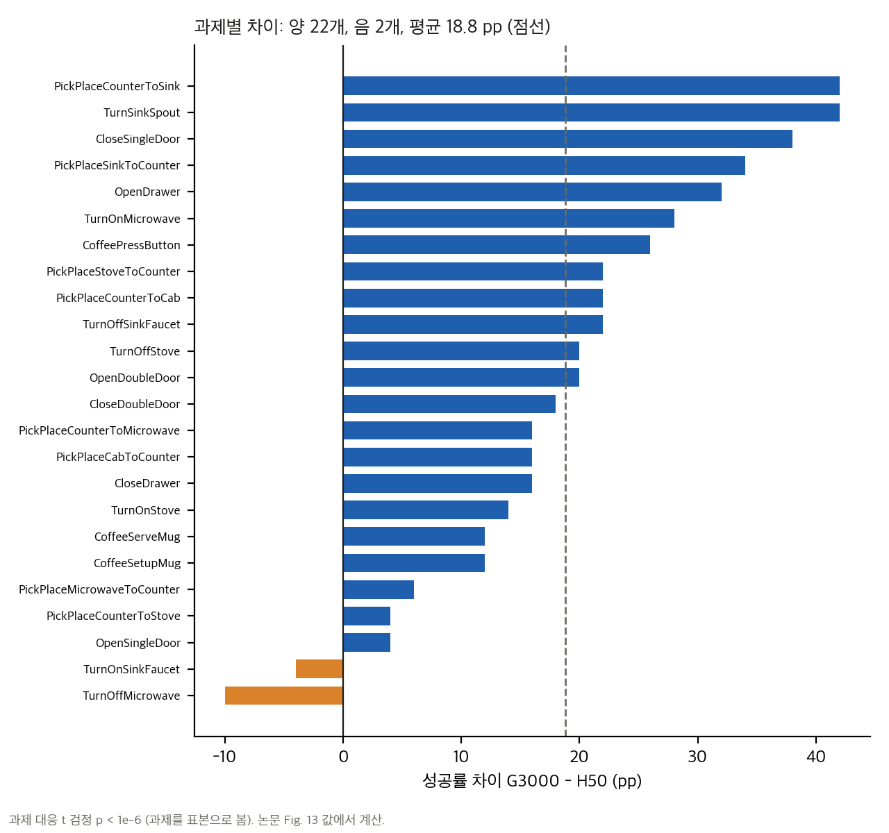
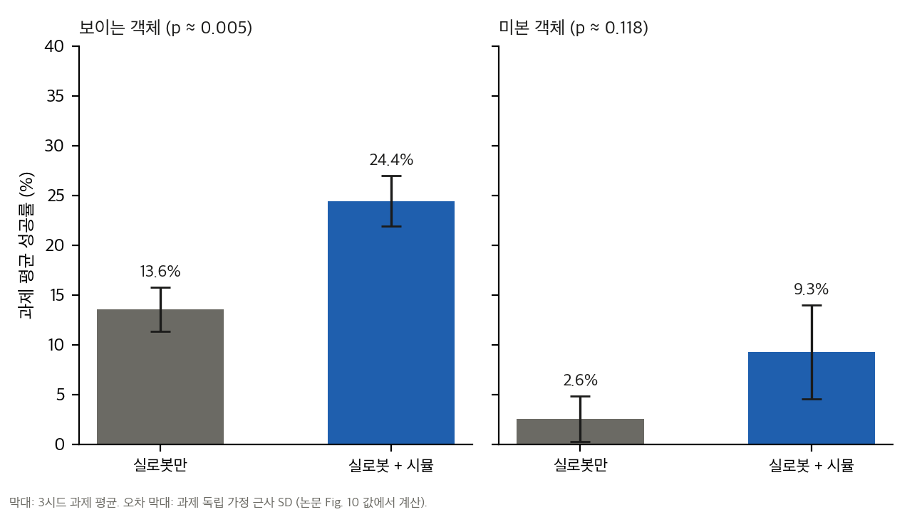

> **논문:** Soroush Nasiriany, Abhiram Maddukuri, Lance Zhang, Adeet Parikh, Aaron Lo, Abhishek Joshi, Ajay Mandlekar, Yuke Zhu. *RoboCasa: Large-Scale Simulation of Everyday Tasks for Generalist Robots.* RSS 2024, arXiv:2406.02523 (v1, 2024-06-04).
> 공식 코드(robocasa/robocasa)는 정적으로만 읽었고 실행하지 않았습니다. 논문 그림은 싣지 않고, 우리가 논문 표 값으로 그린 그래프만 씁니다.

## 논문이 묻는 것

로봇 학습은 데이터가 모자랍니다. 실세계에서 모으는 것은 비싸니, 시뮬레이션으로 장면과 과제와 데이터를 같이 키우자는 주장입니다. RoboCasa는 주방을 중심으로 장면 120개, 객체 2,509개, 과제 100개를 만들었습니다. 사람 시연은 원자 과제마다 50개씩 모았고, 그것을 MimicGen으로 과제당 3000개까지 늘렸습니다.

핵심 질문은 하나입니다. **생성한 데이터가 사람이 모은 데이터를 넘어서는가, 그리고 규모에 따라 오르는가?**

## 이 글에서 확인한 것

**1. 평균은 맞습니다.** 원자 과제 24개의 과제별 성공률(Fig. 13)에서 네 설정의 평균을 계산하면 28.8, 26.3, 35.0, 47.6%가 나옵니다. 논문 표와 같습니다. 과제당 평가가 50회라서 평가 잡음은 평균 기준 약 ±2 pp입니다.

**2. 생성 3000개는 사람 50개보다 낫습니다.** 같은 과제끼리 짝지어 비교하면 24개 중 22개에서 생성 쪽이 높습니다. 대응 t 검정 p는 10⁻⁶보다 작습니다. 과제별 차이의 평균은 18.8 pp입니다. 차이의 크기는 평가 잡음으로 설명되지 않습니다.

**3. 생성 100개는 사람 50개와 차이가 없습니다.** 26.3 대 28.8%, 차이 −2.5 pp, p = 0.25입니다. 본문이 말하는 "규모가 커지면 오른다"는 300개 이상에서 확실합니다. 과제당 100개 생성은 사람 50개 수준입니다.

**4. 규모 추세는 평균에서 뚜렷하지만 과제마다 다릅니다.** 기울기는 10배당 약 14 pp이고, 과제 부트스트랩 95% 구간은 10–18 pp입니다. 다만 24과제 중 17개만 생성 100 → 300 → 3000에서 단조입니다. 과제당 50회 평가의 잡음을 고려하면 자연스러운 수준입니다.

**5. 실로봇 전이는 보이는 객체에서 확실합니다.** 실로봇만 13.6%였던 것이 시뮬 공동학습으로 24.4%가 됩니다. 과제 세 개 모두 올랐습니다. 근사 p는 0.005입니다. 미본 객체에서는 2.6%에서 9.3%로 올랐지만, 3시드 SD가 커서 근사 p ≈ 0.12입니다. 방향은 맞지만 확실하다고 말하기 어렵습니다.

## 코드와 논문 사이에서 본 것

- **사람 시연의 범위.** 서론은 "100개 과제 전체에 사람 시연"을 쓰지만, 공개 데이터는 원자 과제 25개와 복합 과제 5개입니다. 나머지 70개 복합 과제에는 공개 사람 시연이 없습니다.
- **생성 데이터의 시점.** 생성 데이터 항목은 논문 직후인 2024년 7월에 공개 코드에 들어갔습니다. 생성 알고리즘 자체는 외부 MimicGen 패키지에 있습니다.
- **버전.** 태그 v0.2는 2025년 12월 커밋을 가리키고, 현재 코드는 후속 RoboCasa365입니다. 논문 수치를 다시 맞추려면 2024년 커밋(be5d99c, a6c2dc6)을 고정해야 합니다.
- **부록 값.** Diffusion Policy 12%와 BC-Transformer 56%(PickPlaceCounterToSink)는 Fig. 13의 어떤 설정과도 맞지 않습니다. 데이터 설정이 적혀 있지 않습니다.

## 평가 보고에서 빠진 것

- 과제당 50회는 장면 5개에 걸친 총 횟수로 읽힙니다. 값이 1/50 단위여서 그렇게 판단했습니다.
- 학습 시드가 몇 개인지 없습니다. 그래서 구간은 평가 잡음만 봅니다. 시드 변동이 있다면 실제 불확실성은 더 큽니다.
- 평가 하네스가 공개 저장소에 없습니다.

## 맥에서 할 수 있는 것

- **할 수 없는 것:** 24과제 BC 학습(GPU 권장), 생성 규모 곡선, 복합 과제 미세 조정, 실로봇 공동학습.
- **할 수 있는 것(조건부):** 설치와 약 10 GB 에셋 다운로드 후, 원자 과제 하나의 MimicGen 생성 성공률과 시도 수를 CPU로 측정하는 것. 시간은 측정해 보기 전까지 모릅니다.

## 권하지 않는 것

- "생성 데이터가 사람보다 낫다"를 시드 분산 없이 확실한 효과로 인용하는 것.
- 실로봇 미본 객체의 개선을 확실한 결과로 쓰는 것.
- 2024 논문 수치를 현재 코드(RoboCasa365)에서 재현했다고 말하는 것.

## 자료

- [통합 리포트 PDF](report/report_public.pdf)
- [01. 논문 분석: RoboCasa](analysis/01_paper_analysis.md)
- [02. 선행연구, 가까운 대안, 자료](analysis/02_prior_work.md)
- [03. 수치 재계산과 일관성 점검](analysis/03_analysis.md)
- [04. 공식 코드 대조 (논문 ↔ 코드, 차이 D1–Dn)](analysis/04_code_verification.md)
