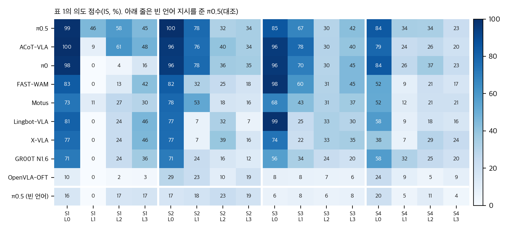
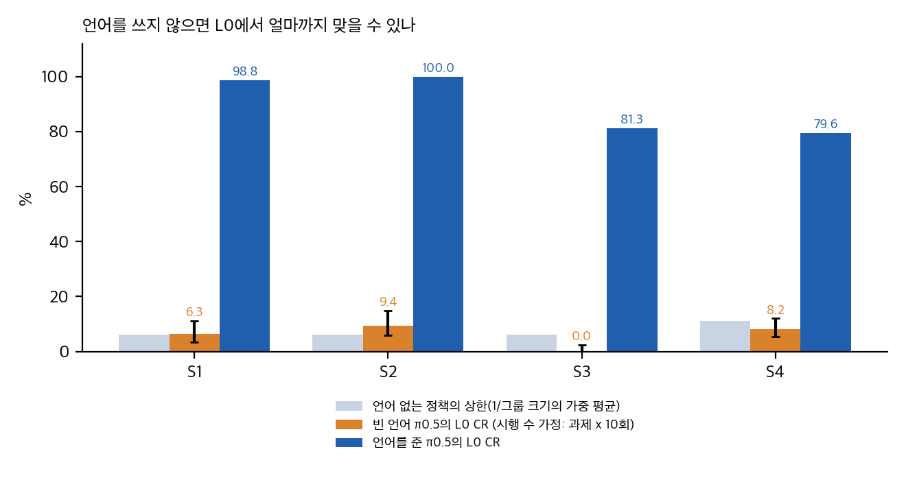
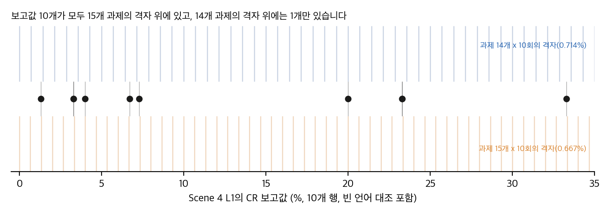
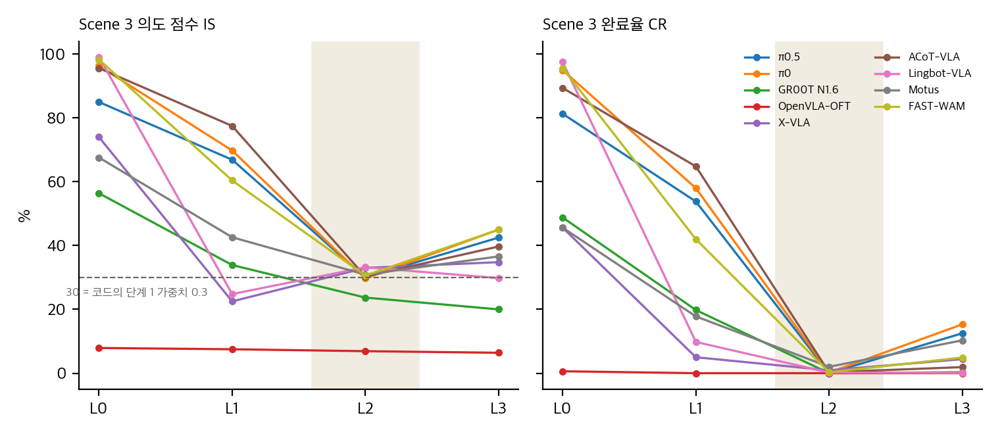
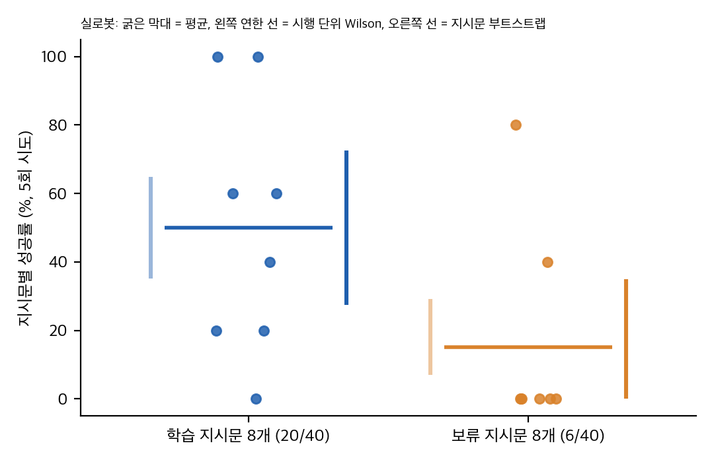

> **논문:** Chang Guo, Yukun Xie, Bohan Tan, Zheng Chang, Zhaokai Yin, Qianli Ma, Yingqiao Wang, Chao Liang, Zhipeng Zhang. *RoboFollow: Unveiling the Instruction Following Mirage in Embodied Agents.* CoRL 2026 포스터, arXiv:2609.25636 (v1, 2026-09-22).
> 공식 코드(AutoLab-SAI-SJTU/RoboFollow)는 정적으로만 읽었고 실행하지 않았습니다. 논문은 CC BY 4.0이지만 그림이 모두 시뮬레이터 화면이나 실로봇 사진이라 싣지 않고, 우리가 만든 그래프만 씁니다.

## 논문이 묻는 것

로봇 정책의 성공률이 높아도, 정책이 지시문을 쓰고 있는지는 알 수 없습니다. 장면만 봐도 할 일이 하나로 정해지면 언어는 필요 없기 때문입니다. 이 논문은 같은 장면에서 서로 다른 과제가 여럿 가능하도록 학습 데이터를 만들어 이 문제를 벤치마크 설계로 풉니다. 같은 장면에서 가능한 과제가 몇 개인지를 장면 엔트로피(식 (1))로 재고, RoboFollow는 3.782 bits, LIBERO 네 스위트의 평균은 0.880 bits라고 보고합니다.

## 벤치마크 구성

RoboTwin 2.0 위에 장면 네 개(공간 관계, 속성, 경로·방향 제약, 논리), 학습 과제 75개, 평가 과제 554개를 둡니다. 평가는 네 수준입니다. L0는 학습 분포, L1은 지시는 같고 물체 위치를 바꿈, L2는 배치는 같고 지시를 새로 조합, L3는 둘 다입니다. 점수는 단계별 의도 점수(IS), 실행 점수(ES), 완료율(CR)입니다. VLA 7개와 WAM 2개를 3,750 에피소드로 미세조정해 평가합니다. 평가 과제 수와 시행 수는 논문에 없고 공식 저장소 README에서 옵니다(554과제, 과제당 10회, 총 5,540회). 이 글의 시행 수는 이 값을 쓴 **가정**입니다.

## 표 1에서 읽은 것

그래프: 표 1의 의도 점수(IS). 아래 줄은 π0.5에 빈 언어 지시를 준 대조입니다. 우리가 그린 그래프입니다.

L0 평균 IS는 π0 94, ACoT-VLA 93, π0.5 92이고, L1–L3 평균은 각각 33.3, 40.5, 43.5입니다. 표의 산술은 맞습니다. Avg 열 30개 값은 16칸 단순 평균과 0.05 이내이고, 프로젝트 사이트의 결과 CSV 160행은 표 1과 160/160칸 같습니다.

평균을 어떻게 내는지는 순위에 영향을 줍니다. 표의 Avg는 16칸 단순 평균이고, 평가 과제 수로 가중하면 L2와 L3가 71%를 차지합니다. IS 1위는 단순 평균에서 π0.5(55.7 대 53.5), 과제 수 가중에서 ACoT-VLA(49.1 대 48.6)입니다. CR의 순위는 두 방식에서 같습니다.

## 언어를 쓰지 않으면 어디까지 맞나

표 1에는 π0.5에 빈 언어 지시를 준 행이 있는데, 본문에는 이 행의 설명이 없습니다. 이 행을 장면 구조에서 계산한 값과 비교해 볼 수 있습니다. 한 장면 그룹 안에서 언어 없이 한 과제만 고르는 정책의 맞는 비율은 (그룹 수)/(과제 수)이고, 전체로 6/75 = 8.0%(Scene 1–3은 1/16 = 6.25%, Scene 4는 3/27 = 11.1%)입니다.

그래프: 언어 없는 정책의 L0 상한(회색), 빈 언어 π0.5의 L0 CR(주황, 막대는 시행 수 가정 Wilson 95% 구간), 언어를 준 π0.5의 L0 CR(파랑). 우리가 그린 그래프입니다.

빈 언어 π0.5의 L0 CR은 6.3/9.4/0.0/8.2로 이 상한 범위입니다. 이 대조는 L0에서 언어가 과제를 정한다는 설계 가정을 뒷받침합니다. 같은 기준으로 보면 OpenVLA-OFT의 L0 평균 IS(17.5)는 빈 언어 π0.5(14.8)와 가깝습니다. 이 모델의 L1–L3 하락(9.1포인트)은 높은 L0에서의 붕괴가 아니라 L0 자체가 낮은 경우입니다. 초록의 "where attained"가 가리키는 구분입니다.

## 완료율 값이 놓이는 격자

CR은 과제별 완료율의 단순 평균이라서 과제 수와 과제당 시행 수가 정해지면 가능한 값이 격자 위에 있습니다. 과제당 10회(시행 수 n 가정)로 놓고 표 1의 CR을 검사하면, 격자가 0.1%보다 거친 160칸 중 149칸이 맞습니다. 격자가 가장 거친 n = 80(1.25%)과 n = 160(0.625%)의 50칸이 모두 맞으므로 이 가정은 지지됩니다.

그래프: Scene 4 L1의 CR 보고값 10개(빈 언어 대조 포함)와 과제 14개 대 15개(과제당 10회 가정)의 격자. 우리가 그린 그래프입니다.

맞지 않는 11칸 중 9칸이 Scene 4 L1입니다. 이 열의 값 10개는 시행 수 150(과제 15개 x 10회)에서 모두 가능하고 140(과제 14개 x 10회)에서는 1개만 가능합니다. 저장소의 Scene 4 L1 과제는 14개로 등록되어 있고 코드의 `id` 번호에서 7번이 비어 있습니다. 과제 수, 과제당 시행 수, 집계 방식 중 무엇이 다른지는 이 자료로 정할 수 없고 저자 확인이 필요합니다.

## Scene 3 L2의 값

그래프: Scene 3의 수준별 IS와 CR. L2에서 CR이 모든 모델에서 바닥입니다. 우리가 그린 그래프입니다.

Scene 3 L2의 CR은 9개 모델 모두 2.0 이하입니다. L0 CR이 95–98%인 모델(π0, ACoT-VLA, Lingbot-VLA, FAST-WAM)도 같습니다. 7개 모델의 IS는 29.7–33.2에 모입니다. 코드를 읽으면 Scene 3의 단계 가중치는 0.3/0.3/0.4이고, 뒤 단계의 의도 점수는 앞 단계 의도가 만점일 때만 인정됩니다. 그래서 IS ≈ 0.3은 "물체는 맞게 고르고 경로 단계 이후는 통과하지 못함"과 같은 값입니다. 점수 구조와 값이 일치한다는 데서 온 추정이고, 에피소드 기록으로 확인한 것은 아닙니다. L2는 경로와 방향 표현을 모두 바꾼 지시라서, 이 칸이 언어 이해의 어느 부분을 재는지는 단계별 점수 없이는 가를 수 없습니다.

## 점수 규칙: 논문과 코드

공식 코드의 채점기에는 논문 서술보다 많은 규칙이 있습니다.

- Scene 1과 2에서 최종 배치가 맞으면 IS나 ES가 0.5 미만일 때 0.3을 더합니다. 장면 1–3에는 잘못된 팔의 감점(−0.2)이, Scene 4에는 받침 물체를 들어 올리는 감점(−0.3)이 있습니다.
- 앞 단계가 만점이어야 뒤 단계 의도 점수가 인정되고, 실행 점수는 의도가 만점이어야 인정됩니다.
- "완료 후 더 행동하지 않음"으로 서술된 마무리 단계는 코드에서 시작 위치 반경 12 cm 안으로 연속 20프레임 안정되게 돌아오는지를 요구합니다.
- 관계 판정은 거리 12 cm 이내와 기준 방향 ±45° 원뿔입니다.

저장소 README는 이 조정을 "existing score adjustments"로 적지만 논문 본문과 부록에는 없습니다. 이 규칙 때문에 IS는 의미 선택만의 척도가 아니라 단계 가중 누적, 기하 임계, 보너스를 포함한 값입니다. 표 1에서 ES가 IS보다 큰 칸이 하나도 없는 것(160칸)은 이 관문 구조와 맞습니다.

## 표 2와 3: 완화 기법

표 2는 Scene 2만으로 미세조정한 설정에서 더 강한 VLM(Qwen3-VL-4B), QA 공동학습, LangForce, CFG를 시험하고 L1–L3 격차가 줄지 않는다고 보고합니다. 표를 다시 읽으면 세 가지가 보입니다.

- **짝을 맞춘 비교가 아닙니다.** Qwen-GR00T(L0 IS 67.9)와 π0.5(93.6)는 VLM뿐 아니라 행동 머리, 사전학습, 학습 설정이 다릅니다. 같은 데이터로 학습한 GR00T 기본 행이 표에 없어 백본 효과를 분리할 수 없습니다.
- **LangForce 서술과 표가 다릅니다.** "미미한 변화"는 Qwen-GR00T 행을 기준으로 하면 L0 CR 65.6→35.0, L2 IS 31.1→18.6, L3 IS 14.8→0.0과 다릅니다. 비교 기준이 표에 명시되어 있지 않습니다.
- **표 3의 작은 차이.** 시연 25→50 등 4–7포인트 개선은, Scene 2 시행 수를 160/240/680/240으로 가정하고 표준오차 상한으로 낸 보수적 z 하한에서 대부분 구분되지 않습니다. 지시 변형 1→5의 L3(+11.5, z ≥ 2.5)는 구분됩니다.

## 실로봇 파일럿

그래프: 실로봇 파일럿의 지시문별 성공률. 왼쪽 연한 선은 시행 단위 Wilson 구간, 오른쪽 선은 지시문 단위 부트스트랩 구간입니다. 우리가 그린 그래프입니다.

학습 지시문 20/40(50%), 보류 지시문 6/40(15%)이고 합계는 부록 표와 맞습니다. 두 집합은 구성이 다릅니다(집기 14/20 대 6/30, 쌓기 6/20 대 0/10). 시행 단위 Fisher 검정은 p = 0.0016이고 집기·쌓기로 층화한 CMH는 p = 7e-5입니다. 지시문 8개 대 8개로 보는 순열 검정은 p = 0.081입니다. 저자도 이 비교를 서술적인 것으로 밝히고 시행 간 의존을 반영하지 않았다고 적습니다.

## 공식 코드와 자료

공식 저장소는 4개 장면의 학습 과제와 시연 수집, 평가 과제와 채점기, π0.5 변환·학습·추론 어댑터를 담고 있습니다. π0.5 이외 8개 모델의 어댑터, 완화 기법, 시각 QA 프로브, 실로봇 코드, 표 집계 스크립트는 없습니다. GitHub는 라이선스를 MIT로 표시하지만 저장소의 라이선스 파일은 RoboTwin의 고지(`LICENSE.RoboTwin`)뿐입니다. 데이터셋은 Hugging Face에 있고 합계 약 40.4 GB입니다(메타데이터 기준, 받지 않았습니다). README가 가리키는 프로젝트 페이지 주소는 2026-11-26에 확인하지 못했습니다.

저장소 이슈 #2는 Scene 2 L3에서 그릇을 교환한 배치(2.5, 2.6)의 "left bowl/right bowl" 지시와 채점 대상이 어긋난다고 보고했습니다. 이전 공개본과 현재 코드를 비교하면 `evaluation/scene2.py`의 L3 참조 선택 부분만 다르고, 영향 범위는 Scene 2 L3 24개 중 8개입니다. 저자는 이전 공개본에 구버전의 Scene 2 평가 코드가 들어 있었고 수정했다고 답했습니다. 표 1의 Scene 2 L3이 어느 코드 버전으로 계산되었는지는 저장소에서 확인할 수 없습니다.

## 이 맥에서 구현할 수 있는가

**논문 수치의 재현은 이 맥(Apple M4 Pro, 24 GiB, CUDA 없음)에서 불가능합니다.** 저장소의 전제가 Linux, CUDA GPU, SAPIEN, cuRobo이고, 모델 미세조정과 5,540회 평가가 GPU를 요구합니다. 데이터셋만 약 40.4 GB입니다. 표 재계산과 채점 규칙의 정적 대조는 새 설치 없이 끝냈습니다. 자작 소형 환경에서 같은 현상을 보는 것은 조건부로 가능합니다(mujoco와 torch가 이미 있고 노력 1–2주, 추정).

## 읽을 때 조심할 것

- 표 1의 L1–L3 하락을 "모든 모델이 언어를 무시한다"로 읽으면 OpenVLA-OFT처럼 L0에서 이미 빈 언어 대조에 가까운 모델이 섞입니다.
- Scene 3 L2의 값(IS ≈ 30, CR ≈ 0)으로는 모델 사이의 우열을 말하기 어렵습니다.
- 이 글의 시행 수는 저장소 README의 과제 수에 과제당 10회를 곱한 가정입니다. Scene 4 L1처럼 이 가정과 맞지 않는 열이 있습니다.
- 저자 확인이 필요한 항목: Scene 4 L1의 과제 수와 시행 수, Scene 2 L3의 코드 버전, 보너스와 감점이 표 1에 모두 반영되었는지, 빈 언어 대조 행의 생성 방식, CFG의 학습 중 언어 드롭아웃 여부.

## 정리

RoboFollow는 "같은 장면에서 언어가 필요하도록 학습 데이터를 만든다"는 설계로 높은 성공률과 지시 따르기를 가르려는 시도이고, 빈 언어 대조와 L0–L3 분할이 그 설계의 핵심 증거입니다. 이 글의 재계산은 표의 산술과 장면 구조에서 나오는 상한이 설계를 지지하는 쪽임을 확인했고, 동시에 몇 가지를 열어 둡니다. 완료율의 시행 수, 점수 규칙의 보너스와 관문, 일부 칸(Scene 3 L2)의 해석, 완화 기법 비교의 기준이 그것입니다. 평가 점수를 비교할 때는 시행 수와 채점 규칙을 같이 적고 군집 단위의 불확실성을 보고하는 것이 안전합니다.

## 자료

- [통합 리포트 PDF](report/report_public.pdf)
- [01. 논문 분석: RoboFollow](analysis/01_paper_analysis.md)
- [02. 선행연구와 계보](analysis/02_prior_work.md)
- [03. 수치 재계산과 일관성 검사](analysis/03_analysis.md)
- [04. 논문 ↔ 공식 코드 정적 대조와 구현 가능성](analysis/04_code_verification.md)
