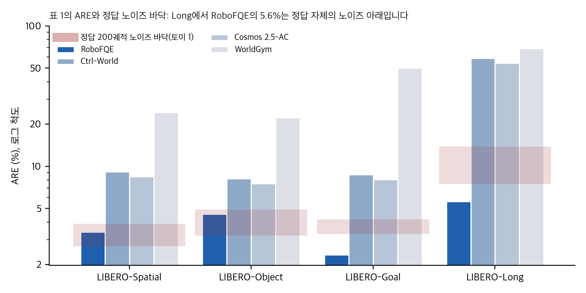
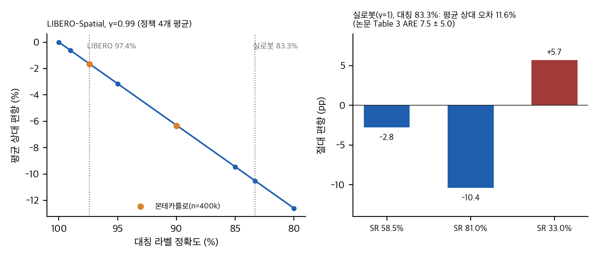
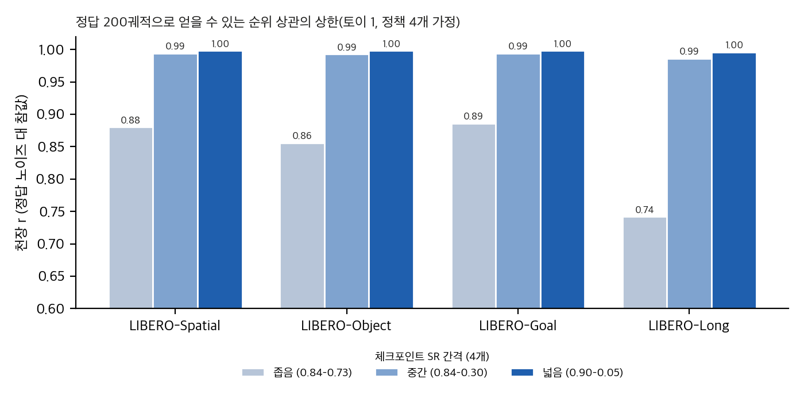

> **논문:** Yunfu Deng, Sangwoo Shin, Brahma S. Pavse, Josiah P. Hanna. *RoboFQE: Rollout-Free Evaluation of Visual Robot Policies from Offline Trajectories.* CoRL 2026 포스터, arXiv:2610.18699 (v2, 2026-11-05).
> 공식 코드(MIT, prediction-action-lab/RoboFQE)는 정적으로만 읽었고 실행하지 않았습니다. 논문 그림은 싣지 않고, 우리가 만든 그래프만 씁니다.

## 논문이 묻는 것

로봇 정책을 배포하기 전에 성능을 알고 싶을 때, 보통 실물에서 시도를 반복하거나 시뮬레이터, 영상 세계모델에서 새 궤적을 만듭니다. 이 논문은 질문을 바꿉니다. 이미 가진 오프라인 궤적만으로 정책의 할인 반환을 추정할 수 있을까요?

방법은 **RoboFQE**입니다. 고정 정책의 Q 함수를 벨만 목표에 회귀하는 FQE에 두 가지를 더합니다. 하나는 DINOv3 같은 사전학습 비전 인코더이고, 다른 하나는 궤적의 성공 여부를 LRM 같은 시각-언어 모델로 붙이는 것입니다. 정책을 굴리지 않으므로 세계모델처럼 예측 오차가 쌓이지 않는다는 것이 주장입니다.

LIBERO 네 과제, CALVIN ABC→D, 실로봇 블록 쌓기 세 과제에서 세계모델 세 개와 비교했습니다. 긴 과제(LIBERO-Long)에서 세계모델은 54–69%의 ARE를 보이고, RoboFQE는 5.6%입니다. 이 차이가 이 글의 중심 결과입니다.

## 이 글에서 확인한 것

**표 값끼리는 대부분 맞습니다.** 논문 표 2의 평균 길이는 성공률 합과 일치하고, 표 4의 ARE는 MSE에서 나온 상한 안에 있습니다. 그러나 논문 표 1의 Long 세계모델 셀 세 개와 Spatial 한 셀이 같은 V로 계산한 상한을 넘습니다. 기준값이 셀마다 다르다는 뜻입니다. 데모만 쓴 표 5의 세 셀도 같은 문제입니다.

**순위 상관의 단위가 빠져 있습니다.** 본문은 정책 4개로 순위를 매긴다고 쓰지만, 부록 그림은 정책-과제 쌍을 점으로 찍습니다. 정책 4개라면 p < 0.05 임계는 r = 0.95이고, 표 1의 RoboFQE 상관 중 Spatial(0.96)만 그 경계를 넘습니다.

그래프: 표 1의 평균 ARE와, 정답을 시뮬레이터 궤적 200개로 잰 때 생기는 노이즈 바닥(성공 시점 분포 가정 c = 0.15–0.35). 정답 자체가 흔들리는 폭에 가깝게 오는 값이 Spatial과 Object에 있고, Long의 RoboFQE 5.63%는 바닥보다 낮습니다. 우리가 그린 그래프입니다.

**정답 노이즈가 측정 한계를 정합니다.** 정답은 LIBERO에서 궤적 200개로 잽니다. 그 표준오차는 Spatial에서 상대 3–5%, Long에서 9–17%입니다. 따라서 Spatial의 3.4% 오차는 정답 노이즈와 같은 크기이고, Long의 5.6%는 정답 노이즈보다 작아서 정답 기준으로는 크기를 말할 수 없습니다. 세계모델과의 차이(50% 이상)는 그래도 남습니다.

**실로봇의 "가장 낮은 ARE"는 검정되지 않습니다.** RoboFQE는 7.5 ± 5.0%, Ctrl-World는 10.3 ± 10.2%입니다. 세 시드에서 Welch 검정 p는 0.37입니다. 표 3 캡션의 ±는 95% 신뢰구간 반폭이라고 쓰고, 부록은 표준편차라고 씁니다. 두 해석 모두 차이가 없습니다. 또 정확도 83.3%(250 궤적)와 정책 성공률 58.5%(300 에피소드)는 정수 성공 수로 만들 수 없는 값입니다.

## 라벨 오류는 어떻게 값을 바꾸나

FQE의 목표에 들어가는 종료 라벨은 LRM이 붙입니다. 논문은 라벨 정확도 97.4%(LIBERO)와 83.3%(실로봇)만 보고합니다. 클래스별 값이 없습니다.

성공 궤적이 1 − TPR, 실패 궤적이 TNR로 틀린다고 두면, 추정은 V̂ = TPR·V + (1 − TNR)·γ^(H−1)·(1 − SR)로 정리됩니다. 간단한 식이지만 두 가지를 알려 줍니다.

- LIBERO에서는 γ^(H−1)이 작아서 대칭 오류는 할인 반환을 평균 약 −2% 끌어내리고 순위는 그대로 둡니다.
- 실로봇은 γ = 1이라서 같은 83.3%의 대칭 오류가 평균 상대 오차 11.6%를 만듭니다. 보고된 7.5%보다 큽니다. 실제 오류가 대칭이 아니거나, 목표 정책의 롤아웃에서 정확도가 다르다고 봐야 합니다.

그래프: 왼쪽은 대칭 라벨 정확도에 따른 LIBERO-Spatial의 평균 상대 편향(닫힌 형태와 몬테카를로가 겹침). 오른쪽은 실로봇(γ = 1) 설정에서 정책 세 개의 절대 편향입니다. 우리가 그린 토이입니다.

초록의 "정확도를 약간만 떨어뜨린다"는 주장은 이 점에서 근거가 약합니다. v2 본문에는 LRM 라벨과 정답 라벨을 나란히 둔 RoboFQE 결과가 없습니다. 코드에는 정답 라벨로 학습하는 옵션(`--rollout-reward-key sim_rewards`)이 있지만, 그 결과는 논문에 없습니다.

그래프: 체크포인트 네 개의 성공률 간격 세 가지에서, 정답 200 궤적의 노이즈가 허용하는 순위 상관의 상한. 간격이 3–4pp면 상한이 0.74–0.89입니다. 우리가 그린 그래프입니다.

## 공식 코드에서 본 것

공식 저장소(MIT)는 LIBERO 실험만 공개합니다. 지표 계산, 세 가지 세계모델 기준선, CALVIN, 실로봇 코드는 없습니다. 표 1–3은 이 저장소로 다시 만들 수 없습니다.

코드와 논문의 차이도 있습니다. Q 함수의 입력에는 관절과 그리퍼 상태가 들어갑니다. 평가 대상 정책은 영상만 보는 정책인데, 세계모델은 영상만 생성할 수 있습니다. 비교가 같은 정보에서 이뤄졌는지는 논문만으로 판단할 수 없습니다. 목표 네트워크는 논문이 쓴 주기적 복사가 아니라 매 스텝 Polyak 평균이고, 목표 값을 [0, 1]로 자릅니다. LRM 미세조정 데이터는 시연의 마지막 프레임과 초기 프레임이라서, 목표 자리에 가까운 실패를 학습하지 않습니다.

## 이 맥에서 구현할 수 있는가

**논문 수치의 재현은 이 맥(Apple M4 Pro, 24 GiB, CUDA 없음)에서 불가능합니다.** 두 가지가 막습니다.

- **메모리:** 로더가 이미지를 RAM에 올립니다. LIBERO-Spatial은 10 GB, LIBERO-Long은 23 GB, 전체 혼합은 56 GB입니다.
- **시간:** 인코더 한 스텝을 MPS에서 재 보니 약 3.2초입니다(랜덤 가중치, ViT-S 구조, 정책 제외). 50k 스텝이면 약 45시간입니다.

LRM 검출기(8B VLM), 세계모델, CALVIN, 실로봇은 더 어렵습니다.

**MuJoCo 도달 과제에 소형 인코더를 두고, 정답을 몬테카를로로 잡고, 라벨 오류를 주입하는 축소판은 가능합니다.** mujoco와 torch는 이미 있어서 새 설치는 없습니다. 노력은 1–2주로 봅니다(추정).

## 읽을 때 조심할 것

- 표 1의 순위 상관은 정책 몇 개로 계산했는지 불분명합니다. 이 값을 유의하다고 인용하기 전에 저자에게 확인해야 합니다.
- 실로봇 표의 ±는 두 가지로 쓰였습니다. 어느 쪽이든 이 표본으로는 방법 사이의 차이를 주장할 수 없습니다.
- 토이들은 우리가 만든 모형입니다. 성공 시점 분포와 라벨 오류 구조는 가정이고, 논문 과제의 수치를 예측하지 않습니다.

## 정리

RoboFQE는 "궤적만 있으면 정책 가치를 추정할 수 있다"는 실용적인 질문을 던집니다. 긴 과제에서 세계모델보다 훨씬 작은 오차를 보인 것은 의미가 큽니다. 그러나 정답 노이즈 바닥, 순위 상관의 단위, 라벨 오류의 구조가 아직 열려 있습니다. 평가 방법을 비교할 때는 정답의 불확실성을 같이 적고, 순위 지표는 정책 단위로 보고하는 것이 안전합니다.

## 자료

- [통합 리포트 PDF](report/report_public.pdf)
- [01. 논문 분석: RoboFQE](analysis/01_paper_analysis.md)
- [02. 선행연구와 계보](analysis/02_prior_work.md)
- [03. 수치 재계산, 일관성 검사, 토이](analysis/03_analysis.md)
- [04. 논문 ↔ 공식 코드 정적 대조와 구현 가능성](analysis/04_code_verification.md)
