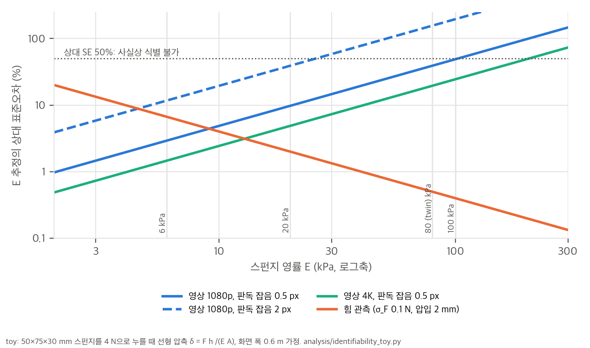
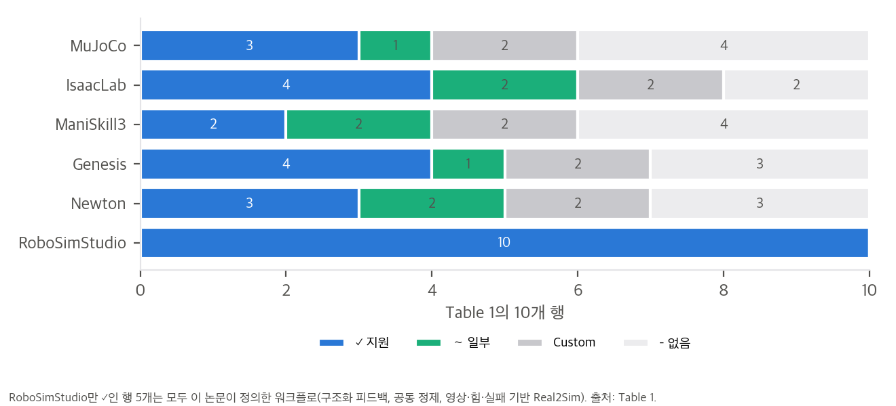

# 03. 수치 재계산과 toy 해석

스크립트는 `analysis/table_check.py`(결과 `table_check_results.json`)와 `analysis/identifiability_toy.py`(결과 `identifiability_toy_results.json`)입니다. 모두 numpy·scipy로 단일 스레드에서 1초 안에 끝납니다. 공식 데모 수치는 저장소 `examples/08_demos/wipe_the_bar/`(커밋 `81f57c9`)의 README와 `bar.py`에서 옮겼습니다.

## 1. Preston 마모: 공개 twin의 마커 줄 지우기 (C5)

공개 twin은 마커 줄을 2.5 mm 셀로 나누고, 각 셀의 잉크를 Preston 법칙으로 줄입니다.

```
d(ink)/dt = − k_p · p · v      (k_p = 1.2×10⁻² 1/(Pa·m), p < 300 Pa이면 마모 없음, ink ≤ 0.1이면 "clean")
```

- **주석 검산:** `bar.py`는 "4 N, 30 mm/s 스트로크면 셀 하나를 약 2초에 지운다"고 적었습니다. 4 N을 스펀지 면(50 × 75 mm)에 고르게 나누면 평균 압력이 1,067 Pa이고, 잉크 0.9를 지우는 데 0.9 / (k_p · p · v) = **2.34 s**가 걸립니다. 주석과 맞습니다.
- **한 스트로크의 마모는 속도와 무관합니다.** 스펀지 긴 변 L(75 mm)이 셀을 지나는 시간은 L / v이므로, 한 번 지날 때 마모량은 k_p · p · L입니다. 평균 압력이면 **0.96**이라 한 스트로크로 거의 지워집니다. 측정된 첫 스트로크 0.91과 같은 자릿수입니다.
- **최대 압력은 평균과 두 자릿수 차이가 납니다.** 측정 최대 압력은 84 kPa로 평균의 약 80배이고, 이 압력이면 셀 하나가 0.03초에 지워집니다. "닦인 비율"은 압력이 몰린 곳과 300 Pa 문턱 아래 띠의 비율에 따라 정해지는 지표입니다.
- **함의:** 네 번 닦아도 0.955–0.959에 머무는 것은 문턱 아래 띠와 접촉이 끊기는 셀 때문으로 보입니다(가설). 논문의 "닦인 면적 100%"는 GaP가 만든 다른 rollout의 값이라 직접 비교할 수 없습니다. 다만 같은 법칙과 문턱을 쓴다면 100%는 문턱 아래 셀이 하나도 없어야 나오는 값입니다.

## 2. 영상만으로 강성을 맞출 수 있는가 (식별성 toy)

논문은 사람이나 에이전트가 영상과 시뮬레이션을 **눈으로** 비교해 물성 값을 고친다고 씁니다(Sec. 4.1, 4.3). 가장 단순한 모델로 그 비교의 해상도를 계산했습니다.

- **모델:** 스펀지 면을 4 N으로 누를 때 선형 압축 δ = F h / (E A)입니다(A = 50 × 75 mm, h = 30 mm).
- **시각 관측:** 화면 폭이 0.6 m인 영상에서 δ를 픽셀로 읽습니다. 판독 잡음은 0.5 px와 2 px 두 경우입니다.
- **힘 관측:** 알려진 2 mm 압입에서 힘을 0.1 N 잡음으로 읽습니다.
- **표준오차:** 해석식은 SE_vision(E) = σ_δ · E² · A / (F h), SE_force = σ_F · h / (A · δ_c)이고, Monte Carlo로 확인했습니다. 20 kPa에서 해석 1.95 kPa, Monte Carlo 1.96 kPa입니다.

| E | 압축 δ | 1080p에서 | 4K에서 |
|---|---|---|---|
| 6 kPa | 5.33 mm | 17.1 px | 34.1 px |
| 20 kPa | 1.60 mm | 5.1 px | 10.2 px |
| 80 kPa (공개 twin) | 0.40 mm | 1.3 px | 2.6 px |
| 100 kPa | 0.32 mm | 1.0 px | 2.0 px |



- **영상으로는 E가 약 100 kPa를 넘으면 사실상 정해지지 않습니다.** 상대 SE가 50%를 넘는 경계는 1080p·0.5 px에서 104 kPa, 1080p·2 px에서 26 kPa, 4K·0.5 px에서 206 kPa입니다.
- **영상에서 구분되는 차이와 구분되지 않는 차이가 있습니다.** Fig. 7e의 20 kPa와 100 kPa는 1080p·0.5 px에서 5.8σ 차이라 구분됩니다. 반면 공개 twin의 80 kPa와 100 kPa는 0.36σ 차이라 영상으로는 같습니다.
- **힘 관측은 오차가 E와 무관하게 일정합니다(0.4 kPa).** 그래서 단단한 물체일수록 힘 관측이 유리하고, 무른 물체(10 kPa 미만)에서는 오히려 영상이 낫습니다.
- **해석:** 논문이 힘 피드백을 따로 둔 동기(Sec. 4.2 "관찰만으로는 접촉을 판단하기 어렵다")와 강성을 맞추는 대신 넓게 변형한 선택(Fig. 7e)을 정량적으로 뒷받침합니다. 반대로, 에이전트가 "영상과 맞는 시뮬레이션"을 만들었다는 주장은 기하와 운동에는 강하고 물성에는 약하다는 뜻입니다.
- **한계:** 선형 일축 압축, 고정 시야, 판독 잡음은 모두 가정입니다. 실제 영상의 원근, 가림, 흐림은 이보다 나쁩니다.

## 3. 강성과 잡기: 공개 twin이 80 kPa를 쓴 이유 (C6)

`bar.py`의 FOAM 주석에 따르면, 80 kPa 폼은 패드당 8.6–8.9 N으로 50 mm에서 45.5 mm로 눌립니다(변형률 9%). 이를 선형 탄성으로 보면 유효 패드 면적은 약 12 cm²입니다. 같은 조건에서 각 강성의 예상 변형률은 다음과 같습니다.

| E | 예상 변형률 | 저장소의 관찰 |
|---|---|---|
| 6 kPa | 120% (불가능, 완전히 눌림) | – |
| 20 kPa (영상 속 부엌 스펀지) | 36% | "패드 사이로 흘러나가 집게가 맞닿았다" |
| 80 kPa (공개 twin) | 9% | 잡히지만 마찰만으로는 닦는 동안 미끄러짐 → latch |
| 100 kPa | 7% | – |

선형 추정은 20 kPa에서도 잡힐 것처럼 보이지만, 실제 FEM에서는 큰 변형 때문에 폼이 흘러나갔습니다. 어느 쪽이든 **Fig. 7e의 6·20 kPa는 공개 twin의 집게 조건으로 스펀지를 들 수 없는 범위**입니다. GaP가 이 강성 변형에서 어떻게 닦았는지(latch를 썼는지)는 공개 자료로 알 수 없습니다.

## 4. GaP 곡선의 분모 (C2)

Fig. 1과 Fig. 7f의 값은 반복 0·9·11·14에서 0·29·71·100%입니다. 이 네 값이 k/n을 정수 %로 반올림해서 나오는 n을 60까지 찾으면 다음과 같습니다.

```
n = 7, 14, 17, 21, 24, 28, 31, 34, 35, 38, 41, 42, 45, 48, 49, 51, 52, 55, 56, 58, 59
```

**30은 없습니다.** 30개 배치의 성공 비율이라면 29% 대신 26.7%나 30.0%, 71% 대신 70.0%나 73.3%가 나와야 합니다. 따라서 이 곡선은 본문 말대로 닦인 면적 같은 연속량이거나, 30개가 아닌 다른 개수에 대한 비율입니다. Fig. 1의 y축 이름 "completion rate"는 성공률로 읽히기 쉬워서 오해의 여지가 있습니다.

## 5. Table 1의 구조 (C1)



RSS는 10개 행이 모두 ✓입니다. 다른 다섯 프레임워크는 2–4개입니다. RSS만 ✓인 행은 5개입니다(구조화된 에이전트 피드백, 사람-에이전트 공동 정제, 영상 기반·힘 피드백·실패 기반 Real2Sim). 모두 이 논문이 정의하고 구현한 워크플로입니다. 나머지 물리 기능 5행에서 RSS의 ✓는 대부분 Newton 위에서 물려받은 것입니다. 예를 들어 Newton 자체도 강체·변형체는 ✓이고 결합은 ∼입니다.
