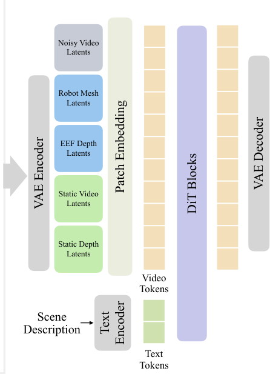
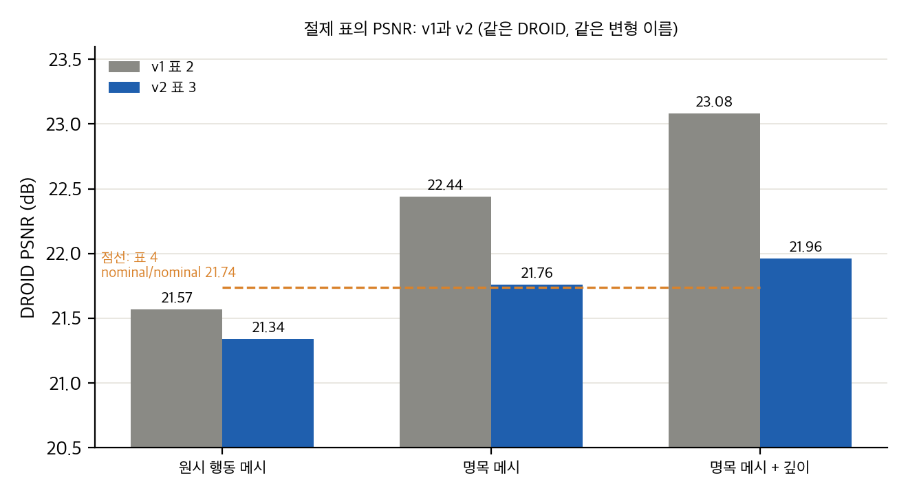
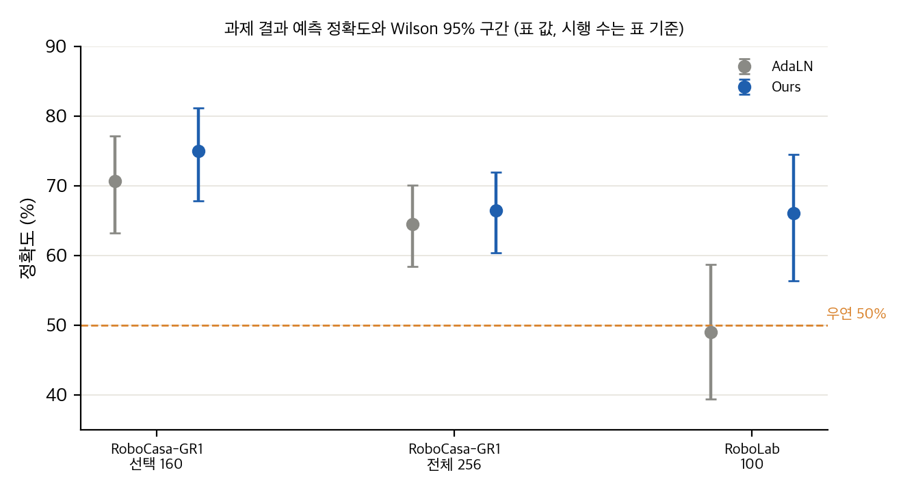
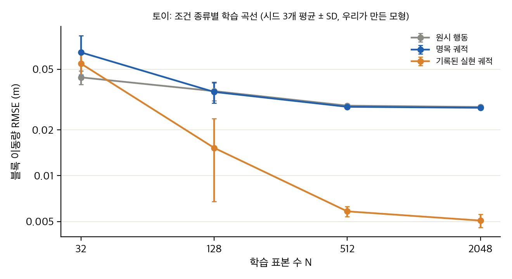

> **논문:** Byungjun Kim, Taeksoo Kim, Hyunsoo Cha, Hanbyul Joo. *Robot-Factored World Models via Robot Rendering.* CoRL 2026 포스터, arXiv:2607.22535 (v2, 2026-11-02).
> 공식 코드(Apache-2.0)는 정적으로만 읽었고 실행하지 않았습니다. 논문 그림은 CC BY 4.0이라 블록 다이어그램 한 장만 출처를 밝히고 실었고, 나머지 그래프는 우리가 그렸습니다.

## 논문이 묻는 것

행동 조건 영상 세계모델은 보통 관절이나 EEF 벡터를 조건층에 넣습니다. 그러면 모델은 두 가지를 함께 배웁니다. 하나는 제어 신호가 로봇 움직임으로 실현되는 과정이고, 다른 하나는 장면이 그 움직임에 반응하는 과정입니다. 이 논문은 앞의 것을 모델 밖으로 뺍니다.

행동열을 로봇 자체의 컨트롤러와 기구학으로 접촉 없이 굴려 **명목(nominal) 궤적**을 얻고, 이를 URDF 메시 RGB와 EEF 깊이 영상으로 렌더링합니다. 정적 장면 RGB·깊이와 함께 VAE로 인코딩해 Wan2.1-Fun 14B의 입력 채널에 이어 붙이고, 패치 임베딩과 LoRA(rank 64)만 학습합니다.

## 이 글에서 확인한 것

**1. 절제 표의 값이 v1과 v2에서 다릅니다.** 같은 DROID 설정의 PSNR이 원시 행동 메시 21.57 → 21.34 dB, 명목 메시 22.44 → 21.76 dB, 명목 메시 + 깊이 23.08 → 21.96 dB입니다. 깊이를 더한 이득은 +0.64 dB에서 +0.20 dB로 줄었고 SSIM은 0.874에서 0.856으로 내려가 본문 서술도 "세 지표 모두 개선"에서 "PSNR이 오르고 SSIM은 조금 낮다"로 바뀌었습니다. v1에서 표 2의 명목 행(22.44)과 표 4의 같은 설정(21.74)이 0.70 dB 달랐던 점은 v2에서 0.02 dB로 좁혀졌습니다. 값이 바뀐 이유는 v2에 적혀 있지 않아 저자 확인이 필요합니다.

**2. 과제 결과 예측은 RoboLab에서 검정을 통과합니다.** 생성 영상을 GPT-5.4가 판정해 성공·실패를 맞히는 실험입니다(표 2, 부록 E). RoboLab 49.0 대 66.0은 부록 E의 혼동 행렬로 맞짝 McNemar 정확검정이 p < 0.001입니다(같은 100개 클립에 두 모델을 적용했다고 가정). RoboCasa-GR1의 70.6 대 75.0은 160클립 기준 113 대 120클립의 차이이고 독립 Fisher p = 0.45입니다. 클립별 정오표가 없어 맞짝 검정은 불일치 클립이 9개 이하일 때만 p < 0.05가 됩니다. 판정자가 정답 영상에서 결과를 맞힌 209클립 안에서 고른 160클립이므로, 전체 256클립에서는 64.5 대 66.4로 차이가 줄어듭니다(p = 0.71). RoboLab의 AdaLN은 100개 중 1개만 성공이라고 답했고 정확도 49.0%는 "항상 실패"(50%)보다 낮습니다. Ours도 성공 영상 50개 중 18개를 성공으로 판정합니다.

**3. 벡터 기준선과 렌더 조건의 입력 정보량이 같지 않습니다.** DROID의 AdaLN은 프레임마다 7차원(EEF 위치, 오일러 각, 그리퍼)을 받습니다. 공식 코드에서 이 값은 Panda 정기구학으로 계산한 베이스 좌표의 플랜지 포즈이고 카메라 정보는 들어가지 않습니다. 렌더 조건은 팔 전체 링크 형상과 카메라에 정렬된 이미지 좌표를 봅니다. 그래서 표 1의 +3.30 dB(DROID)는 시각 표현의 이득과 입력 정보량의 차이가 섞여 있다고 읽는 것이 안전합니다. 논문도 "벡터는 추가 grounding을 배워야 한다"고 쓰는데, 정보량을 맞춘 벡터 기준선(관절 전체와 카메라 외부 파라미터 포함)과의 비교는 본문에 없습니다.

**4. 명목 궤적은 정보를 더하지 않고, 기록된 상태는 결과를 담습니다.** 식 1의 q는 행동열과 초기 상태의 결정적 함수라서 q를 조건으로 주는 것은 정보를 늘리지 않습니다. 이득은 모델이 컨트롤러 역학을 배우지 않아도 된다는 학습 편의와, 원시 행동이 실제 팔보다 앞서가 화면 정렬이 어긋나는 문제를 피하는 시간 정렬에서 나옵니다. 반면 표 4에서 기록된 상태로 학습·추론한 오라클은 배포 가능한 설정보다 DROID 0.63 dB, RoboCasa-GR1 2.56 dB 높습니다. 우리가 만든 1차원 토이에서도 같은 방향이 나왔습니다. 원시 행동과 명목 궤적을 조건으로 준 예측기의 RMSE는 학습 표본 128개 이상에서 거의 같았고(512개에서 0.0288 대 0.0283), 기록된 실현 궤적을 주면 약 0.005로 내려갔습니다. 이 결과는 모형 구성상 당연하며 방향을 확인하는 용도입니다.

**5. 공식 코드는 논문의 핵심 전처리 하나와 평가 전체를 담지 않습니다.** 저장소(Apache-2.0, 커밋 `f9504d0`)에는 Wan2.1 학습·추론, RoboCasa 명목 상태 추출, 메시 렌더링 스크립트가 있습니다. DROID 명목 궤적을 만드는 Isaac Lab 재생 스크립트는 없고, 학습 로더는 미리 만든 관절 파일을 읽습니다. PSNR/SSIM/LPIPS, 로봇 제외 평가, 판정자, SVD 기준선, RoboTwin·HRDexDB 전이 평가도 저장소에서 확인되지 않았습니다. 공개 체크포인트는 8,000 스텝이고 RGB용은 DROID만, 깊이용은 DROID + RoboCasa로 학습되어 문서가 "일치하는 절제가 아니다"라고 밝힙니다. 그래서 공개 자료만으로 표 3의 절제를 다시 만들 수 없습니다.

**6. 코드에만 보이는 학습 설정이 있습니다.** 설정 파일에 EEF 깊이 드롭아웃 0.1과 텍스트 드롭아웃 0.1이 있고, 새 패치 임베딩 채널은 0으로 초기화되며, 정적 깊이는 역깊이로 바꿔 0.2–3.0 m로 잘라 16비트로 정규화합니다. 논문 본문과 부록에는 이 값들이 서술되어 있지 않습니다.

**7. 보지 못한 로봇으로의 영점 전이 결과는 도메인 변화와 함께 읽어야 합니다.** HRDexDB에서 Ours 영점(PSNR 21.00)이 타깃 로봇 575클립으로 미세조정한 AdaLN(19.29)보다 높고, RoboTwin의 두 로봇에서 AdaLN 대비 +3.98, +5.44 dB입니다(표 5). 다만 RoboTwin 전이는 시뮬레이터가 함께 바뀌고, AdaLN은 DROID로 학습된 입력 슬롯에 새 로봇의 EEF 포즈를 그대로 넣는 설정입니다(부록 D).

## 구현 가능성

이 맥(Apple M4 Pro, 약 24 GiB, MPS, CUDA 없음)에서는 논문 수치의 재현이 불가능합니다. Wan2.1 14B 가중치만 bf16으로 약 26 GiB이고, 공식 학습 설정은 GPU 4장과 DeepSpeed ZeRO-2(CPU 오프로드)입니다. DROID 명목화 코드와 평가 코드는 저장소에 없습니다. 표 재계산, 정적 코드 대조, 작은 토이는 CPU로 끝냈습니다. MuJoCo 푸시 환경과 소형 확산 모델로 "벡터 대 렌더 조건"을 비교하는 축소판은 조건부로 가능하며, 노력은 1–2주로 추정합니다(처리량은 측정하지 않았습니다).

## 저자에게 물어볼 것

- 표 3 변형과 표 1 모델의 학습 스텝 수, 그리고 공개 8,000 스텝 체크포인트와의 관계.
- v1 표 2에서 v2 표 3으로 값이 바뀐 이유.
- AdaLN 기준선이 카메라 정보를 받았는지, EEF 포즈를 어느 좌표계로 주었는지.
- RoboCasa-GR1 160클립의 클립별 정오표와 RoboLab 정답 영상에서의 판정 정확도.
- DROID 명목 궤적 생성 코드(또는 명목 파일)와 평가 스크립트의 공개 계획.

## 표현 방식에 대하여

시행 수를 논문이 밝히지 않은 곳(학습 GPU 4장, 클립 256개)은 가정이라고 표시했습니다. 이 글의 지적은 표와 서술에 대한 것이며 저자 확인이 필요한 항목은 위에 모았습니다.

## 자료

- [통합 리포트 PDF](report/report_public.pdf)
- [01. 논문 분석: Robot-Factored World Models via Robot Rendering (RoFacto)](analysis/01_paper_analysis.md)
- [02. 선행연구와 가까운 대안](analysis/02_prior_work.md)
- [03. 수치 재계산과 해석](analysis/03_analysis.md)
- [04. 논문 ↔ 공식 코드 대조](analysis/04_code_verification.md)
