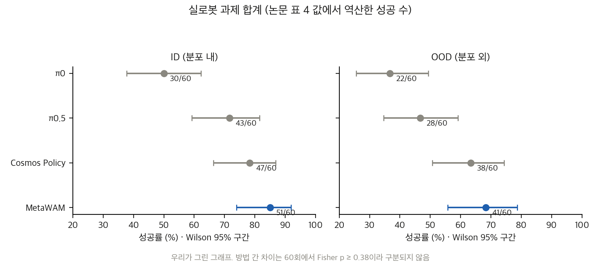
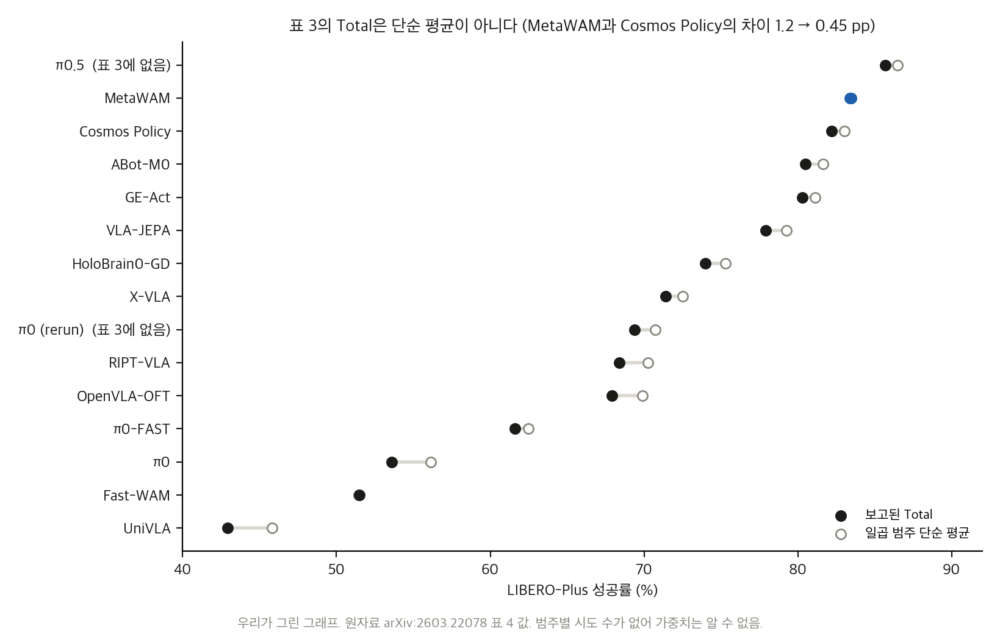
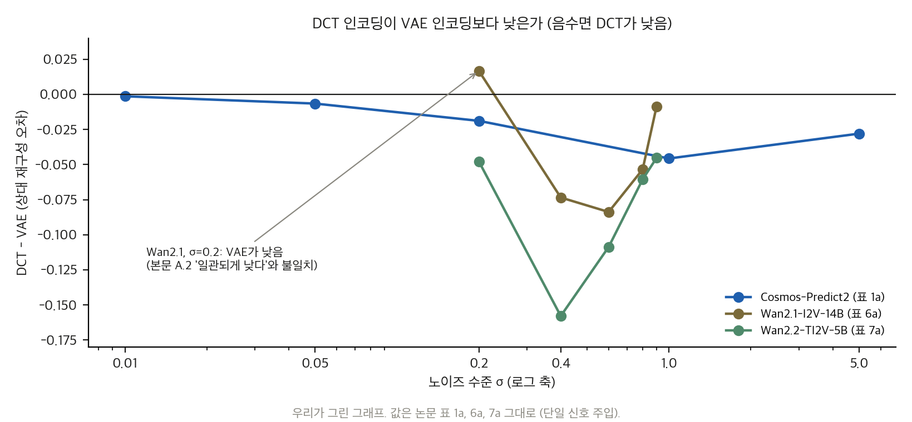

> **논문:** Guoqiang Liang, Yiqi Lin, Yanzhe Chen, Kevin Yuchen Ma, Mike Zheng Shou. *From Video Frames to Robot Meta-Frames: A Unified Latent Interface for World Action Models.* CoRL 2026 포스터, arXiv:2611.14365 (v1, 2026-11-10).
> 공식 코드는 GitHub showlab/MetaWAM (Apache-2.0)에 있습니다. 이 글의 그림은 모두 우리가 그린 그래프입니다. 논문 그림은 넣지 않았습니다.

## 논문이 묻는 것

영상 확산 모델 위에 로봇 행동을 얹는 WAM에서, 고유감각·행동·과제·가치 같은 저차원 신호를 어떻게 잠재 공간에 넣을지는 흔히 형식의 문제로 취급됩니다. 기존 방식은 신호마다 잠재 프레임을 하나씩 쓰거나 (프레임 수가 늘어남), 전용 인코더와 디코더를 붙입니다.

MetaWAM은 이것을 **분포 정렬 문제**로 봅니다. 주입된 잠재가 사전학습 영상 모델의 자연 영상 분포에 가까울수록 디노이저가 덜 고친다는 진단을 세우고, 신호를 채널 대역에 나눠 DCT 계수로 싣는 방식을 제안합니다. 읽기는 학습 없이 역변환으로 합니다. 프레임은 11개에서 8개로 줄고, RoboCasa 지연은 39% 줄었다고 보고합니다.

## 무엇이 맞고 무엇이 약한가

**수치와 산술.** 프레임 11 → 8과 어텐션 약 47% 감소, 지연 39% 감소는 표 값과 맞습니다. 공식 코드의 슬롯 배치, Huber δ, 배치 크기도 논문 식과 맞습니다.

**통계.** 가장 큰 문제는 차이의 크기입니다.

*그래프: 우리가 그린 그래프. 논문 표 4 값에서 역산한 성공 수와 Wilson 95% 구간 (과제당 20회 × 3).*

실로봇 ID 차이 (85.0% 대 78.3%)는 60회에서 Fisher p = 0.48입니다. 이 표본에서 구분할 수 있는 최소 차이는 약 22 pp입니다. RoboCasa 차이 (68.9% 대 67.1%)도 독립 가정에서 p = 0.11입니다. 시드와 과제에 묶인 분산은 논문에 없어 넣지 못했고, 그 경우 더 약해집니다.

**기준선 표.** LIBERO-Plus 표의 Total은 일곱 교란 범주의 단순 평균이 아닙니다. 보고된 차이는 1.2 pp지만 단순 평균으로는 0.45 pp입니다. 원자료의 π0.5 (Total 85.7)도 표에 없습니다.

*그래프: 우리가 그린 그래프. 표 3의 보고된 Total과 단순 평균 (원자료 arXiv:2603.22078 표 4 값).*

**인코딩 비교.** 부록의 Wan 백본 실험은 "DCT가 일관되게 낮다"고 씁니다. Wan2.1에서 σ = 0.2일 때는 VAE 쪽이 낮습니다. 나머지 조건은 대체로 맞습니다.

*그래프: 우리가 그린 그래프. 논문 표 1a, 6a, 7a 값 그대로 (음수면 DCT가 낮음).*

## 식 수준에서 확인한 것

채널 대역을 행 0 (k_H = 0)의 DCT 슬롯에 쓰고 정규직교 역변환으로 공간 잠재를 만드는 설계는 잡음이 없으면 정확히 되돌아옵니다. 다만 행 0만 쓰면 각 채널은 열 방향 자유도만 가집니다. 행동 대역은 RoboCasa 청크 (32 × 7 = 224)에서 용량이 꽉 찹니다. 디노이저가 틀리면 그 오차는 그대로 신호 오차가 됩니다.

## 재현 가능성

이 설계를 맥에서 재현하는 것은 대부분 불가능합니다. 학습은 GPU 4장으로 64시간쯤 걸리고, 공식 코드는 CUDA 전용 커널에 의존합니다. 공식 체크포인트의 추론만 MPS 포팅을 거쳐 조건부로 가능합니다. 논문의 학습률은 10^-6이라고 적혀 있지만 공식 설정은 1e-4입니다. 실제 값을 확인하기 전에는 결과를 그대로 옮기기 어렵습니다.

## 정리

- 차이는 방향만 맞고 통계로는 구분되지 않습니다.
- 기준선 표의 Total 정의와 최고 기준선 생략을 확인해야 합니다.
- 인터페이스 아이디어 (신호 대역, 분석적 역변환)는 가져다 쓸 만하지만, 행 0 설계의 용량 한계를 먼저 계산해야 합니다.

## 자료

- [통합 리포트 PDF](report/report_public.pdf)
- [논문 분석: From Video Frames to Robot Meta-Frames (arXiv:2611.14365)](analysis/01_paper_analysis.md)
- [선행연구와 공식 저장소](analysis/02_prior_work.md)
- [재계산, 일관성 점검, 토이 검사, 주장 판정](analysis/03_analysis.md)
- [공식 코드 대조 (논문 ↔ 저장소)와 구현 가능성](analysis/04_code_verification.md)
