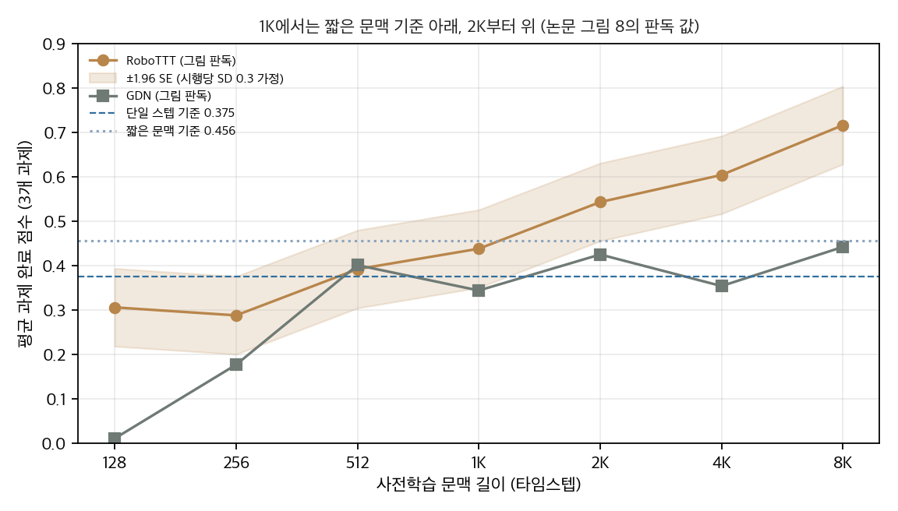
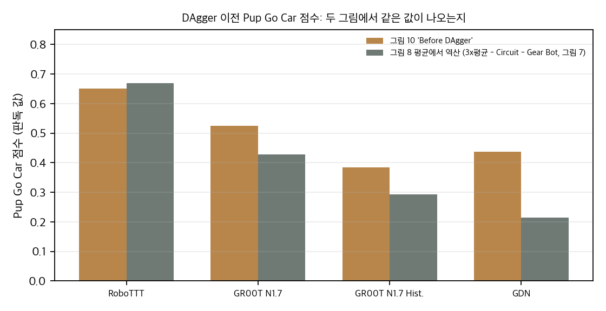
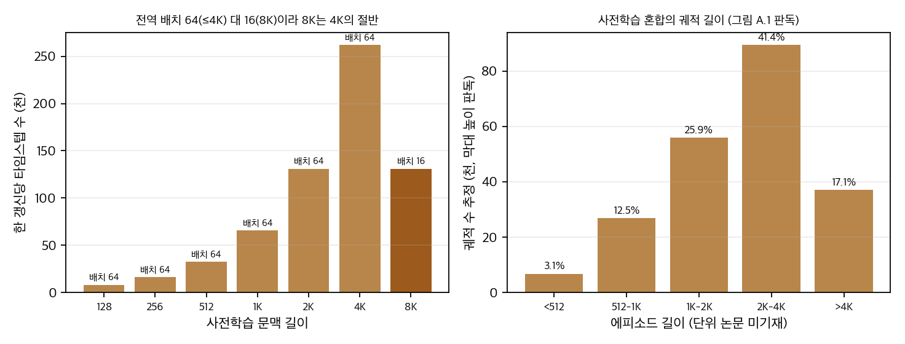

# 03. 수치 재계산과 해석: RoboTTT (arXiv:2607.15275)

모든 계산은 `analysis/recompute.py`(numpy, scipy, 1초 미만)이고 결과는 `analysis/recompute_results.json`에 있습니다. 그래프는 `analysis/plot_figures.py`가 그립니다. 확인 항목 번호는 V1–V13입니다.

**입력의 종류.** (a) 논문 본문과 표 1–3의 성공 횟수는 인쇄된 값입니다. (b) 그림 7, 8, 10, 12, A.1의 값은 PDF의 벡터 막대와 선의 좌표에서 읽은 값입니다("그림 판독 값", 오차 약 ±0.005). 막대 높이는 본문에 적힌 값(RoboTTT 평균 79%, GR00T 42%, GDN 56%, Hist Pup Go Car 39.5%, GR00T Pup Go Car 57%)에 맞춰 눈금을 보정했고 보정 후 다른 본문 값(그림 8 선의 71.5%, 43.9%, 45.6%)과 ±0.003 안에서 일치했습니다. 그림 10은 RoboTTT Distillation 막대를 그림 7 Pup Go Car 값(0.886)과 같다고 두고 눈금을 정했으며, 독립 확인으로 GR00T 0.566(본문 57%)과 Hist. 0.392(본문 39.5%)가 맞았습니다. 그림 12는 전체 모델 막대를 그림 10의 Before DAgger(0.650)와 같다고 둔 절대값이고, 본문의 23%, 18%, 27%는 눈금과 무관한 비율로 확인했습니다. (c) 시행별 점수는 논문에 없어서 점수 차의 검정은 가정을 적은 근사입니다.

## 1. 표 1 완전 성공 횟수 (V1)

| 방법 | Pup Go Car (/20) | Circuit (/20) | Gear Bot (/10) | 합계 (/50) | 비율, Wilson 95% |
|---|---|---|---|---|---|
| RoboTTT | 9 | 13 | 2 | 24 | 48%, [35%, 61%] |
| GR00T N1.7 | 3 | 3 | 0 | 6 | 12%, [6%, 24%] |
| GR00T N1.7 Hist. | 0 | 8 | 0 | 8 | 16%, [8%, 29%] |
| GDN | 3 | 8 | 0 | 11 | 22%, [13%, 35%] |

과제별 Fisher 정확검정(양측, RoboTTT 대비)과 Holm 보정(9개 비교):

| 비교 | Pup Go Car | Circuit | Gear Bot |
|---|---|---|---|
| 대 GR00T N1.7 | p = 0.082 (Holm 0.58) | p = 0.003 (Holm 0.025) | p = 0.47 (1.0) |
| 대 Hist. | p = 0.001 (Holm 0.011) | p = 0.20 (1.0) | p = 0.47 (1.0) |
| 대 GDN | p = 0.082 (Holm 0.58) | p = 0.20 (1.0) | p = 0.47 (1.0) |

세 과제를 합친 Fisher(시행 50회): 대 GR00T p = 0.00015, 대 Hist. p = 0.0011, 대 GDN p = 0.011.

해석.
- "모든 과제에서 가장 많은 완전 성공"(§4)은 표 1에서 맞습니다(9, 13, 2가 각 열의 최대). 다만 과제별로 보면 Holm 보정 후 구별되는 쌍은 Pup Go Car 대 Hist.와 Circuit 대 GR00T 두 개이고, 나머지 일곱 쌍은 시행 20회(Gear Bot은 10회)로는 구별되지 않습니다. 합친 검정에서는 세 기준선 모두와 구별됩니다(과제를 독립 시행으로 합침). 초기 배치를 모든 방법에서 같게 했으므로(부록 B.2) 시행이 쌍을 이룰 가능성이 있고, 그 경우 쌍체 검정이 더 민감하지만 시행별 데이터가 없어 계산하지 못했습니다.
- **Gear Bot "어떤 기준선도 완전 성공하지 못한다"(초록, §4).** 표 1과 일치합니다. 기준선 0/10의 Clopper-Pearson 95% 상한은 30.8%이고 RoboTTT 2/10의 Wilson 95% 구간은 [5.7%, 51%]라서, 구간이 크게 겹칩니다(Fisher p = 0.47). 가장 긴 과제의 결과는 방향은 같지만 이 시행 수로 확정하기는 어렵습니다.
- 5분 과제의 이 시행 수는 평가 시간 때문임을 논문이 밝힙니다(부록 B.2).

## 2. 표 2·3과 점수의 가능 범위 (V2, V3, V5, V6)

**표 2 (Circuit 일회 모방, 10회).** RoboTTT 6/10(Wilson [31%, 83%]) 대 GDN 0/10, Fisher p = 0.011. 구성은 같은 문장("assemble circuit")을 쓰고 목표가 영상에만 있다는 점이 설계의 강점입니다(§4). 시행 수 10이라 구간은 넓고, 같은 과제의 언어 지정 결과(표 1의 13/20 = 65%)와 비교하면 일회 모방 6/10(60%)은 비슷한 수준이지만, 시행 수와 구성 집합이 다르므로(표 1은 미관측 60개 구성에서, 표 2는 영상 조건) 직접 비교하지 않았습니다.

**표 3 (교란 복구).**

| 방법 | 지붕 | 타이어 | 합계 (/40) | Wilson 95% | Fisher 대 RoboTTT (합계) |
|---|---|---|---|---|---|
| RoboTTT | 15/20 | 18/20 | 33 (82.5%) | [68%, 91%] | |
| GR00T N1.7 | 10/20 | 11/20 | 21 (52.5%) | [38%, 67%] | p = 0.008 |
| Hist. | 3/20 | 5/20 | 8 (20%) | [11%, 35%] | p < 0.001 |
| GDN | 13/20 | 18/20 | 31 (77.5%) | [63%, 88%] | p = 0.78 |

- 초록·서론의 "83% 대 53%"는 합계 33/40과 21/40(82.5%, 52.5%)과 일치하고, 비교 대상은 GR00T N1.7입니다. 같은 합계에서 GDN은 77.5%로 RoboTTT와 구별되지 않습니다(p = 0.78). 본문(§4)도 "지붕 15/20 대 GDN 13/20", "타이어 둘 다 18/20"로 적고 있어 서술과 표는 일치합니다. 서론의 "best short-context baseline"은 GR00T N1.7이고 GDN(1K 문맥)은 짧은 문맥 기준선이 아니라는 구분이 읽는 쪽에는 분명하지 않을 수 있습니다.
- 교란 데이터 30분을 과제 데이터와 함께 학습했다고 밝혔습니다(§4). 모든 방법이 영향을 받았다는 서술이 있습니다.

**점수의 가능 범위 (V5).** 루브릭(부록 B.1)에서 완전 성공 바로 아래 최대 점수는 Pup Go Car 0.9, Gear Bot 0.9, Circuit 0.75(세 조각과 스위치)입니다. 표 1의 완전 성공 횟수 k와 시행 수 n에서 평균 점수의 범위는 [k/n, (k + (n−k)·최대)/n]인데, 그림 7에서 읽은 12개 평균이 모두 이 범위 안에 있습니다(예: RoboTTT Pup Go Car 범위 [0.45, 0.945], 판독 0.886). 한 가지는 읽을 만합니다. RoboTTT Pup Go Car는 9회가 완전 성공이고 나머지 11회의 평균이 0.79입니다. 점수 0.6 이하인 시행이 최대 4회라면 맞출 수 있으므로, 비완전 11회 중 7회 이상이 바퀴 삽입 단계(0.75) 이상까지 갔다는 뜻입니다. Pup Go Car 점수는 이 과제에서 "완전 성공 직전"에 몰려 있어 점수 상한 근처 압축이 있을 수 있습니다.

**점수 차의 근사 검정 (V6).** 시행별 점수가 없어, 평균 m인 [0, 1] 변수의 표준편차 상한 √(m(1−m))를 쓴 보수적 z와 시행당 SD 0.3 가정의 z를 계산했습니다.

| 비교 (그림 7 판독) | 점수 차 | z (SD 상한) | z (SD 0.3 가정) |
|---|---|---|---|
| RoboTTT 대 GR00T, Pup Go Car | +0.32 | 2.4 | 3.4 |
| 대 GR00T, Circuit | +0.55 | 4.1 | 5.7 |
| 대 GR00T, Gear Bot | +0.24 | 1.1 | 1.8 |
| 대 Hist., Pup Go Car | +0.49 | 3.8 | 5.2 |
| 대 Hist., Circuit | +0.24 | 1.6 | 2.5 |
| 대 Hist., Gear Bot | +0.17 | 0.8 | 1.3 |
| 대 GDN, Pup Go Car | +0.32 | 2.4 | 3.4 |
| 대 GDN, Circuit | +0.25 | 1.7 | 2.6 |
| 대 GDN, Gear Bot | +0.12 | 0.6 | 0.9 |

세 과제 중 Gear Bot의 점수 차는 어느 가정에서도 구별 기준(|z| ≈ 2)에 이르지 못합니다. 평균 79% 대 56%(GDN)의 큰 격차는 Pup Go Car와 Circuit에서 나옵니다.

## 3. 그림 8: 사전학습 문맥 길이 (V7)

그림 판독 값(평균 점수): RoboTTT 0.306, 0.288, 0.392, 0.438, 0.543, 0.604, 0.716 (128, 256, 512, 1K, 2K, 4K, 8K). GDN 0.011, 0.177, 0.401, 0.344, 0.425, 0.354, 0.442. 기준선: 단일 스텝 0.375, 짧은 문맥 0.456.

- **추세는 뚜렷합니다.** log2(길이)에 대한 선형 회귀: 128–8K 기울기 0.072/배, r2 = 0.96; 1K–8K 기울기 0.090/배, r2 = 0.99. GDN은 128–8K에서 0.060/배(r2 = 0.67)이지만 512–8K에서는 0.009/배(r2 = 0.11, p = 0.58)로 평평합니다. "GDN에서는 이득이 없다"는 서술은 512 이상에서 맞고, 128–512의 상승은 짧은 문맥에서 오릅니다.
- **1K 지점.** 본문은 RoboTTT 8K 71.5%, 1K 43.9%, 짧은 문맥 45.6%를 적습니다. 43.9 < 45.6이므로 1K에서는 RoboTTT가 짧은 문맥 기준선보다 0.018 낮고, 기준선을 넘는 첫 지점은 2K(0.543, +0.087)입니다. 그림 8 캡션의 "surpassing the best short-context baseline from 1K onward"와 본문의 숫자가 이 지점에서 다릅니다. 차이 0.018은 아래 표준오차(0.05–0.08)보다 작아 "1K에서 같은 수준"으로 읽는 편이 정확합니다.
- **"1K 미만에서도 GDN보다 낫다"(§4).** 128(+0.295), 256(+0.111)은 맞고 512는 −0.009(GDN 0.401 대 RoboTTT 0.392)로 같은 수준입니다.
- **중간 점의 불확실성(시행당 SD 0.3 가정).** 세 과제 20/20/10회의 평균 점수 표준오차는 0.045, 차의 표준오차는 0.063입니다(SD 0.25–0.40이면 0.053–0.084). 1K에서 8K로의 +0.278은 z = 3.3–5.3으로 구분됩니다. 반면 인접한 두 길이 사이의 증가(1K 이후 평균 +0.09, z ≈ 1.1–1.8)는 단독으로는 구분되지 않습니다. "꾸준히 오른다"는 서술은 전체 추세로는 지지되고 점 하나하나의 순서로는 지지되지 않습니다. 각 점이 몇 개의 학습 시드인지 본문에 없으며 오차 막대도 없습니다.
- **128 대 256.** RoboTTT가 0.306에서 0.288로 내려갑니다(−0.018). 본문은 "steady"라고 쓰고 이 점은 언급하지 않습니다.
- **그림 8과 그림 7·10을 합친 값(V7, 그림 판독 값).** 그림 8 평균 0.716은 (그림 10 Before DAgger 0.65 + 그림 7 Circuit 0.775 + Gear Bot 0.705)/3 = 0.710과 0.006 차이로 맞습니다. 캡션이 말한 "DAgger 이전" 값으로 그림 8을 만들었다는 설명과 일관됩니다. 기준선은 다릅니다.

| 방법 | 그림 8 평균 | 그림 10 이전·그림 7 두 과제로 만든 평균 | 차 | 그림 8에서 역산한 Pup Go Car | 그림 10 Before DAgger |
|---|---|---|---|---|---|
| RoboTTT (8K) | 0.716 | 0.710 | +0.006 | 0.668 | 0.650 |
| GR00T N1.7 | 0.375 | 0.407 | −0.032 | 0.428 | 0.524 |
| GR00T N1.7 Hist. | 0.456 | 0.487 | −0.031 | 0.293 | 0.385 |
| GDN (8K) | 0.442 | 0.516 | −0.074 | 0.214 | 0.437 |

세 기준선은 그림 8에서 역산한 Pup Go Car가 그림 10의 "Before DAgger"보다 0.09, 0.09, 0.22 낮습니다(판독 오차 ±0.01보다 큽니다). Circuit과 Gear Bot 값이 그림 7과 그림 8에서 같다는 가정에 따른 계산이고, 기준선이 별도 평가 회차에서 나왔거나 사전학습 문맥이 달랐을 가능성이 있습니다. 논문만으로는 구분되지 않으므로 저자 확인이 필요합니다(`04` C9).

- **8K 대 1K 비율.** 71.5/43.9 = 1.629이므로 서론의 63%와 일치하고 초록의 62%는 이 값(62.9%)을 내림한 표기로 읽힙니다. 비교의 기준인 1K 사전학습 값 43.9%는 짧은 문맥 기준선 45.6%보다 낮아서, "1K 대비 +63%"와 "짧은 문맥 대비 +57%"는 서로 다른 기준입니다.

## 4. DAgger Distillation (그림 10, V8, V13)

그림 판독 값(Pup Go Car):

| 방법 | Before | 교정만 | 전체 궤적 | Distillation |
|---|---|---|---|---|
| RoboTTT | 0.650 | 0.720 | (없음) | 0.886 |
| GDN | 0.437 | 0.506 | (없음) | 0.563 |
| GR00T N1.7 | 0.524 | 0.566 | 0.566 | 적용 불가 |
| Hist. | 0.385 | 0.392 | (없음) | 적용 불가 |

- 본문의 "9%, 13%, 33%, 36%, 29%"는 모두 **Before 대비 상대 향상**입니다. 교정만: RoboTTT +10.8%, GDN +15.8%, GR00T +8.0%, Hist +1.8%, 평균 9.1%, 시퀀스 두 모델 13.3%. Distillation: RoboTTT +36.3%, GDN +28.8%, 평균 32.5%. 본문 값과 일치합니다. 절대 점수로는 RoboTTT +0.07(교정만)과 +0.236(Distillation), GDN +0.069와 +0.126입니다.
- GR00T 전체 궤적 0.566과 교정만 0.566이 같다는 서술("57% for both")은 막대 높이가 같아 확인됩니다.
- **그림 7과 그림 10의 연결.** 그림 7의 Pup Go Car 값은 그림 10의 사후 값과 같습니다(RoboTTT 0.886 = Distillation, GDN 0.564 ≈ Distillation 0.563, GR00T 0.566 = 교정만, Hist 0.392 ≈ 교정만 0.392). 즉 그림 7의 RoboTTT·GDN은 Distillation, GR00T·Hist는 교정만 쓴 값입니다. DAgger 이전 값으로 평균을 만들면 RoboTTT 0.710 대 GR00T 0.407(+74%), Hist 0.487(+46%), GDN 0.516(+38%)이고, 그림 7 그대로는 +87%, +61%, +41%입니다. 헤드라인 "87%"(그림 7)는 RoboTTT에만 적용되는 Distillation과 같은 100개 궤적 DAgger 데이터를 포함한 비교입니다. 기준선도 그 데이터로 교정만 학습했다는 점은 공정하지만, Distillation은 시퀀스 모델에만 가능한 방법이라 "RoboTTT 구조의 이득"과 "DAgger Distillation의 이득"이 평균 79%에 섞여 있습니다.
- **데이터 구성.** DAgger 풀 100개 중 50개는 RoboTTT로, 50개는 GR00T N1.7로 수집했습니다(§4). RoboTTT 자신의 실패가 풀의 절반이고, GDN과 Hist의 실패는 없습니다. 기본 시연은 평균 2분 기준 약 240개(8시간÷2분, 추정)이므로 DAgger 100개는 Pup Go Car 데이터를 약 30% 늘립니다. 모든 방법이 같은 100개를 쓰지만, 어느 정책의 실패가 풀에 있는지가 방법마다 같지 않다는 점이 이득의 일부일 수 있습니다.
- **빠진 대조군.** 그림 10에서 시퀀스 모델(RoboTTT, GDN)은 "전체 궤적, 손실도 모든 행동에 거는" 조건이 없습니다(GR00T만 있음). 마스킹의 효과를 "손실 가림" 대 "문맥 포함"으로 가르려면 이 조건이 필요합니다. 그림 10에는 시행 수, 오차 막대, 시드가 없고, 본문은 Pup Go Car 점수에서 20회 시행이라고만 합니다.
- 성공 횟수 기준: RoboTTT Pup Go Car 9/20(Distillation 후), 같은 모델의 Distillation 전 완전 성공 횟수는 보고되지 않았습니다. 점수 향상이 완전 성공으로 이어졌는지는 이 논문 값으로 알 수 없습니다.

## 5. 절제 (그림 12, V9)

판독 값(Pup Go Car, 전체=0.65로 보정, 이 값은 그림 10 Before의 0.650과 같음): No Seq. Action Forcing ≈ 0.01, TTT Linear 0.477, State Tokens 0.447, +Action Tokens 0.551, +Register Tokens 0.650, GR00T N1.7 + 레지스터 0.434.

- 본문의 23%(0.551/0.447 = +23.3%), 18%(0.650/0.551 = +18.0%), 27%(1 − 0.477/0.650 = 26.6%)가 재계산과 일치합니다.
- **레지스터 비교.** "레지스터는 GR00T에 도움이 안 된다"는 근거: GR00T + 레지스터 0.434 대 GR00T 0.524(그림 10 Before). 즉 하락(−0.09)입니다. 같은 막대 눈금으로 보정했고 GR00T 비교값은 그림 10의 것이어서 같은 시험 회차인지는 알 수 없습니다.
- **TTT Linear 0.477 대 State Tokens 0.447.** 선형 고속 모델이 "State Tokens만 TTT" 개발 단계 점수(0.447)와 같은 수준이고 GR00T N1.7 단독(0.524, 그림 10)보다는 낮습니다. 본문은 "TTT-linear은 GR00T N1.7 기준선보다 낫다"(Fig. 12 서술)고 쓰는데, 그림 12의 GR00T N1.7 + 레지스터(0.434)와의 비교라면 맞고 그림 10의 GR00T(0.524)와의 비교라면 반대입니다. 어느 기준선인지 표기가 필요합니다.
- 절제의 시행 수와 시드는 본문에 없습니다. Pup Go Car만 다룹니다.

## 6. 시간과 규모의 산술 (V10, V12)

| 항목 | 계산 | 값 |
|---|---|---|
| 8K 타임스텝 (30 Hz) | 8192 / 30 | 273초 = 4.55분 (본문 "over four minutes", "about five minutes") |
| 1K | 1024 / 30 | 34초 ("about half a minute") |
| 128 | 128 / 30 | 4.3초 ("a few seconds") |
| 평균 에피소드 | 2분, 1분, 5분 | 3600, 1800, 9000 스텝 |
| Gear Bot 대 8K | 9000 / 8192 | 1.1배 (평균 에피소드가 8K보다 약간 김) |
| 사후학습 1K 대 Gear Bot | 1024 / 9000 | 11% |
| 일회 모방 시퀀스 | 사람 영상 1분 + 로봇 1분 | 3600 스텝 (사후학습 1K보다 김) |
| 파라미터 | 538M + 16 x 10M | 698M (본문 690M, 층당 9.5M이면 일치) |

**배치와 문맥 길이의 교란 (사전학습 설정, 부록 A.2).**

| 문맥 길이 | 전역 배치 | 갱신당 타임스텝 | 30K 스텝의 시퀀스 수 |
|---|---|---|---|
| 128 – 4K | 64 | 8K – 262K | 192만 |
| 8K | 16 | 131K | 48만 |

8K 지점만 전역 배치가 16이므로 갱신당 시퀀스가 4배 적고, 갱신당 타임스텝 수는 4K(262K)보다 적습니다. 문맥 길이와 배치 크기가 같이 바뀐 것이라, 그림 8의 마지막 구간(4K→8K, +0.112)이 문맥 길이만의 효과라고 읽기 어렵습니다. 반대 방향으로 이 변경이 8K에 불리했다면 효과가 더 크다는 뜻이기도 하지만 어느 쪽인지 본문에서는 알 수 없습니다.

**데이터 분포(그림 A.1 판독).** 사전학습 혼합은 약 21.6만 궤적(막대 높이 판독, ±5%)이고 4K 초과가 17.1%(약 3.7만), 2K–4K가 41.4%(약 8.9만)입니다. 단위는 그림에 없습니다(타임스텝으로 읽음). 8K 문맥이 의미를 가지려면 8K 이상 궤적이 필요한데 그 비율은 17.1%의 일부이고 따로 보고되지 않습니다. 문맥 길이 이상의 시퀀스는 전체 궤적이거나 "연속 부분 궤적"이라고 쓰여 있어(§3.2), 8K 사전학습에서도 대부분의 시퀀스는 8K보다 짧을 수 있습니다. 또 30K 스텝은 전역 배치 64에서 192만 시퀀스(약 8.9 에폭), 배치 16에서 48만 시퀀스(약 2.2 에폭)입니다.

## 7. 비용 모델: 상태 크기 대 KV 캐시 (V11)

"추론 지연이 문맥에 따라 커지지 않는다"(초록)를 가정 아래 계산했습니다. 가정: d = 1536(공개 GR00T N1.7 설정의 DiT 내부 차원 32 x 48), 16층, bf16, 고속 MLP 은닉 = d 또는 d/2(논문 미기재), 시간 축 토큰 = 레지스터 16 + 상태 1 + 행동 H.

| H | 타임스텝당 토큰 | 8K 전체 KV 캐시 | 청크 스트라이드(8K/H 항목) KV 캐시 | 고속 가중치 (은닉 d / d/2) | 8K 동안 갱신 횟수 | 갱신당 계산 (6PT 근사) |
|---|---|---|---|---|---|---|
| 16 | 33 | 26.6 GB | 1.7 GB | 151 MB / 75 MB | 512 | 15 GFLOP |
| 40 | 57 | 45.9 GB | 1.1 GB | 151 MB / 75 MB | 204 | 26 GFLOP |

- 고속 가중치는 문맥 길이와 무관하게 75–151 MB(층 16개)이고, 이력에 비례하는 어텐션 캐시는 8K에서 1–46 GB(가정에 따라)입니다. "고정 크기 상태"라는 설명은 이 계산과 일치합니다.
- 갱신당 계산은 RTX 5090급 GPU에서 수 ms 이하로 추정됩니다(이 분석은 측정하지 않음). 다만 학습 비용은 다릅니다. 8K 시퀀스 하나는 VLM을 타임스텝마다(또는 청크마다) 통과해야 하는데 논문은 VLM 호출 간격을 쓰지 않습니다. 16 GPU, 30K 스텝, 8K 문맥은 실제로 큰 비용이고 논문도 한계로 적습니다(§6).
- 갱신 횟수 열은 "타임스텝이 제어 스텝이고 갱신이 청크당 한 번"이라는 가정입니다. 이 해석이 맞다면 8K는 갱신 약 200–500회입니다. 해석이 다르면 달라집니다.

## 8. 본문 백분율 재계산 요약 (V4)

| 본문 서술 | 재계산 | 판정 |
|---|---|---|
| 79%가 GR00T 42%보다 87% 높다 | 79/42 = +88.1%(반올림 값), 그림 판독 +87.4% | 일치 |
| GDN 56%보다 41% | +41.1% | 일치 |
| 8K가 1K보다 63% (서론), 62% (초록) | 71.5/43.9 = +62.9% | 서론 일치, 초록은 내림 |
| 짧은 문맥 기준선 45.6%보다 57% | +56.8% | 일치 |
| 교란 복구 83% 대 53% | 33/40 = 82.5%, 21/40 = 52.5% | 일치 (GR00T N1.7 기준) |
| Pup Go Car에서 Hist. 39.5% 대 GR00T 57% | −30.7% | 일치 (본문과 그림 판독이 같음) |
| DAgger 9%, 13%, 33%, 36%, 29% | 9.1, 13.3, 32.5, 36.3, 28.8 | 일치 (Before 대비 상대 향상) |
| 절제 23%, 18%, 27% | 23.3, 18.0, 26.6 | 일치 |
| 완전 성공 최다 (세 과제) | 9, 13, 2 | 일치 |

## 9. 이 분석이 하지 않은 것

- toy 실험은 하지 않았습니다. 핵심 주장(고속 가중치의 비선형 갱신이 선형 순환보다 긴 로봇 스트림에서 낫다)은 실로봇 데이터와 메타 학습이 얽혀 있어 CPU 장난감 실험으로 직접 검증되지 않습니다. 무작위 키-값 기억 같은 단순 과제는 구조가 있는 로봇 스트림과 다른 질문이라 결론을 이끌지 못합니다.
- 시행별 점수와 시드가 없어 쌍체 검정, 부트스트랩, 분산 분해는 하지 못했습니다. 그림 값은 판독 값이므로 소수 셋째 자리의 차이는 다루지 않았습니다.
