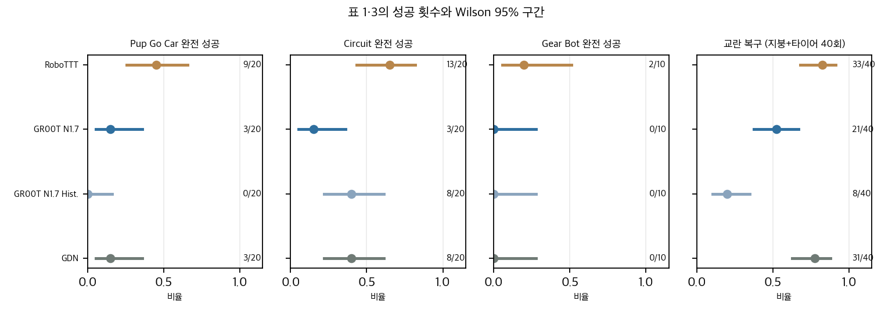
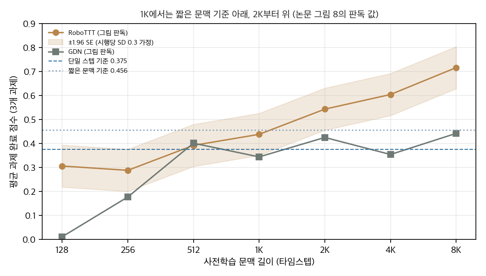
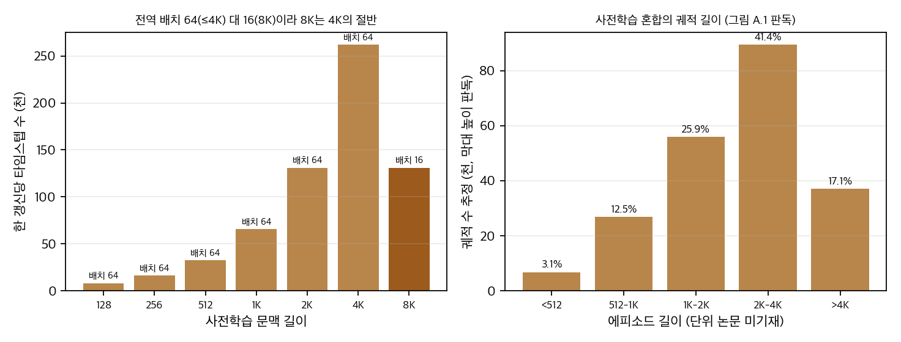
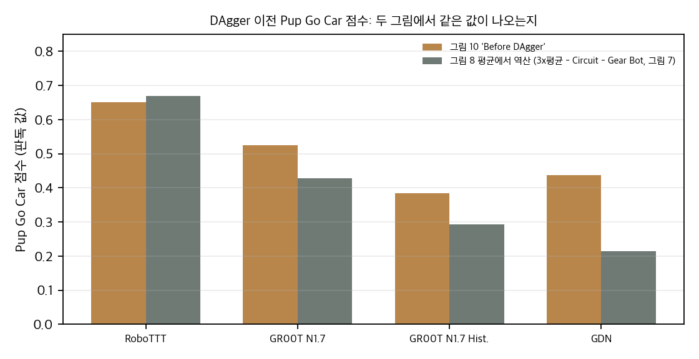

> **논문:** Yunfan Jiang, Yevgen Chebotar, Ruijie Zheng, Fengyuan Hu, Yunhao Ge, Jimmy Wu, Tianyuan Dai, Scott Reed, Li Fei-Fei, Yuke Zhu, Linxi "Jim" Fan. *RoboTTT: Context Scaling for Robot Policies.* CoRL 2026 구두 발표, arXiv:2607.15275 (v1, 2026-07-16).
> 이 글은 공개된 논문과 프로젝트 페이지만 읽고 쓴 분석입니다. 공식 코드는 찾지 못했고, 논문 그림은 싣지 않았습니다(우리가 그린 그래프만 씁니다). 그림 값은 PDF의 벡터 막대와 선에서 읽은 값이라 "(그림 판독 값)"으로 표시했고 오차는 약 ±0.005입니다.

## 논문이 묻는 것

대부분의 로봇 기초 모델은 현재 관측 하나, 또는 몇 프레임의 짧은 이력만 봅니다. 이 논문은 시각 운동 문맥을 8K 타임스텝까지 늘리면 무엇이 달라지는지 묻습니다. 어텐션은 이력 길이에 따라 비용이 늘기 때문에, 저자들은 Test-Time Training(TTT) 층을 씁니다. 은닉 상태를 작은 MLP의 가중치로 두고, 토큰이 들어올 때마다 경사 한 걸음으로 그 가중치를 갱신하는 방식입니다. GR00T N1.7의 DiT 행동 헤드 16개 층에 이 층을 하나씩 붙이고, 시퀀스 행동 강제와 TBPTT로 긴 시퀀스를 학습합니다.

이 구조 위에서 저자들은 세 가지를 보입니다. 사람 영상 하나를 문맥으로 주는 일회 모방, 실패 구간을 문맥으로 삼고 사람 교정만 손실에 거는 DAgger Distillation, 그리고 사전학습 문맥 길이를 늘릴수록 폐루프 점수가 오른다는 스케일링입니다. 평가는 YAM 양팔 로봇의 조립 과제 세 개입니다.

## 맞는 것

헤드라인 백분율은 표와 그림 판독 값에서 다시 계산하면 맞습니다. 평균 79% 대 단일 스텝 42%(+87%), 대 GDN 56%(+41%), 8K 대 1K는 71.5/43.9로 +63%(서론)이고, 교란 복구는 33/40과 21/40으로 83% 대 53%입니다. DAgger의 9%, 13%, 33%, 36%, 29%와 절제의 23%, 18%, 27%도 모두 맞고, DAgger 값은 Before 대비 상대 향상입니다. 구조 자체도 설득력 있습니다. 고속 가중치는 문맥 길이와 무관한 고정 크기 상태이고, 우리가 가정을 적어 계산한 값으로는 75–151 MB이며, 같은 8K 이력을 어텐션 캐시로 들면 가정에 따라 1–46 GB입니다.

## 읽으면서 걸린 곳

**그림 8의 1K 지점.** 그림 8의 캡션은 "RoboTTT가 1K부터 짧은 문맥 기준선을 넘는다"고 쓰지만, 본문 수치는 1K가 43.9%, 짧은 문맥 기준선이 45.6%입니다. 기준선을 처음 넘는 점은 2K(그림 판독 값 0.543, +0.087)입니다. 1K에서 8K로의 증가(+0.278)는 시행당 점수 표준편차 0.25–0.40을 가정하면 z = 3.3–5.3으로 구분되고, 인접한 두 길이 사이의 증가는 단독으로는 구분되지 않습니다. "꾸준히 오른다"는 전체 추세로는 지지되고 점 하나하나로는 지지되지 않습니다.

**문맥 길이와 배치 크기가 같이 바뀐 곡선.** 부록 A.2에 따르면 사전학습 전역 배치는 4K 이하에서 64, 8K에서 16입니다. 갱신당 타임스텝 수는 4K가 262K, 8K가 131K입니다. 4K 초과 궤적은 사전학습 혼합의 17.1%이고 8K 이상 비율은 보고되지 않았습니다. 그림 8의 마지막 구간(4K에서 8K)이 문맥 길이만의 효과인지는 이 정보로 가를 수 없습니다.

**Gear Bot.** 가장 긴 과제에서 완전 성공은 RoboTTT 2/10 대 기준선 0/10입니다. Fisher 정확검정 p = 0.47이고 기준선 0/10의 95% 상한은 30.8%입니다. 표 1의 과제별 비교 9개 중 Holm 보정 후 구별되는 것은 Pup Go Car 대 Hist.와 Circuit 대 GR00T N1.7 둘입니다. 세 과제를 합치면 RoboTTT 24/50이 GR00T 6/50, Hist. 8/50, GDN 11/50과 모두 구별됩니다(Fisher p = 0.00015, 0.0011, 0.011). 초기 배치를 모든 방법에 같게 했으므로(부록 B.2) 시행별 결과가 있다면 쌍체 검정이 더 민감할 수 있습니다.

**그림 7은 DAgger 이후, 그림 8은 이전.** 그림 7의 Pup Go Car 값은 RoboTTT와 GDN에는 DAgger Distillation, GR00T N1.7과 Hist.에는 사람 교정만 쓴 값입니다(그림 판독 값으로 그림 10의 사후 값과 같습니다). DAgger 이전 값으로 평균을 다시 만들면 RoboTTT 0.710 대 GR00T 0.407로 +74%이고, 그림 7 그대로는 +87%입니다. DAgger 풀 100개 중 50개는 RoboTTT로 수집했습니다. 그림 10에는 시퀀스 모델에 "전체 궤적, 전체 손실" 조건이 없어서, 이득이 마스킹에서 오는지 문맥 포함에서 오는지는 GR00T에서만 대조됩니다.

**그림 사이의 값.** 그림 8의 기준선 값에서 Circuit과 Gear Bot이 그림 7과 같다고 가정해 역산한 Pup Go Car 점수는, 그림 10의 Before DAgger보다 GR00T N1.7에서 0.09, Hist.에서 0.09, GDN에서 0.22 낮습니다(그림 판독 값, 판독 오차 ±0.01보다 큽니다). 같은 평가 회차에서 나온 값인지는 저자 확인이 필요합니다.

## 빈칸

공식 코드와 체크포인트는 없고(비공식 구현 두 개는 논문에 없는 요소를 포함합니다), 구현 세부 일부가 본문에 없습니다.
- 타임스텝의 단위. 8K를 "30 Hz 약 5분"으로 설명하는데(§5), 그림 2는 고속 가중치를 H스텝 미니 배치마다 갱신합니다. 사후학습 문맥은 1K(약 34초)인데 Circuit 일회 모방은 사람 영상 1분과 로봇 궤적 1분을 한 시퀀스에 넣습니다.
- 행동 청크 길이 H, 디노이징 단계 수, 고속 MLP 은닉 크기, TTT 미니 배치와 TBPTT 구간 길이, GDN 기준선의 하이퍼파라미터.
- 시행별 점수, 시드 수. 그림 8, 10, 12에는 오차 막대가 없습니다.
- 부록 A.1은 VLM 백본을 Eagle로 쓰는데, 공개된 GR00T N1.7 설정은 Cosmos-Reason2-2B(Qwen3-VL 구조)입니다. 참고문헌 [51]은 GR00T N1 논문입니다.

## 이 글이 확인하지 않은 것

논문의 실로봇 수치를 다시 만들지 않았습니다. 사전학습(GB200 16개, 30K 스텝), YAM 로봇 세 과제, 비공개 데이터와 체크포인트가 필요해서 이 분석의 범위가 아닙니다. 고속 가중치와 어텐션 캐시 크기는 가정을 적은 비용 모델의 값이고 측정값이 아닙니다. 점수 차의 검정은 시행별 점수가 없어 가정(표준편차 상계 또는 0.3)을 둔 근사입니다. 계산 스크립트와 결과는 함께 올린 git 폴더에 있습니다.

## 자료

- [통합 리포트 PDF](report/report_public.pdf)
- [01. 논문 분석: RoboTTT (arXiv:2607.15275)](analysis/01_paper_analysis.md)
- [02. 선행연구와 자료: RoboTTT (arXiv:2607.15275)](analysis/02_prior_work.md)
- [03. 수치 재계산과 해석: RoboTTT (arXiv:2607.15275)](analysis/03_analysis.md)
- [04. 주장 검증과 구현 가능성: RoboTTT (arXiv:2607.15275)](analysis/04_claim_verification.md)
